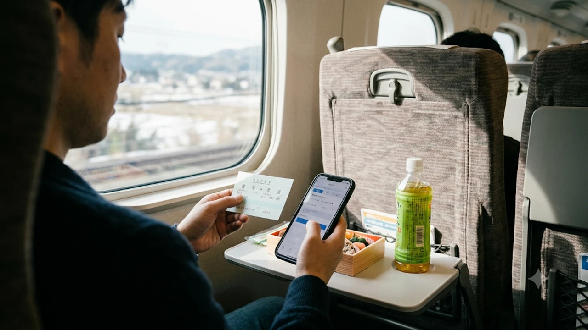

日本の年末年始は、帰省する人々と観光客の移動が一斉に重なり、年間を通じて最も鉄道網が混み合う時期です。**日本 年末 新幹線 予約**のタイミングを逃すと、指定席が早々に満席となり、ホームの自由席乗車口で何時間も立ち続ける羽目になりかねません。JR各社の発売スケジュールや大型荷物の持ち込みルールをあらかじめ押さえておけば、慌ただしい年末の移動もずっとスムーズになります。

## 年末年始の新幹線予約開始スケジュールと基本ルール

JRグループの指定席発売には厳格なルールがあり、仕組みを知っているかどうかで座席確保の確率が大きく変わります。出発日が決まったら、発売日の朝一番に動けるよう準備を整えておきましょう。

### 乗車日1ヶ月前の午前10時発売の仕組み

新幹線や在来線特急の指定席は、**乗車日の1ヶ月前の午前10時**に全国一斉で発売がスタートします。たとえば12月29日に出発するなら、11月29日の午前10時が勝負の時刻です。駅の「みどりの窓口」や指定席券売機だけでなく、インターネット予約サイトもまったく同じタイミングで受付が始まるため、発売開始から数分で富士山側の窓際席や人気の時間帯が埋まってしまいます。

### ネット予約サービスの事前受付活用法

寒いなか駅の窓口に並ぶ手間を省きたいなら、JR東海・JR西日本・JR九州の「スマートEX」や「エクスプレス予約」、JR東日本の「えきねっと」といったオンライン予約サービスが頼りになります。これらの会員サービスでは、発売日のさらに1週間前から**事前申込（事前受付）**を利用できます。

- 発売日の午前10時になった瞬間、システムが自動的に座席の確保を試みてくれる
- 深夜や早朝でもスマートフォンから24時間いつでも申し込み手続きができる
- 手持ちの交通系ICカードを登録しておけば、窓口で切符を発券せずそのまま改札を通過できる

> 事前受付は発売開始と同時に申し込みを代行してくれる便利な機能ですが、座席の確保そのものを約束するものではありません。本命の列車だけでなく、前後1〜2時間の列車を第2・第3希望として登録しておくと、希望に近い便を押さえやすくなります。

### のぞみ号の「全席指定席」期間に要注意

近年の年末年始（12月下旬〜1月上旬）で最も見落としやすいのが、東海道・山陽新幹線の最速達列車「のぞみ」号の運行形態です。ピーク期間中は**「のぞみ」号が全席指定席として運行**されるため、自由席車両そのものが設定されません。自由席特急券ではデッキに立って乗り込むことも原則認められていないため、必ず事前に指定席を購入するか、自由席が設けられている「ひかり」号や「こだま」号を選ぶ必要があります。

## 帰省ラッシュのピーク時期と混雑回避のポイント

年末年始の人の流れは、下り（東京・大阪発の地方方面）と上り（地方発の東京・大阪方面）で混雑が集中する日程がはっきり分かれています。

### 下り・上りそれぞれの混雑ピーク日程

多くの企業が仕事納めを迎える12月28日〜30日頃は、東京駅から新大阪・博多方面へ向かう下り列車の混雑がピークに達します。午前中から夕方にかけて走る「のぞみ」号は、発売日から数日で満席になるケースも珍しくありません。反対に、Uターンラッシュと呼ばれる上り列車のピークは、年始の1月2日〜4日頃に集中します。地方で正月を過ごした人々が午後から夜にかけて首都圏へ戻るため、上りホームは大きなお土産袋を抱えた乗客で溢れかえります。

### 狙い目の時間帯と列車選びのコツ

混雑が予想される日程であっても、乗車する時間帯や列車の種類を少しずらすだけで、驚くほどあっさり空席が見つかることがあります。

- **始発に近い早朝（6時台）や夜間（20時以降）の便**はビジネス客が少なく狙い目
- 「のぞみ」号が満席でも、停車駅の多い「ひかり」号なら指定席に余裕が残っている場合がある
- 大晦日（12月31日）の午後や元日（1月1日）の午前中は、移動の波が一旦落ち着く穴場の時間帯

冬の日本滞在で買い物やイベントの予定も組み込むなら、[2026年ブラックフライデー日本でお得に買うコツ](/posts/japan-trends/japan-black-friday-2026-deals-guide/)や[2026 일본 소비 트렌드 핵심](/posts/japan-trends/japan-consumer-trends-2026/)もあわせて目を通しておくと、現地での行動計画が立てやすくなります。

## 大きなスーツケースを持ち込む際の事前予約ルール

防寒着や土産物で荷物がかさみがちな冬の移動では、車内への大型荷物の持ち込みルールにも気を配らなければなりません。

### 特大荷物スペースつき座席の予約義務

東海道・山陽・九州・西九州新幹線では、縦・横・高さの3辺の合計が**160cm超〜250cm以内**の荷物を持ち込む際、事前に「特大荷物スペースつき座席」または「特大荷物コーナーつき座席」の予約が義務付けられています。1週間以上の滞在で使う大型スーツケース（約90〜100リットルクラス）はこの基準を超えるケースが多いため、パッキングを始める前にメジャーで3辺の合計を測っておくと安心です。

### 事前予約なしで持ち込んだ場合のペナルティ

もし事前予約をせずに特大荷物を車内へ持ち込むと、車掌から**持込手数料（1,000円・税込）**を徴収されるうえ、乗務員が指定する場所へ荷物を移動させられます。特大荷物スペースつき座席自体は通常の指定席と同じ料金で利用できるため、ネット予約や券売機で座席を選ぶ段階で、忘れずに該当の座席オプションにチェックを入れておきましょう。

## 航空便や高速バスとの比較と遅延時の備え

新幹線がどうしても取れない場合や、寒波によるダイヤ乱れが心配な時期には、別の移動ルートや車内待機への備えを用意しておくと心に余裕が生まれます。

### 国内線航空便・LCCの早割活用

東京〜福岡間や東京〜札幌間といった長距離区間を移動するなら、新幹線だけに絞らずANAやJALの早期割引運賃、あるいはLCC（格安航空会社）の便も比較してみてください。年末年始の航空券は夏頃から予約が始まるため11月下旬には価格が上がっているものの、キャンセルが出たタイミングや深夜・早朝便であれば手頃な運賃で空席を拾えることがあります。

### 雪による遅延・運休への備えと快適グッズ

年末年始の日本海側や関ヶ原周辺では、強い冬型の気圧配置による大雪で新幹線に大幅な遅延や運転見合わせが発生することがあります。JR各社の公式運行情報アプリやX（旧Twitter）の公式アカウントをフォローし、出発当日の朝は最新の運行状況を必ず確認してください。また、長時間の移動や万が一の車内待機に備えて、大容量のモバイルバッテリーやネックピロー、乾燥した車内で喉を守るマスクを手荷物に入れておくと移動中のストレスを和らげられます。[関連상품 쿠팡에서 보기](https://www.coupang.com/np/search?q=%EC%97%AC%ED%96%89%EC%9A%A9%20%EB%AA%A9%EB%B2%A0%EA%B0%9C%20%EB%B3%B4%EC%A1%B0%EB%B0%B0%ED%84%B0%EB%A6%AC&sourceType=affiliate&trackingCode=AF8691300)

#日本トレンド #新幹線 #年末年始 #帰省ラッシュ #日本旅行 #指定席予約 #冬休み #鉄道旅