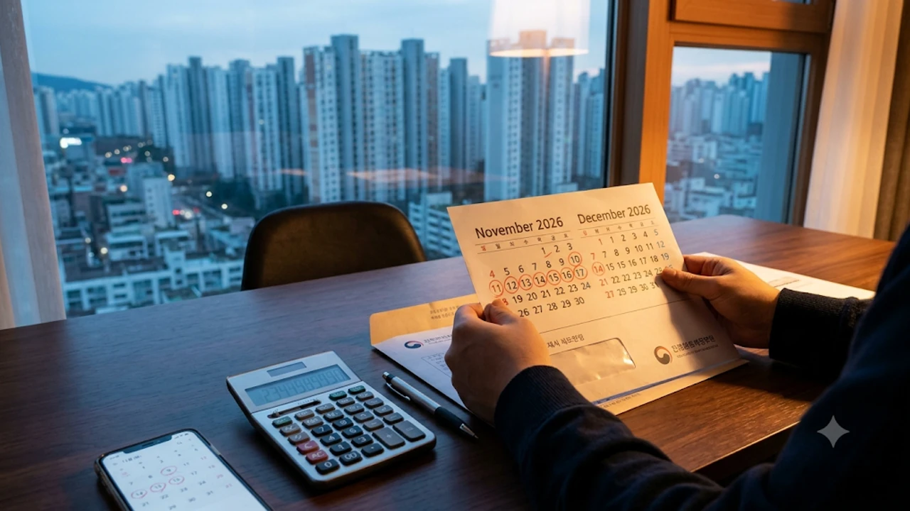

**2026년 연말 부동산 세금** 정산과 잔금 일정이 코앞으로 다가오면서 취득세 및 종합부동산세(종부세) 납부 기준을 꼼꼼히 따져봐야 하는 시점입니다. 11월 하순 정기분 종부세 고지서 발송과 12월 잔금 일정이 한꺼번에 겹치면 현금 흐름이 꽉 막히거나 가산세 폭탄을 맞기 쉽습니다. 지금 당장 챙겨야 할 핵심 세무 일정과 매수자·보유자별 실전 절세 전략을 짚어봅니다.

## 2026년 11월 말 기준, 지금 가장 시급한 부동산 세금 일정

연말 부동산 거래에서는 잔금 날짜 하루 차이, 고지서 납부 방식 선택 하나에 따라 수백만 원의 세부담이 갈립니다. 자금 집행 전 반드시 대조해야 할 세 가지 핵심 기한입니다.

### 12월 정기분 종합부동산세 납부 기한 및 분납 조건 확인

매년 12월 1일부터 15일까지는 정기분 종합부동산세 납부 기간입니다. 11월 하순 우편이나 홈택스 전자고지로 세액을 확인한 뒤 일시납과 분납 중 유리한 쪽을 골라야 합니다.

- 납부할 세액이 250만 원을 넘어가면 관할 세무서에 분납을 신청해 납부 기한 경과 후 6개월 이내에 이자 부담 없이 나누어 낼 수 있습니다.
- 농어촌특별세 역시 본세 분납 비율만큼 함께 쪼개 낼 수 있으므로 연말 현금 유동성을 지키는 데 요긴합니다.

### 연말 잔금 예정자를 위한 취득세 중과 및 감면 적용 시점

취득세는 계약서 작성일이 아니라 **잔금 지급일**과 **등기접수일** 중 빠른 날을 기준으로 납세 의무가 생깁니다. 생애최초 주택 구입 감면이나 신생아 특례 감면처럼 요건이 까다로운 혜택을 적용받는 매수자라면, 잔금 당일 기준 세대원 전원의 과거 주택 소유 이력까지 다시 확인해야 추징을 피할 수 있습니다.

> **실무 체크:** 계약서상 잔금일보다 며칠 앞서 잔금을 송금했다면 실제 돈을 보낸 날이 취득일이 됩니다. 취득세 신고·납부 기한(취득일로부터 60일 이내) 역시 그날부터 카운트되므로 일정을 착각해선 안 됩니다.

### 1세대 1주택자 고령자·장기보유 세액공제 최종 점검

1세대 1주택 단독명의 보유자는 과세기준일(매년 6월 1일) 현재 연령과 보유 기간에 따라 종부세 세액공제를 받습니다. 고령자 공제(만 60세 이상부터 구간별 적용)와 장기보유 공제(5년 이상 보유 시 적용)는 합산 한도(최대 80%) 내에서 중복 적용되므로 고지서 내역에 공제율이 정확히 반영됐는지 꼼꼼히 대조해야 합니다.

## 매수자 vs 보유자, 연말 부동산 세금 전략 비교

연말 계약을 앞둔 당사자라면 잔금을 올해 안에 치르느냐, 내년 1월로 넘기느냐에 따라 소득공제와 양도세 시계가 완전히 달라집니다.

### 올해 안 잔금 치르는 매수자가 유리한 경우와 불리한 경우

생애최초 취득세 감면이나 연말정산 주택자금 소득공제(장기주택저당차입금 이자상환액 공제 등)를 올해 귀속분부터 챙기려는 무주택 매수자라면 12월 31일 이전 잔금 청산과 전입신고를 마치는 편이 유리합니다. 반대로 기존 집 매도가 지연돼 일시적 2주택 요건이 어긋날 상황이라면 무리하게 올해 잔금을 치르기보다 매도자와 협의해 일정을 조율해야 합니다. 최근 자금 조달 여건과 대출 한도 변화를 함께 점검하려면 [15억 이하 대출규제 6억 축소될까?](/posts/kr-realestate/under-1500m-mortgage-loan-cap-tightening-2026/) 내용을 참고해 자금 계획을 병행하는 것이 안전합니다.

### 내년으로 잔금을 미뤘을 때 달라지는 보유세 과세 기준일(6월 1일) 영향

재산세와 종합부동산세는 매년 **6월 1일** 등기부상(또는 사실상) 소유자에게 부과됩니다. 12월에 잔금을 치르든 이듬해 1월에 잔금을 치르든 차기 연도 보유세 과세 기준일 이전이므로 보유세 측면의 유불리는 없습니다. 다만 매도자 입장에서는 양도소득세 기본공제(연 250만 원)를 당해 연도에 쓸지, 다음 해로 넘길지에 따라 절세 폭이 달라집니다.

### 일시적 2주택자 종전주택 처분 기한 및 비과세 요건 체크리스트

기존 주택을 보유한 상태에서 신규 주택을 매수한 일시적 2주택자는 신규 주택 취득일로부터 정해진 기한(통상 3년 이내) 안에 종전 주택을 매도해야 양도세 비과세 특례를 지킬 수 있습니다.

- 종전 주택 보유 기간 2년 이상 충족 여부 (조정대상지역 취득 시 실거주 2년 요건 포함)
- 신규 주택 취득일(잔금일)과 종전 주택 잔금 청산일의 정확한 선후 관계
- 일시적 2주택 취득세 중과 배제 신청서 제출 여부

## 연말 부동산 세무 처리 시 흔히 놓치는 실수 3가지

실제 거래 현장에서는 서류 한 장이나 날짜 계산 착오로 수백만 원의 가산세를 무는 사례가 반복됩니다.

### 잔금일과 등기접수일 차이로 발생하는 취득세 가산세 주의

서울 마포구 아파트를 매수한 직장인 A씨는 잔금을 11월 28일에 송금하고, 법무사 일정상 소유권이전등기 접수를 해를 넘겨 진행하려다 취득일로부터 60일을 넘겨 무신고가산세(20%) 대상이 될 뻔했습니다. 취득세는 등기 접수가 아니라 **사실상 잔금 지급일**부터 60일 이내에 관할 시·군·구청에 신고·납부해야 합니다.

### 부부 공동명의 변경 신청 기한 놓쳤을 때의 세부담 차이

부부 공동명의 1주택자는 유리한 과세 방식을 직접 고를 수 있습니다. 1세대 1주택 단독명의 특례(기본공제 12억 원 및 고령자·장기보유 공제)를 적용받으려면 매년 **9월 16일부터 9월 30일** 사이에 관할 세무서에 특례 신청을 마쳐야 합니다. 연말 고지서를 받아 든 뒤에는 소급 변경이 불가능하므로 내년도 신청 일정을 미리 캘린더에 고정해 두는 편이 좋습니다.

### 전세보증금 반환 및 대출 상환 일정과 세금 납부 자금 계획

전세 낀 매물을 매수하거나 기존 세입자를 내보내면서 잔금을 치를 때는 취득세 납부 현금이 보증금 반환 자금과 겹쳐 통장 잔고가 바닥나기 쉽습니다. 청년층이나 신혼부부라면 기존에 가입해 둔 정책 금융 상품의 만기나 중도 해지 페널티를 미리 따져봐야 하며, [청년도약계좌 3년 유지 혜택 정리](/posts/kr-realestate/youth-leap-account-3-year-benefits/)를 확인해 주택 구입 자금 활용 시 비과세 혜택을 놓치지 않도록 조율해야 합니다.

## 2026년 연말 부동산 세금 및 자금 조달 실행 체크리스트

세금 납부와 잔금 실행을 실수 없이 마무리하기 위한 실전 점검 순서입니다.

### 홈택스·위택스 전자고지서 확인 및 카드 무이자 할부 활용법

국세인 종합부동산세는 **홈택스(손택스)**에서, 지방세인 취득세는 **위택스(이택스)**에서 세액을 조회하고 결제할 수 있습니다.

- **국세(종부세):** 신용카드 납부 시 0.8%(체크카드 0.5%)의 납부대행수수료가 붙으므로 카드사별 무이자 할부 혜택과 수수료 비용을 계산기로 두드려 본 뒤 결제합니다.
- **지방세(취득세):** 신용카드 납부대행수수료가 면제되므로, 카드사별 2~6개월 무이자 할부 프로모션을 적극 활용하면 연말 현금 흐름을 방어할 수 있습니다.

### 연말 가계대출 총량 관리 기간 중 잔금 대출 실행 유의사항

11월 말부터 12월은 시중은행의 연간 가계대출 총량 관리가 가장 빡빡하게 조여드는 시기입니다. 은행별 대출 창구 접수 중단이나 우대금리 축소가 예고 없이 발표될 수 있으므로, 잔금일 최소 3~4주 전에는 대출 약정서 작성을 마치고 실제 실행 가능 여부를 영업점 담당자와 재확인해야 합니다.

### 세무사 상담 전 미리 준비해야 할 계약서 및 등기부등본 서류 목록

정확한 세액 산출과 비과세 판정을 위해 상담 전 아래 서류를 한 폴더에 모아 두면 상담 시간과 비용을 크게 아낄 수 있습니다.

- 매매계약서 사본 (종전 주택 및 신규 주택 계약서 모두 포함)
- 잔금 영수증 및 계약금·중도금 계좌 이체 내역서
- 매수인 및 세대원 전원의 주민등록등본과 가족관계증명서
- 해당 부동산의 등기사항전부증명서(등기부등본) 및 건축물대장

매매계약서와 등기부등본, 각종 세금 납부 영수증은 향후 매도 시 양도소득세 필요경비로 인정받기 위해 최소 5년 이상 원본을 보관해야 합니다. 부동산 계약서와 등기 권리증을 항목별로 깔끔하게 정리해 둘 수 있는 [부동산 계약서 서류 보관함 쿠팡에서 보기](https://www.coupang.com/np/search?q=%EB%B6%80%EB%8F%99%EC%82%B0%20%EA%B3%84%EC%95%BD%EC%84%9C%20%EC%84%9C%EB%A5%98%20%EB%B3%B4%EA%B4%80%ED%95%A8&sourceType=affiliate&trackingCode=AF8691300)를 활용해 서류 분실 리스크를 미리 차단해 두세요.

#2026년연말부동산세금 #부동산취득세 #종합부동산세납부 #일시적2주택비과세 #연말잔금일정 #부동산절세전략 #홈택스종부세 #위택스취득세 #아파트매수체크리스트