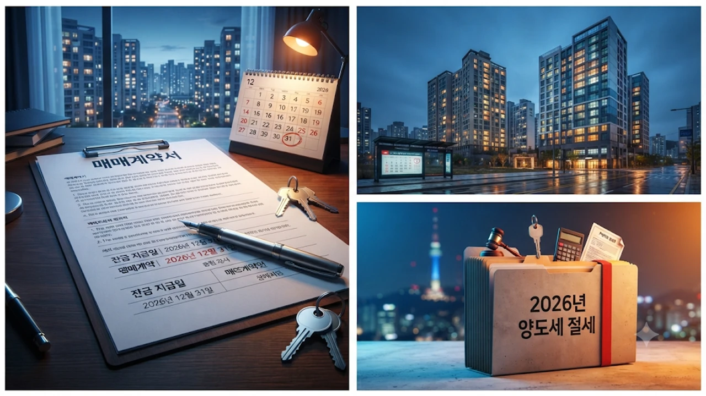

연말 부동산 매도를 앞둔 집주인에게 **2026년 연말 양도세 절세 전략**은 세후 잔액을 결정짓는 핵심 변수입니다. 12월 31일과 다음 해 1월 1일, 단 하루의 잔금일 차이만으로도 다주택자 중과 배제 여부와 과세표준 합산 구간이 갈려 수천만 원의 세금 격차가 벌어집니다. 잔금일 설정부터 필요경비 증빙까지 실제 매도 현장에서 바로 적용할 수 있는 절세 기준을 정리했습니다.

## 연말 양도소득세 중과 배제 요건과 잔금일 기준

세법상 부동산 양도 시기는 매매계약서 작성일이 아닌 **잔금 청산일과 소유권 이전 등기 접수일 중 빠른 날**로 확정됩니다. 연말에 계약금을 받고 중도금까지 치렀더라도 실제 잔금이 해를 넘겨 입금되면 다음 연도 귀속분으로 세금이 부과됩니다.

### 잔금 청산일과 등기접수일 판정 기준

매도인과 매수인이 협의해 잔금 지급일을 연말과 연초 사이에서 조율하는 방식은 합법적인 절세 수단입니다. 단, 잔금을 다 받기 전에 매수인의 대출 실행 등을 이유로 소유권 이전 등기 서류를 먼저 넘겨주면 등기접수일이 양도 시기가 되므로 계약서 특약에 잔금 지급일과 등기 접수일을 반드시 일치시켜야 합니다.

- **양도 시기 판정**: 잔금 수령일과 등기접수일 중 빠른 날짜가 기준
- **과세표준 합산 리스크**: 같은 연도에 주택 2채 이상을 매도하면 양도차익이 합산되어 최고 45%(지방소득세 별도) 누진세율 구간에 진입할 수 있음
- **연도 분산 매도**: 한 채는 12월 말에 잔금을 완료하고, 나머지 한 채는 1월 초에 잔금을 받아 연도별 기본공제(각 250만 원)와 낮은 세율 구간을 각각 적용받음

### 다주택자 양도세 중과 배제 체크사항

조정대상지역 내 주택을 매도할 때 중과 배제 혜택을 적용받으려면 **보유기간 2년 이상** 요건을 채워야 합니다. 보유기간 2년 미만 단기 양도는 중과 배제 대상에서 빠져 높은 단일세율이 적용되므로, 등기부등본상 취득일로부터 만 2년이 지나는 날짜를 하루 단위로 계산해 잔금일을 잡아야 합니다.

> 양도소득세 계산 시 보유기간은 원칙적으로 취득일부터 양도일까지 산정하지만, 상속받은 주택은 피상속인(망인)이 해당 주택을 취득한 날부터 기간을 통산해 중과 배제 여부를 판정합니다.

## 일시적 2주택 비과세 특례와 처분 기한 관리

갈아타기를 진행하는 일시적 2주택자는 종전 주택 처분 기한을 단 하루라도 넘기면 1세대 1주택 비과세 혜택이 전면 취소되고 일반과세로 전환됩니다. 연말에는 은행권 가계대출 총량 관리로 매수인의 잔금 대출이 지연되는 일이 잦아 매도자의 선제적인 일정 통제가 필수입니다.

### 신규 주택 취득일 기준 처분 기한 계산

일시적 2주택 비과세 특례를 인정받으려면 종전 주택 취득일로부터 **1년 이상 지난 뒤** 신규 주택을 취득해야 합니다. 이후 신규 주택 취득일로부터 **3년 이내**에 종전 주택의 잔금 청산까지 끝내야 비과세 요건이 완성됩니다.

- **종전 주택 보유·거주 요건**: 양도일 현재 2년 이상 보유 필수(취득 당시 조정대상지역이었다면 2년 이상 실거주 요건 추가)
- **고가주택 과세 기준**: 실거래가 12억 원까지는 비과세되며, 12억 원 초과분에 해당하는 비율만큼만 양도세 산출
- **잔금 지연 방어책**: 매수자의 주택담보대출 실행 가능 여부를 사전에 확인하고, 법정 처분 기한보다 최소 2~3주 앞당겨 잔금일을 지정

실제 매도 현장에서는 매수자가 대출 한도 축소로 인해 계약 후 잔금 일정을 미뤄달라고 요청하는 분쟁이 빈번합니다. 매수인의 자금 조달 한계가 매도 일정에 미치는 변수들은 [15억 이하 대출규제 6억 축소될까?](/posts/kr-realestate/under-1500m-mortgage-loan-cap-tightening-2026/) 글에서 상세히 다뤘습니다.

### 분양권과 입주권 보유 시 비과세 판정

2021년 1월 1일 이후 취득한 분양권은 세법상 주택 수에 합산되므로 종전 주택을 팔 때 비과세 특례 요건을 따로 챙겨야 합니다. 아파트 준공 후 세대 전원이 신규 주택으로 전입해 **1년 이상 계속 거주**하고, 신규 주택 완공일로부터 **3년 이내**에 종전 주택을 처분해야 기존 주택의 비과세 혜택을 지킬 수 있습니다.

## 양도차익을 줄이는 필요경비 인정 항목 정리

양도소득세는 양도가액에서 취득가액과 **필요경비**를 뺀 양도차익을 기준으로 계산합니다. 수리비와 부대비용 영수증을 빠짐없이 모아 제출하면 과세표준 자체가 줄어들어 누진세율 구간을 한 단계 낮추는 효과를 얻습니다.

### 자본적 지출과 수익적 지출 구분 기준

집을 수리했다고 해서 모든 공사비가 필요경비로 인정받지는 못합니다. 부동산의 가치를 물리적으로 높이는 **자본적 지출**만 공제 항목에 들어가며, 낡은 부분을 고치거나 미관을 바꾸는 수익적 지출은 경비 처리에서 제외됩니다.

- **공제 가능(자본적 지출)**: 발코니 확장 공사, 샷시(창호) 전체 교체, 노후 보일러 교체, 시스템 에어컨 설치, 상하수도 배관 교체
- **공제 불가(수익적 지출)**: 벽지 도배, 장판 교체, 싱크대·신발장 교체, 욕실 타일 보수, 단순 방수 및 페인트 도장
- **부대비용 공제**: 매수 당시 납부한 취득세·등록면허세, 법무사 보수료, 매수·매도 시 지급한 공인중개사 중개수수료, 국민주택채권 매각차손

### 적격증빙 확보와 세무서 소명 방법

자본적 지출을 경비로 인정받으려면 **세금계산서, 현금영수증, 신용카드 매출전표** 등 법정 적격증빙을 갖춰야 합니다. 간이영수증이나 단순 견적서만 제출하면 세무서 소명 과정에서 부인당하기 쉬우며, 계좌이체 내역만 남은 경우에는 시공업체의 사업자등록증 사본과 세부 공사 내역서를 함께 첨부해야 지출 사실을 인정받습니다.

> 시공업체가 제안하는 부가가치세 10% 할인을 받으려다 현금 무증빙 거래를 선택하면, 훗날 양도세 신고 시 수천만 원의 필요경비를 공제받지 못해 배보다 배꼽이 더 큰 세금 폭탄을 맞을 수 있습니다.

## 연말 매도 직전 실전 체크리스트와 주의사항

매매계약서 특약 기재부터 잔금 수령 후 예정신고까지 단계별 절차를 빈틈없이 밟아야 억울한 가산세를 피할 수 있습니다. 특히 부부 공동명의 지분 계산과 예정신고 기한 엄수는 잔금 전후로 반드시 확인해야 할 과제입니다.

### 부부 공동명의와 단독명의 세액 비교

부부 공동명의로 등기된 주택은 양도차익이 지분율대로 나뉘어 각각 연 **250만 원의 양도소득 기본공제**를 받습니다. 개인별 과세표준이 절반 수준으로 낮아지면서 단독명의일 때보다 낮은 누진세율 구간을 적용받으므로, 매도 계약 전 지분 비율에 따른 예상 산출세액을 미리 비교해 봐야 합니다.

### 양도소득세 예정신고 기한과 가산세 방지

주택을 양도한 날이 속하는 달의 말일부터 **2개월 이내**에 관할 세무서 방문 또는 국세청 홈택스를 통해 양도소득세 예정신고를 마쳐야 합니다. 신고 기한을 하루라도 넘기면 무신고가산세 20%와 일자별 납부지연가산세가 붙으므로 잔금일 직후 모든 영수증을 취합해 신고를 완료하는 편이 안전합니다. 매매계약서 원본과 인테리어 세금계산서, 중개수수료 영수증을 분실하지 않고 연도별로 분류해 보관하려면 [부동산 계약서 서류 보관함 쿠팡에서 보기](https://www.coupang.com/np/search?q=%EB%B6%80%EB%8F%99%EC%82%B0%20%EA%B3%84%EC%95%BD%EC%84%9C%20%EC%84%9C%EB%A5%98%20%EB%B3%B4%EA%B4%80%ED%95%A8&sourceType=affiliate&trackingCode=AF8691300)를 활용해 증빙 서류를 한곳에 정리해 두면 세무 신고 누락을 막을 수 있습니다.

#양도소득세 #연말양도세절세 #다주택자중과배제 #일시적2주택비과세 #양도세필요경비 #부동산매도전략 #2026부동산세금 #잔금일기준