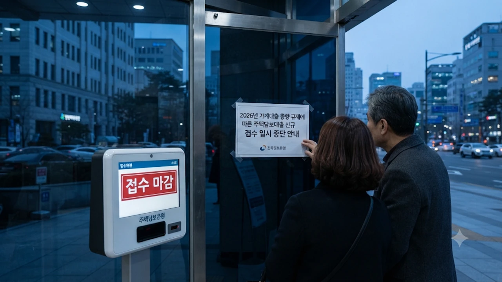

2026년 11월 말에 접어들며 주요 시중은행들이 가계대출 총량 목표치를 맞추기 위해 영업점 문턱을 빠르게 높이고 있습니다. 특히 **2026 연말 주담대 한도** 축소와 비대면 접수 중단이 동시에 진행되면서, 연내 잔금 납부를 앞둔 매수자들의 자금 계획에 비상이 걸렸습니다. 스트레스 DSR 규제와 은행별 가산금리 조정이 맞물린 현재 금융권의 대출 막차 조건과 현실적인 우회 경로를 정리했습니다.

## 2026년 11월 말 시중은행 주담대 총량 관리 현황

금융당국의 가계부채 관리 기조에 따라 주요 시중은행들은 11월 하순부터 연간 대출 총량을 채운 영업점 위주로 신규 주택담보대출 취급을 제한하고 있습니다. 예년 같으면 12월 중순에 시작되던 연말 대출 접수가 올해는 한 달가량 앞당겨지면서 현장의 체감 문턱이 부쩍 높아졌습니다.

### 주요 시중은행별 비대면·대면 대출 접수 제한 비교

은행권은 가장 먼저 모바일 앱을 통한 비대면 주택담보대출 및 전세자금대출 접수를 일시 중단하는 방식으로 물량 조절에 나섰습니다. 금리가 낮고 서류 제출이 간편한 비대면 창구로 신청자가 몰려 배정 한도가 순식간에 바닥났기 때문입니다.

- **비대면 채널 중단**: 주요 시중은행 대부분이 11월 중순 이후 올해 실행분 비대면 주담대 접수를 닫고 내년 1월 실행분만 제한적으로 받고 있습니다.
- **대면 창구 일일 한도제**: 오프라인 지점은 영업점별로 하루 처리 가능한 대출 건수와 금액 쿼터를 배정해 아침 일찍 방문한 고객부터 순차 심사합니다.
- **대출 모집인 물량 소진**: 은행권과 계약을 맺은 대출 상담사(모집인) 배정 한도는 이미 11월 초에 대부분 소진되어 신규 접수가 막힌 상태입니다.

### 연말 가계대출 총량 규제 강화가 실수요자에게 미치는 영향

은행들이 연말 가계대출 총량을 넘기면 이듬해 대출 한도 배정에서 불이익을 받으므로, 11월 말 이후에는 무리해서 실적을 늘리지 않습니다. 이로 인해 무주택 실수요자조차 주거래 은행에서 거절당해 금리가 높은 타 은행 지점을 돌아다니는 발품 경쟁이 벌어지고 있습니다. 매수 심리 흐름은 [2030 영끌 재점화, 전세 폭등 속 진짜 살까?](/posts/kr-realestate/young-generation-panic-buying-jeonse-spike-2026/) 글에서도 확인할 수 있습니다.

## 주담대 한도 축소 시 실제 대출 가능 금액 변화

연말에는 대출 접수창구만 좁아지는 것이 아니라, 승인받는 대출 액수 자체도 줄어듭니다. 은행들이 가산금리를 올리고 부수거래 우대금리 항목을 축소하면서 DSR(총부채원리금상환비율) 한도가 함께 깎이기 때문입니다.

### 스트레스 DSR 및 우대금리 축소에 따른 한도 계산 예시

수도권 주택 매수 시 적용되는 스트레스 DSR 가산금리에 은행 자체 가산금리 인상분까지 더해지면 체감 금리는 연 4% 후반에서 5% 초반대까지 뜁니다.

> 연소득 7,000만 원인 직장인이 30년 만기 원리금균등상환으로 대출을 받을 때, 적용 금리가 4.2%에서 5.0%로 0.8%포인트 오르면 DSR 40% 기준 최대 한도는 약 4억 8,000만 원에서 4억 3,500만 원으로 4,500만 원가량 줄어듭니다.

여기에 일부 은행이 방 공제(소액임차보증금 차감) 면제 상품인 MCI·MCG 가입을 연말까지 중단하면서, 수도권 아파트 기준 최대 5,500만 원이 추가로 차감되는 사례도 속출합니다. 규제 구간별 한도 변화는 [15억 이하 대출규제 6억 축소될까?](/posts/kr-realestate/under-1500m-mortgage-loan-cap-tightening-2026/) 포스팅에서 상세히 비교했습니다.

### 잔금 일정이 촉박한 매수자의 자금 조달 리스크 분석

11월 말에서 12월 말 사이 잔금을 치러야 하는 매수자는 계약 전 가심사 한도만 믿고 잔금일을 잡았다가 실행 시점에 수천만 원이 비는 상황을 맞을 수 있습니다. 특히 신용대출이나 마이너스통장을 보유했다면, 실제 쓰지 않은 마이너스통장 개설 한도 전체가 DSR 부채로 잡혀 주담대 한도를 갉아먹습니다.

## 2026 연말 주담대 막차 탑승을 위한 실전 체크리스트

연내 잔금 실행이 꼭 필요한 상황이라면, 은행 지점 방문 전 서류와 기존 부채를 미리 정리해 심사 보완 요청으로 일정이 밀리는 일을 막아야 합니다.

### 은행 창구 접수 전 필수 서류 및 사전 한도 조회 방법

지점별 당일 쿼터가 오전 중에 마감되는 경우가 많으므로, 영업점 개점 직후 방문해 당일 접수 가능 여부를 먼저 확인하는 편이 안전합니다.

1. **기본 소득·재직 서류**: 건강보험자격득실확인서, 소득금액증명원, 재직증명서를 정부24와 홈택스에서 당일 발급본으로 출력합니다.
2. **부동산 매매 관련 서류**: 확정일자가 찍힌 매매계약서 원본, 등기사항전부증명서, 전입세대열람내역서를 챙깁니다.
3. **기존 부채 정리**: 쓰지 않는 마이너스통장은 해지하고, 소액 카드론이나 할부 잔액은 미리 상환해 DSR 여유분을 확보합니다.

### 실행일 기준 금리 확정 조건과 모집인 한도 활용 팁

주택담보대출 금리는 서류 접수일이 아닌 **대출 실행일(잔금일)** 기준으로 확정됩니다. 연말에 급히 접수를 마쳤더라도 12월 중 채권금리 변동이나 은행의 추가 가산금리 조정이 반영될 수 있으므로, 금리 상한 조건과 중도상환수수료 면제 조항을 약정서에서 직접 대조해야 합니다.

## 1금융권 대출 마감 시 선택 가능한 현실적 대안

시중은행 영업점 쿼터 소진으로 연내 대출 실행이 어렵다는 답을 들었다면, 지체 없이 다른 자금 조달 경로로 방향을 틀어야 계약금 손실을 막을 수 있습니다.

### 정책모기지(보금자리론·디딤돌)와 2금융권 금리 비교

부부합산 소득과 주택 가격 요건을 충족한다면 시중은행 총량 규제 영향을 덜 받는 정책금융상품을 먼저 두드려야 합니다.

- **특례·일반 보금자리론 및 디딤돌대출**: 한국주택금융공사(HF)가 공급하는 정책모기지는 시중은행 자체 총량과 별도로 운영되며, 고정금리 혜택과 함께 LTV·DSR 산정 기준이 유리합니다. 세부 요건은 [청년미래보금자리론 4억 빌라 숨은 조건](/posts/kr-realestate/youth-future-bogeumjari-loan-villa-2026/)에서 확인할 수 있습니다.
- **상호금융 및 보험사 주담대**: 새마을금고·농협 등 상호금융권이나 대형 생명보험사는 DSR 50% 규제가 적용되어 시중은행보다 한도가 넉넉하게 나옵니다. 다만 금리가 시중은행보다 0.5~1.0%포인트가량 높으므로 연초 대환 전까지 단기 브릿지 자금으로 활용하는 방식이 현실적입니다.

### 2027년 초 은행권 신규 한도 재개 시점 활용 전략

매도인과 협의해 잔금일을 2027년 1월 초 이후로 늦출 수 있다면 굳이 고금리 2금융권을 택할 이유가 없습니다. 새해 첫 영업일인 1월 2일부터 시중은행들의 연간 가계대출 총량 한도가 초기화되면서 비대면 접수 재개와 우대금리 복원이 차례로 이루어지기 때문입니다. 불가피하게 연말에 높은 금리로 대출을 실행했다면, 중도상환수수료 조건을 확인한 뒤 내년 1분기 시중은행 대환대출 플랫폼을 통해 갈아타는 전략이 유리합니다.

[부동산 계약 및 대출 서류 보관용 파일 정리함 쿠팡에서 보기](https://www.coupang.com/np/search?q=%EB%B6%80%EB%8F%99%EC%82%B0%20%EA%B3%84%EC%95%BD%EC%84%9C%20%EC%84%9C%EB%A5%98%20%EB%B3%B4%EA%B4%80%ED%95%A8&sourceType=affiliate&trackingCode=AF8691300)

#2026연말주담대한도 #주택담보대출막차 #가계대출총량규제 #스트레스DSR #시중은행대출중단 #보금자리론조건 #주담대금리비교 #잔금대출대안 #부동산자금조달 #내집마련체크리스트