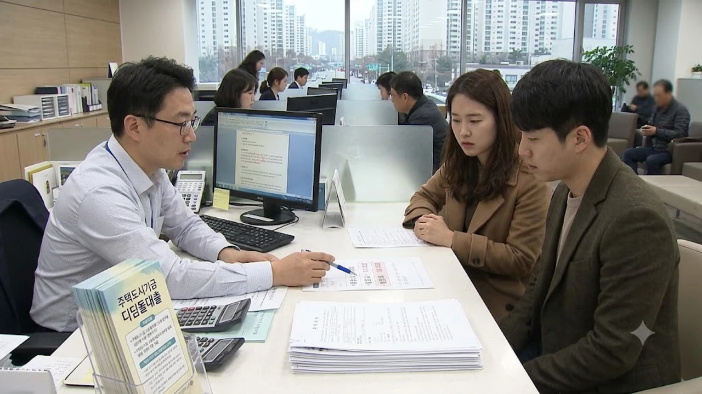

정부와 주택도시보증공사(HUG)가 사전 예고도 없이 시중은행 창구에 디딤돌대출 한도 축소 가이드라인을 기습 하달하면서 내 집 마련을 눈앞에 둔 무주택 서민들의 자금 계획이 완전히 무너졌습니다. 주택임대차보호법상 소액임차보증금을 대출액에서 무조건 깎는 **디딤돌대출 방공제** 의무화와 신축 미등기 아파트 대상 후취담보 대출 중단 조치가 동시에 터져 입주 현장은 아비규환입니다. 저금리 정책 모기지만 믿고 분양 계약서에 도장을 찍었던 수분양자들은 당장 수천만 원에 달하는 현금을 며칠 안에 토해내야 하는 벼랑 끝에 몰렸습니다.

## 기습 발표된 디딤돌대출 규제 구체적인 변화 내용

### 국토부와 HUG의 대출 한도 축소 가이드라인 요약
국토교통부와 HUG는 금융당국의 가계부채 관리 기조를 맞춘다는 구실로 5대 시중은행(국민·신한·하나·우리·농협) 창구에 정책대출 옥죄기를 구두 요청했습니다. 핵심은 모기지신용보증(MCG) 취급 중단입니다. 종전에는 소액임차보증금을 차감하지 않는 대신 MCG 보증을 세워 LTV 한도(일반 70%, 생애최초 80%)를 온전히 채워줬으나, 이를 원천 금지했습니다. 여기에 소유권 이전 등기가 나지 않은 신축 분양 아파트의 후취담보 대출까지 취급을 막았습니다.

### 최우선변제금 방공제 의무화로 깎이는 실제 금액
방공제는 주택임대차보호법에 규정된 소액임차인 최우선변제금 명목의 금액을 대출 담보가치에서 강제로 빼는 조치입니다. 주택 소재지에 따라 차감액이 딱 정해져 있어 에누리가 없습니다.
- **서울**: 무조건 **5,500만 원** 차감
- **경기·인천 과밀억제권역**: **4,800만 원** 차감 (용인 수지·성남 분당·하남·수원 등)
- **광역시 및 세종·안산·용인 처인구 등**: **2,800만 원** 차감
- **기타 지방 시·군 지역**: **2,500만 원** 차감

> "MCG 가입이 전면 차단되면서 서울 아파트는 신청 버튼을 누르자마자 5,500만 원이 증발합니다. 연 소득 4,000만 원대 무주택자가 며칠 만에 메울 수 있는 액수가 아닙니다."

### 신축 미등기 아파트 후취담보 대출 전면 중단의 의미
재개발·재건축 조합 단지나 대규모 신도시 공공·민간 분양 아파트는 준공검사를 통과해도 지번 부여와 소유권 이전 등기까지 보통 6개월에서 1년 넘게 걸립니다. 지금까지는 수분양자가 입주할 때 은행이 '소유권 취득 후 1순위 근저당 설정'을 약정하는 후취담보 조건으로 잔금대출을 내줬습니다. 이 통로를 닫아버렸다는 뜻은, 미등기 신축 단지에 들어갈 때 디딤돌대출을 한 푼도 쓰지 말라는 사망 선고나 다름없습니다.

## 규제 전후 대출 한도 비교와 실수요자 자금 타격

### 서울·수도권 vs 지방 아파트 한도 감소폭 시뮬레이션
매매가 5억 원 아파트를 분양받거나 매입하려던 무주택 세대를 기준으로 계산기를 두드려 보면 낙폭이 살벌합니다. 종전 LTV 70%를 꽉 채우면 최대 3억 5,000만 원까지 대출이 승인되었습니다.
- **서울 5억 원 아파트**: 기존 3억 5,000만 원 → 규제 적용 후 **2억 9,500만 원** (5,500만 원 순감)
- **경기 수원 5억 원 아파트**: 기존 3억 5,000만 원 → 규제 적용 후 **3억 200만 원** (4,800만 원 순감)
- **지방 광역시 3억 원 아파트**: 기존 2억 1,000만 원 → 규제 적용 후 **1억 8,200만 원** (2,800만 원 순감)

매매가가 높고 주택 과밀이 심한 수도권 실수요자일수록 대출 축소 직격탄의 파괴력이 큽니다.

### 입주 앞둔 신축 분양 단지 수분양자가 겪는 현실적 차질
당장 이달 말이나 다음 달 입주를 앞둔 신축 단지 현장은 발등에 불이 떨어졌습니다. 집단대출 협약 은행들이 HUG 공문을 핑계로 디딤돌 잔금대출 접수를 현장에서 퇴짜 놓고 있기 때문입니다. 수분양자는 계약금 10%와 중도금 60%를 치른 뒤 잔금 30%를 연 2~3%대 저리 디딤돌로 상환할 계산이었으나, 잔금을 내지 못해 연 8%가 넘는 입주 지연 연체료를 물거나 계약 파기 위기로 내몰리고 있습니다. 종전 시장을 뒤흔들었던 [2030 영끌 재점화, 전세 폭등 속 진짜 살까?](/posts/kr-realestate/young-generation-panic-buying-jeonse-spike-2026/) 흐름 속 막차를 탔던 층이 정책 급선회의 첫 희생양이 된 꼴입니다.

### 생애최초 LTV 80% 혜택 축소와 체감 자금 공백
내 집 마련 문턱을 낮춰주겠다던 '생애최초 LTV 80%' 혜택은 허울만 남았습니다. 매매가 4억 원짜리 소형 평형을 살 때 기존에는 3억 2,000만 원까지 대출이 나와 수중에 8,000만 원만 있으면 진입이 가능했습니다. 하지만 방공제 4,800만 원(경기권 기준)이 빠지면 실제 손에 쥐는 돈은 2억 7,200만 원으로 쪼그라듭니다. 체감 LTV는 68%로 주저앉고, 준비해야 할 종잣돈은 하루아침에 8,000만 원에서 1억 2,800만 원으로 60% 폭증합니다.

## 갑작스러운 잔금 부족 현실적인 우회 및 대체 방안

### 시중은행 일반 주택담보대출 전환 시 DSR 부담 비교
디딤돌대출 구멍을 메우려고 1금융권 일반 주택담보대출로 고개를 돌리는 순간 또 다른 규제의 벽에 부딪힙니다. 일반 주담대는 스트레스 DSR 2단계가 뼈아프게 적용됩니다.
- 디딤돌대출: 차주 단위 DSR 규제 예외 대상, DTI 60%만 적용
- 시중은행 일반 주담대: **DSR 40% 강제 적용**, 스트레스 가산금리 가산

소득이 적은 맞벌이나 외벌이 직장인은 DSR 한도에 걸려 디딤돌에서 모자란 금액만큼 일반 주담대 한도를 뽑아내지 못합니다. 여기에 금리마저 연 2%대 중반에서 연 4%대 중후반으로 2%p 가까이 치솟아 매월 나가는 원리금 상환액이 수십만 원씩 불어납니다.

### 보금자리론 및 디딤돌 차액 메우기용 신용대출 활용법
디딤돌 한도가 깎인 차주가 최우선으로 검토해야 할 우회로는 한국주택금융공사의 보금자리론입니다. 보금자리론은 시중은행 일반 대출과 달리 차주 단위 DSR 40%를 적용받지 않고 DTI를 기준 삼아 한도를 넉넉하게 산정합니다. 비아파트 거주 청년층이라면 [청년미래보금자리론 4억 빌라 숨은 조건](/posts/kr-realestate/youth-future-bogeumjari-loan-villa-2026/)을 대조해 한도 차이를 확인하는 접근이 필수입니다.
- **대출 실행 순서 철저 준수**: 디딤돌이나 보금자리론 잔금대출 심사 통과 전 신용대출을 먼저 개설하면 주담대 승인 자체가 부결되므로 주담대 실행 직후 신용대출을 기표하는 순서를 지켜야 합니다.
- **제도권 밖 사우회·공제회 자금 활용**: 교직원공제회, 군인공제회, 대기업 사내 근로복지기금 대출은 시중 금융권 DSR 전산망에 잡히지 않으므로 방공제 차액을 메우는 최우선 카드로 써야 합니다.

### 입주 지정 기간 활용 및 건설사 협약 집단대출 점검 순서
신축 수분양자는 건설사가 정한 입주 지정 기간을 영리하게 활용해야 합니다. 보통 입주 개시일부터 60일에서 90일까지 여유가 주어지므로, 무리해서 첫날 잔금을 납부하기보다 지정 기간 막바지까지 시간을 버는 편이 낫습니다. 은행권 반발과 민원이 빗발치며 HUG가 경과 규정을 완화하거나 집단대출 참여 은행들이 미등기 상태에서도 취급 가능한 은행 자체 잔금대출 특판을 내놓는지 매주 현장 상담센터를 뒤져야 합니다.

## 디딤돌대출 축소 사태 속 실수요자 대응 가이드

### 계약 일정별 규제 유예 및 예외 적용 대상 확인법
규제가 기습적으로 시행되더라도 가이드라인 공문 발송일 이전에 매매계약을 체결한 매수자는 구제받을 여지가 있습니다.
- 은행 창구 공문 도착일 전에 부동산 실거래 매매계약서를 작성하고 계약금을 통장으로 이체한 내역이 입증되는 차주
- 주택도시기금 '기금e든든' 웹사이트 및 은행 전산에 사전 적격 심사 접수를 마친 상태인 건
- 사업장 승인 당시 지자체 입주자모집공고문에 정책자금 취급 조항이 명문화된 분양 현장

지점 창구 실무자마다 지침 해석이 엇갈리고 있으므로, 거절당하더라도 즉시 포기하지 말고 기금e든든 전산 이력을 들이밀며 소명 절차를 밟아야 합니다.

### 무주택자가 계약 전 반드시 은행 창구에서 거쳐야 할 3단계
계약금을 날리지 않으려면 매매계약서 날인 전 철저한 사전 검증을 끝내야 합니다.
1. **대출 모집인 말만 믿지 말고 지점 정규직 책임자와 면담**: 모집인의 구두 약속은 법적 효력이 전혀 없으므로, 취급 은행 대부계 여신 책임자에게 규제 적용 여부를 직접 캐물어야 합니다.
2. **방공제 적용 실제 승인 확약서 확인**: 매수할 집의 방 개수와 주소지 최우선변제금을 차감한 최종 가용 한도를 서면으로 산출받아야 안전합니다.
3. **계약서 특약 조항 사수**: "정부 및 공공기관의 정책대출 규제 강화로 인하여 주택담보대출 한도가 축소되거나 미승인될 경우 본 계약은 위약금 없이 무효로 하며 매도인은 계약금을 즉시 전액 반환한다"는 문구를 계약서에 관철해야 합니다.

### 연말 가계대출 총량 관리 기조 속 자금 조달 리스크 관리법
가계부채 총량 억제 압박 때문에 4분기 시중은행들은 정책금융 실적을 채우기는커녕 접수를 닫기에 급급합니다. 한 은행 지점에서 취급을 거부당하면 즉시 타 권역 1금융권 지점으로 발품을 팔아야 합니다. 아울러 상환 계획이 없는 무리한 고금리 카드론이나 2금융권 영끌은 피하고, 가족 간 차용증을 쓰고 법정 이자율(연 4.6%)을 적용하거나 성인 자녀 10년 5,000만 원 증여세 공제 한도를 적절히 끌어와 부족한 잔금을 확보하는 비상 계획을 가동해야 합니다.

부족한 입주 잔금을 맞추고 이사 날짜를 확정했다면, 입주 초기 과도한 인테리어 비용을 아끼고 깔끔한 정리 환경을 만들어 불필요한 지출을 통제하는 계획이 병행되어야 합니다. [이사 입주 정리 수납용품 쿠팡에서 보기](https://www.coupang.com/np/search?q=%EC%9D%B4%EC%82%AC%20%EC%9E%85%EC%A3%BC%20%EC%A0%95%EB%A6%AC%20%EC%88%98%EB%82%A9%EC%9A%A9%ED%92%88&sourceType=affiliate&trackingCode=AF8691300)

#디딤돌대출 #디딤돌대출방공제 #방공제축소 #신축후취담보중단 #주택도시기금 #보금자리론 #잔금대출비상 #입주잔금마련