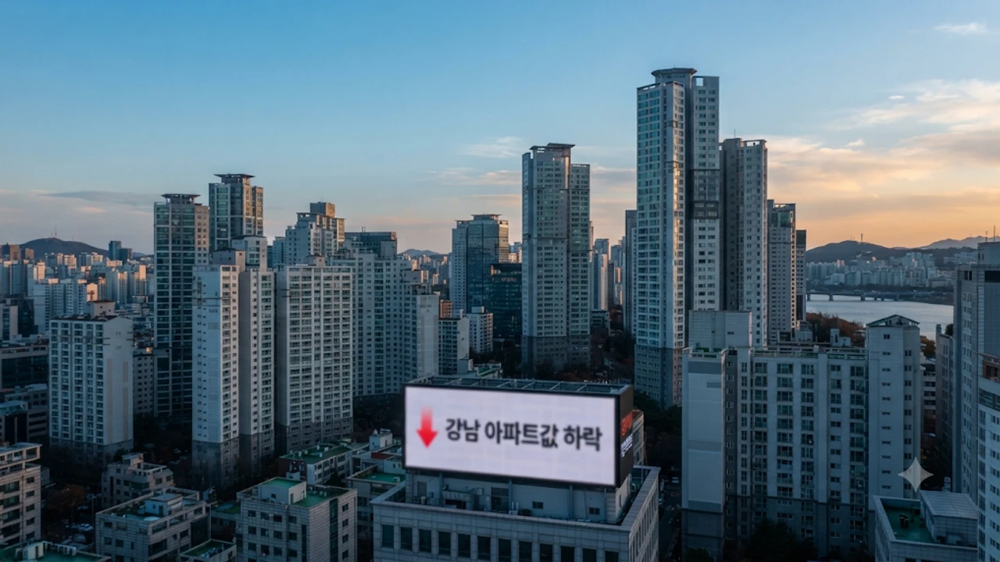

최근 서울 부동산 시장의 핵심 척도인 강남 아파트값 하락세가 본격화되면서 시장의 이목이 집중되고 있습니다. 송파와 서초 등 고가 지역을 중심으로 가격 조정 조짐이 뚜렷해짐에 따라, 향후 수도권 전역으로 하락 파급력이 이어질지 실수요자들의 고민이 깊어지는 국면입니다. 특히 대출 규제와 금리 인상이 겹친 현시점에서 청년미래보금자리론 4억 빌라 숨은 조건과 같은 금융 지원 정책을 꼼꼼히 점검하는 전략적 접근이 필수적입니다.

## 강남3구 아파트값 하락 전환 배경

### 송파·서초·강남 중심 하락세의 주된 원인
한국부동산원이 발표한 11월 둘째 주(9일 기준) 아파트 가격 동향에 따르면, 서울 아파트값 전체 상승세 속에서도 송파구(-0.35%), 서초구(-0.26%), 강남구(-0.25%)는 일제히 하락 전환했습니다. 그간 시장을 견인해 온 초고가 단지들의 호가 거품이 걷히고, 매수 우위 시장으로 지형도가 바뀌는 결정적 변곡점입니다. 호가를 높이던 매도자들도 가격을 낮춘 실거래 매물을 던지기 시작하면서 시세 상단이 빠르게 무너지고 있습니다.

### 한강벨트 확산 현상과 시장 파급력
강남권의 가격 조정은 비강남권으로 즉각 번지는 모양새입니다. 성동구, 마포구, 강동구 등 주요 한강벨트 핵심 지역에서도 매수 문의가 자취를 감추고 실거래가가 직전 최고가 대비 하향 조정되는 사례가 속출하고 있습니다. 전문가들은 이를 단순한 일시적 숨고르기가 아닌, 자금 줄이 꽉 막힌 시장의 구조적 압박 현상으로 진단합니다.

## 매물 증가와 대출 규제의 복합 영향

### 서울 아파트 매물 8만 건 돌파의 의미
부동산 빅데이터 업체 아실 통계 기준으로 서울 아파트 매물은 8만 건을 이미 넘어섰습니다. 불과 몇 달 전과 비교해 30% 이상 급증한 수치입니다. 팔려는 사람은 넘쳐나지만 사려는 사람은 찾아보기 힘든 전형적인 매물 적체 장세가 형성되었습니다. 강화된 세제와 보유세 압박을 견디지 못한 다주택자 매물이 누적된 결과입니다.

### 주택담보대출 금리 인상과 매수 관망세
시중 은행의 주택담보대출 금리가 4%대 후반으로 올라서며 차주들의 이자 부담이 임계점에 달했습니다. DSR 규제 강화와 맞물려 대출 한도가 대폭 깎이면서, 현금 동원력이 부족한 대기 수요자들은 계약을 포기하고 관망세로 완전히 돌아섰습니다. 

## 정부 진단과 현장 체감 온도의 괴리

### 정부의 '시장 안정세' 진단 입장
국토교통부 등 관계 당국은 최근의 거래 감소와 매물 증가 현상을 과열된 시장이 부드럽게 가라앉는 긍정적인 '하향 안정화' 신호로 평가합니다. 투기 수요가 차단되고 실수요자 중심 체제로 재편되는 자연스러운 치유 과정이라는 분석입니다.

### 실수요자와 투자자가 체감하는 현실
반면 현장 공인중개사와 실수요자들이 마주하는 현실은 정부의 낙관론과 거리가 멉니다. 급매물이 나와도 매수 심리가 완전히 얼어붙어 실제 계약으로 이어지지 않으며, 오히려 2030 영끌 재점화, 전세 폭등 속 진짜 살까?와 같은 극단적인 선택지 사이에서 혼란만 가중되는 양상입니다.

## 향후 부동산 시장 전망 및 대응 전략

### 연말 및 내년 초 부동산 시장 시나리오
올해 연말부터 내년 초까지의 부동산 시장은 강남권 조정의 깊이와 기간에 따라 방향성이 결정될 전망입니다. 금리 인하 기대감이 지연되고 대출 규제가 철저히 유지되는 한, 급격한 반등보다는 보합 내지 약세 장세가 길어질 공산이 큽니다.

### 실수요자 및 1주택자를 위한 핵심 대응 팁
조정장 국면에서는 무리한 레버리지 활용을 철저히 차단하고 자기자금 수지 분석을 엄격히 수행해야 합니다. 특히 갈아타기를 준비하는 1주택자라면 매도 시점과 매수 시점의 간격을 최대한 좁히는 유연한 가격 전략이 승패를 가릅니다. 자금 계획 수립과 주거 환경 개선을 고민하는 이들이라면 [관련상품 쿠팡에서 보기](https://www.coupang.com/np/search?q=%EC%9D%B8%ED%85%8C%EB%A6%AC%EC%96%B4+%ED%99%88%EA%B0%80%EC%96%AC&sourceType=affiliate&trackingCode=AF8691300)를 통해 실내 공간 최적화 팁을 확인하는 것도 소소한 대안이 될 수 있습니다.

#강남아파트 #부동산시장전망 #서울아파트하락 #주택담보대출금리 #부동산조정장 #한강벨트아파트 #아파트매물증가 #부동산규제