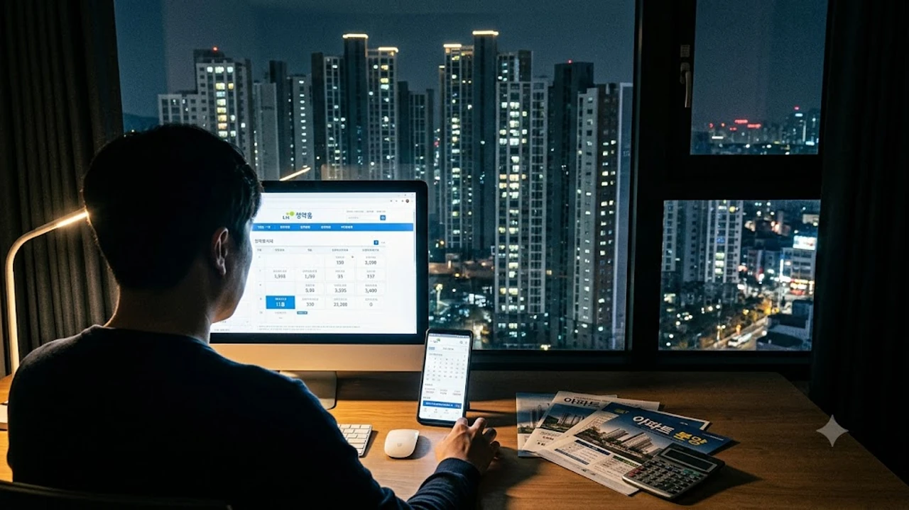

2026년 가을 분양 시장의 정점이 될 **11월 아파트 분양** 일정이 본격적으로 쏟아져 나오고 있다. 전국 분양 물량이 전월 대비 대폭 늘어난 반면 수도권 실수요자가 선호하는 알짜 입지의 공급은 되레 쪼그라들면서, 청약 가점 보유자들의 셈법도 그 어느 때보다 복잡해졌다.

## 전국 분양 물량 급증과 양극화의 실체

### 일반분양 대폭 증가와 밀어내기 분양의 배경
부동산 플랫폼 집계 기준 11월 전국 분양 계획 물량은 약 4만 4천여 가구로 전년 동기 대비 큰 폭으로 반등했다. 건설사들이 원자재 가격 상승과 금융 비용 부담을 덜기 위해 내년 상반기로 미뤄두었던 단지들을 올해 4분기에 한꺼번에 털어내는 양상이다.

* **건설사 PF 리스크 회피**: 미분양 우려가 덜한 수도권 외곽과 지방 거점 도시를 중심으로 인허가 후 지연되던 물량이 급격히 출회
* **청약자 분산 효과**: 대규모 단지들이 동시다발적으로 청약 접수를 진행하면서 비인기 단지의 미달 위험 가중

### 서울 일반분양 축소와 수도권 공급 격차
물량 수치는 풍성해 보이지만 정작 서울 일반분양은 약 2,400여 가구 수준에 그친다. 정비사업 조합원 물량을 제외하면 일반 무주택자에게 돌아가는 일반분양 몫은 턱없이 부족하며, 그마저도 소형 평형이나 저층 위주로 배정된 곳이 많다. 서울과 인접한 경기 핵심지를 제외한 나머지 수도권 외곽 지역은 공급 과잉 국면에 직면했다.

### 가을 분양 시장에서 드러나는 허수 물량
계획 물량 중 실제 입주자 모집 공고 승인을 받아 청약 홈에 등록되는 비중은 통상 70~80% 선에 머문다. 시공사와 조합 간 공사비 증액 갈등이 봉합되지 않은 서울·수도권 주요 재건축 단지들은 12월 또는 내년으로 재연기될 여지가 상존하므로, 공고문 확정 전까지는 통계상 수치를 맹신하기 어렵다.

## 지역별 청약 옥석 가리기와 당첨 기준선

### 상급지 분양가 상한제 단지의 현금 동원력
분양가 상한제가 적용되는 강남 3구 및 용산권 단지는 당첨 시 확실한 시세 차익이 보장되지만, 청약 진입 장벽은 자금력에서 갈린다.

> **자금 조달 핵심 체크포인트**
> - 계약금 20% 납입 시 최소 수억 원대 순수 자기자본 필수
> - 전매제한 3년 및 실거주 의무 유예 3년 적용에 따른 잔금 대출 계획 확정 필요

금융권의 주택담보대출 옥죄기가 거세진 상황에서 [15억 이하 대출규제 6억 축소될까?](/posts/kr-realestate/under-1500m-mortgage-loan-cap-tightening-2026/) 분석 내용처럼 가계대출 총량 관리가 강화되고 있어 레버리지를 극대화하기 어렵다.

### 수도권 경기·인천 대단지 미분양 위험도
분양가가 이미 주변 구축 시세를 훌쩍 웃도는 수준으로 책정된 경기 남부·인천 일부 택지지구는 경쟁률 미달 단지가 속출할 가능성이 높다. 동일 생활권 내 입주 물량 누적 여부와 인근 지하철 연장선 착공 지연 리스크를 꼼꼼히 대조해야 한다.

### 지방 거점 도시의 선별 청약 원칙
지방은 브랜드 대단지 및 초품아 입지라도 안전마진이 확보되지 않으면 외면받는다. 분양가가 인근 5년 이내 신축 시세보다 10% 이상 저렴하지 않다면 청약 통장을 소진하기보다는 미분양 이후 발생하는 계약 조건 안심보장제 단지를 선별하는 편이 유리하다.

## 대출 한도 규제와 실질 자금 조달 리스크

### 분양가 상한제 실거주 의무와 전세 활용의 한계
실거주 의무 3년 유예 조치가 내려졌다고 해도 전세를 놓아 분양 잔금을 치르는 방식은 과거보다 훨씬 위험하다. 전세대출 보증 기준 강화로 세입자를 구하기까지 시간이 지체되면 연체 이자 부담이 급증한다.

- 전세 시세 하락 시 보증금 반환 리스크 사전 대비
- 전세보증금 반환보증 가입 한도 요건 충족 여부 점검

### DSR 2단계 적용에 따른 대출 한도 축소
스트레스 DSR 2단계가 완전히 안착함에 따라 은행권에서 산출되는 주택담보대출 원리금 상환 가능액은 이전보다 수천만 원 단위로 줄어들었다. 소득 수준이 높지 않은 무주택 세대라면 청약 전 은행 상담 창구를 통해 실제 실행 가능한 대출 한도를 서면으로 확인해 두어야 한다.

### 청약 통장 사용과 보류를 가르는 분기점
가점이 60점대 후반 이상인 무주택 세대주는 서울 알짜 정비사업 일반분양을 끝까지 노리는 편이 낫다. 반면 가점이 30~40점대에 불과한 2030 세대라면 경쟁이 치열한 인기 단지 대신 특별공급 추첨제나 기축 매수를 현실적인 대안으로 검토할 필요가 있다. 특히 [2030 영끌 재점화, 전세 폭등 속 진짜 살까?](/posts/kr-realestate/young-generation-panic-buying-jeonse-spike-2026/) 흐름 속에서 무리한 고분양가 청약은 장기 하우스푸어로 직결될 수 있다.

## 연말 분양 시장 실수요 맞춤 대응법

### 무순위 줍줍 대기 vs 11월 본청약 승부
무순위 청약(줍줍)의 거주 요건 및 무주택 요건 규제가 한층 정교해지면서, 전국구 현금 부자들의 투기성 무순위 청약 잔치는 제동이 걸렸다. 

1. **상급지 본청약**: 가점이 높고 계약금 납입 여력이 확실한 경우 정면 승부
2. **비규제지역 무순위**: 분양가와 입지가 검증된 잔여 세대를 선착순·선별적으로 픽업
3. **선별적 청약 철회**: 모델하우스 관람 후 주변 유사 평형 실거래가와 비교해 안전마진이 없으면 과감히 청약 통장 보존

### 특별공급 소득 기준 및 가점 관리 요령
신혼부부와 신생아 특별공급은 소득 요건이 일부 완화되었으나, 세대원 전원의 무주택 유지 기준과 보유 자산 기준을 정확히 충족하지 못해 부적격 당첨으로 취소되는 사례가 빈번하다. 모집공고일 당일 기준 세대 분리 여부와 가족관계등록부상의 자격 요건을 빈틈없이 확인해야 한다.

### 청약 대안으로서의 기축 준신축 매수 체크
원하는 입지의 청약 분양가가 지나치게 높다면, 입주 5~10년 차 준신축 아파트 급매물을 노리는 전략이 실질적인 비용을 아끼는 지름길이다. 확장비, 옵션비, 후불 이자를 합산한 신축 분양 총비용과 인근 준신축 매매 호가를 꼼꼼히 비교한 뒤 결정해야 한다. 새 아파트 입주나 이사를 준비하면서 필요한 실내 인테리어 소품이나 정리 도구는 [관련상품 쿠팡에서 보기](https://www.coupang.com/np/search?q=%EC%9D%B8%ED%85%8C%EB%A6%AC%EC%96%B4%20%ED%99%88%EA%B0%80%EA%B5%AC&sourceType=affiliate&trackingCode=AF8691300)를 통해 미리 비교하고 장만해 두면 이사 비용을 한층 절약할 수 있다.

#11월아파트분양 #아파트청약전략 #분양가상한제 #청약가점계산 #신혼부부특별공급 #스트레스DSR #무순위청약