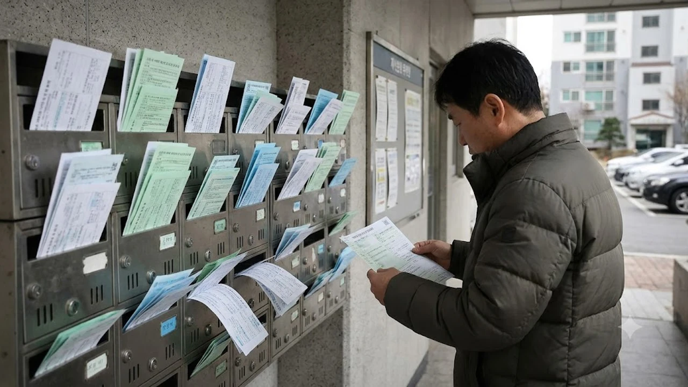

올해 **서울 아파트 재산세** 총액이 사상 처음으로 3조 원 선을 넘어서며 주택 시장에 적잖은 파장을 일으키고 있다. 실거래가 반등 흐름과 공동주택 공시가격 현실화율 조정이 맞물려, 9월 고지서를 받아 든 1주택 실거주자들 사이에서도 **보유세 폭탄** 여부를 둘러싼 체감 격차가 뚜렷하다. 고금리와 대출 규제로 현금 흐름이 묶인 가구라면 이번 과세 내역이 가계 재정에 상당한 부담으로 작용할 수밖에 없다.

## 서울 아파트 재산세 첫 3조 원 돌파 배경

### 1년 만에 두 자릿수 급증을 부른 핵심 요인
서울시 공동주택 재산세 부과액이 지난해 대비 큰 폭으로 뛴 배경에는 고가 단지 중심의 실거래가 회복세가 자리한다. 재산세는 매년 1월 1일 기준 공시가격을 토대로 산정되는데, 주요 상급지의 시세 반영분이 과표에 고스란히 얹혔다. 

> **핵심 체크**: 재산세 과세표준은 공시가격에 공정시장가액비율(1주택자 기준 43~45% 안팎 특례 적용)을 곱해 정해진다. 공시가격 자체가 10~20% 뛰면 과표와 누진세율 구간이 함께 밀려 올라가 실제 세액 체감 폭이 가팔라진다.

### 공시가격 반영률과 시세 동향의 괴리
정부가 인위적인 공시가격 현실화 로드맵을 손질했음에도 시장 체감 세부담이 꺾이지 않은 이유는 자치구별 시세 양극화 때문이다. 강남권과 한강변 단지는 직전 고점을 회복하며 가파르게 올랐으나, 외곽 지역은 제자리걸음을 걸어 과세 불균형 체감이 더 뼈아프게 다가온다.

### 자치구별 세수 변동의 명암
서울시 전체 재산세 세수는 불어났지만, 자치구 간 세수 편차는 역대 최고 수준으로 벌어졌다. 재산세의 절반을 시세로 거두어 25개 구에 균등 배분하는 '재산세 공동과세' 제도가 작동하고 있음에도 자치구별 자체 세원 격차를 완전히 메우기는 역부족인 실정이다.

## 강남 3구·마용성 vs 노도강 세부담 양극화 현주소

### 강남권 쏠림과 외곽 지역 간 세액 격차
강남·서초·송파 등 강남 3구에서 걷힌 재산세 비중은 서울 전체 부과액의 40%를 훌쩍 넘어섰다. 강남구 한 개 구의 재산세 총액이 노원·도봉·강북 등 외곽 3개 구를 합친 금액의 수 배에 달하는 구조다.

- **강남 3구**: 대단지 신축 및 재건축 단지 중심의 공시가격 상승으로 가구당 수백만 원대 재산세 고지
- **마용성(마포·용산·성동)**: 한강변 준신축 위주로 전년 대비 15~25% 세부담 증가 확인
- **노도강(노원·도봉·강북)**: 공시가격 변동이 미미하거나 하락해 재산세 변동 폭이 크지 않음

### 자산 격차가 부른 보유세 양극화와 시장 영향
고가 단지 밀집 지역은 세부담을 감당할 수 있는 자산가 위주로 손바뀜이 일어나면서 매물 잠김 현상이 짙어졌다. 반면 대출 한도 축소로 진입 장벽이 높아진 실수요자들은 [15억 이하 대출규제 6억 축소될까?](/posts/kr-realestate/under-1500m-mortgage-loan-cap-tightening-2026/) 분석처럼 대출 문턱과 세부담을 동시에 계산기 두드리며 관망세로 돌아섰다.

## 1주택 실거주자가 실제로 마주한 납부액 체감

### 시가 구간별 전년 대비 재산세 인상 폭
공시가격 9억 원 이하 구간에 적용되는 1세대 1주택 특례세율(구간별 0.05%p 인하) 덕분에 중저가 주택 실거주자는 세부담 증가를 크게 느끼지 못했다. 그러나 공시가격 9억 원을 초과하는 중고가 주택 소유자는 일반 누진세율이 적용되며 세액 앞자리가 바뀌는 경험을 했다.

> **실제 과세 사례**: 마포구 전용 84㎡(공시가격 약 11억 원선)를 보유한 1주택자는 7월과 9월 합산 재산세가 전년 대비 약 30만~40만 원 이상 늘어난 180만 원 안팎을 고지받았다. 반면 노원구 전용 59㎡(공시가격 4억 원선) 1주택자는 40만 원대 초반으로 전년과 대동소이했다.

### 세부담 상한제 작동과 12월 종부세 예고편
지방세법상 재산세는 전년 대비 일정 비율 이상 오르지 못하도록 세부담 상한(공시가격 3억 이하 105%, 3억~6억 110%, 6억 초과 130%)을 둔다. 올해 상한선까지 세금이 찬 가구는 오는 12월 부과될 종합부동산세에서도 적잖은 추가 고지서를 받을 공산이 크다.

### 고금리 금융 비용과의 이중고
영끌 매수를 선택했던 차주들은 치솟은 원리금 상환액에 보유세 인상분까지 겹치며 체감 압박이 극에 달했다. 무주택자들의 관망세와 맞물려 [2030 영끌 재점화, 전세 폭등 속 진짜 살까?](/posts/kr-realestate/young-generation-panic-buying-jeonse-spike-2026/)를 고민하던 층도 보유 비용 상승을 확인한 뒤 매수 타이밍을 저울질하는 모양새다.

## 고지서 수령 후 반드시 짚어야 할 절세 체크포인트

### 1주택 특례 누락 여부와 과세표준 확인
고지서를 받았다면 가장 먼저 세액 계산 내역에서 **1세대 1주택자 특례세율**이 제대로 적용되었는지 확인해야 한다. 상속주택이나 일시적 2주택, 지방 저가주택 보유 등으로 전산상 다주택자로 잘못 분류되어 일반세율로 고지된 사례가 종종 발생한다. 

- 과세표준에 적용된 공정시장가액비율이 주택 수에 맞게 들어갔는지 대조
- 1주택 특례가 빠졌다면 관할 구청 세무과에 즉시 이의를 제기하고 경정 청구 진행
- 신용카드 무이자 할부 납부 행사나 지방세 마일리지 적립 혜택 활용

### 불복 청구 기간과 납세 계획 수립
재산세 부과에 오류가 있거나 부당하다고 판단될 경우 고지서를 받은 날로부터 **90일 이내**에 이의신청이나 행정심판을 청구해야 법적 권리를 보호받는다. 단순 세액 불만이 아닌 공시가격 산정 오류나 주택 수 산정 착오 등 명확한 증빙을 갖추는 것이 필수다.

가계 자산 장부를 체계적으로 관리하고 납부 일정을 챙기려면 전용 바인더나 다이어리를 구비해 두는 것도 실질적인 도움이 된다. [자산관리 가계부 바인더 쿠팡에서 보기](https://www.coupang.com/np/search?q=%EC%9E%90%EC%82%B0%EA%B4%80%EB%A6%AC%20%EA%B0%80%EA%B3%84%EB%B6%80&sourceType=affiliate&trackingCode=AF8691300)를 통해 지출 내역을 정리해 두면 연말 세금 납부 계획을 세우는 데 수월하다.

#서울아파트재산세 #아파트재산세폭탄 #보유세계산 #공시가격현실화 #1주택자재산세 #강남마용성양극화 #재산세절세법