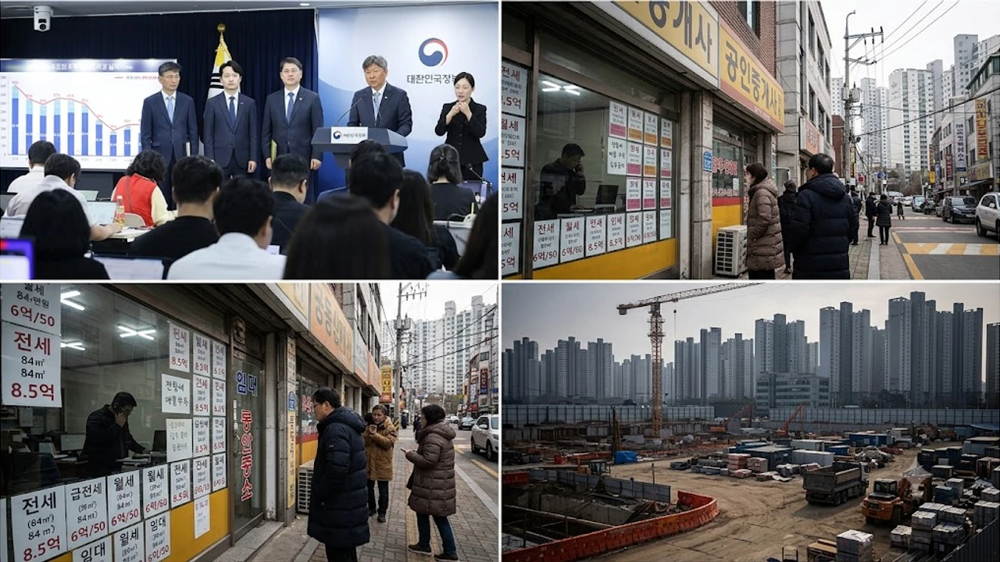

정부가 개최한 첫 주택공급 정례 브리핑에서 공개된 **수도권 착공 37%**라는 성적표는 시장에 적잖은 파장을 던졌다. 연초 계획했던 연간 물량의 절반에도 미치지 못하면서 향후 2~3년 뒤 수도권 주택 공급 절벽과 신축 아파트 희소성에 대한 우려가 번지고 있다. 공사비 폭등과 PF 자금 경색이 맞물린 결과로, 무주택 실수요자들의 내 집 마련 셈법도 전면 수정이 불가피해졌다.

## 첫 정례 브리핑서 드러난 착공률 37% 성적표 실체

### 26만 8천 호 목표 중 9만 9천 호 불과한 배경
국토교통부와 관계부처 합동 브리핑에 따르면 올해 1월부터 8월까지 집계된 수도권 주택 착공 실적은 9만 9,000호에 그쳤다. 당초 정부가 제시했던 연간 목표치 26만 8,000호의 37% 수준이다. 3.3㎡당 900만 원 선을 가볍게 넘어선 공사비 증액 갈등과 고금리 여파로 시공사들이 선별 수주를 넘어 현장 착공 자체를 미루는 '버티기'에 들어간 영향이 결정적이다.

### 공공택지 26% vs 민간 정비 23.6%의 동반 부진 구조
세부 지표를 뜯어보면 상황은 한층 어둡다. LH 등이 주도하는 공공택지 착공률은 26%에 머물렀고, 서울 도심 공급의 핵심 줄기인 민간 정비사업 부문은 23.6%로 바닥을 쳤다.

* **공공택지 부문:** 토지 보상 지연과 기반시설 조성 단가 급등으로 블록별 본공사 착공 줄줄이 순연
* **민간 정비사업:** 조합과 시공사 간 공사비 증액 소송, 시공 계약 해지 등 잡음으로 멈춰 선 도심 재건축·재개발 현장 다수
* **비아파트 부문:** 빌라 전세사기 여파가 이어지며 다세대·연립 착공 물량 전년 대비 30% 급감

> "인허가를 손에 쥐고도 첫 삽을 뜨지 못하는 사업장이 수도권 전역에 쌓여 있다. 이는 단순한 행정 절차 문제가 아니라 금융비용과 공사비를 감당하지 못하는 구조적 마비 상태다." — 현장 건설사 실무진 반응

### 정부가 공언한 연말 80%대 만회 한계점
국토부는 4분기 공공택지 본청약 물량 집중과 인허가 단축을 통해 연말까지 착공률을 80%대까지 끌어올리겠다고 밝혔다. 그러나 겨울철 기온 강하로 인한 콘크리트 타설 제한과 건설사들의 보수적인 재무 기조를 감안할 때 불과 석 달 만에 12만 호 이상의 착공 실적을 쏟아내기는 현실적으로 불가능에 가깝다.

## 2~3년 뒤 수도권 입주 가뭄과 전월세 시장 파장

### 착공 지연이 2028~2029년 서울 신축 공급에 미치는 영향
아파트는 첫 삽을 뜨고 열쇠를 받기까지 보통 30~36개월이 걸린다. 지금 발생한 착공 가뭄은 2028년부터 2029년 사이 서울과 수도권 핵심 입지의 신축 입주 절벽으로 직결된다. 부동산원 및 시장 집계 기준 2028년 서울 아파트 입주 예정 물량은 평년의 절반 수준으로 급감할 것으로 추산되며, 신축 프리미엄을 노린 희소성 경쟁을 다시 부추길 가능성이 높다.

### 아파트 대체재인 비아파트 인허가 회복세의 한계
정부는 빌라와 오피스텔 매입임대를 늘려 충격을 완충하겠다는 구상이지만 시장의 반응은 냉랭하다. 빌라 기피 현상이 워낙 깊게 박혀 있어 비아파트 인허가가 소폭 반등하더라도 아파트 대기 수요를 흡수하지 못하는 엇박자가 지속되고 있다. 대체 주거지가 제 기능을 못 하면서 결국 아파트 쏠림 현상만 심화되는 구조다.

### 매매 수요 위축이 전세가 상승 압력으로 전이되는 메커니즘
대출 한도 축소와 스트레스 DSR 여파로 매매 자금 마련이 막힌 무주택자들이 매수를 접고 전세 시장에 머무는 기간이 길어지고 있다. 착공 절벽 예고에 불안해진 기존 세입자들까지 계약갱신청구권을 쓰며 눌러앉자 시중 전세 매물이 바닥을 드러냈다. 실수요자 사이에서 [2030 영끌 재점화, 전세 폭등 속 진짜 살까?](/posts/kr-realestate/young-generation-panic-buying-jeonse-spike-2026/)와 같은 고심이 깊어지는 이유다.

## 4분기 공공분양·임대 1.5만 호 잔여 일정 긴급 점검

### 3기 신도시 사전·본청약 1만 호 분양 일정
공급 절벽 충격을 줄이기 위해 LH는 4분기 고양창릉, 남양주왕숙, 부천대장을 축으로 총 1만 호 규모의 본청약 접수를 진행한다.

- **고양창릉 A-4블록:** 총 612가구 (전용 55·59㎡), GTX-A 창릉역 호재를 낀 선호 입지
- **남양주왕숙 B-2블록:** 총 873가구 (전용 74·84㎡), 분양가상한제 적용으로 주변 시세 대비 75~80% 선 책정
- **부천대장 A-7블록:** 총 450가구 (신혼희망타운 및 일반분양)

다만 사전청약 당시 예고했던 추정 분양가보다 본청약 분양가가 10~15%가량 오르고 있어 초기 계약금과 중도금 대출 가능액을 미리 계산해 둘 필요가 있다.

### 과천지식정보타운·구리갈매역세권 공공임대 5천 호 자격
임대 수요 분산을 위해 과천지식정보타운과 구리갈매역세권에서는 총 5,000호의 공공임대 및 행복주택 입주자를 모집한다. 월 소득 기준 도시근로자 월평균 소득 100% 이하, 무주택 세대구성원 요건을 충족해야 하며 지하철 접근성이 뛰어난 입지 특성상 청년·신혼부부 계층의 청약 접수가 몰릴 전망이다.

### 지연 사업지 착공 재개 현황
민간 정비사업장 중에서는 공사비 증액 분쟁을 마무리 지은 흑석11구역과 신림2구역이 관리처분인가 변경을 마치고 4분기 실착공 채비에 들어갔다. 관악·동작 일대의 공급 숨통을 일부 틔워줄 물량이지만, 수도권 전체의 수급 불균형을 되돌리기에는 턱없이 부족한 규모다.

## 공급 절벽 리스크 속 무주택자 맞춤 대응 시나리오

### 3기 신도시 청약 대기 vs 수도권 외곽 준신축 급매물 매수 비교
현재 무주택자의 현실적 선택지는 3기 신도시 분양 대기와 경기권 역세권 준신축 급매물 매수로 나뉜다. 청약 가점이 60점 안팎이고 2~3년 거주 안정이 확보됐다면 분양가상한제가 걸려 있는 3기 신도시 본청약 유지가 유리하다. 반면 전세 만기가 코앞이고 가점이 낮다면 가격 조정을 거친 기축 역세권 단지를 물색하는 전략이 더 현실적이다. 자금 계획을 짤 때는 [15억 이하 대출규제 6억 축소될까?](/posts/kr-realestate/under-1500m-mortgage-loan-cap-tightening-2026/)와 같은 주담대 한도 조이기 흐름을 필히 반영해야 한다.

### 전세보증금 상승기 안전장치 및 대체 주거지 활용법
전셋값이 치솟을수록 자산 보호가 최우선이다. HUG 전세보증금 반환보증 가입 요건(공시가격 126% 이내)에 들어오는 집인지 등기부등본 확인이 필수적이다. 최장 10년간 이사 스트레스 없이 머물 수 있는 공공지원 민간임대나 LH 든든전세주택 공고를 챙겨보며 무리한 전세대출 이자 지출을 피하는 방안도 검토해 볼 만하다.

### DSR 자금 계획과 현금 흐름 점검
대출 조이기가 이어지는 국면에서는 주택담보대출뿐 아니라 신용대출, 카드론까지 DSR 산정에 잡힌다. 월 원리금 상환액을 가처분소득의 30% 선 안쪽으로 묶어두고, 비상시를 대비한 예비 현금을 최소 6개월 치 유지하는 보수적인 자금 운용이 요구된다.

안정적인 자금 계획과 함께 이사를 준비하고 있다면 [이사 가구 침대 매트리스 쿠팡에서 보기](https://www.coupang.com/np/search?q=%EC%9D%B4%EC%82%AC%20%EA%B0%80%EA%B5%AC%20%EC%B9%A8%EB%8C%80%20%EB%A7%A4%ED%8A%B8%EB%A6%AC%EC%8A%A4&sourceType=affiliate&trackingCode=AF8691300)를 통해 실내 공간 배치를 고려한 실속형 가구 구성을 살펴볼 수 있다.

#수도권주택착공 #3기신도시청약 #입주물량절벽 #부동산공급부족 #아파트전세전망 #DSR대출한도 #공공분양일정