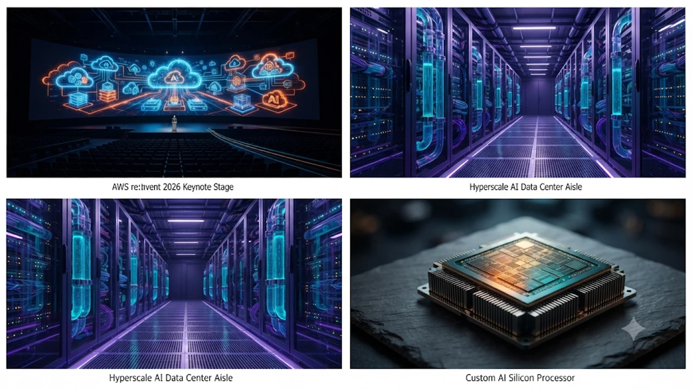

매년 연말 글로벌 클라우드 시장의 향방을 가르는 **AWS 리인벤트 2026** 개막이 코앞으로 다가왔습니다. 이번 행사는 단순한 서버 인프라 확장을 넘어 기업용 생성형 AI와 자율형 에이전트, 그리고 차세대 AI 칩 아키텍처의 실질적인 상용화 기준을 제시하는 분수령이 될 전망입니다.

## AWS 리인벤트 2026 개막 임박, 올해 반드시 주목할 이유

### 전년 대비 달라진 행사 규모와 AI 중심 기조
미국 라스베이거스에서 열리는 AWS 리인벤트는 전 세계 개발자와 IT 의사결정권자가 집결하는 세계 최대 규모의 클라우드 컨퍼런스입니다. 과거에는 서버 가상화나 스토리지, 데이터베이스 등 기초 클라우드 컴퓨팅 서비스의 신규 기능 공개가 주를 이루었다면, 2026년 행사는 발표 세션의 대다수가 **인공지능 인프라 최적화**와 **산업별 AI 실전 적용 사례**에 집중되어 있습니다.

### 클라우드 인프라 시장의 판도를 흔들 핵심 발표 예고
글로벌 빅테크 기업 간의 AI 패권 경쟁이 인프라 효율성 싸움으로 번지면서 AWS의 차기 로드맵에 시장의 이목이 쏠리고 있습니다. 특히 매트 가먼(Matt Garman) CEO를 비롯한 주요 경영진의 기조연설에서는 대규모 언어모델(LLM) 학습 비용을 낮추는 신규 컴퓨팅 옵션과 기업 내부 데이터를 안전하게 연결하는 통합 데이터 플랫폼 전략이 구체화될 예정입니다.

> "클라우드 도입의 성패는 이제 얼마나 많은 자원을 쓰느냐가 아니라, AI 워크로드를 얼마나 경제적이고 안전하게 운영하느냐에 달려 있습니다."

## 차세대 AI 칩과 데이터센터 아키텍처의 진화

### 커스텀 실리콘과 엔비디아 GPU의 하이브리드 전략
AWS는 고성능 연산이 필수적인 영역에서는 최신 엔비디아(NVIDIA) GPU 기반 인스턴스를 적극 도입하는 동시에, 자체 설계한 맞춤형 반도체인 **트레이니움(Trainium)**과 **인퍼런시아(Inferentia)** 생태계를 빠르게 확장하고 있습니다. 고가의 범용 GPU 의존도를 줄이고 자체 칩을 병행 배치함으로써 고객사에게 폭넓은 가격 대비 성능 선택지를 제공하는 것이 핵심입니다. 차세대 파운드리 공정 기술의 발전과 맞물린 반도체 경쟁 흐름은 [TSMC 1.6나노 A16, 진짜 2나노 건너뛸까?](/posts/latest-tech/tsmc-16nm-a16-mass-production-2026/) 글에서도 자세히 확인할 수 있습니다.

### 추론 비용 절감을 위한 신규 인스턴스 도입 효과
AI 서비스가 단순 테스트 단계를 지나 실제 상용 서비스로 전환되면서 기업들이 체감하는 가장 큰 부담은 **모델 추론(Inference) 비용**입니다. 이번 행사에서 공개될 차세대 EC2 인스턴스 라인업은 전력 효율성과 메모리 대역폭을 대폭 개선해, 동일한 예산으로 처리할 수 있는 트래픽 규모를 한층 끌어올리는 데 초점을 맞추고 있습니다.

- **학습용 인프라**: 대규모 파운데이션 모델의 사전 학습 및 미세 조정(Fine-tuning) 속도 극대화
- **추론용 인프라**: 실시간 응답이 필요한 챗봇 및 검색 서비스의 토큰당 처리 단가 절감
- **냉각 및 전력 설계**: 고밀도 AI 서버 랙 운영을 위한 액체 냉각 솔루션 및 데이터센터 전력 효율화

## 엔터프라이즈 AI 에이전트 생태계의 확장

### 기존 생성형 AI 서비스와 자율형 에이전트의 결정적 차이
작년까지 기업들이 도입한 AI가 사용자의 질문에 텍스트나 코드를 답변하는 '보조 도구' 수준이었다면, 올해 화두는 스스로 목표를 설정하고 외부 시스템과 연동해 업무를 완결하는 **자율형 AI 에이전트**입니다. 아마존 베드록(Amazon Bedrock)을 중심으로 사내 ERP, 고객 관리(CRM), 데이터베이스를 직접 호출해 복잡한 워크플로우를 자동화하는 기능이 한층 고도화되고 있습니다.

### 기업 실무 도입 시 예상되는 보안 및 비용 장단점
자율형 에이전트는 반복적인 행정 및 분석 업무 시간을 획기적으로 단축해 주지만, 시스템 접근 권한이 넓어지는 만큼 철저한 통제가 수반되어야 합니다. 에이전트가 민감한 기업 데이터에 무단으로 접근하거나 의도치 않은 API를 반복 호출해 과도한 클라우드 요금이 발생하는 문제를 예방하려면 세밀한 권한 관리 체계가 필수적입니다. AI 환경에서의 최신 보안 아키텍처 설계 기준은 [제로 트러스트 보안, AI 시대 바뀌는 핵심은?](/posts/latest-tech/zero-trust-ai-security-future-2026/)에서 함께 다루고 있습니다.

## 개발자와 IT 담당자를 위한 실전 참관 및 활용 가이드

### 온라인 키노트 실시간 시청 및 핵심 세션 선별법
현지 라스베이거스 행사장에 직접 방문하지 않더라도 공식 웹사이트에서 무료 가상 등록을 마치면 주요 **라이브 키노트**와 기술 세션을 실시간으로 시청할 수 있습니다. 방대한 세션 목록 중 실무에 바로 적용할 주제를 고르려면 아키텍처 레벨(Level 300~400) 태그를 활용해 심화 기술 세션을 우선 필터링하는 것이 효율적입니다.

### 발표 직후 신규 프리티어 및 베타 기능 테스트 절차
기조연설 직후에는 신규 공개된 관리형 서비스와 AI 모델의 프리뷰(Preview) 버전이 AWS 콘솔에 순차적으로 개방됩니다. 개발팀은 프로덕션 환경에 즉시 반영하기보다 별도의 샌드박스 계정을 생성해 **프리티어 할당량** 내에서 API 응답 속도와 기존 인프라와의 호환성을 먼저 검증해야 합니다. 클라우드 개발 및 AI 학습 환경을 쾌적하게 구축하기 위한 고성능 하드웨어 장비는 [클라우드 개발용 노트북 쿠팡에서 보기](https://www.coupang.com/np/search?q=%EA%B0%9C%EB%B0%9C%EC%9E%90%EC%9A%A9+%EA%B3%A0%EC%84%B1%EB%8A%A5+%EB%85%B8%ED%8A%B8%EB%B6%81&sourceType=affiliate&trackingCode=AF8691300)에서 확인할 수 있습니다.

#AWS리인벤트2026 #AWS #클라우드컴퓨팅 #AI인프라 #AI에이전트 #아마존베드록 #AI반도체 #최신기술동향