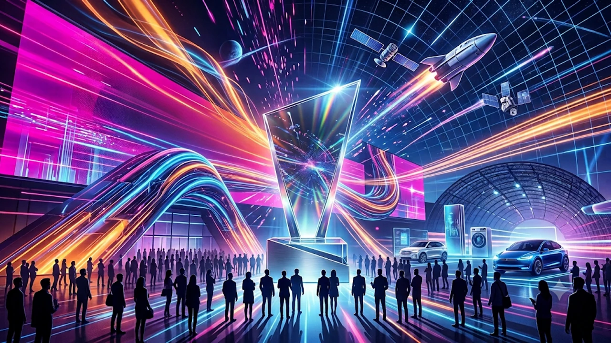

내년 1월 라스베이거스 개막을 앞두고 공개된 **CES 2027 혁신상** 수상작을 뜯어보면, 업계의 무게중심이 완전히 넘어갔음을 실감하게 된다. 더 얇은 화면이나 더 빠른 칩셋을 자랑하던 시절은 끝났다. 이제는 **온디바이스 AI**와 **피지컬 AI**가 우리 집 거실과 일터의 불편을 얼마나 조용하고 정확하게 해결하는지가 승부를 가른다. 발표 직후 IT 업계가 가장 뜨겁게 반응하는 3가지 기술 변화를 짚어본다.

## CES 2027 혁신상 핵심 요약: 올해 달라진 심사 기준과 트렌드

### 2026년 대비 크게 확대된 AI·로보틱스 수상 비중
미국소비자기술협회(CTA)가 발표한 이번 수상 명단에서 인공지능은 더 이상 별도의 독립 카테고리가 아니다. 가전, 모빌리티, 스마트홈, 헬스케어까지 전 부문에 AI가 기본 사양처럼 녹아들었다. 눈에 띄는 변화는 화면 속 챗봇에 머물던 AI가 모터와 센서를 달고 물리적 공간으로 걸어 나온 로보틱스 분야의 약진이다.

### 단순 스펙 경쟁에서 '실생활 문제 해결'로 이동한 평가 기준
예전에는 전시장에서 시선을 끄는 화려한 시제품이 상을 휩쓸었다면, 올해 심사 기준은 철저히 현실적이다. 기술 그 자체보다 **사용자가 매일 겪는 번거로움을 실제로 덜어주는가**가 핵심 잣대가 됐다.
> "벤치마크 점수가 조금 더 높은 제품보다, 배터리 소모를 줄이고 누구나 설명서 없이 바로 쓸 수 있는 기기가 심사위원단의 표를 얻었다."

- **저전력·발열 제어:** AI 연산을 돌리면서도 전기 요금과 발열 부담을 낮춘 하드웨어 설계가 높은 점수를 받았다.
- **생활 밀착형 접근성:** 고령자나 거동이 불편한 사용자가 별도 학습 없이 쓸 수 있는 직관적인 보조 기기들이 대거 선정됐다.

## 가장 주목받는 3대 핵심 기술 분야 심층 분석

### 온디바이스 AI: 클라우드 없이 작동하는 차세대 개인화 기기
인터넷 연결이 끊겨도 기기 자체 칩셋에서 추론을 끝내는 **온디바이스 AI**가 스마트폰을 넘어 생활 가전 전반으로 번졌다. 외부 서버를 거치지 않으니 명령 반응이 즉각적이고, 집 안 영상이나 음성 같은 민감한 데이터가 클라우드로 빠져나갈 걱정도 없다. 사용자의 귀가 시간과 수면 습관을 기기 내부에서만 학습해 온도와 조명을 조절하는 스마트 허브, 통신 음영 지역에서도 실시간 통번역을 처리하는 초경량 웨어러블이 대표적이다.

### 피지컬 AI와 가사·산업용 로보틱스의 상용화 가속
화면을 벗어나 현실 세계의 물건을 직접 집고 옮기는 **피지컬 AI**가 연구실을 나와 상용화 단계에 접어들었다. 바닥만 닦고 돌아다니던 기존 로봇청소기와 달리, 거실에 흩어진 양말이나 장난감을 종류별로 인식해 정리하거나 물류 창고에서 작업자와 호흡을 맞추는 로봇들이 수상 명단에 올랐다. 이런 흐름은 최근 휴머노이드 로봇 기업들의 자본 시장 행보와도 맞닿아 있으며, 관련 산업의 수익성 구조는 [유니트리 상장, 진짜 돈 될까?](/posts/latest-tech/unitree-ipo-humanoid-profitability-2026/) 글에서 더 구체적으로 확인할 수 있다.

### 디지털 헬스케어: 비침습 생체 모니터링과 예방 의료 기술
병원을 찾기 전에 일상에서 이상 징후를 먼저 잡아내는 **디지털 헬스케어**도 한 단계 진화했다. 매일 아침 손끝을 찔러 채혈하는 대신 광학 센서로 혈당 추이와 혈압 변화를 읽어내는 비침습 기기, 수면 중 미세한 호흡 끊김을 감지해 경고하는 초소형 스마트 링과 패치형 센서가 주목받았다. 웨어러블 기기가 다루는 생체 정보가 이처럼 정밀해지면서 기기 자체의 보안 방식도 바뀌고 있는데, 관련 변화는 [웨어러블 생체인식 보안 결국 지문 추월한다](/posts/latest-tech/wearable-biometric-security-future/)에서 다룬 바 있다.

## 글로벌 빅테크 vs 국내 기업 수상 성과 비교

### 삼성·LG 등 국내 대기업의 주력 수상 분야와 전략
글로벌 빅테크들이 초거대 언어모델과 데이터센터 인프라 경쟁에 천문학적인 비용을 쏟는 사이, 삼성전자와 LG전자 등 국내 대기업은 **일상 가전과 디스플레이의 결합**으로 실리 있는 해법을 내놓았다.
- **자동화된 홈 에너지 관리:** 집 안 가전을 하나의 허브로 연결해 전력 피크 시간대에 알아서 소비 전력을 줄이고, 구성원의 동선에 맞춰 공조 시스템을 제어하는 기능이 좋은 평가를 받았다.
- **차량 내 공간의 재해석:** 투명 디스플레이와 AI 인포테인먼트 시스템을 결합해, 주행 중에도 탑승자가 자연스럽게 정보를 소비하고 휴식할 수 있는 모빌리티 솔루션이 돋보였다.

### 글로벌 시장에서 두각을 나타낸 K-스타트업 혁신 기술
국내 스타트업의 행보도 매섭다. 자본력이 막대한 범용 AI 시장에서 정면 승부를 벌이기보다, 특정 현장의 고질적인 불편을 파고드는 틈새 전략이 통했다. 카메라 스캔만으로 피부 상태를 분석하는 뷰티 테크 기기, 소형 기기에 바로 얹을 수 있는 저전력 엣지 AI 반도체 모듈, 시각장애인에게 전방 장애물과 보행 경로를 음성으로 안내하는 웨어러블 등 완성도 높은 제품들이 해외 바이어들의 관심을 모았다.

## CES 2027 본 행사 전 미리 체크해야 할 관전 포인트

### 내년 상반기 실제 출시로 이어질 유력 상용화 제품군
이번 수상작 상당수는 전시용 목업이 아니라 내년 상반기 실제 매장에 풀릴 양산형 모델이다. 차세대 NPU를 품은 AI 노트북, 단순 청소를 넘어 정리 정돈까지 돕는 멀티태스킹 가사 로봇, 월 구독형 건강 리포트와 연동되는 스마트 웨어러블이 소비자가 가장 먼저 만나게 될 제품군이다. 본 행사에서 공개될 실제 출고가와 국내 출시 일정에 따라 시장 반응이 갈릴 전망이다.

### IT 투자자와 업계 종사자가 주목해야 할 핵심 키워드 정리
내년 1월 라스베이거스 현장에서 쏟아질 소식을 허투루 넘기지 않으려면 세 가지 축을 기준으로 살펴보는 편이 유리하다.
- **엣지 컴퓨팅 확산:** 클라우드 서버 유지비를 아끼려는 기업들이 늘면서 기기 자체 연산 수요가 빠르게 커지고 있다.
- **에이전틱 AI의 하드웨어화:** 사용자가 일일이 지시하지 않아도 상황을 판단해 작업을 끝내는 에이전트 기능이 가전과 모바일의 새 기준이 되고 있다.
- **배터리와 열관리 기술:** AI 기능이 상시 작동하는 기기가 많아질수록, 이를 버텨내는 배터리 수명과 방열 설계의 가치가 더 커진다.

온디바이스 AI와 스마트 헬스케어 흐름이 실제 제품에 어떻게 반영되고 있는지 궁금하다면, 현재 국내에 출시된 관련 스마트 기기들의 사양과 실사용자 후기를 먼저 확인해 보는 것도 참고가 된다. [최신 AI 스마트 웨어러블 기기 쿠팡에서 보기](https://www.coupang.com/np/search?q=%EC%8A%A4%EB%A7%88%ED%8A%B8%EA%B8%B0%EA%B8%B0%20AI%EA%B8%B0%EA%B8%B0&sourceType=affiliate&trackingCode=AF8691300)

#CES2027혁신상 #CES2027 #온디바이스AI #피지컬AI #디지털헬스케어 #최신기술동향 #IT트렌드 #로보틱스