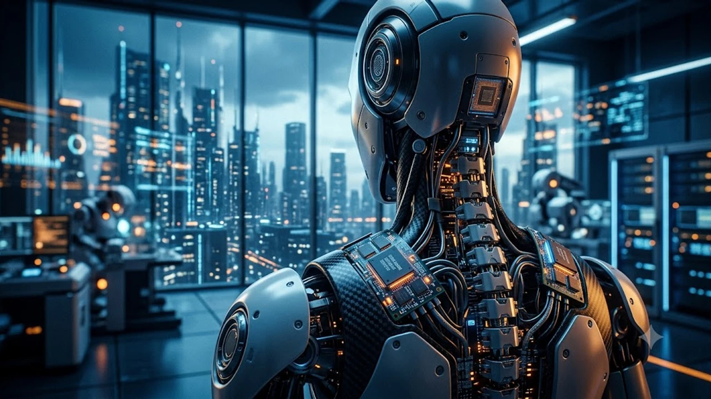

인공지능(AI) 데이터센터를 중심으로 전개되던 메모리 반도체 슈퍼사이클이 피지컬 AI 영역으로 빠르게 확장하면서 **휴머노이드 DRAM** 시장이 새로운 격전지로 떠올랐습니다. 글로벌 시장조사업체 카운터포인트 리서치가 2030년까지 로봇용 메모리 수요가 20배 이상 폭증한다는 분석을 내놓자 글로벌 반도체 공급망과 투자 시장의 시선이 온디바이스 피지컬 컴퓨팅으로 쏠리고 있습니다.

## 카운터포인트 로봇 DRAM 전망과 시장의 실체

### 8,300Tb에서 172,000Tb로 향하는 수직 상승 곡선

카운터포인트 리서치가 공개한 메모리 수요 추정치에 따르면, 전 세계 휴머노이드 로봇 컴퓨팅에 투입되는 연간 DRAM 수요는 2026년 기준 약 8,300테라비트(Tb) 수준입니다. 그러나 생산 공정 라인 도입과 물류 자동화, 상업용 서비스 로봇 도입이 본격화되는 2030년에는 172,000테라비트로 20배 넘게 치솟을 것으로 집계됐습니다.

> "데이터센터 중심의 초대형 AI 가속기 시장이 기초 인프라를 다졌다면, 현실 공간에서 직접 작동하는 피지컬 AI는 에지 디바이스 단위의 실시간 메모리 탑재량을 근본적으로 바꿔놓고 있다." — 카운터포인트 리서치 분석 보고서 중

이 가파른 상승 곡선은 단순한 출하 대수 증가뿐만 아니라 로봇 한 대당 요구되는 온디바이스 메모리 집적도가 기하급수적으로 커지고 있음을 방증합니다.

### 클라우드 서버에서 피지컬 AI 에지 컴퓨팅으로의 축 이동

그동안 거대언어모델(LLM) 구동의 핵심은 초거대 클라우드 서버와 데이터센터였습니다. 하지만 인간 작업자와 같은 공간에서 물리적으로 상호작용하는 휴머노이드는 클라우드 통신 지연시간(Latency)을 허용하지 않습니다.

시각 인식, 모터 관절 제어, 장애물 회피, 실시간 공간 매핑이 기기 본체 내부에서 밀리초(ms) 단위로 완결되어야 하므로 온디바이스 AI 메모리 의존도가 절대적입니다. 와이파이나 5G 통신망이 일시적으로 끊기더라도 로봇 스스로 균형을 잡고 판단을 지속해야 하는 물리적 제약이 고용량 DRAM 탑재를 강제하는 구조입니다.

### 로봇 한 대에 들어가는 온디바이스 메모리 용량 스펙

현재 공장 필드 테스트를 거치고 있는 주요 제조사들의 차세대 휴머노이드 로봇은 일반 플래그십 스마트폰이나 고성능 노트북을 가볍게 뛰어넘는 메모리를 장착합니다.

- **비전 및 센서 융합 처리부:** 라이다, 다중 광학 카메라, 토크 센서의 스트리밍 데이터를 실시간 버퍼링하기 위해 32GB~64GB 용량의 LPDDR5X 메모리 탑재
- **온디바이스 VLM 추론 연산부:** 본체 내부에서 시각-언어 모델(VLM)을 직접 구동하기 위해 64GB 이상의 고대역폭 메모리 모듈 배치
- **기동 제어 시스템:** 모터 액추에이터의 실시간 피드백 루프 처리를 위한 초저지연 캐시 메모리 탑재

결과적으로 휴머노이드 한 대에 최소 128GB에서 최대 256GB 이상의 전용 DRAM이 필수 부품으로 자리 잡고 있습니다.

## 기존 모바일·서버 DRAM과 로봇 전용 DRAM의 결정적 차이

### LPDDR과 HBM의 하이브리드 탑재 구조

로봇은 배터리로 움직이는 이동체이면서 서버급 연산 처리를 동시에 수행해야 하는 하드웨어 한계를 안고 있습니다. 이 때문에 전력 소모를 억제하는 모바일용 저전력 DRAM(LPDDR5X/LPDDR6)과 초고속 데이터 처리를 전담하는 특수 패키징 메모리가 공존하는 하이브리드 아키텍처가 기본 규격으로 굳어졌습니다.

열 설계 전력(TDP) 마진이 극도로 빡빡한 로봇 환경에서는 미세공정 기술력 또한 핵심 변수로 꼽힙니다. 파운드리 미세공정의 진화 흐름은 [TSMC 1.6나노 A16, 진짜 2나노 건너뛸까?](/posts/latest-tech/tsmc-16nm-a16-mass-production-2026/) 분석에서 구체적으로 다루고 있습니다.

### 물리 제어용 초저지연과 극한 환경 내구성 기준

로봇 내부 구동 모터와 감속기 주변은 끊임없는 물리적 진동과 순간적인 고열에 노출됩니다. 일반 소비자용 IT 기기에 들어가는 메모리 패키징 규격으로는 거친 산업 현장을 견뎌내기 어렵습니다.

- **차량용(AEC-Q100)을 웃도는 신뢰성:** 영하 40도에서 영상 105도를 오르내리는 가혹한 작동 온도 보증
- **진동 및 충격 내성:** 보행 충격과 관절 부하 속에서도 접점 불량을 막는 언더필(Underfill) 보강 패키징
- **기능 안전 인증:** 단 한 번의 비트 반전 오류가 작업자와의 물리적 충돌 사고로 번지지 않도록 하드웨어 레벨의 인라인 ECC(Error Correcting Code) 필수 적용

### 범용 메모리 대비 높은 평균판매단가(ASP) 형성

이러한 고신뢰성 검증과 특수 패키징 구조는 메모리 제조사에 높은 가격 프리미엄을 보장합니다. 규격화된 범용 PC·모바일 DRAM에 비해 로봇 전용 메모리 모듈의 평균판매단가(ASP)는 30%~50% 이상 비싸게 책정됩니다. 메모리 다운사이클 국면에서도 견고한 마진율을 지탱할 수 있는 고부가가치 먹거리로 평가받는 이유입니다.

## 삼성전자 vs SK하이닉스: 로봇 메모리 주도권 격돌

### 온디바이스 패키징과 파운드리 턴키를 앞세운 삼성전자

삼성전자는 메모리와 파운드리, 첨단 패키징을 하나로 묶어 처리하는 턴키(Turnkey) 역량을 전면에 내세웠습니다.

- LPDDR 메모리를 모바일 AP나 로봇용 NPU 다이(Die) 위에 직접 수직 적층하는 3D 패키징 솔루션 적용
- 로봇 전용 컨트롤러 칩과 고용량 DRAM을 초소형 공간에 집약하는 SiP(System in Package) 기술 제공
- 반도체 생산라인 및 가전 제조 공장을 통해 자체 개발 로봇에 메모리를 선제 검증하며 신뢰성 레퍼런스 축적

단순 단품 칩 납품을 넘어 완제품 설계 단계부터 맞춤형 메모리 서브시스템을 패키지로 공급하는 전략에 집중하고 있습니다.

### HBM 성공 공식을 로봇 보드로 확장하는 SK하이닉스

SK하이닉스는 AI 데이터센터를 장악한 HBM 기술 노하우를 물리 로봇용 메인보드 영역으로 이식하는 데 집중하고 있습니다.

- 고성능 NPU와 초고속 통신을 지원하는 특화 인터페이스 기반 커스텀 DRAM 라인업 구축
- 산업용 고온 환경에서도 안정적인 열 방출을 유지하는 어드밴스드 MR-MUF 패키징 공정 확장 적용
- 글로벌 자율주행 및 로보틱스 플랫폼 선도 기업들과의 폐쇄적 공급망 파트너십 선점

최고 사양을 요구하는 하이엔드 휴머노이드 두뇌 시장을 초기부터 선점하겠다는 구상입니다.

### 글로벌 완성품 제조사 진입을 둘러싼 납품 시나리오

테슬라 옵티머스를 비롯해 보스턴 다이내믹스, 그리고 가격 공세를 앞세운 중국계 제조사들이 차세대 양산 라인 발주를 준비하고 있습니다. 중국 로봇 진영의 제조 단가와 상장 행보에 대한 시장 평가는 [유니트리 상장, 진짜 돈 될까?](/posts/latest-tech/unitree-ipo-humanoid-profitability-2026/) 글에서 자세히 짚어볼 수 있습니다.

완성형 로봇 제조사들은 특정 공급사에 휘둘리지 않기 위해 삼성전자와 SK하이닉스를 상대로 이원화 공급망을 타진하고 있습니다. 고대역폭 연산 모듈은 하이닉스가, 저전력 제어 통합 모듈은 삼성전자가 나눠 갖는 분할 수주 구도가 유력하게 점쳐집니다.

## 투자자가 확인해야 할 3대 체크포인트와 숨은 리스크

### 양산 스케줄 지연에 따른 수요 절벽 가능성

2030년 20배 폭증이라는 수치는 로봇 하드웨어의 대당 양산 단가가 2만~3만 달러 선에 안착한다는 가정을 바탕에 둡니다. 관절 액추에이터의 수율 부진이나 현장 안전 규제 문제로 공장 배치 일정이 1~2년 지연된다면, 메모리 제조사들이 선제 증설한 전용 라인은 일시적인 가동률 저하와 고정비 부담으로 돌아올 수 있습니다.

### 시스템 원가 대비 메모리 채택 비율의 경제성 한계

로봇 한 대당 메모리 탑재량이 무한정 늘어나기는 어렵습니다. 완성차 및 로봇 제조업체들은 대당 제조원가(BOM)를 낮추기 위해 혹독한 부품 단가 인하를 요구합니다.

소프트웨어 최적화나 소형 언어 모델(SLM) 기술이 빠르게 발전해 64GB 이하의 메모리로도 동등한 제어 성능을 뽑아낸다면, 카운터포인트가 예측한 대당 탑재량 증가세가 둔화될 가능성을 염두에 두어야 합니다.

### 실적 가시화 여부를 가를 핵심 지표

반도체 기업의 주가 모멘텀이 단순한 기대감을 넘어 실적으로 연결되는지 확인하려면 구체적인 분기 지표를 추적해야 합니다.

- 대형 로봇 제조사향 커스텀 DRAM 퀄(Quality) 테스트 완료 및 정식 제품 코드 등록 여부
- 분기별 실적 발표에서 집계되는 차량용·산업용(Automotive/Industrial) 메모리 매출 비중의 성장률
- 턴키 패키징 수주를 통한 비메모리-메모리 복합 제품 출하량 증가 추이

장밋빛 전망 뒤에 숨은 실질 수주 공시를 냉정하게 교차 검증하는 안목이 필요한 시점입니다.

[로봇 제어용 고성능 AI 개발 보드 쿠팡에서 보기](https://www.coupang.com/np/search?q=%EB%A1%9C%EB%B4%87%20AI%20%EA%B0%9C%EB%B0%9C%20%EB%B3%B4%EB%93%9C&sourceType=affiliate&trackingCode=AF8691300)

#휴머노이드DRAM #피지컬AI #카운터포인트리서치 #삼성전자반도체 #SK하이닉스 #온디바이스AI #로봇반도체