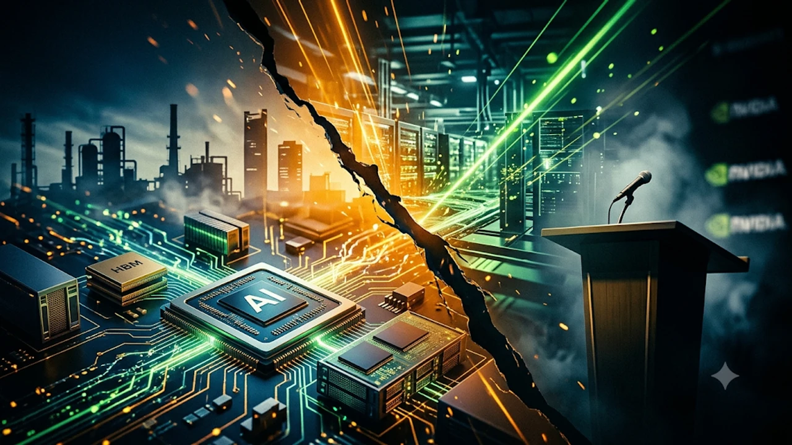

**젠슨 황 사임 엔비디아** 체제 전환이 전 세계 인공지능(AI) 반도체 시장에 거대한 충격을 안겼다. 2026년 11월 12일 젠슨 황 엔비디아 최고경영자(CEO)의 전격 사임 발표 이후, 국내 주요 대기업들이 맺어온 **GPU 공급 계약**과 피지컬 AI 협력 로드맵에도 불확실성이 커지고 있다. 임시 CEO로 선임된 콜레트 크레스 최고재무책임자(CFO)의 경영 기조 아래 한국 AI 동맹이 맞이할 실질적인 변화를 짚어본다.

## 젠슨 황 사임 충격, 엔비디아 AI 생태계 지각변동

창업자이자 30년 넘게 회사를 이끌어온 수장의 퇴진은 단순한 경영진 교체를 넘어 엔비디아의 사업 우선순위 재편을 예고한다.

### 임시 CEO 콜레트 크레스 체제의 핵심 방향

콜레트 크레스 임시 CEO는 재무 전문가 출신답게 공격적인 신사업 확장보다 **수익성 방어와 공급망 리스크 통제**에 무게를 둘 공산이 크다.

- 글로벌 수출 규제 및 메가스피드(Megaspeed) 우회 반출 스캔들 여파 수습
- 대형 클라우드 서비스 제공업체(CSP) 중심의 안정적 매출원 수성
- 국가별 AI 인프라 투자 대비 실질 투자수익률(ROI) 원점 재검토

> "창업자의 비전으로 밀어붙이던 대형 프로젝트는 리더십 전환기를 맞아 냉정한 재무 검증과 규제 준수 심사대에 오른다."

### 기존 GPU 26만 장 공급 계약과 베라 루빈 로드맵 점검

한국 정부 및 민간 기업들과 논의되던 대규모 **GPU 26만 장 공급 구상**과 차세대 아키텍처 '베라 루빈(Vera Rubin)' 도입 일정도 세밀한 점검 대상에 올랐다. 이미 체결된 본계약 물량은 유지되겠지만, 추가 물량 배정 협상에서는 젠슨 황 특유의 톱다운(Top-down)식 파격 결단을 기대하기 어려워졌다.

## 한국 주요 기업별 AI 인프라 및 협력 사업 영향 분석

국내 핵심 파트너사들은 반도체를 공급하는 위치와 AI 가속기를 사들이는 고객사의 위치에 동시에 놓여 있어 기업별 온도 차가 뚜렷하다.

### 삼성전자·SK하이닉스: 반도체 설계 및 공정 시뮬레이션 협력

메모리 반도체 부문에서는 고대역폭메모리(HBM) 공급망의 핵심 축인 **SK하이닉스와 삼성전자의 협상력이 오히려 부각**될 여지가 있다.

- 엔비디아의 차세대 가속기 양산을 위해 HBM4 수율과 안정적 물량 확보가 필수적이기 때문
- 다만 양사가 추진 중인 **AI 팩토리 및 디지털 트윈 기반 공정 시뮬레이션** 구축 속도는 엔비디아 전담 기술 지원 인력의 재배치 여부에 영향을 받을 수 있음
- 파운드리 공급망 전략과 관련해서는 [TSMC 1.6나노 A16, 진짜 2나노 건너뛸까?](/posts/latest-tech/tsmc-16nm-a16-mass-production-2026/) 분석에서 다룬 초미세 공정 경쟁 구도 역시 함께 주시해야 함

### 현대차·LG전자·네이버클라우드: 피지컬 AI와 데이터센터 변수

자율주행과 로보틱스, 소버린 AI를 추진하는 기업들은 한층 보수적인 시나리오를 대비해야 한다.

- **현대차·LG전자:** 옴니버스(Omniverse) 기반 로봇 학습과 피지컬 AI 전환 프로젝트에서 엔비디아의 장기 로드맵 일관성 재확인 필요
- **네이버클라우드:** 소버린 AI 데이터센터 확장을 위한 차세대 GPU 확보 단가와 인도 시점이 재무 중심 경영진 아래에서 깐깐하게 책정될 가능성 존재

## 엔비디아 AI 데이 서울 2026에서 드러난 기술 전환점

사임 발표 직전까지 한국 시장에서 강조된 핵심 화두는 소프트웨어와 하드웨어가 결합된 현장 적용형 AI였다.

### 피지컬 AI와 에이전틱 AI의 산업 현장 도입 전략

엔비디아는 단순 거대언어모델(LLM) 학습을 넘어 **스스로 판단하고 실행하는 에이전틱 AI(Agentic AI)**와 물리적 공간을 이해하는 **피지컬 AI**를 차세대 성장 동력으로 제시했다. 제조업 비중이 높은 한국 산업 구조상 스마트 팩토리와 물류 자동화 영역에서 가장 빠른 현장 적용이 기대되는 분야다.

### 매디슨 황 방한 취소 배경과 후속 리더십 리스크

젠슨 황의 장녀이자 엔비디아 핵심 제품 마케팅을 총괄해온 **매디슨 황의 방한 일정 취소**는 사내 권력 구조와 대외 소통 창구의 급격한 변화를 상징한다. 한국 파트너사들과 직접 교감하던 핵심 채널이 닫히면서 실무 협의 라인을 전면 재정비해야 하는 과제가 남았다.

## 향후 국내 AI 업계의 대응 전략과 체크포인트

특정 빅테크 리더 개인의 네트워크에 의존하던 협력 방식에서 벗어나 구조적인 인프라 자생력을 갖춰야 할 시점이다.

### 차세대 GPU 물량 배정 우선순위 변화 가능성

국내 기업들은 엔비디아 차기 CEO 선임 과정을 면밀히 추적하며 **기존 약정 물량의 납기 준수 여부**를 계약서 단위로 재점검해야 한다. 미국 상무부의 수출 통제 강화 기조 속에서 글로벌 물량 배정 기준이 더욱 까다로워질 수 있기 때문이다.

### 자체 AI 칩 및 멀티 벤더 인프라 다변화 시나리오

엔비디아 독점 의존도를 낮추기 위한 인프라 다변화 전략이 한층 탄력을 받을 전망이다.

- 추론(Inference) 영역에 국산 신경망처리장치(NPU) 및 맞춤형 주문형 반도체(ASIC) 도입 확대
- AMD 인스팅트 시리즈 등 대체 가속기와의 소프트웨어 호환성 검증 가속화
- 온프레미스 서버와 클라우드 자원을 혼합한 하이브리드 AI 아키텍처 구축

[AI 서버 및 워크스테이션 부품 쿠팡에서 보기](https://www.coupang.com/np/search?q=%EC%9B%8C%ED%81%AC%EC%8A%A4%ED%85%8C%EC%9D%B4%EC%85%98%20%EA%B7%B8%EB%9E%98%ED%94%BD%EC%B9%B4%EB%93%9C&sourceType=affiliate&trackingCode=AF8691300)

#젠슨황사임 #엔비디아 #한국AI동맹 #GPU공급망 #피지컬AI #콜레트크레스 #AI반도체 #에이전틱AI