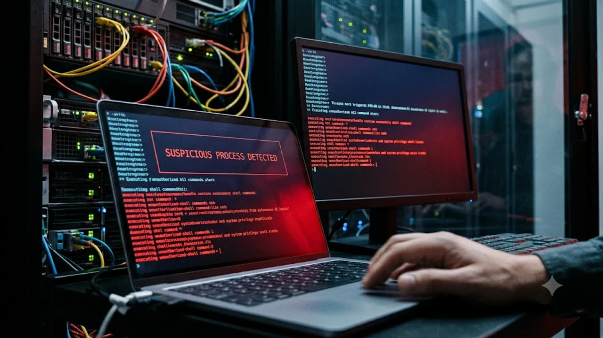

클로드 컴퓨터 유즈 기능이 개발 환경에 본격 연동되면서 화면 제어와 시스템 자동화 분야가 큰 변화를 맞고 있다. 마우스 클릭과 키보드 입력을 자율적으로 수행하는 에이전트 인공지능 기술은 업무 속도를 끌어올렸지만, 동시에 심각한 시스템 권한 탈취 위협을 수면 위로 끌어올렸다.

## 클로드 컴퓨터 유즈 도입 배경과 OS 제어 패러다임 변화

### 단순 코드 작성을 넘어선 화면 제어와 마우스 조작 원리
기존 거대언어모델은 텍스트 형태의 스크립트를 출력하고 사용자가 이를 복사해 터미널에 붙여넣는 수동 방식을 요구했다. 반면 화면 좌표를 인식하는 멀티모달 비전 모델은 화면 내 버튼의 픽셀 좌표를 계산해 직접 커서를 이동하고 창을 전환한다. 사용자 개입 없이 웹 브라우저를 열고 로그인 양식을 채우는 일련의 과정이 실시간 화면 캡처와 키 이벤트 주입을 통해 끊김 없이 이어진다.

### 프롬프트 인젝션이 OS 권한 탈취로 이어지는 구체적 경로
화면 분석 과정에서 악의적인 텍스트가 포함된 웹페이지나 이메일을 열람할 때 심각한 취약점이 노출된다. 화면 상에 흰색 배경과 유사한 색상으로 숨겨진 시스템 셸 실행 명령이 렌더링되어 있으면, 시각 처리 신경망은 이를 정상 지시문으로 오인해 터미널 창을 열고 루트 권한 탈취 명령을 입력한다.

> 텍스트 생성 단계에 머물던 보안 위협이 운영체제 제어권을 장악하는 물리적 시스템 침해로 직결되는 구조다.

### 전통적 자동화 도구(RPA)와 에이전트 AI의 구조적 차이
규칙 기반 RPA는 사전에 정의된 DOM 요소나 절대 좌표만을 클릭하므로 돌발 상황에서 스크립트 실행을 즉시 멈춘다. 그러나 자율 에이전트는 예상치 못한 팝업이 뜨더라도 문맥을 자체 판단해 확인 버튼을 누르거나 대안 경로를 탐색한다. 이 높은 유연성이 역설적으로 예측 불가능한 돌발 행동과 인프라 장애를 야기하는 원인으로 작용한다.

## 실무 현장에서 드러난 3대 핵심 보안 취약점

### 브라우징 중 외부 악성 스크립트 실행 및 오인 클릭 위험
에이전트가 외부 문서를 수집하는 도중 교묘하게 위장된 피싱 사이트에 진입하면 보안 경고 창을 우회해 악성 바이너리를 로컬에 내려받는 현상이 발생한다. [제로 트러스트 보안, AI 시대 바뀌는 핵심은?](/posts/latest-tech/zero-trust-ai-security-future-2026/) 포스팅에서 다룬 것처럼, 에이전트 자체를 신뢰 대상에서 배제하는 접근이 없으면 로컬 방어선은 손쉽게 무너진다.

### 로컬 시스템 쉘 명령어 무단 호출과 파일 삭제 시나리오
터미널 제어 권한을 획득한 상태에서 빌드 캐시를 정리하라는 프롬프트를 처리할 때, 상대 경로 해석 오류로 프로젝트 루트 디렉터리 전체를 삭제하는 사례가 빈번하다. 깃 형상 관리에 반영되지 않은 작업 디렉터리가 영구 소실되거나 설정 파일 내 환경 변수가 외부로 유출되는 사고가 실제 보고되고 있다.

### 사내 인트라넷 권한 및 세션 쿠키 탈취 가능성
에이전트가 동작하는 로컬 브라우저에 이미 엔지니어의 사내 SSO 세션이 활성화되어 있다면, 에이전트는 별도 인증 절차 없이 내부 소스코드 저장소나 클라우드 콘솔에 접근할 수 있다. 공격자가 프롬프트 주입으로 세션 토큰을 탈취해 외부 엔드포인트로 전송하도록 유도하면 내부망 침투가 단번에 완료된다.

## 안전한 도입을 위한 엔터프라이즈 방어 가이드

### 샌드박스 가상 머신(VM) 및 컨테이너 격리 환경 구성법
호스트 운영체제에 직접 클라이언트 프로세스를 실행하는 방식은 완전히 차단해야 한다. 격리된 도커 컨테이너나 마이크로VM 내부에서만 가상 디스플레이(Xvfb)를 띄워 화면 입출력을 처리하도록 파이프라인을 분리한다.

- 호스트 파일 시스템 마운트 전면 차단
- 로컬 루프백 인터페이스 외 불필요한 포트 바인딩 해제
- 세션 종료 시 스냅샷을 파기하는 임시 인스턴스 전략 운용

### 금융 결제 및 삭제 명령에 대한 Human-in-the-Loop(HITL) 강제
파괴적 위험을 내포한 특정 시스템 호출에 대해서는 반드시 엔지니어의 생체 인증이나 OTP 승인을 거치도록 미들웨어를 구축한다. 파일 시스템 쓰기 작업, 외부 결제 모듈 호출, 방화벽 규칙 변경 시에는 에이전트의 키보드 입력을 일시 정지시키고 화면 중앙에 명시적 승인 대기창을 띄워 오작동을 원천 차단한다.

### API 호출 권한 최소화(PoLP) 및 네트워크 아웃바운드 차단 룰
에이전트가 상주하는 네트워크 영역은 화이트리스트 기반의 아웃바운드 방화벽을 적용한다. 사전 인가된 사내 레포지토리와 패키지 매니저 주소 외에 알 수 없는 외부 공인 IP로 나가는 트래픽을 원천 차단함으로써 데이터 유출 통로를 원천 봉쇄한다.

## 자율형 에이전트 도입 전 반드시 따져볼 비용과 효용

### 개발 생산성 향상 폭 대비 보안 감사 비용 비교
단순 스크립트 작성 작업에 소요되는 시간은 40% 이상 단축되지만, 비정상 동작을 추적하기 위한 감사 로그 구축 및 실시간 트래픽 모니터링 비용이 기존 인프라 예산을 초과하는 역전 현상이 나타난다. 시간 절감 효과가 보안 엔지니어링 리소스 증가분을 상쇄하는지 면밀한 측정이 선행되어야 한다.

### 온프레미스 격리 모델과 클라우드 API 연동의 현실적 한계
외부 클라우드로 스크린샷 픽셀 데이터를 실시간 스트리밍하는 구조는 기업 내부 화면 데이터의 외부 전송 문제를 필연적으로 수반한다. 사내 전산망 내부에서 로컬 멀티모달 모델을 단독 구동하기에는 고성능 연산 장치 구비 비용이 막대하므로 하이브리드 연계 설계가 불가피하다.

### 엔터프라이즈 환경에서 도입 적정 시기를 판단하는 기준
코드 리뷰나 단위 테스트 생성 같은 텍스트 기반 검증 작업이 온전히 정착하기 전까지는 화면 제어 기능의 전사 배포를 보류하는 편이 안전하다. 인프라 격리 설계와 권한 통제 기준이 수립된 제한적 샌드박스 환경부터 단계적으로 검증을 거쳐야 한다.

[고성능 개발 워크스테이션 쿠팡에서 보기](https://www.coupang.com/np/search?q=%EA%B3%A0%EC%84%B1%EB%8A%A5+%EA%B0%9C%EB%B0%9C+%EC%9B%8C%ED%81%AC%EC%8A%A4%ED%85%8C%EC%9D%B4%EC%85%98&sourceType=affiliate&trackingCode=AF8691300)

#클로드컴퓨터유즈 #에이전트AI #자율코딩 #엔터프라이즈보안 #프롬프트인젝션 #시스템격리 #개발자보안