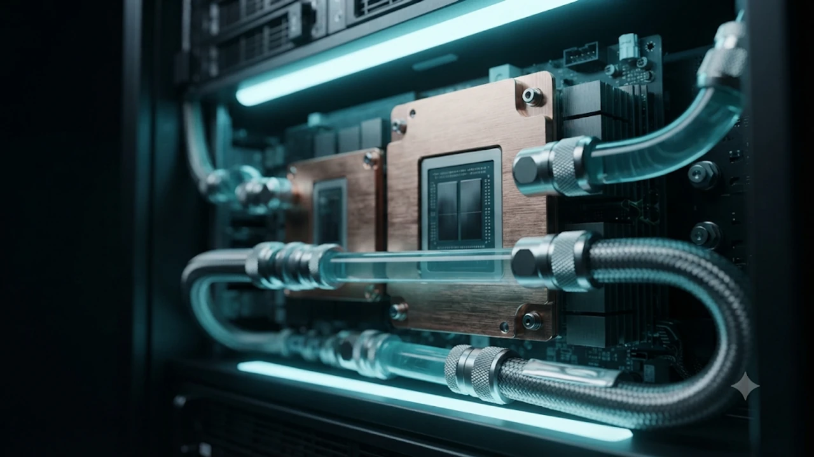
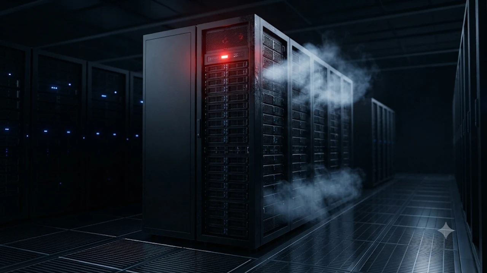

차세대 AI 데이터센터의 핵심 연산 엔진으로 주목받던 **엔비디아 블랙웰 울트라**가 서버 랙 통합 단계에서 예상치 못한 **고밀도 발열 및 액체 냉각 설계 결함 논란**에 휩싸였습니다. 2026년 11월 글로벌 하드웨어 업계와 주요 클라우드 공급사(CSP) 사이에서 GB300 기반 시스템의 열관리 한계가 수면 위로 떠오르며, AI 인프라 구축 일정 전반에 긴장감이 감돌고 있습니다.

## 엔비디아 블랙웰 울트라 발열 논란의 핵심 배경

### 2026년 11월 데이터센터 납품 지연 및 설계 재검토 보도 요약
2026년 11월 중순, 북미 IT 전문 매체와 대만 서버 ODM 공급망을 통해 엔비디아의 차세대 AI 가속기 플랫폼인 **블랙웰 울트라(GB300) 서버 랙이 고부하 테스트 과정에서 과열 현상을 보였다는 소식**이 전해졌습니다. 초기 Blackwell(GB200) 아키텍처 도입 당시에도 72개 GPU를 단일 랙에 집적하는 NVL72 구성에서 열적 병목이 보고된 바 있으나, 클럭 속도와 HBM3E 메모리 용량을 끌어올린 울트라 모델에서 **냉각 계통 재설계(Re-design) 요구**가 다시 불거졌습니다. 이에 따라 일부 하이퍼스케일러의 데이터센터 인도 일정이 수주에서 최대 한 분기 가량 밀릴 가능성이 거론됩니다.

### 기존 GB200 대비 전력 밀도 급증과 열설계전력(TDP) 변화
블랙웰 울트라는 대규모 추론(Inference) 모델의 연산 처리량을 극대화하기 위해 단일 칩당 **열설계전력(TDP)을 이전 세대보다 대폭 높였습니다**. 랙당 소비 전력이 120kW~140kW 수준을 넘나들면서, 단위 면적당 발생하는 열밀도가 기존 데이터센터의 표준 공조 설계치를 크게 웃돌기 시작했습니다.

> "반도체 미세공정 집적도가 물리적 한계에 다다르면서, 이제 AI 칩 성능 경쟁의 본질은 연산 속도가 아닌 '단위 랙당 열 배출 능력'으로 완전히 넘어갔다."

## 발열 및 랙 과열 문제가 발생한 진짜 원인 3가지

### 초고밀도 NVLink 5.0 패키징에 따른 국부 열점(Hotspot) 현상
패키징 구조의 극단적인 고밀도화가 첫 번째 걸림돌입니다. 블랙웰 울트라는 두 개의 대형 다이(Die)를 초고속 인터커넥트로 묶고 그 주변에 고용량 HBM3E 적층 메모리를 빈틈없이 배치했습니다. 이 과정에서 연산 코어와 메모리 컨트롤러 경계면에 열이 갇히는 **국부 열점(Hotspot) 현상**이 심화되었습니다. 랙 전체 평균 온도가 정상 범위에 머물러도 특정 소자의 온도가 임계치를 넘기면, 시스템 보호를 위해 **서멀 스로틀링(Thermal Throttling)**이 작동해 연산 속도가 급격히 떨어집니다.

### 기존 공랭·수냉 하이브리드 냉각 모듈의 열전달 한계
서버 랙 내부에 적용된 **직접 칩 냉각(Direct-to-Chip, D2C) 콜드플레이트와 보조 공랭식 구조의 불균형**도 문제로 꼽힙니다. GPU와 CPU는 수냉식 냉각판이 열을 흡수하지만, 고밀도로 실장된 전원부(VRM), 광트랜시버, 스위치 칩에서 뿜어져 나오는 복사열까지는 기존 하이브리드 공조 방식으로 감당하기 벅찬 수준에 이르렀습니다. 좁은 랙 내부에 얽힌 배관 연결 부위의 유량 저항과 미세 누수 방지 설계가 고밀도 실장 구조와 충돌하며 냉각 효율을 깎아먹은 셈입니다.

### AI 추론 워크로드 폭증 시 발생하는 순간 전력 피크 문제
AI 서비스의 무게중심이 학습에서 추론으로 이동한 점도 열관리를 까다롭게 만들었습니다. 과거 모델 학습(Training) 위주 환경에서는 전력 소모가 비교적 일정한 파형을 유지했으나, 2026년 들어 실시간 추론형 에이전트 서비스가 대중화되면서 **밀리초(ms) 단위로 전력이 급등락하는 스파이크(Power Spike) 현상**이 잦아졌습니다. 갑작스러운 전력 피크는 냉각수 순환 펌프와 냉각수 분배 장치(CDU)의 제어 반응 속도를 앞질러 순간적인 온도 급상승을 일으킵니다.

## 주요 빅테크 및 서버 제조사의 대응과 대안 기술

### 마이크로소프트·메타 등 하이퍼스케일러의 인프라 전략 수정
최대 고객사인 마이크로소프트, 메타, 구글 등은 신규 데이터센터 구축 사양을 전면 손보고 있습니다. 델 테크놀로지스, 슈퍼마이크로, 퀀타(Quanta) 등 주요 서버 ODM 파트너사들과 협력해 **랙당 GPU 배치 밀도를 일부 분산하거나, 신규 수냉 배관 규격을 적용한 맞춤형 랙 설계**를 병행 추진 중입니다. 이러한 인프라 전력·열관리 안정화는 [제로 트러스트 보안, AI 시대 바뀌는 핵심은?](/posts/latest-tech/zero-trust-ai-security-future-2026/)에서 다룬 대규모 클라우드 환경의 무중단 가용성 확보와도 맞물려 있습니다.

### 액침 냉각(Immersion Cooling) 및 차세대 CDU 도입 가속화
기존 공랭·수냉 하이브리드 방식의 한계가 드러나면서, 서버 전체를 비전도성 특수 냉각유에 담그는 **액침 냉각(Immersion Cooling) 도입 논의가 급물살**을 타고 있습니다. 또한 버티브(Vertiv), 슈나이더 일렉트릭 등 전력·열관리 전문 기업들이 선보인 고압·대용량 차세대 CDU(Coolant Distribution Unit) 채택이 필수 사양으로 자리 잡았습니다.

- **단상(Single-phase) 액침 냉각**: 유지보수 편의성이 높고 기존 데이터센터 개조에 유리함
- **이상(Two-phase) 액침 냉각**: 냉매의 기화열을 활용해 150kW 이상의 극한 열밀도를 효과적으로 제어함
- **후면 도어 열교환기(RDHx)**: 랙 후면에서 배출되는 잔열을 즉각 액체로 흡수해 공조 부하를 차단함

### 경쟁사(AMD MI355X·자체 ASIC) 반사이익 가능성 분석
엔비디아의 랙 통합 일정이 주춤하는 틈을 타, **AMD의 인스팅트(Instinct) MI355X 시리즈와 빅테크의 자체 맞춤형 반도체(ASIC)가 대체재로 부상**하고 있습니다. 구글 TPU, AWS 트레이니움(Trainium) 등 특정 워크로드에 맞춘 자체 칩은 범용 GPU 대비 전력 효율(전성비)이 뛰어나 열관리 부담이 상대적으로 적다는 강점을 앞세워 데이터센터 점유율 확대를 노립니다.

## 향후 AI 반도체 시장 전망과 투자자·실무자 체크포인트

### 차세대 루빈(Rubin) 아키텍처 로드맵에 미치는 영향
이번 블랙웰 울트라 발열 이슈는 차기 아키텍처인 **루빈(Rubin)의 패키징 및 공정 전략에도 직접적인 영향**을 미칠 전망입니다. TSMC의 차세대 미세공정과 후면 전력 공급 기술(BSPDN)을 결합해 전력 손실과 발열을 원천적으로 줄이는 설계가 더욱 강조되고 있으며, 이는 [TSMC 1.6나노 A16, 진짜 2나노 건너뛸까?](/posts/latest-tech/tsmc-16nm-a16-mass-production-2026/)에서 분석한 파운드리 초미세 공정 경쟁의 핵심 승부처이기도 합니다.

### 2026년 연말~2027년 상반기 데이터센터 인프라 투자 핵심 지표
향후 AI 하드웨어 시장의 옥석을 가리기 위해서는 단순 연산 성능(FLOPS) 수치를 넘어 실제 인프라 운영 효율성을 따져봐야 합니다.

- **전력효율지수(PUE)**: 데이터센터 전체 전력 중 순수 IT 장비가 쓰는 전력 비율이 1.15 이하로 유지되는지 확인
- **액체 냉각 밸류체인 수주 잔고**: CDU, 퀵 디스커넥트(커플링), 냉각판 공급사의 실제 매출 반영 시점 추적
- **서버 ODM 출하량 가이던스**: 2026년 4분기 및 2027년 1분기 AI 서버 랙 출하량 전망치 변동 여부

고성능 연산 칩의 발열 제어는 초대형 데이터센터뿐만 아니라 개인용 워크스테이션과 고사양 PC 환경에서도 시스템 수명과 성능을 좌우하는 핵심 요소입니다. [고성능 PC 수냉 쿨러 및 서버 쿨링 솔루션 쿠팡에서 보기](https://www.coupang.com/np/search?q=%EA%B3%A0%EC%84%B1%EB%8A%A5%20PC%20%EC%88%98%EB%83%89%20%EC%BF%A8%EB%9F%AC&sourceType=affiliate&trackingCode=AF8691300)

#엔비디아 #블랙웰울트라 #GB300 #AI반도체 #데이터센터 #액침냉각 #액체냉각 #서버발열 #반도체동향 #최신기술동향