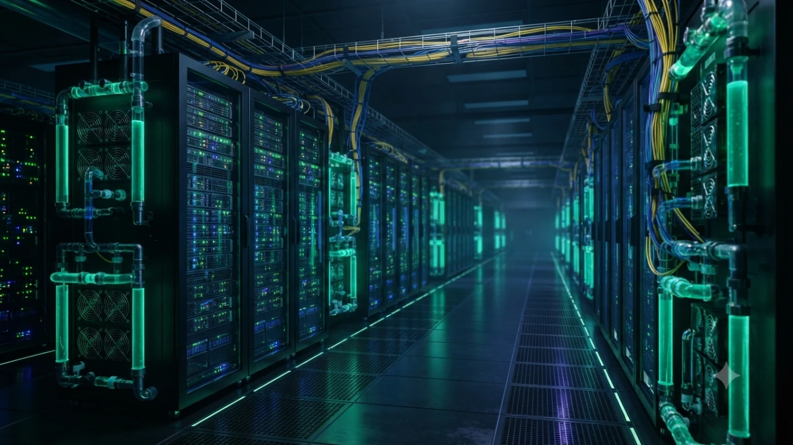
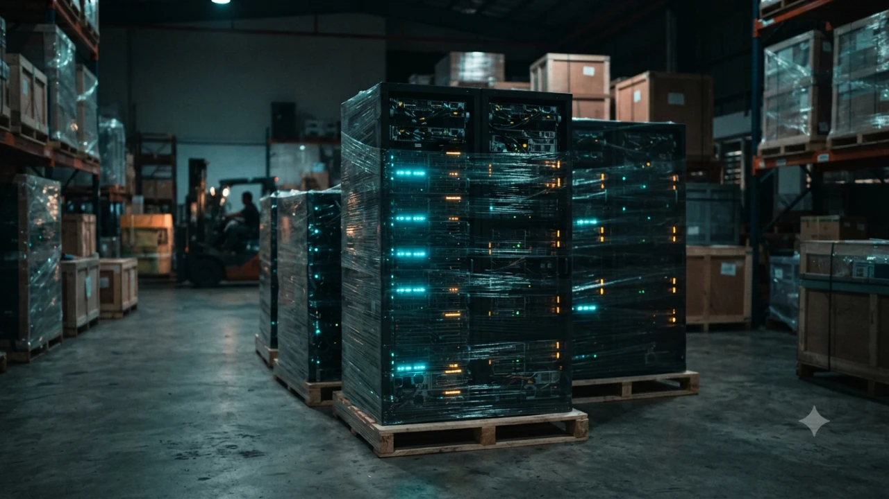

**엔비디아 동남아 서버** 출하가 2026년 11월 말 전격 보류되면서 글로벌 AI 인프라 시장이 긴장감에 휩싸였다. 말레이시아와 싱가포르 등 동남아 주요 거점을 향하던 고성능 AI 서버 물량이 일시 멈추자, 미국 수출 규제 강화와 원격 AI 연산 통제가 어디까지 번질지 업계의 시선이 쏠리고 있다.

## 엔비디아 동남아 서버 출하 중단 이슈의 핵심 배경

### 말레이시아·싱가포르 등 4개국 출하 일시 중단 경위

2026년 11월 말 업계 보도를 통해 엔비디아 AI 가속기가 탑재된 고성능 서버의 동남아 4개국(말레이시아·싱가포르·태국·베트남) 출하가 일시 중단된 사실이 드러났다. 서버 제조 파트너사와 물류 라인에 출하 보류 지침이 내려지면서, 현지 클라우드·데이터센터 프로젝트로 향하던 장비 선적이 한꺼번에 멈춰 섰다.

- **핵심 대상 품목:** 고대역폭메모리(HBM)와 최신 AI 가속기가 결합된 엔터프라이즈용 AI 서버 시스템이다.
- **즉각적 현장 반응:** 동남아 지역에 신규 랙을 증설하려던 클라우드 사업자와 코로케이션 업체들은 통관·선적 일정 재확인에 들어갔다.

### 미국 수출 규제와 원격 AI 컴퓨팅 우회 경로 단속

이번 조치의 배경에는 미국의 대중국 반도체 수출 통제 사각지대를 틀어막으려는 압박이 자리한다. 규제 대상 국가 기업들이 직접 칩을 들여오는 대신, 동남아 데이터센터에 구축된 GPU 클러스터를 원격 접속 방식으로 임대해 대규모 모델을 학습시키는 우회 경로가 집중 점검 대상에 오른 것이다.

> "물리적 칩 반입만 막아서는 기술 통제 효과가 떨어진다는 판단이 작동하면서, 제3국 데이터센터의 최종 사용자 검증과 원격 컴퓨팅 접근권까지 규제 그물망이 넓어졌다."

### 글로벌 서버 제조 파트너사에 미친 즉각적 파장

서버 완제품을 조립해 공급하는 글로벌 ODM·OEM 파트너사들도 출하 일정 조정과 재고 재배치라는 과제에 직면했다. 최종 수요처의 실소유 구조와 데이터센터 운영 주체를 증빙하는 절차가 한층 까다로워지면서, 계약 체결부터 실제 납품까지 걸리는 리드타임이 길어지는 추세다.

## AI 인프라 공급망과 클라우드 시장의 판도 변화

### 동남아 데이터센터 투자·가동 일정의 변수

그동안 말레이시아 조호르와 싱가포르 일대는 상대적으로 풍부한 전력 인프라와 지리적 이점을 앞세워 글로벌 빅테크와 클라우드 기업의 아시아 허브로 급부상했다. 그러나 AI 서버 반입에 제동이 걸리면서 준공을 앞둔 데이터센터의 상업 가동 시점과 고객사 입주 계약이 연쇄적으로 밀릴 위험이 커졌다.

### 대체 GPU·자체 칩 수요로의 눈길 이동

출하 통제와 납기 불확실성이 길어질수록 클라우드 사업자와 AI 기업들은 단일 벤더 의존도를 낮추려는 움직임을 키운다. 경쟁사 GPU나 빅테크 자체 설계 주문형 반도체(ASIC)를 병행 검토하는 사례가 늘고 있으며, 차세대 초미세 공정 기반 칩 로드맵은 [TSMC 1.6나노 A16, 진짜 2나노 건너뛸까?](/posts/latest-tech/tsmc-16nm-a16-mass-production-2026/) 글에서도 확인할 수 있다.

### 한국 반도체·서버 밸류체인의 기회와 경계

국내 메모리·반도체 업계에는 양면적 신호가 동시에 켜졌다. 단기적으로는 동남아 물량 보류로 글로벌 서버 출하 속도가 숨을 고를 수 있지만, 중장기적으로는 **규제 리스크가 적은 한국·일본·북미 거점으로 AI 데이터센터 투자가 이동하는 반사이익**을 기대할 수 있다. 동시에 데이터센터 보안과 접근 통제 기준이 높아지면서 [제로 트러스트 보안, AI 시대 바뀌는 핵심은?](/posts/latest-tech/zero-trust-ai-security-future-2026/) 같은 보안 아키텍처 전환도 함께 가속화되는 흐름이다.

## 규제 강화 국면에서 나타나는 장단점 분석

### 기술 유출 억제와 규제 준수 투명성 확보 장점

엄격한 최종 사용자(End-User) 검증과 출하 통제는 첨단 AI 연산 자원이 허가되지 않은 경로로 전용되는 것을 막는 안전장치로 작동한다. 공급망 전반에 실사 체계가 자리 잡으면 합법적 라이선스를 확보한 기업 입장에서는 오히려 정책 불확실성을 줄이고 안정적으로 사업을 영위할 명분이 생긴다.

### 공급망 지연·비용 상승 및 기업 혼선 단점

반면 정상적인 현지 비즈니스를 추진하던 클라우드 사업자와 스타트업에는 적지 않은 부담이 따른다.

- **납기 지연 비용:** 이미 부지와 전력 계약을 마친 데이터센터에 핵심 서버가 제때 들어오지 못하면 초기 투자비 회수가 늦어진다.
- **행정·법무 비용 증가:** 최종 고객 신원 확인과 원격 접속 로그 관리 등 규제 준수(컴플라이언스) 인력과 시스템 구축 비용이 불어난다.

### 컴플라이언스 체계 정비에 따른 장기 구조 변화

결국 AI 서버 시장은 '누가 먼저 물량을 확보하느냐'의 속도전에서 '누가 규제 기준을 충족하는 투명한 공급망을 증명하느냐'의 신뢰 경쟁으로 옮겨가고 있다. 제조사와 클라우드 사업자 모두 계약 단계부터 원격 접속 통제와 감사 추적 기능을 기본 사양으로 넣는 구조가 표준으로 굳어질 전망이다.

## 기업 실무자와 투자자를 위한 대응 가이드

### 클라우드 리전·서버 납기 리스크 점검 순서

동남아 리전을 활용 중이거나 서버 증설을 앞둔 IT·인프라 실무자라면 아래 순서대로 대응 시나리오를 점검해야 한다.

1. **계약 리전 및 납기 재확인:** 이용 중인 클라우드 리전의 신규 GPU 인스턴스 증설 일정이 보류됐는지 계정 담당자를 통해 확인한다.
2. **백업 리전 이중화 설계:** 학습·추론 워크로드를 단일 국가 리전에 몰아두지 말고 한국·일본 등 대체 리전으로 분산 배치할 수 있도록 아키텍처를 정비한다.
3. **최종 사용자 증빙 서류 준비:** 하드웨어 직접 구매를 진행 중이라면 법인 지배구조와 실제 연산 목적을 소명할 문서를 사전에 갖춰 통관 지연을 줄인다.

### 수출 통제 및 공급망 뉴스 모니터링 기준

단기 루머에 흔들리지 않으려면 **미국 상무부 산업안보국(BIS)의 공식 규제 업데이트**, **주요 서버 ODM 업체의 출하 가이던스 수정 공시**, **엔비디아 분기 실적 발표 내 지역별 매출 비중 변화** 세 가지 지표를 중심으로 흐름을 추적하는 편이 정확하다.

### 변동성 확대 구간에서 포지션을 관리하는 법

AI 인프라 공급망 이슈는 발표 직후 변동성이 크게 튀었다가 우회·대체 경로가 윤곽을 드러내면서 안정을 찾는 패턴을 반복해 왔다. 로컬 AI 개발 환경이나 고성능 연산 워크스테이션 구성을 함께 점검하고 있다면 관련 하드웨어 사양을 비교해 두는 것도 실무에 도움이 된다.

[고성능 AI 워크스테이션 미니PC 쿠팡에서 보기](https://www.coupang.com/np/search?q=AI%20%EC%9B%8C%ED%81%AC%EC%8A%A4%ED%85%8C%EC%9D%B4%EC%85%98%20%EB%AF%B8%EB%8B%88PC&sourceType=affiliate&trackingCode=AF8691300)

#엔비디아동남아서버 #엔비디아 #AI서버 #수출규제 #AI반도체 #데이터센터 #클라우드인프라 #공급망이슈 #최신기술동향