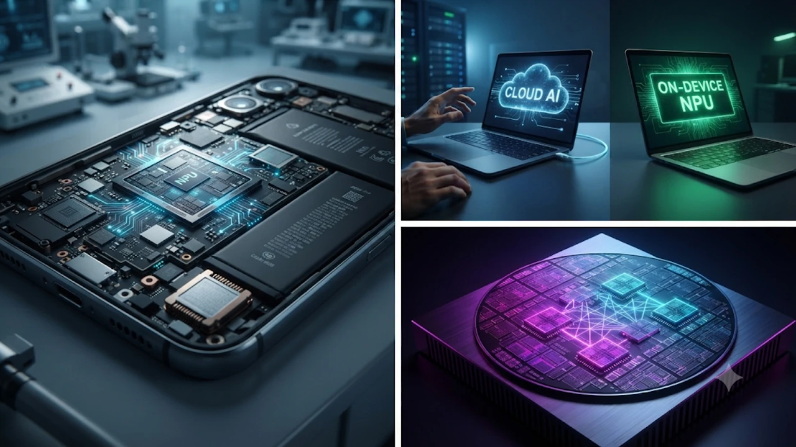

AI 서비스를 클라우드 서버에만 의존하던 방식에서 벗어나 **온디바이스 AI NPU**가 스마트폰, 노트북, 엣지 기기의 핵심 연산 장치로 빠르게 자리 잡고 있다. 초경량 언어모델(sLLM)과 전용 신경망처리장치(NPU) 아키텍처가 맞물리면서 네트워크 연결 없이도 빠른 추론 속도와 데이터 보안성을 동시에 확보할 수 있는 기반이 마련됐다.

## 차세대 온디바이스 AI NPU 아키텍처가 주목받는 핵심 배경

### 클라우드 추론 비용 급증과 로컬 연산 전환 가속화
생성형 AI와 실시간 음성·이미지 기능이 일상 앱과 운영체제 곳곳에 들어가면서 서버 측 GPU 추론 비용이 서비스 확장 속도를 따라가지 못하는 사례가 늘고 있다. 모든 요청을 원격 데이터센터로 보내면 사용자가 늘어날수록 트래픽과 연산 원가가 함께 커지므로, 반복 작업이나 개인화 처리를 기기 내부로 옮기려는 움직임이 뚜렷하다.

> 서버 왕복 횟수를 줄이는 것만으로도 서비스 운영 원가 구조와 사용자가 체감하는 반응 속도가 동시에 달라진다.

### 초경량 파운데이션 모델(sLLM) 최적화 기술의 성숙
과거에는 수백억 파라미터급 초대형 모델이 기준이었지만, 최근에는 특정 작업에 맞춘 소형 모델과 지식 증류, 가중치 가지치기(Pruning) 기술이 고도화되며 기기 내 실행 문턱이 크게 낮아졌다. 얇은 노트북이나 모바일 칩셋에서도 회의록 요약, 실시간 통역, 화면 맥락 인식 같은 기능을 버벅거림 없이 돌릴 수 있게 된 배경이다.

### 프라이버시 규제 강화에 따른 데이터 로컬 처리 수요
통화 녹음, 사내 계약서 초안, 건강 기록, 현장 촬영 이미지처럼 민감한 정보가 외부 서버를 오가는 구조에 기업과 개인 모두 민감하게 반응하고 있다. 기기 안에서 원본 데이터를 곧바로 처리하고 외부 송신을 최소화하는 방식은 보안 정책 준수 측면에서 유리하며, [제로 트러스트 보안, AI 시대 바뀌는 핵심은?](/posts/latest-tech/zero-trust-ai-security-future-2026/) 글에서 짚은 접근 통제 흐름과도 맞닿아 있다.

## 기존 클라우드 기반 AI 대비 온디바이스 NPU 성능 비교

### 응답 지연시간(Latency) 및 오프라인 가용성 분석
네트워크 왕복이 필요한 클라우드 추론과 달리 로컬 NPU 연산은 회선 속도나 서버 혼잡의 영향을 받지 않는다. 비행기 기내, 지하철 터널 구간, 통신 음영 지역처럼 인터넷이 끊기는 환경에서도 문서 요약이나 음성 명령 같은 기본 AI 기능을 그대로 쓸 수 있어 실사용 만족도가 높다.

### 전력 소모 대비 TOPS 연산 효율성 격차
범용 CPU나 고전력 GPU 대신 행렬 곱셈과 텐서 연산에 특화된 NPU 파이프라인을 쓰면 같은 배터리 용량으로 훨씬 많은 AI 작업을 처리할 수 있다. 모바일 기기와 휴대용 노트북에서는 전력 소모와 발열 억제가 곧 사용 시간과 직결되기 때문에, 순간 최대 성능 수치보다 와트당 연산 효율이 실제 체감 격차를 만든다.

### 대규모 멀티모달 추론 한계와 하이브리드 오프로딩 구조
로컬 NPU는 통합 메모리 용량과 대역폭 한계가 분명해 초거대 모델을 단독으로 감당하기 어렵다. 따라서 단문 요약이나 실시간 화면 인식은 로컬 NPU가 맡고, 방대한 웹 검색이나 고난도 코드 생성은 클라우드로 넘기는 하이브리드 오프로딩 구조가 현업에서 가장 현실적인 해법으로 쓰인다. 미세 공정과 패키징 변화는 [TSMC 1.6나노 A16, 진짜 2나노 건너뛸까?](/posts/latest-tech/tsmc-16nm-a16-mass-production-2026/)에서도 함께 확인할 수 있다.

## 차세대 AI NPU 도입 시 실무 환경의 장단점

### 인프라 운영 비용 절감 및 보안 컴플라이언스 확보 장점
- **서버 트래픽 피크 완화**: 단순 반복 추론을 사용자 기기로 분산해 백엔드 GPU 점유율을 낮춘다.
- **원본 데이터 유출 차단**: 사내 문서나 개인정보가 외부 API로 전송되지 않아 보안 심사 부담을 덜 수 있다.
- **균일한 반응 속도**: 접속자가 몰리는 시간대에도 대기열 지연 없이 일정한 응답성을 유지한다.

### 하드웨어 파편화 및 모델 양자화(Quantization) 정확도 손실 단점
- **기기별 스펙 편차**: 제조사와 세대마다 NPU 연산 성능, 메모리 구조, 드라이버 지원 범위가 달라 기종별 체감 품질 차이가 발생한다.
- **양자화 오차 누적**: 모델 용량을 줄이려 정밀도를 낮추는 과정에서 미묘한 문맥 왜곡이나 추론 정확도 저하가 생길 수 있다.
- **검증·배포 공수 증가**: 여러 운영체제와 칩셋 조합을 일일이 테스트해야 하므로 QA 일정이 길어진다.

## 온디바이스 AI 모델 배포 및 NPU 가속 적용 가이드

### 타겟 NPU 칩셋별 지원 모델 포맷 및 런타임 환경 확인
모델을 배포하기 전 대상 기기가 지원하는 연산 그래프 포맷과 추론 런타임, 드라이버 버전을 먼저 확인해야 한다. 같은 모델이라도 런타임 백엔드에 따라 NPU 가속이 정상 작동하지 않고 CPU로 우회되는 경우가 있으므로 실제 대상 기기에서 점유율과 실행 경로를 검증한다.

### INT4·FP8 양자화 파이프라인 구축 및 추론 속도 벤치마크
- **정밀도 단계별 품질 비교**: 원본 FP16 모델과 양자화 모델의 출력 차이를 실제 업무 데이터셋으로 대조한다.
- **실측 지표 기록**: 첫 토큰 생성 시간, 초당 토큰 생성량, 최대 메모리 점유율, 기기 표면 온도 상승 폭을 함께 측정한다.
- **회귀 테스트 자동화**: 모델을 업데이트할 때마다 정확도와 속도 기준선을 통과하는지 자동으로 점검한다.

### 하이브리드 폴백(Fallback) 아키텍처 설계 및 모니터링 설정
로컬 NPU 메모리가 부족하거나 응답 신뢰도가 기준치 아래로 떨어질 때는 클라우드 추론으로 즉시 전환하는 폴백 경로를 둬야 한다. 운영 단계에서는 로컬 처리 비율, 클라우드 전환율, 오류 코드를 로그로 수집해 모델 경량화 수준을 꾸준히 다듬는다.

[AI NPU 가속 스마트 기기 쿠팡에서 보기](https://www.coupang.com/np/search?q=AI%20NPU%20%EB%85%B8%ED%8A%B8%EB%B6%81%20%EC%8A%A4%EB%A7%88%ED%8A%B8%EA%B8%B0%EA%B8%B0&sourceType=affiliate&trackingCode=AF8691300)

#온디바이스AI #NPU #sLLM #엣지컴퓨팅 #AI아키텍처 #모델양자화 #최신기술동향