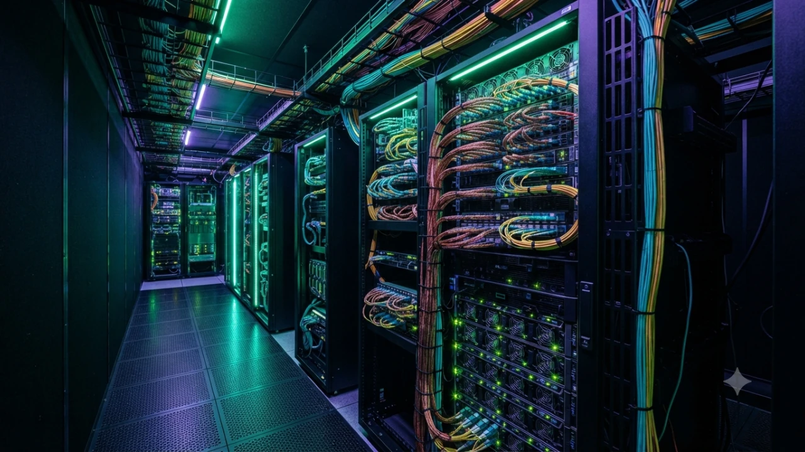
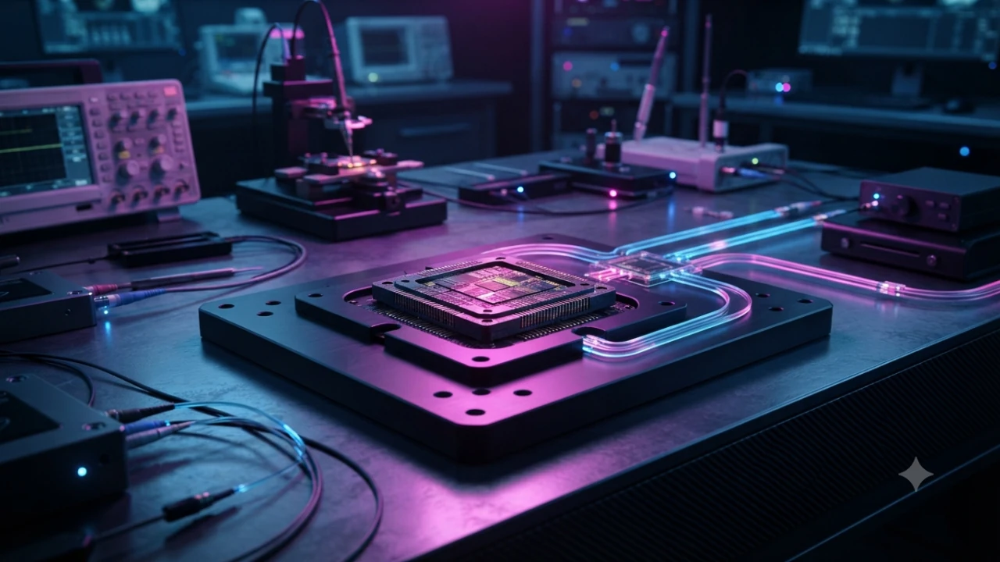

오픈AI와 앤트로픽 등 주요 인공지능 기업이 **AI 칩 다변화** 속도를 높이면서 엔비디아 중심의 AI 반도체 시장에 균열이 생길지 업계의 시선이 쏠리고 있다. 경쟁사 가속기 도입부터 클라우드 맞춤형 칩 활용, 자체 실리콘 설계까지 동시에 가속화되면서 데이터센터 인프라와 공급망 전략도 새 국면에 접어들었다.

## AI 칩 다변화 움직임이 부상한 배경

### 오픈AI의 AMD 도입과 자체 칩 행보

단일 공급사에 의존하던 AI 가속기 조달 방식에 변화가 뚜렷해졌다. **오픈AI**는 엔비디아 GPU 물량 확보에 머무르지 않고 경쟁사인 **AMD** 반도체를 도입하는 한편, 자체 AI 칩 개발 프로젝트를 병행하며 선택지를 넓히고 있다.

- **조달 창구 확대:** 특정 제조사의 생산 일정과 공급 배분에 전체 서비스 확장 속도가 묶이는 구조를 완화하려는 움직임이다.
- **맞춤형 연산 대응:** 대규모 모델 학습과 실시간 추론처럼 성격이 다른 연산에 맞춰 칩 구조를 달리 가져가려는 계산이 깔려 있다.

### 앤트로픽의 아마존·구글 칩 활용 확대

**앤트로픽** 역시 클라우드 파트너사가 설계한 맞춤형 AI 칩을 모델 학습과 운영에 적극 끌어들이고 있다. 아마존웹서비스(AWS)의 트레이니움 계열 칩과 구글 클라우드의 TPU 인프라를 활용하면서 엔비디아 외 대안 환경에서도 대규모 모델을 훈련·배포하는 트랙을 구축했다.

> "빅테크가 대체 칩을 병행 채택하는 핵심 동기는 성능 우위 선언보다 공급 안정성과 비용 구조 통제에 가깝다."

### AI 인프라 비용과 공급망 병목 압박

초거대 모델의 파라미터 규모와 추론 트래픽이 불어나면서 GPU 구매 단가와 전력·냉각 인프라 유지비는 기업 수익성을 직접 압박하는 변수가 됐다. 여기에 최첨단 파운드리 패키징과 고대역폭메모리(HBM) 공급 병목이 겹치자, 빅테크는 단일 벤더 대기열만 바라보지 않고 복수의 반도체 로드맵을 동시에 가동하기 시작했다. 차세대 공정 경쟁 흐름은 [TSMC 1.6나노 A16, 진짜 2나노 건너뛸까?](/posts/latest-tech/tsmc-16nm-a16-mass-production-2026/) 글에서도 확인할 수 있다.

## 엔비디아 독주 구도와 대체 칩의 경쟁력

### 소프트웨어 생태계(CUDA) 해자와 전환 장벽

하드웨어 연산 성능표만 놓고 보면 경쟁 칩과 맞춤형 가속기가 빠르게 격차를 좁히고 있지만, 현장에서는 여전히 **CUDA** 소프트웨어 생태계의 벽이 높다. 수년간 축적된 라이브러리, 디버깅 툴, 분산 학습 프레임워크 최적화는 단기간에 복제하기 어려운 자산이다.

- **개발 생산성 차이:** 기존 코드베이스를 다른 컴파일러와 런타임 환경으로 옮기는 과정에서 추가 인력과 검증 기간이 소요된다.
- **엔지니어 숙련도:** 현업 AI 연구자와 인프라 엔지니어 대부분이 엔비디아 환경에 익숙해 전환 초기 시행착오가 발생한다.

### 맞춤형 가속기·경쟁 칩의 성능 및 효율 변수

반면 클라우드 사업자의 주문형 반도체(ASIC)와 경쟁 GPU 진영은 **특정 워크로드의 전력 대비 성능(전성비)**과 대규모 클러스터 가격 경쟁력을 무기로 파고들고 있다. 특히 반복 호출이 많은 추론 구간에서는 범용 GPU보다 특정 연산에 특화된 칩이 총소유비용(TCO)을 낮추는 데 유리한 경우가 적지 않다.

### 데이터센터 구축과 운영 환경의 현실

데이터센터 현장에서는 칩 단품 성능뿐 아니라 서버 랙 설계, 고속 인터커넥트, 냉각 방식, 보수 인력 확보까지 맞물려 돌아간다. 이 때문에 단숨에 엔비디아 장비를 걷어내기보다 **핵심 프런티어 학습은 기존 주력 클러스터에 두고, 추론이나 보조 학습부터 대체 칩 비중을 늘리는 하이브리드 구성**이 현실적인 해법으로 자리 잡고 있다.

## 빅테크 칩 다변화의 장점과 잠재 리스크

### 협상력 확보와 공급망 분산의 이점

복수의 AI 칩 공급망을 확보한 기업은 가격과 납기 협상에서 훨씬 유리한 위치를 점한다. 대체 플랫폼에서 실제 모델을 돌려본 레퍼런스 자체가 기존 공급사에 대한 견제 수단으로 작동하기 때문이다.

- **납기 리스크 완화:** 특정 제품군의 출하 지연이나 수요 폭증이 발생해도 서비스 확장 일정을 방어할 수 있다.
- **워크로드별 단가 절감:** 연산 특성에 맞는 칩을 골라 배치해 인프라 지출 효율을 높일 여지가 생긴다.

### 모델 최적화 부담과 호환성 리스크

멀티 칩 전략이 항상 비용 절감으로 직결되지는 않는다. 하드웨어 아키텍처가 달라질 때마다 커널 튜닝과 모델 병렬화 전략을 새로 맞춰야 하고, 정밀도 차이나 드라이버 안정성 이슈로 모델 품질 편차가 생길 위험도 안고 있다.

### 클라우드·반도체 밸류체인 파급 효과

오픈AI와 앤트로픽의 행보는 파운드리, HBM 메모리, 디자인하우스, 서버 ODM 업계 전반의 수주 구도에도 변화를 예고한다. 범용 GPU 단일 품목 쏠림이 완화되면서 빅테크 맞춤형 칩 설계 파트너와 패키징 협력사의 전략적 가치가 한층 부각되고 있다. 인프라 전환과 함께 보안 아키텍처를 점검하고 싶다면 [제로 트러스트 보안, AI 시대 바뀌는 핵심은?](/posts/latest-tech/zero-trust-ai-security-future-2026/) 글도 참고해 보자.

## 실무·투자 관점에서 살펴볼 체크포인트

### 워크로드별 최적 하드웨어 조합 점검 순서

기업 IT 팀이나 AI 서비스 운영자가 멀티 칩·멀티 클라우드 환경을 검토할 때는 아래 순서로 타당성을 따져보는 편이 안전하다.

1. **워크로드 분리:** 대규모 사전학습, 파인튜닝, 실시간 추론 중 어디에서 비용과 지연시간 병목이 가장 큰지 먼저 구분한다.
2. **프레임워크 호환성 검증:** 사용 중인 파이토치·추론 엔진이 대상 칩의 소프트웨어 스택에서 별도 커스텀 코드 없이 안정 구동되는지 확인한다.
3. **총소유비용(TCO) 비교:** 시간당 인스턴스 단가뿐 아니라 이식 공수, 디버깅 시간, 장애 대응 비용까지 합산해 손익을 계산한다.

### 차세대 AI 칩 전환 신호 모니터링 기준

엔비디아 독주 구도의 실제 변화 속도를 가늠하려면 단발성 제휴 발표보다 **실제 대규모 상용 모델 학습 완료 사례**, **클라우드 사업자의 설비투자(CAPEX) 중 자체 칩 비중**, **오픈소스 프레임워크의 비(非)CUDA 지원 성숙도**를 꾸준히 추적해야 한다.

### 변동성 국면에서 리스크를 줄이는 접근법

AI 반도체 시장은 기술 전환 속도가 빠르고 공급망 변수도 커서 한쪽 시나리오에 치우친 판단은 위험하다. 연산 인프라와 개발 워크스테이션 환경을 점검하며 고성능 컴퓨팅 장비 구성을 비교하고 있다면 아래 링크에서 관련 기기 사양을 함께 확인해 보자.

[AI 워크스테이션 노트북 쿠팡에서 보기](https://www.coupang.com/np/search?q=AI%20%EC%9B%8C%ED%81%AC%EC%8A%A4%ED%85%8C%EC%9D%B4%EC%85%98%20%EB%85%B8%ED%8A%B8%EB%B6%81&sourceType=affiliate&trackingCode=AF8691300)

#AI칩다변화 #엔비디아 #오픈AI #앤트로픽 #AI반도체 #AMD #클라우드인프라 #데이터센터 #최신기술동향