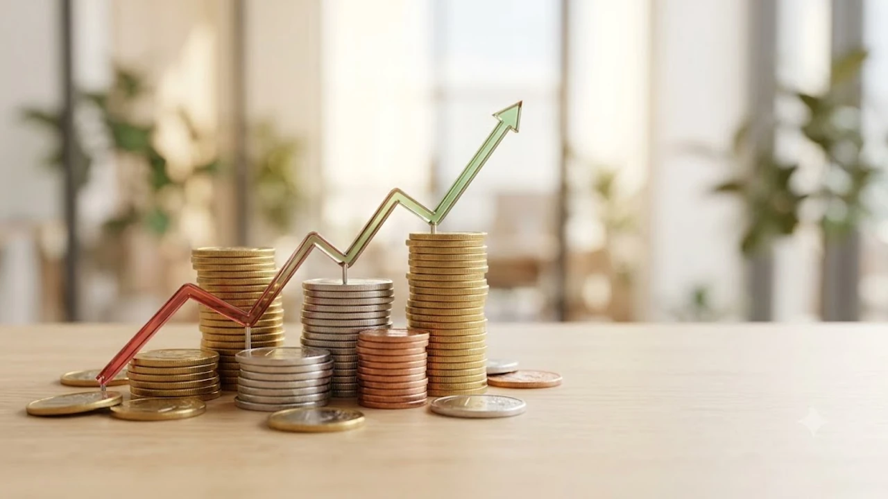

일론 머스크가 무대 위로 몰고 나온 **테슬라 사이버캡(Cybercab)**을 본 순간, 월가의 표정은 급격히 굳어졌습니다. 운전대와 페달을 완전히 들어낸 파격적인 차체를 앞세웠지만, 정작 시장이 숨죽여 기다리던 완전자율주행(FSD) 상용화 검증 지표와 당장의 수익 모델은 어디에도 없었습니다. 로보택시 생태계의 판도를 바꿀 구체적 해법을 기대했던 투자자들은 실망 매물을 쏟아냈고, 주가는 하루 만에 9% 가까이 곤두박질치며 테슬라의 자율주행 시간표에 거센 의구심을 던졌습니다.

## 테슬라 사이버캡 발표 직후 시장이 냉담했던 진짜 이유

### 운전대·페달 제거 혁신 뒤에 가려진 핵심 로드맵의 부재
이번 '위, 로봇(We, Robot)' 행사의 주인공은 스티어링 휠과 가속 페달이 아예 없는 2인승 전용 차량 **사이버캡**이었습니다. 하지만 화려한 조명과 버터플라이 도어 연출 뒤편에는 정작 알맹이에 해당하는 기술 검증 데이터가 통째로 빠져 있었습니다.
- **주행 데이터 및 이탈률(Disengagement Rate) 미공개**: 비전 온리 기반 FSD가 운전자 개입 없이 실제 도심에서 몇 마일을 버텨낼 수 있는지 보여주는 실증 수치가 전무했습니다.
- **소프트웨어 버전 명시 누락**: 현재 필드에서 달리는 감독형 FSD v12 체계에서 무감독(Unsupervised) 자율주행으로 건너가는 구체적인 전환 매커니즘을 밝히지 못했습니다.

### 월가 예상치를 밑돈 구체적 양산 일정과 실적 기여도
모건스탠리와 골드만삭스를 비롯한 투자은행들의 시선은 시제품의 생김새가 아니라 당장 분기 실적을 견인할 현금 흐름에 쏠려 있었습니다.
> 머스크는 2026년 양산 돌입과 3만 달러 이하 가격표를 내걸었으나, 시장은 모델 3, 사이버트럭, 세미 트럭 때마다 반복된 수년간의 양산 지연 악몽을 먼저 떠올렸습니다.

투자자들은 2026년 혹은 2027년이라는 기약 없는 타임라인이 전기차 캐즘(일시적 수요 둔화)으로 꺾인 마진율을 당장 방어하기엔 턱없이 부족하다고 판단했습니다.

### 발표 당일 9% 급락을 촉발한 기관 투자자들의 차익 실현 심리
행사 직전까지 주가를 끌어올렸던 이벤트 프리미엄은 구체적인 사업 계획서가 나오지 않자마자 순식간에 증발했습니다. 단기 상승을 노리고 들어왔던 헤지펀드와 기관 투자자들은 무대가 끝나기 무섭게 매도 버튼을 눌렀습니다. 결제 인프라, 호출 수수료 배분율, 기존 운송 플랫폼과의 제휴 구조 등 사업의 뼈대가 빠져 있던 점이 기관 자금 엑소더스를 부추겼습니다. 로봇 하드웨어의 화려한 시연 뒤에 숨은 실질적 수익화 한계는 [유니트리 상장, 진짜 돈 될까?](/posts/latest-tech/unitree-ipo-humanoid-profitability-2026/) 분석에서도 똑같이 확인할 수 있습니다.

## 무인 FSD 승인이라는 넘기 힘든 규제의 벽

### 웨이모 라이다 방식 대비 비전 온리 시스템의 안전성 검증 한계
테슬라는 값비싼 라이다(LiDAR)와 레이더를 전부 걷어내고 카메라 센서와 인공신경망 연산만으로 달리는 **비전 온리(Vision-Only)** 노선을 꺾지 않고 있습니다. 반면 교통 당국과 엔지니어들은 기습 폭우, 안개, 역광, 카메라 렌즈 오염 환경에서 발생할 물리적 한계를 집요하게 파고듭니다.
- 카메라 센서 왜곡 및 야간 저조도 환경에서의 거리 오차 검증 미비
- 절대적인 물리 거리를 교차 측정해 줄 다중 센서 중복성(Redundancy)의 원천적 부재
- 시스템 마비나 이상 발생 시 갓길로 차를 안전하게 빼내는 비상 정지(Fail-Safe) 기술의 신뢰성 결여

### 미국 도로교통안전국(NHTSA) 무인 면제 승인 절차의 현주소
스티어링 휠과 페달이 없는 차를 미국 일반 도로에 굴리려면 NHTSA로부터 **연방 자동차 안전 기준(FMVSS)** 면제 승인을 반드시 따내야 합니다.
- 제너럴 모터스(GM) 계열사인 크루즈(Cruise)조차 운전대 없는 전용 셔틀 '오리진(Origin)'의 규제 면제를 수년 동안 두드리다 잇단 사고와 승인 난항 끝에 양산을 무기한 백지화했습니다.
- 테슬라는 사이버캡에 대한 FMVSS 정식 면제 신청서조차 제출하지 않은 상태이며, 서류 검토와 청문회 절차만 따져도 최소 수년이 걸릴 판입니다.

### 텍사스·캘리포니아 주별 규제 장벽과 주행 허가 시점의 불확실성
머스크는 2025년부터 텍사스와 캘리포니아에서 모델 3와 모델 Y를 이용한 무감독 FSD 주행을 시작하겠다고 공언했습니다. 하지만 캘리포니아 차량국(DMV)은 상업용 무인 자율주행 배치 허가(Deployment Permit) 발급에 극도로 까다로운 기준을 적용합니다. 현재 캘리포니아에서 무인 로보택시 요금을 정식으로 받는 사업자는 알파벳 산하 웨이모가 유일하며, 테슬라는 기본 테스트 허가 단계조차 밟지 않아 허가 획득 시점은 안갯속입니다.

## 경쟁사 웨이모·크루즈 대비 사이버캡의 실질적 경쟁력

### 3만 달러 이하 가격표와 차량 공유 비즈니스 모델의 경제성
사이버캡이 경쟁 진영을 압도하는 단 하나의 무기는 **극단적인 제조 원가 절감**입니다.
- **웨이모(Waymo)**: 재규어 I-PACE 차량 위에 대당 수천만 원을 호가하는 5대의 라이다와 레이더 6대, 카메라 29대를 얹어 대당 제작 단가가 1억 5천만 원을 훌쩍 넘깁니다.
- **사이버캡**: 모듈 단위로 찍어내는 '언박스드(Unboxed)' 조립 공정을 태워 대당 단가를 3만 달러(약 4천만 원) 선까지 끌어내리겠다는 계산입니다. 하드웨어 단가 싸움에서 이기면 단위 경제학(Unit Economics) 측면에서 경쟁사를 압살할 수 있습니다.

### 마일당 20센트 운행 비용 목표치와 무선 충전 기술의 실현 가능성
테슬라는 사이버캡 운행 비용을 1마일당 20센트(기존 시내버스 운행 비용인 1마일당 1달러의 5분의 1 수준)까지 낮추겠다고 밝혔습니다. 이 계산을 맞추기 위해 유선 충전구를 아예 없애고 **유도식 무선 충전 패드**를 표준으로 잡았습니다. 하지만 수십 킬로와트급 배터리를 무선으로 고속 충전할 때 발생하는 막대한 발열과 10~15% 수준의 전력 손실은 인프라 구축 비용을 되레 끌어올릴 뇌관입니다.

### 이미 상용 운행 중인 웨이모 로보택시 서비스와의 시장 점유율 격차
웨이모는 피닉스, 샌프란시스코, 로스앤젤레스에서 매주 10만 건이 넘는 유상 운행을 처리하며 실제 탑승객 결제 데이터를 빨아들이고 있습니다. 반면 테슬라는 승객에게 돈을 받고 차를 굴려본 경험이 단 한 건도 없습니다. 플랫폼 비즈니스 특성상 2~3년의 선점 격차는 네트워크 효과 측면에서 치명적인 열세로 작용합니다.

## 사이버캡 투자 전 반드시 점검해야 할 핵심 체크리스트

### 2026년 이후로 예고된 양산 일정이 실질 매출로 이어지는 시점
공장 라인을 깔고 부품 공급망을 조율해 시험 생산을 거치는 데만 수많은 변수가 도사리고 있습니다. 2026년 말에 첫 삽을 뜬다 해도 테슬라 재무제표에 의미 있는 모빌리티 서비스 매출이 찍히는 시점은 빨라야 2027년 중반 이후입니다. 그때까지는 주가의 버팀목 역할을 기존 모델 3와 모델 Y의 출하량 및 영업이익률이 전적으로 짊어져야 합니다.

### 기존 모델 3·모델 Y 차량의 완전 무인 주행 소프트웨어 업데이트 여부
수백만 명의 테슬라 오너들이 수백~수천만 원을 주고 산 FSD 패키지가 진짜 운전자 없는 레벨 4 자율주행으로 판올림될 수 있는지가 관건입니다. 하드웨어 3.0(HW3)과 4.0(HW4) 간의 연산 성능 격차가 벌어진 마당에, 구형 하드웨어 차량에 무감독 주행을 적용하지 못할 경우 집단 소송과 브랜드 신뢰도 추락은 피하기 어렵습니다.

### 규제 승인 지연 시 테슬라 밸류에이션 재평가 리스크 대응 전략
테슬라의 주가수익비율(PER)은 기존 내연기관 완성차 업계(5~8배)를 아득히 뛰어넘는 60배 선에서 거래되고 있습니다. 이 기업 가치의 7할 이상은 자율주행 소프트웨어와 로보택시 플랫폼 프리미엄에 빚지고 있습니다. 안전 당국의 규제 빗장이 풀리지 않아 일정이 1년씩 밀릴 때마다 주가 밸류에이션은 혹독한 조정을 겪을 수밖에 없으므로 보수적인 분할 매매가 유효합니다. 차량 내 AI 제어 하드웨어와 전자기기 최신 트렌드를 확인하려면 [테슬라 및 스마트 모빌리티 AI 기기 쿠팡에서 확인하기](https://www.coupang.com/np/search?q=%EC%8A%A4%EB%A7%88%ED%8A%B8%EA%B8%B0%EA%B8%B0%20AI%EA%B8%B0%EA%B8%B0&sourceType=affiliate&trackingCode=AF8691300) 링크를 참고할 수 있습니다.

#테슬라사이버캡 #로보택시 #FSD무인주행 #테슬라주가폭락 #자율주행규제 #웨이모비교 #일론머스크