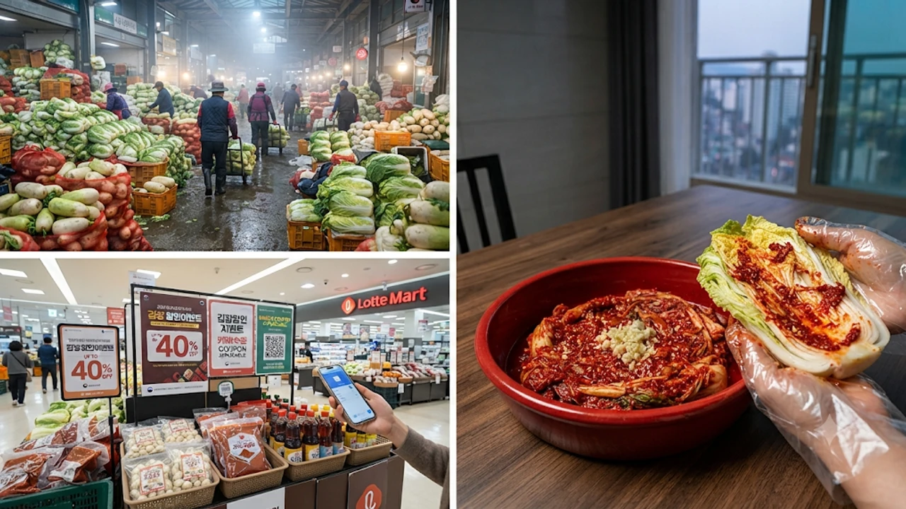

매년 11월 하순이 되면 장바구니 물가 걱정이 깊어지는데, 특히 올해 **2026 김장물가 배추값** 동향은 산지별 작황 편차와 정부 할인 정책이 맞물리면서 구매 시점과 채널에 따라 체감 비용이 극명하게 갈립니다. 솔직히 말하면 마트 진열대의 정가표만 보고 덜컥 장바구니를 채웠다간 예산을 훌쩍 넘기기 십상입니다. 지금 당장 적용할 수 있는 정부 농축산물 할인지원부터 산지 직송 절임배추 선별 기준까지 실질적인 김장 비용 절감 전략을 낱낱이 파헤쳐 보겠습니다.

## 2026년 11월 김장철 배추·무 시세 및 수급 현황

### 가락시장 도매가 기준 배추·무 실시간 시세 추이
한국농수산식품유통공사(aT) 농산물유통정보(KAMIS)와 서울 가락시장 경매 동향을 보면, 11월 중순 이후 김장용 가을배추 출하가 본격화되면서 산지 반입량이 점차 안정을 찾아가고 있습니다. 하지만 가을철 기상 여건에 따라 속이 꽉 찬 상품(上品) 배추와 중품 간의 가격 격차가 크게 벌어진 상태입니다. 무 역시 김장 수요가 몰리는 11월 셋째 주를 기점으로 소매가격이 보합세를 유지하고 있으나, 주말 직전에는 일시적인 수요 집중으로 가격이 소폭 오르는 패턴을 보입니다.

### 가을배추 출하량 변화와 김장 양념 채소 가격 동향
배추와 무만큼이나 김장 총비용을 좌우하는 핵심 변수는 바로 고춧가루, 깐마늘, 대파, 새우젓 등 부재료 시세입니다. 2026년 11월 기준 고춧가루와 깐마늘은 저장 물량이 풀리면서 비교적 안정적인 흐름을 보이지만, 쪽파와 갓 같은 엽채류는 산지 출하량에 따라 일별 변동 폭이 큽니다. 주재료인 배추 가격만 따질 것이 아니라 양념 채소 시세까지 묶어서 계산해야 정확한 김장 예산을 짤 수 있습니다.

### 대형마트 vs 전통시장 김장 재료 구매 비용 비교
동일한 20포기 기준으로 장을 볼 때 대형마트와 전통시장의 체감 비용 차이는 분명합니다.

| 구분 | 대형마트 (할인 미적용 시) | 전통시장 (온누리 환급 전) | 유리한 품목 |
| :--- | :--- | :--- | :--- |
| **배추·무** | 규격화·소포장 위주, 정가 기준 다소 높음 | 망 단위 대량 구매 시 단가 저렴 | 전통시장 |
| **양념 채소** | 세척·손질 상품 편리하나 단가 높음 | 깐마늘·쪽파·생강 등 묶음 구매 유리 | 전통시장 |
| **수육·굴 등 부식** | 원산지 표기 명확, 기획전 할인 풍부 | 제철 생굴·돼지고기 정육점 시세 유리 | 선택적 활용 |

## 정부 농축산물 할인지원 및 김장 쿠폰 활용법

### 농림축산식품부 김장철 최대 40% 할인 행사 대상 품목
농림축산식품부는 매년 김장 성수기인 11월 중순부터 12월 초까지 대형마트, 중소형 마트, 온라인몰과 연계해 '농축산물 할인지원'을 시행합니다. 정부 지원 20%에 유통업체 자체 할인 20%가 더해져 최대 40%까지 저렴하게 구매할 수 있는 구조입니다.

- **핵심 할인 대상:** 배추, 무, 고춧가루, 깐마늘, 대파, 쪽파, 생강, 배 등 김장 주·부재료 전반
- **해양수산부 연계 품목:** 천일염, 새우젓, 멸치액젓, 굴 등 수산물 김장 재료 별도 할인 적용
- **할인 한도 확인:** 1인당 주간 할인 한도(통상 1만~2만 원 선)가 정해져 있으므로 가족 명의 멤버십을 나누어 결제하는 것이 유리합니다.

### 전통시장 온누리상품권 환급 행사 일정 및 참여 방법
전통시장을 이용할 계획이라면 농식품부와 해수부가 주관하는 온누리상품권 현장 환급 행사를 절대 놓쳐서는 안 됩니다. 지정된 전통시장에서 국산 신선 농축산물이나 수산물을 구매한 뒤 영수증을 시장 내 환급 부스에 제출하면 구매 금액에 따라 온누리상품권으로 돌려줍니다. 모바일 앱을 통한 충전식 카드형 온누리상품권 구매 할인(평시 10% 내외)까지 먼저 적용해 결제하면 이중으로 혜택을 챙길 수 있습니다.

### 대형마트·온라인몰별 추가 카드 할인 중복 적용 팁
대형마트 앱이나 온라인 장보기 플랫폼에서는 정부 할인지원 쿠폰을 다운로드한 뒤, 제휴 신용카드(신한·삼성·국민·농협 등) 즉시 할인 프로모션을 중복으로 적용할 수 있습니다. 주말 전단 행사 기간에 배추 1망(3포기)을 행사 카드로 결제하면서 정부 할인 쿠폰을 동시에 쓰면, 도매가 수준에 근접한 금액으로 집 앞까지 배송받을 수 있습니다. 장바구니 물가 외에도 생활 전반의 정책 변화가 궁금하다면 [사회 전체 글 보기](/posts/society/)에서 최신 생활 정보를 함께 확인해 보시기 바랍니다.

## 절임배추 vs 생배추 구매 선택 기준과 가성비 전략

### 4인 가족 기준 절임배추와 생배추 총비용 및 노동력 비교
과거에는 생배추를 직접 사서 소금에 절이는 집이 많았지만, 최근에는 4인 가족(15~20포기 기준)도 절임배추를 선택하는 비중이 압도적입니다. 생배추를 직접 절일 경우 천일염 구매 비용, 상하수도 요금, 베란다·욕실 청소 시간, 그리고 배추를 뒤집고 헹구는 허리 통증까지 감수해야 합니다.

> **실전 비교 포인트:** 생배추 20포기와 천일염 구매 비용에 노동 시간의 기회비용을 더하면, 산지 직송 절임배추 2박스(40kg, 약 16~20포기) 예약 구매 비용과 큰 차이가 나지 않습니다.

### 산지 직송 절임배추 예약 시 실패 없는 품질 확인 체크리스트
절임배추는 박스를 열어보기 전까지 상태를 알기 어렵기 때문에 주문 전 아래 기준을 반드시 점검해야 합니다.

- **천일염 및 세척 횟수:** 100% 국내산 천일염(신안 등)을 사용했는지, 지하수나 정제수로 최소 3회 이상 세척해 바로 물기만 빼서 양념을 버무릴 수 있는지 확인합니다.
- **배추 품종과 절임 시간:** 속이 노랗고 고소한 '휘파람골드' 등 김장 전용 품종인지, 18~20시간 내외로 저염 절임해 아삭한 식감이 살아 있는지 상품 설명을 꼼꼼히 따져봐야 합니다.
- **수령일 지정 가능 여부:** 김장 당일 오전이나 전날 오후에 정확히 도착하도록 희망 배송일을 지정할 수 있는 산지 농협이나 인증 농가를 선택하는 것이 안전합니다.

### 남은 김장 재료 보관법 및 김장 후 냉장고 정리 노하우
김장을 마치고 어정쩡하게 남은 깐마늘, 생강, 무청, 배추 겉잎을 방치하면 며칠 만에 물러져 버리게 됩니다. 깐마늘과 생강은 믹서기에 갈아 지퍼백에 얇게 편 뒤 칼등으로 격자무늬를 내어 냉동 보관하면 요리할 때마다 한 조각씩 떼어 쓰기 편합니다. 배추 겉잎(우거지)은 끓는 물에 살짝 데쳐 찬물에 헹군 뒤 한 번 먹을 분량씩 소분해 냉동실에 넣어두면 겨울철 된장국 재료로 훌륭합니다.

## 알뜰 김장을 위한 시기별·채널별 실전 구매 로드맵

### 11월 말~12월 초 지역별 적정 김장 시기와 시세 하락 타이밍
기상청 중기예보와 민간 기상업체의 김장 적정 시기 분석을 보면, 중부 내륙과 수도권은 11월 하순부터 12월 초순, 남부 지방은 12월 초순부터 중순 사이가 김장하기에 가장 알맞습니다. 너무 이른 11월 초에는 출하 초기라 배추 속이 덜 차고 가격이 비싸며, 반대로 11월 말로 접어들면 해남·괴산 등 주산지 물량이 본격적으로 쏟아지면서 시세가 안정화됩니다. 일 최저기온이 0도 이하로 떨어지기 직전 주간을 노려 일주일 전부터 할인 쿠폰을 모아두는 것이 가장 현명한 타이밍입니다.

### 로컬푸드 직매장 및 지자체 김장 직거래 장터 이용 절차
대형 유통업체의 중간 마진을 완전히 걷어내고 싶다면 거주지 인근의 로컬푸드 직매장이나 지자체·농협이 주최하는 주말 김장 직거래 장터를 공략해야 합니다. 생산 농가가 당일 새벽 수확한 배추와 무를 직접 진열하기 때문에 신선도가 월등하고 가격도 시중보다 15~25%가량 저렴합니다. 인기 품목은 오전 시간대에 조기 품절되는 경우가 많으므로 개장 시간에 맞춰 방문하는 것이 좋습니다.

### 김장 비용을 추가로 아끼는 대체 식재료 및 소포장 구매 전략
원자재 가격 부담을 조금이라도 더 낮추려면 양념 배합에서 가성비 대체 재료를 활용하는 것도 좋은 방법입니다. 비싼 찹쌀풀 대신 찬밥을 믹서기에 갈아 넣거나 감자 전분으로 풀을 쑤면 감칠맛은 유지하면서 재료비를 줄일 수 있습니다. 1~2인 가구라면 대용량 절임배추 대신 5kg~10kg 단위 소포장 절임배추와 시판 김장 양념 속(김치 양념소) 세트를 조합해 구매하는 편이 잔반 없이 훨씬 경제적입니다. 김장 당일 위생적인 작업과 뒷정리를 돕는 필수 소모품도 미리 챙겨두면 수고를 크게 덜 수 있습니다.

[절임배추 김장매트 김장봉투 쿠팡에서 보기](https://www.coupang.com/np/search?q=%EA%B9%80%EC%9E%A5%EB%A7%A4%ED%8A%B8+%EA%B9%80%EC%9E%A5%EB%B4%89%ED%88%AC&sourceType=affiliate&trackingCode=AF8691300)

#2026김장물가배추값 #김장철배추시세 #절임배추추천 #농축산물할인지원 #온누리상품권환급 #김장비용절약 #가을배추가격 #김장준비체크리스트