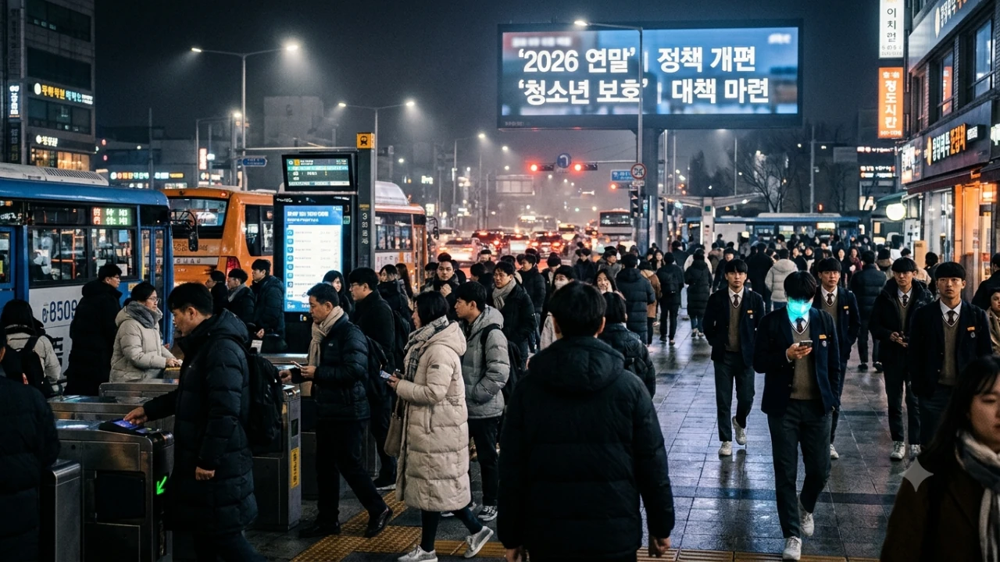

2026년 11월 말 기준, **2026 연말 사회 이슈**의 핵심은 거대 담론보다 당장 내 지갑과 일상에 닿는 생활 밀착형 규제 변화다. 연말 예산안 심사와 새해 제도 개편이 맞물리면서 교통·통신·디지털 환경 전반에서 체감도가 큰 정책들이 한꺼번에 쏟아지고 있다. 솔직히 말하면 해마다 반복되는 연말 행정 절차 같아 보여도, 놓치면 불이익을 보거나 혜택을 날리는 핵심 현안들을 추렸다.

## 연말 교통·공공요금 개편과 생활비 체감 변화

매년 11월 말은 지자체와 중앙정부의 새해 예산 및 공공요금 조정안이 윤곽을 드러내는 시기다. 교통비 환급 제도부터 동절기 에너지 바우처까지, 연말 행정 처리 여부에 따라 가계 고정비 차이가 벌어진다.

### 대중교통 환급 패스 정산과 한도 점검

수도권과 주요 광역시를 중심으로 시행 중인 대중교통 환급형 패스는 이용 횟수와 구간에 따라 환급률이 달라진다. 연말에는 카드사별 실적 연동 시스템 점검과 새해 적용 기준 공지가 집중된다.

*   **환급 기준 확인:** 최소 이용 횟수를 채우지 못하면 환급 대상에서 아예 제외된다.
*   **카드 등록 상태:** 실물 카드를 재발급받았거나 모바일 교통카드로 변경한 경우 전용 앱에서 카드 번호를 다시 등록해야 누락을 막는다.

### 동절기 난방비 지원 대상자 신청 마감

기온이 영하권으로 떨어지는 11월 말부터는 동절기 에너지 바우처와 지자체별 취약계층 난방비 지원 사업의 실질적인 사용과 추가 신청이 마감된다. 자동 지급 대상이 아닌 가구는 주민센터나 온라인 복지로를 통해 자격 여부를 직접 조회해야 한다.

> 지원 자격이 되더라도 신청 기한을 넘기면 소급 적용이 불가능하다. 고지서 차감 방식과 국민행복카드 결제 방식 중 본인에게 유리한 수령 형태를 미리 선택해 두어야 한다.

## 디지털 플랫폼 규제와 청소년 보호 논의

연말 정기국회 법안 심사 소위원회에서는 플랫폼 기업의 알고리즘 책임과 미성년자 보호 조치가 뜨거운 감자다. 해외 주요국에서 먼저 불붙은 청소년 온라인 환경 규제가 국내 입법 논의로 직결되면서 찬반 여론이 팽팽하다.

### 미성년자 소셜미디어 이용 제한 쟁점

스마트폰 과의존과 딥페이크 범죄 예방을 명분으로 내세운 연령 제한 및 부모 동의 의무화 법안이 테이블에 올랐다. 표현의 자유 침해와 실효성 부족을 지적하는 목소리도 만만치 않다. 구체적인 입법 쟁점과 찬반 논리는 [청소년 SNS 금지 법안 진짜 시행될까? 3가지 쟁점 정리](/posts/society/youth-sns-ban-law-issues-2026/) 글에서 상세히 다루고 있다.

### 야간 치안 공백과 귀가 지원 시스템 재정비

연말 모임이 늘어나는 시기를 앞두고 지자체별 스마트 안심 귀가 앱과 폐쇄회로(CC)TV 관제 센터 연동 서비스가 일제히 업데이트되고 있다.

*   **지자체 앱 통합:** 기존에 구청별로 파편화되어 있던 귀가 모니터링 기능이 광역 단위 통합 플랫폼으로 묶이는 추세다.
*   **긴급 신고 연동:** 스마트폰 흔들기나 전원 버튼 연타만으로 관제 센터에 위치와 현장 음성이 전송되는 기능이 기본 탑재된다.

자세한 이용 방법과 지자체별 지원 범위는 [2026년 안심 귀가 서비스 완전 정리](/posts/society/youth-safety-stranger-anxiety-2026/)를 참고하면 바로 활용할 수 있다.

## 연말 정산과 개인정보 보안 관리 수칙

11월 말은 한 해의 세무 정산을 준비하는 동시에, 연말 특수를 노린 스미싱과 개인정보 유출 사고가 급증하는 구간이다. 행정 서비스 개편과 보안 수칙을 함께 챙겨야 불필요한 손실을 피한다.

### 연말정산 간소화 자료 사전 점검

국세청 연말정산 미리보기 서비스가 열리면서 공제 한도 초과 여부와 부양가족 자료 제공 동의를 점검하는 직장인이 늘고 있다. 특히 월세 세액공제나 교육비 항목처럼 자동 수집이 누락되기 쉬운 영수증은 12월이 되기 전에 발급처에 미리 요청해 두는 편이 수월하다.

### 택배·공공기관 사칭 스미싱 차단

연말 정산 환급금 안내나 택배 주소지 확인을 사칭한 문자 메시지가 기승을 부린다. 출처가 불분명한 인터넷 주소(URL)는 절대 누르지 말고, 통신사가 제공하는 무료 스미싱 차단 부가서비스와 모바일 백신 실시간 감시를 활성화해 두어야 한다.

## 주거 안전과 동절기 생활 대비 체크리스트

계절이 바뀌고 한 해를 마무리하는 시점에는 주거 공간의 안전 점검과 비상 대비 물품 구비가 필수적이다. 특히 노후 주택이나 다세대 주택 거주자라면 작은 방심이 큰 사고로 이어진다.

### 보일러 배기관 및 화재 감지기 점검

본격적인 한파가 닥치기 전 가스보일러 배기관의 이탈 여부와 일산화탄소 경보기 작동 상태를 반드시 확인해야 한다. 배기관 연결 부위가 헐거워져 있으면 실내로 유해 가스가 유입될 위험이 크다.

### 정전 및 한파 대비 비상용품 구비

기습적인 폭설이나 전력 사용량 급증으로 인한 단전·단수 상황에 대비해 최소한의 생필품을 챙겨둘 필요가 있다. 보조배터리와 휴대용 랜턴, 보온용품은 손이 닿기 쉬운 곳에 보관하는 것이 좋다. 겨울철 주거 안전과 비상 대비에 필요한 기본 용품은 [동절기 비상 대비 생활안전용품 쿠팡에서 보기](https://www.coupang.com/np/search?q=%EB%8F%99%EC%A0%88%EA%B8%B0+%EC%83%9D%ED%99%9C%EC%95%88%EC%A0%84%EC%9A%A9%ED%92%88&sourceType=affiliate&trackingCode=AF8691300)에서 한눈에 비교할 수 있다.

#2026연말사회이슈 #연말정책변화 #대중교통환급 #동절기난방비지원 #청소년SNS규제 #안심귀가서비스 #연말정산미리보기 #동절기안전점검