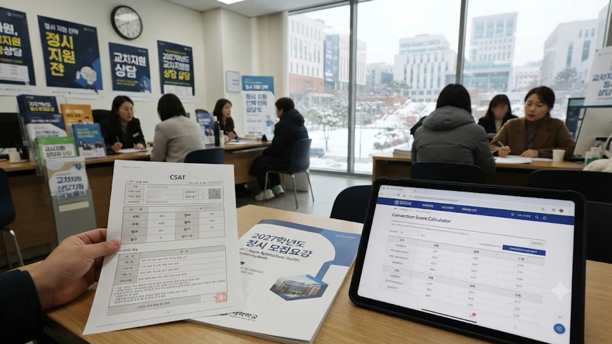

2027 정시 모집요강 발표가 코앞에 닥치면서 원서 조합을 짜는 수험생과 학부모의 신경전이 날카로워졌다. 솔직히 말하면 가채점 원점수만 붙잡고 작년 입시 결과를 그대로 대입했다가는 원서 접수 단계에서 낭패를 보기 십상이다. 올해 대학별 수능 반영 비율 변화와 탐구 변환표준점수 산출 방식, 그리고 정시 지원 일정까지 반드시 짚고 넘어가야 할 핵심 변수를 정리했다.

## 2027학년도 정시 모집요강 주요 변경 사항

대학마다 합격자를 가르는 잣대가 제각각이라 같은 성적표를 쥐고도 대학별 환산점수 격차가 크게 벌어진다. 특히 자연계열과 인문계열의 교차지원 허용 범위와 가산점 체계가 촘촘해지면서 모집요강 세부 조항을 일일이 대조하는 작업이 당락을 좌우한다.

### 대학별 수능 영역별 반영 비율 변화

주요 상위권 대학을 중심으로 국어와 수학의 반영 비중을 손보거나 영어 등급별 감점 폭을 키우는 흐름이 뚜렷하다. 수학 반영 비율이 40%에 달하는 대학과 30% 초반대인 대학은 같은 표준점수를 받아도 환산점수에서 수점 이상의 차이를 만든다.

- **국어·수학 비중 차등화**: 인문계열 모집단위에서도 수학 반영 비율을 높게 잡는 대학이 늘어나면서 수학 고득점자의 강세가 이어진다.
- **영어 등급 간 격차 확대**: 절대평가 영어의 경우 1등급과 2등급 사이 감점 폭이 0.5점에서 최대 3점 이상까지 대학별로 극명하게 갈린다.
- **탐구 과목 지정 폐지 확산**: 자연계열 지원 시 과학탐구 필수 응시 조건을 없애고 사회탐구 응시자에게도 문을 열어둔 대학들이 늘었다.

### 탐구 영역 변환표준점수 적용 방식 차이

선택과목 간 유불리를 보정하기 위해 대부분의 주요 대학이 성적표상의 표준점수 대신 자체 **변환표준점수(변표)**를 쓴다. 탐구 영역 난이도에 따라 만점자 표준점수가 과목별로 5점 이상 벌어지는 일이 잦아, 대학이 내놓는 변표 산출표가 당락을 가르는 결정적 열쇠가 된다.

> 성적통지표가 배부된 직후 각 대학 입학처 홈페이지에 공지되는 변환표준점수 산출표를 확인해야 본인의 실제 유불리를 정확히 판별할 수 있다.

사회탐구와 과학탐구에 별도의 변환표준점수표를 적용하는지, 통합 변표를 적용하는지에 따라 사탐런 수험생의 유불리가 완전히 뒤바뀐다. 과학탐구 선택자에게 일정 비율의 가산점을 주는 대학의 경우 단순 합산 점수만으로는 합격선을 가늠하기 어렵다.

### 학교폭력 조치사항 정시 의무 반영 기준

2027학년도 대입에서는 모든 대학이 학교폭력 조치를 정시 전형 평가 요소로 의무 반영한다. 수능 위주 전형이라 하더라도 학생부에 기재된 학교폭력 처분 호수에 따라 총점에서 일정 점수를 감점하거나 부적격 처리하는 기준이 엄격하게 작동한다.

## 전년도 대비 2027 정시 입시 전략 비교

작년 입시 결과(입결)를 볼 때는 단순 평균 점수가 아니라 모집 인원의 증감과 군 이동 여부를 함께 따져야 한다. 올해는 의약학계열과 첨단학과 정원 조정이 맞물리면서 상위권부터 중위권까지 연쇄적인 합격선 이동이 불가피하다.

### 의대 및 첨단학과 정원 변동에 따른 합격선 변화

최상위권 자연계열 수험생의 선택지가 넓어지면서 상위권 공과대학 및 자연과학대학의 추가 합격(충원) 규모가 크게 출렁일 전망이다. 의과대학 모집 정원 변동은 최상위권만의 문제가 아니라 연쇄 이동을 통해 수도권 주요 대학 입결 전반을 끌어내리는 도미노 효과를 낸다.

- **상위권 연쇄 이동**: 의약학계열 중복 합격자가 빠져나가면서 서울 주요 대학 공학계열의 예비 번호 순번이 예년보다 깊게 돌 가능성이 크다.
- **첨단학과 신설 및 증원**: 반도체, 인공지능, 배터리 등 첨단 분야 학과의 모집 인원이 늘면서 자연계열 중상위권 수험생의 지원 분산 효과가 나타난다.

### 가·나·다군 모집군 이동 대학과 지원 전략

대학들이 우수 인재를 선점하기 위해 특정 학과나 단과대학 전체의 모집군을 옮기는 사례가 적지 않다. 기존에 나군에 있던 인기 학과가 가군이나 다군으로 이동하면 해당 군의 경쟁 구도가 통째로 바뀐다.

다군은 모집 대학과 인원이 적어 전통적으로 경쟁률과 충원율이 높게 형성된다. 가군과 나군에서 안정·적정 지원을 조합했다면, 다군에서는 군 이동으로 새로 합류한 학과들의 경쟁률 추이를 실시간으로 살피며 전략적인 상향 지원을 노려볼 수 있다.

## 원서 접수 전 수험생 필수 체크리스트

수능 성적표 배부 이후 정시 원서 접수 마감까지는 시간이 촉박하다. 대학별 입시 설명회 자료와 최신 사회 정책 흐름까지 함께 살피며 흔들림 없이 원서 조합을 짜야 한다. 입시 외적인 최신 사회적 이슈와 청년 정책 변화가 궁금하다면 [사회 전체 글 보기](/posts/society/)에서 관련 소식을 함께 확인해 두면 좋다.

### 성적표 발표 전 대학별 환산점수 계산법

가채점 단계에서는 원점수 기준 등급컷만 보기 쉽지만, 실제 정시 당락은 **표준점수와 백분위 조합**으로 결정된다. 희망하는 5~6개 대학의 전년도 모집요강 반영 비율표를 미리 엑셀이나 입시 기관 모의지원 프로그램에 넣어 두고, 어떤 영역 가중치가 높은 대학이 유리한지 미리 추려내야 한다.

### 정시 원서 접수 일정 및 제출 서류 확인 절차

정시 원서 접수는 인터넷 접수 대행사를 통해 일괄 진행되지만 대학별로 마감 시간과 서류 제출 기한이 다르다.

- **접수 마감 시간 엄수**: 같은 날 마감하더라도 오후 5시 마감 대학과 오후 6시 마감 대학이 나뉘므로 마감 직전 서버 혼잡을 피해 최소 3시간 전에는 결제를 마쳐야 한다.
- **특별전형 증빙 서류**: 농어촌학생, 기초생활수급자, 특성화고졸업자 등 정원 외 특별전형 지원자는 우편 제출 마감일 소인 기준을 반드시 확인해야 한다.

### 추가 합격 및 충원 등록 마감 일정 관리

최초 합격자 발표 이후 진행되는 미등록 충원(추가 합격) 기간에는 전화 통보 방식과 홈페이지 발표 방식을 병행하는 대학이 많다. 연락처 오기재나 수신 거부 설정으로 인해 합격 기회를 놓치는 일이 없도록 원서 작성 시 보호자 연락처까지 이중으로 점검해야 한다.

## 수험생 컨디션 및 학습 환경 관리 팁

긴 수험 생활을 끝내고 정시 지원 전략을 세우는 시기에는 누적된 피로와 스트레스로 집중력이 떨어지기 쉽다. 모집요강 분석과 대학별 환산점수 계산을 오차 없이 끝내려면 쾌적한 책상 환경과 기본적인 체력 관리가 뒷받침되어야 한다.

### 밤샘 입시 분석을 돕는 데스크테리어 환경 구축

수십 개 대학의 모집요강 PDF 파일과 입시 배치표를 동시에 띄워놓고 비교하려면 오래 앉아 있어도 피로가 덜한 환경이 필요하다. 모니터 높이를 눈높이에 맞추고 스탠드 조명을 활용해 시력 피로를 줄여야 서류 제출 기한이나 반영 비율 숫자를 착각하는 실수를 막는다.

### 원서 접수 기간 멘탈 및 건강 유지법

원서 접수 직전 실시간 경쟁률 변동에 일희일비하다 보면 수면 리듬이 깨져 충동적인 상향 또는 하향 지원을 결정하기 쉽다. 정해진 시간에만 경쟁률을 확인하고 가벼운 스트레칭과 규칙적인 수면 시간을 유지해야 냉정한 판단력을 끝까지 지킬 수 있다.

[수험생 독서대 및 데스크 용품 쿠팡에서 보기](https://www.coupang.com/np/search?q=%EB%8F%85%EC%84%9C%EB%8C%80&sourceType=affiliate&trackingCode=AF8691300)

#2027정시모집요강 #2027학년도대입 #정시지원전략 #수능성적표 #변환표준점수 #대학별환산점수 #정시원서접수 #대입정보