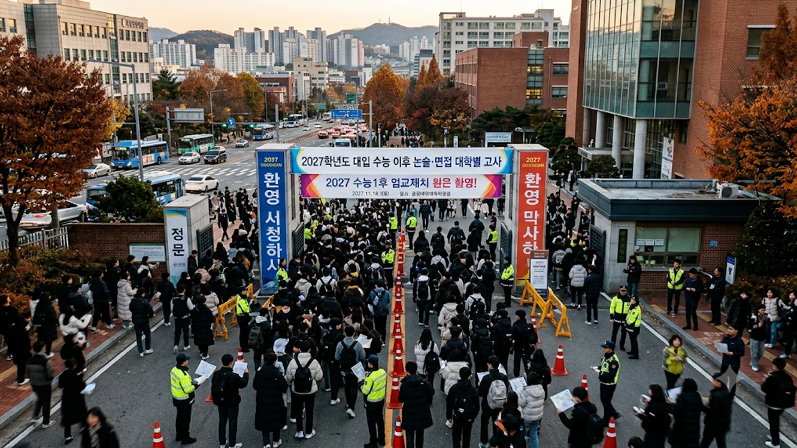

**2027 수능 이후 논술** 및 면접 전형의 성패는 가채점표를 손에 쥔 직후의 냉정한 결단에 달려 있다. 수험생들이 대입 레이스의 막바지인 대학별 고사 일정과 최저학력기준 충족 여부를 두고 갈피를 못 잡는 지금, 솔직히 말하면 남들 다 외우는 뻔한 기출 모범답안만으로는 합격 문턱을 넘기 어렵다. 수시 납치를 피하면서도 합격 확률을 극대화하는 실전 핵심 전략을 지금 바로 짚어본다.

## 2027학년도 수능 직후 시작되는 대학별 고사 일정과 필수 체크리스트

### 11월 중순 주말부터 몰아치는 주요 대학 논술·면접 일정
수능이 끝나자마자 숨 돌릴 틈도 없이 주요 대학의 논술 및 학생부종합전형 면접이 주말마다 연달아 치러진다. 경희대, 서강대, 성균관대, 숭실대, 숙명여대 등 서울권 주요 대학들이 수능 직후 첫 주말부터 고사를 시작하며, 뒤이어 중앙대, 한국외대, 한양대, 이화여대 등의 일정이 촘촘하게 이어진다. 지원 대학의 고사 시간과 입실 마감 시각이 겹치는지 반드시 수험표와 모집요강을 교차 대조해야 한다.

### 가채점 결과에 따른 논술 응시 여부 결정 기준
원점수 기반 가채점 결과가 평소 모의고사보다 월등히 잘 나왔다면 수시 고사장에 가지 않는 것이 정석이다. 수시 전형에 한 번이라도 합격하면 정시 지원 기회 자체가 박탈되는 이른바 '수시 납치'가 발생하기 때문이다.

> 가채점 결과 정시로 지원 가능한 대학 라인이 수시 지원 대학보다 한 단계 이상 높다면, 과감하게 논술·면접을 포기하고 정시 원서 조합에 집중하는 편이 합리적이다.

### 수험생과 학부모가 놓치기 쉬운 고사장 반입 금지 물품 및 유의사항
수능 날 긴장이 풀리면서 대학별 고사장에 스마트폰이나 스마트워치를 전원을 끄지 않은 채 소지해 부정행위로 퇴실당하는 사례가 매년 반복된다.
- **신분증 지참 필수:** 주민등록증, 운전면허증, 기간 만료 전 여권, 모바일 신분증(대학별 허용 여부 사전 확인) 중 하나와 수험표를 반드시 챙긴다.
- **필기구 규정 확인:** 연세대, 성균관대 등 대학마다 흑색 볼펜만 허용하거나 연필·지우개 사용을 허가하는 등 세부 규정이 다르다.
- **전자기기 전원 차단:** 무선 이어폰과 스마트워치는 아예 가방 깊숙이 넣어두거나 보호자에게 맡기고 입실하는 것이 안전하다.

## 올해 대학별 논술 및 면접에서 진짜 바뀌는 핵심 출제 경향

### 무전공(전공자율선택제) 확대에 따른 면접 평가 기준 변화
2027학년도 대입에서 가장 눈에 띄는 변화는 전공자율선택제(무전공) 모집 인원의 안착이다. 과거 학과별 면접에서는 특정 전공에 대한 지식을 묻는 질문이 주를 이뤘다면, 올해는 **계열 간 융합 사고력과 자기주도적 진로 탐색 역량**을 검증하는 질문이 쏟아진다. 지원 동기 역시 특정 학과에 국한하기보다 대학이 제공하는 다전공 제도를 어떻게 활용할 것인지 구체적인 학업 계획을 제시해야 높은 점수를 받는다.

### 수능 최저학력기준 충족률 변동과 실질 경쟁률 예측
원서 접수 당시 수십 대 일을 기록하던 논술 전형의 명목 경쟁률에 겁먹을 필요가 없다. 수능 최저학력기준을 충족하지 못하거나 정시 상향 지원을 위해 결시하는 인원을 제외하면 **실질 경쟁률은 최초 경쟁률의 절반 이하로 뚝 떨어지는 경우**가 허다하다. 특히 탐구 영역 반영 방식이나 영어 등급 감점 폭에 따라 대학별 실질 경쟁률이 크게 요동치므로, 본인이 최저 기준을 간신히 맞췄더라도 끝까지 고사장에 들어가야 한다.

### AI 활용 금지 및 창의적 사고력 검증을 위한 제시문 변별력 강화
생성형 AI의 보편화로 인해 대학들은 정형화된 암기식 답안을 철저히 배제하고 있다. 인문계열 논술에서는 서로 상충하는 두 관점의 제시문을 주고 제3의 대안을 도출하게 만드는 문항이 늘었으며, 자연계열 수리논술은 단순 계산이 아닌 **풀이 과정의 논리적 비약 여부**를 촘촘하게 채점한다.

## 합격생들의 실전 경험으로 본 논술·면접 직전 48시간 대비법

### 기출문제 복기보다 중요한 대학별 채점 기준표 분석 노하우
시험을 며칠 앞두고 새로운 예상 문제를 무리하게 푸는 것은 오히려 독이 된다. 대학교 입학처 홈페이지에 공개된 **선행학습 영향평가 결과보고서**를 내려받아 최근 3개년 기출문제의 출제 의도와 채점 기준표를 정독해야 한다. 채점관이 어떤 핵심 키워드와 논리 전개 단계에 배점을 부여했는지 파악하면 답안의 뼈대를 잡는 속도가 완전히 달라진다.

### 압박 면접과 돌발 질문에 대처하는 논리적 답변 구조화
면접관이 생활기록부 내용에 대해 날카로운 꼬리 질문을 던지는 이유는 지원자를 떨어뜨리려는 것이 아니라 **진위 여부와 순발력**을 확인하기 위함이다. 당황해서 말을 길게 늘이기보다 '결론-근거-느낀 점'의 3단 구조로 40초 이내에 답변을 끊어주는 훈련이 필요하다. 모르는 개념이 나오면 억지로 지어내지 말고 솔직하게 인정한 뒤, 관련 분야에서 본인이 알고 있는 지식을 연결해 답변하는 태도가 훨씬 좋은 평가를 받는다.

### 컨디션 난조를 막고 집중력을 극대화하는 시험 당일 루틴
수능 직후 급격한 긴장 이완으로 감기 몸살이나 소화 불량을 겪는 수험생이 많다. 시험 당일 아침에는 평소 먹던 가벼운 식단을 유지하고, 고사장 이동 시 쌀쌀한 날씨에 대비해 얇은 옷을 여러 겹 껴입어 체온을 조절해야 한다. 수험생들의 안전하고 원활한 이동과 생활 환경 전반에 대한 정보는 [사회 전체 글 보기](/posts/society/)에서도 함께 확인할 수 있다.

## 정시 지원 전략과 병행하는 수시 납치 방지 및 최종 선택 가이드

### 가채점 등급컷 기반 정시 지원 가능 대학 라인업 비교
입시 기관별 가채점 예상 등급컷은 표본 집단의 성향에 따라 조금씩 차이가 난다. 최소 3곳 이상의 주요 입시 기관 배치표를 교차 분석해 본인의 백분위와 표준점수 유불리를 따져봐야 한다. 국어와 수학 중 어느 과목의 표준점수가 높게 형성되었는지에 따라 정시 지원 가능 대학의 급간이 달라지므로, 수시 대학별 고사 응시 직전까지 정시 합격 가능선을 보수적으로 잡아두는 것이 좋다.

### 논술 응시 포기와 강행 사이의 합리적 손익 계산법
당신이 모르는 진실 중 하나는 많은 수험생이 "혹시 모르니 일단 시험은 보자"라는 막연한 불안감 때문에 정시로 충분히 갈 수 있는 대학보다 낮은 곳의 논술을 응시했다가 후회한다는 점이다.
- **응시 강행 추천:** 가채점 성적이 평소보다 하락했거나, 정시 지원 가능 대학과 수시 지원 대학의 선호도가 비슷한 경우
- **응시 포기 권장:** 정시 안정권 대학이 수시 지원 대학보다 명확히 상위권이며, 성적 발표 후 반전 가능성이 없는 경우

### 추가 합격 발표 일정과 등록 예치금 납부 시 주의할 점
수시 최초 합격자 발표 이후 진행되는 충원 합격(추가 합격) 기간에는 전화 통보 방식이 병행되는 대학이 많다. 대학 입학처 번호를 스팸으로 차단해 두지 않았는지 반드시 확인하고, 부재중 전화가 남지 않도록 연락처를 최신화해야 한다. 또한 수시 합격 시 등록 예치금을 기간 내에 납부하지 않으면 등록 포기 의사로 간주되어 합격이 취소되므로 마감 시간을 철저히 엄수해야 한다. 고사장 이동 시 체온 유지를 돕는 [수험생 보온병 및 핫팩 세트 쿠팡에서 보기](https://www.coupang.com/np/search?q=%EC%88%98%ED%97%98%EC%83%9D+%EB%B3%B4%EC%98%A8%EB%B3%91+%ED%95%AB%ED%8C%A9&sourceType=affiliate&trackingCode=AF8691300)를 활용해 최상의 컨디션을 유지하는 것이 유리하다.

#2027수능 #수능이후논술 #대학별면접 #수시납치 #가채점등급컷 #논술최저기준 #무전공면접 #대입전략