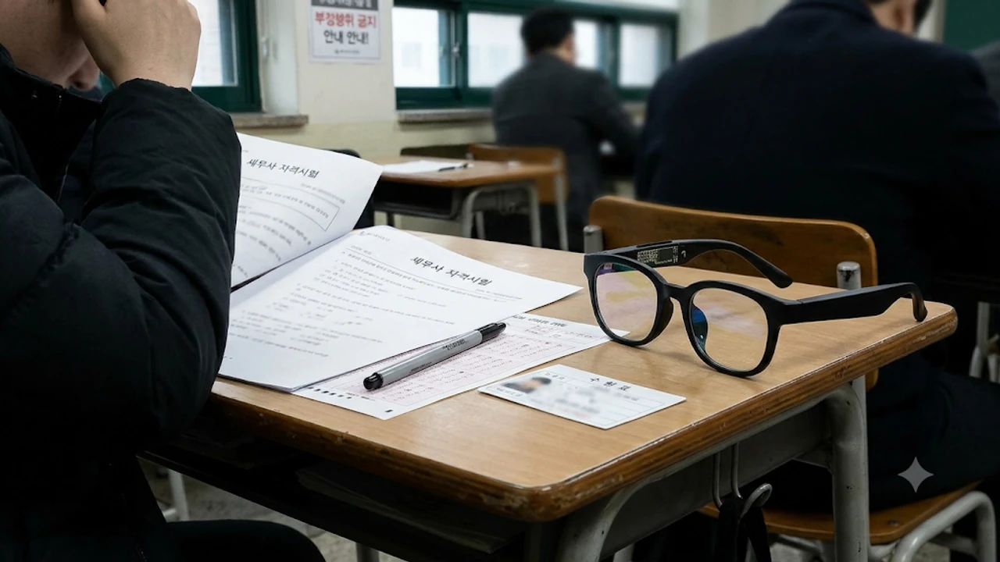

**수능 스마트안경 단속**이 코앞으로 다가온 2027학년도 대학수학능력시험과 각종 국가자격시험의 최대 화두로 떠올랐습니다. 최근 발표된 제63회 세무사 시험 수석 합격자의 비정상적인 고득점을 둘러싸고 AI 스마트안경 부정행위 의혹이 걷잡을 수 없이 번졌기 때문입니다. 일반 뿔테안경과 생김새가 거의 같은 최신 웨어러블 기기가 시험장 보안 체계를 뚫을 수 있다는 위기감이 커지면서 정부까지 긴급 대응에 나섰습니다.

## 세무사 수석 합격자 AI 스마트안경 부정행위 의혹 전말

솔직히 말하면 수험생 커뮤니티가 발칵 뒤집힌 데는 분명한 이유가 있습니다. 응시자 열 명 중 일곱 명 이상이 과락으로 고배를 마신 불시험에서 특정 응시자 혼자 만점에 가까운 점수를 기록했기 때문입니다.

### 과락률 74% 세법학개론 만점 논란이 시작된 배경

2026년 제63회 세무사 자격시험 결과 발표 직후 수험생들과 현직 세무사들 사이에서 거센 의문이 터져 나왔습니다. 전체 응시자의 74% 이상이 40점을 넘기지 못해 과락 처리되고 평균 점수가 30.18점에 그친 세법학개론을 포함해, 수석 합격자가 1차 시험 160문제 중 단 1문제만 틀렸다는 사실이 알려졌기 때문입니다.

> "수십 년간 세무사 시험을 지켜봤지만 과락률 70%가 넘는 극악의 난이도에서 160문항 중 159문항을 맞히는 건 현실적으로 불가능에 가깝다." — 현직 세무사 및 수험 커뮤니티 반응 요약

특히 해당 합격자가 시험 도중 초소형 카메라와 골전도 스피커, AI 실시간 검색 기능이 탑재된 최신 스마트안경을 착용했을 것이라는 구체적 정황 의혹까지 퍼지면서 논란은 단순한 시기심을 넘어 시험 공정성 붕괴 우려로 번졌습니다.

### 한국산업인력공단 진상 조사 및 세무사회 공식 입장

논란이 커지자 시험 주관 기관인 한국산업인력공단은 즉각 당시 시험장 감독관들과 해당 수험생의 응시 기록을 대조하는 내부 진상 조사에 착수했습니다. 한국세무사회 역시 국가전문자격시험의 신뢰가 무너지면 자격사 시장 전체가 흔들릴 수 있다며 철저한 사실관계 규명과 재발 방지 대책 마련을 공식 촉구했습니다.

## 2027 수능 시험장 스마트안경 긴급 단속 기준과 변화

불똥은 당장 다음 주로 다가온 2027학년도 수능으로 튀었습니다. 세무사 시험에서 불거진 웨어러블 부정행위 우려가 입시 현장까지 덮치자 정부가 범부처 차원의 초강경 카드를 꺼내 들었습니다.

### 국무조정실·교육부 합동 수능 부정행위 방지 긴급 대책

국무조정실과 교육부는 긴급 합동 회의를 열고 전국 모든 수능 시험장에 스마트안경 전담 점검 인력을 별도로 배치하기로 결정했습니다. 기존에는 금속탐지기 위주로 휴대전화나 이어폰을 걸러냈지만, 이번 수능부터는 시력 교정용 안경을 착용한 수험생이라도 감독관이 육안으로 프레임 두께와 힌지 부위를 정밀 확인하는 절차가 의무화됩니다.

### 일반 안경과 스마트안경 구별법 및 전담인력 배치 방식

현장 감독관들은 일반 안경과 스마트안경을 가려내기 위해 세 가지 핵심 부위를 집중적으로 살핍니다.

- **안경다리(템플) 두께와 무게 중심:** 배터리와 통신 칩셋, 터치 센서가 내장된 스마트안경은 일반 뿔테안경보다 다리 부분이 두껍고 귀 뒤쪽 무게감이 큽니다.
- **전면 프레임 모서리 렌즈 유무:** 초소형 카메라 모듈이 숨겨진 경첩 부근의 미세한 원형 렌즈 반사광을 전용 손전등으로 비춰 확인합니다.
- **LED 상태 표시등 및 충전 단자:** 테 안쪽에 숨겨진 마그네틱 충전 접점이나 작동 시 미세하게 점등되는 LED 표시등 유무를 검사합니다.

### 시험장 반입 금지 물품 점검 시 수험생 필수 주의사항

시력이 나빠 안경을 써야 하는 수험생이라면 불필요한 오해를 피하기 위해 시험 전날 안경테 구조를 미리 점검해야 합니다. 

- 블루라이트 차단이나 변색 렌즈 등 특수 코팅 안경은 괜찮지만, **블루투스나 카메라 기능이 포함된 모든 웨어러블 안경은 전원 차단 여부와 관계없이 반입 금지 물품**에 해당합니다.
- 1교시 시작 전 감독관의 안경 확인 요구에 불응하거나 기기를 숨기려다 적발되면 그 즉시 부정행위자로 간주되어 퇴실 조치됩니다.
- 아날로그 시계 외에 전자식 화면이 있는 시계, 무선 이어폰, 전자담배 역시 일절 소지할 수 없으므로 가방에 넣어 교실 앞에 제출해야 합니다.

## AI 웨어러블 기기 시험 악용 사례와 기존 전자기기 비교

당신이 모르는 진실은 스마트안경 기술이 이미 우리가 상상하는 수준을 훌쩍 넘어섰다는 점입니다. 과거의 낡은 부정행위 수법과 비교하면 적발 난이도 자체가 완전히 다릅니다.

### 스마트폰·스마트워치 vs 최신 AI 스마트안경 기술 차이

과거 부정행위 수단은 부피가 크거나 손을 움직여야 해서 감독관의 시선을 피하기 어려웠습니다. 반면 최신 AI 스마트안경은 시선 처리만으로 문제를 인식하고 음성으로 정답을 받아 적을 수 있어 적발이 까다롭습니다.

| 구분 | 기존 스마트폰·스마트워치 | 최신 AI 스마트안경 |
| :--- | :--- | :--- |
| **문제 입력 방식** | 직접 타이핑 또는 화면 촬영 | 시선 고정 후 음성·터치 1회로 즉시 스캔 |
| **정답 수신 방식** | 화면 텍스트 확인 (시선 이탈 발생) | 골전도·초지향성 스피커로 외부 소리 차단 |
| **외관 식별 난이도** | 금속탐지기 및 육안으로 쉽게 적발 | 일반 패션 뿔테안경과 외형 거의 동일 |
| **AI 연산 속도** | 별도 앱 실행 및 검색 시간 소요 | 멀티모달 LLM 연동으로 2~3초 내 풀이 도출 |

### 자격증·공무원 시험 감독 사각지대와 해외 사례

이미 미국과 유럽, 일본 등 해외 대학 입시와 공인 어학시험 현장에서는 메타 레이밴(Meta Ray-Ban) 등 카메라 탑재 스마트안경을 활용한 시험 유출 사례가 잇따라 적발되어 논란이 됐습니다. 국내 역시 공무원 시험이나 토익, 각종 전문자격증 시험장에서는 수능만큼 촘촘한 금속탐지 인력을 배치하기 어려워 감독 사각지대가 존재한다는 지적이 끊이지 않습니다. 디지털 기기 규제와 청소년 보호 이슈가 사회 전반으로 확산하는 흐름 속에서 [청소년 SNS 금지 법안 진짜 시행될까? 3가지 쟁점 정리](/posts/society/youth-sns-ban-law-issues-2026/)처럼 첨단 디지털 환경에 맞춘 새로운 사회적 규칙 정립이 시급해졌습니다.

## 부정행위 적발 시 처벌 수위와 공정성 확보 과제

이게 말이 되냐는 수험생들의 분노를 잠재우기 위해서는 단순한 경고 수준을 넘어선 실질적인 처벌과 제도 보완이 뒷받침되어야 합니다.

### 수능 및 국가전문자격시험 부정행위자 제재 및 형사처벌 기준

현행 고등교육법과 국가기술자격법 등에 따르면 시험장에서 금지된 전자기기를 소지하거나 사용해 적발될 경우 강력한 법적 제재를 받게 됩니다.

- **당해 시험 즉시 무효 처리:** 적발된 시점의 시험 성적은 전부 0점 처리되며 현장에서 즉시 퇴실됩니다.
- **응시자격 정지:** 수능의 경우 부정행위 유형에 따라 **다음 연도 1년간 응시자격이 박탈**되며, 세무사 등 국가전문자격시험은 **최대 5년간 시험 응시가 제한**됩니다.
- **형사 고발 및 수사 의뢰:** AI 기기를 이용해 조직적으로 문제를 유출하거나 타인의 조력을 받은 경우 위계에 의한 공무집행방해죄가 적용되어 징역형 또는 벌금형의 형사처벌을 받습니다.

### 첨단 기기 단속 강화의 실효성과 수험생 권익 보호 균형

단속 강화가 반드시 필요하지만, 선량한 대다수 수험생이 시험 직전 과도한 검문으로 심리적 위축을 겪지 않도록 세심한 현장 운영이 요구됩니다. 고도수가 필요한 일반 안경 착용자가 부당한 의심을 받지 않도록 명확한 육안 판별 매뉴얼을 감독관에게 철저히 교육해야 합니다. 기술 발전 속도에 맞춰 시험 보안 시스템 역시 계속 진화해야만 땀 흘려 준비한 수험생들의 노력이 정당하게 평가받을 수 있습니다.

수능 당일 시간 안배와 컨디션 조절을 위해 반입이 허용되는 [수능용 아날로그 시계 쿠팡에서 보기](https://www.coupang.com/np/search?q=%EC%88%98%EB%8A%A5%EC%9A%A9+%EC%95%84%EB%82%A0%EB%A1%9C%EA%B7%B8+%EC%8B%9C%EA%B3%84&sourceType=affiliate&trackingCode=AF8691300)를 미리 챙겨 두면 시험장 반입 물품 점검 과정에서 불필요한 긴장을 덜 수 있습니다.

#수능스마트안경단속 #세무사수석부정행위 #2027수능반입금지물품 #AI스마트안경 #수능부정행위처벌 #세무사시험논란 #수능주의사항 #웨어러블부정행위