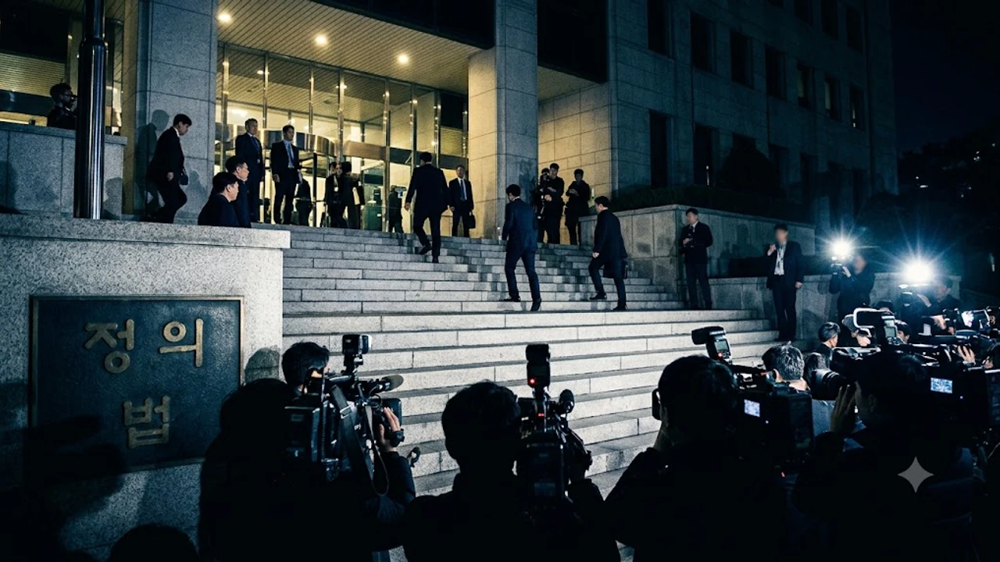

신설 거대 사정기관인 중대범죄수사청이 출범 초기부터 자중지란에 빠졌습니다. 2026년 10월 16일 본청 감찰담당관이 광주를 찾아 임은정 광주중수청장을 비공개로 대면하면서 **중수청 임은정 감찰** 사태는 단순한 내부 갈등을 넘어 정면충돌 양상으로 번졌습니다. 형사사법체계 개편 이후 수사 지휘권과 공직 기강을 둘러싼 권력 내부의 알력이 수면 위로 완전히 터져 나온 셈입니다.

## 중대범죄수사청의 임은정 감찰, 사건의 전말과 쟁점

### 10월 16일 비공개 전격 면담의 경과
솔직히 말하면 이번 감찰 착수는 예견된 수순이었습니다. 본청 감찰팀은 사전 조율 없이 광주청을 찾아 임 청장과 수 시간 동안 마주 앉았습니다. 발단은 명확합니다. 중수청 출범 직후 수사 인력 배분과 초대 지휘부의 정책 기조를 겨냥해 임 청장이 개인 소셜미디어와 언론 인터뷰를 통해 쏟아낸 비판들입니다. 본청은 조직 질서를 깨뜨리는 규율 위반이라 못 박았고, 임 청장은 정당한 내부 의견 개진이라 맞서며 한 치의 양보도 없이 맞부딪쳤습니다.

### 행정안전부 장관 감찰 지시와 중수청 지휘부 입장
이번 조치는 지휘부만의 독자적 판단에 그치지 않습니다. 감독 부처인 행정안전부 장관이 엄정한 공직 기강 확립을 공개 주문한 직후 착수되었습니다. 본청 수뇌부가 내세운 논리는 단호합니다.
- 신설 기관의 체계를 잡아야 할 시점에 기관장급 간부의 장외 비판 방치 불가
- 일선 수사 실무진의 동요 차단 및 공적 신뢰도 훼손 방지
- 공식 지휘 계통을 건너뛴 여론전 차단

> "새롭게 출발한 수사 기관에서 지휘부를 향해 연일 총구를 겨누는 행위는 지휘체계 자체를 뿌리부터 흔드는 일이다."

### 과거 검찰 시절 감찰 사례와 이번 사태의 구조적 유사점
과거 검찰 재직 당시 직무유기 고발, 지휘권 행사 의혹 폭로로 수차례 징계위에 회부되었던 장면이 고스란히 겹칩니다. 당시에도 내부 고발이냐 품위 손상이냐를 두고 행정소송까지 이어졌습니다. 2026년 현재 새로운 수사 기관의 지방 청장으로 자리를 옮겼음에도 똑같은 파열음이 반복된다는 사실은, 기관의 간판만 바뀌었을 뿐 내부 소통과 통제 구조는 구태를 벗지 못했음을 드러냅니다.

## 공무원 표현의 자유 vs 지휘체계 복종 의무

### 국가공무원법상 복종·품위유지 의무 적용 범위
핵심은 공직 사회에서 관행적으로 휘둘러온 국가공무원법 제57조(복종의 의무)와 제63조(품위유지의 의무)의 적용 기준입니다. 본청은 고위 공직자가 내부 조율을 거치지 않고 외부에 조직 문제를 공론화한 것 자체가 품위유지 위반이라 판단합니다. 반면 임 청장 측은 위법하거나 비합리적인 지휘 방침에 침묵하는 것이야말로 공직자의 책무를 저버리는 일이라 맞서고 있습니다.

### 공익신고 및 내부 비판의 법적 정당성 한계
이게 말이 되냐는 의문이 터져 나오는 지점은 내부 비판을 어디까지 공익성으로 볼 것인가입니다. 현행 공익신고자보호법은 조직 내부의 부정부패와 법률 위반을 폭로하는 행위를 보호합니다. 하지만 단순한 인사 불만이나 정책 노선 갈등까지 폭넓게 면책하지는 않습니다. 결국 이번 감찰의 칼끝은 임 청장의 발언이 '구조적 부실 수사를 막기 위한 공익적 고언'인지, 아니면 '정치적 입지를 다지기 위한 규율 위반'인지를 가르는 데 맞춰져 있습니다. 사법 지휘 체계의 균열은 이미 [윤석열 1심 집행유예 선고, 397억 반환 진짜 가능할까?](/posts/society/yoon-first-trial-verdict-appeal-consequences-2026/) 논란에서도 드러났듯, 국가 형사사법 시스템의 공신력을 갉아먹는 뇌관으로 작용합니다.

### 신설 권력기관 내부 갈등이 사법 신뢰도에 미칠 파장
국민이 바라는 것은 정치적 셈법 없는 신속하고 엄정한 수사입니다. 출범 첫해부터 기관장과 본청 지휘부가 감찰권을 주고받으며 진흙탕 싸움을 벌이는 모습은 사법 개혁에 대한 피로감만 키웁니다. 범죄 수사에 매진해야 할 정예 인력들이 내부 감찰 대응과 파벌 갈등에 힘을 쏟는다면 그 피해는 수사 지연과 공백으로 이어집니다.

## 형사사법체계 개편과 중수청 위상 논란

### 검찰청 폐지 이후 중대범죄수사청의 권한 집중 우려
검찰의 직접 수사권 폐지 이후 출범한 중대범죄수사청은 막강한 권한 집중 탓에 시작부터 거센 견제를 받았습니다. 부패·경제·공직자 비리를 전담하는 핵심 기관인 만큼 정치적 중립성은 절대적 가치입니다. 지휘부가 외풍에 흔들리는 순간 수사의 공정성은 무너집니다. 임 청장이 던진 직격탄 역시 바로 이 지휘권 독립의 취약성을 겨누고 있습니다.

### 특별사법경찰과 중수청 수사관 간 직역 갈등
현장 수사 실무진의 긴장감도 위험 수위입니다. 기존 검찰 수사관 출신, 경찰 파견 인력, 새롭게 선발된 중수청 1기 수사관들 사이에 보이지 않는 알력과 지휘권 다툼이 상존합니다. 상이한 조직 문화와 승진 체계가 부딪치면서 내부 피로도는 극에 달했습니다. 본청이 이번 감찰로 군기를 다잡으려는 배경에는 일선 조직의 통제력 상실을 막겠다는 절박함이 깔려 있습니다.

### 국회 국정감사에서 제기된 감찰 정당성 공방
국회 법제사법위원회 국정감사장은 이미 이 문제로 정면충돌했습니다.
- 야당: 정당한 내부 쓴소리를 억누르는 표적 감찰이자 보복성 인사 조치
- 여당: 지휘 라인을 무력화하는 항명 사태를 방치하는 것이야말로 직무유기이며 법과 원칙에 따른 징계 집행 요구
- 사법 학계: 감찰권 남용 여부를 가리기 위해 독립된 외부 감찰위원회의 실사가 불가피하다는 지적

정치권의 진영 논리가 덮치면서 사태의 본질인 조직 쇄신과 합리적 수사권 정립 논의는 겉돌고 있습니다.

## 향후 감찰 결과 전망과 공직 사회에 남길 파급효과

### 징계위원회 회부 여부와 가능한 법적 처분 수위
본청 감찰팀은 10월 말까지 현장 확인과 진술 조사를 마치고 징계 회부 수위를 매듭지을 계획입니다. 처분 경로는 압축됩니다.
1. 불문경고 또는 단순 서면경고로 정치적 부담 덜기
2. 감봉·견책 등 경징계를 통해 규율 확립 명분 챙기기
3. 정직 이상의 중징계를 내려 직무 배제 강행하기

중징계를 밀어붙일 경우 조직 내부의 반발과 함께 감찰권 남용이라는 비판에 직면하게 됩니다.

### 행정소송 및 권익위 보호 신청 가능성 시나리오
임 청장 측은 징계 의결이 내려질 경우 즉각 국민권익위원회에 공익신고자 보호 조치를 신청하고 행정법원에 징계처분 취소 청구 및 집행정지 가처분을 신청할 태세입니다. 과거 치열한 법정 다툼을 이어갔던 전력을 감안하면 타협 없이 법정으로 직행할 공산이 큽니다. 공방이 길어질수록 신설 중수청의 대외 공신력은 걷잡을 수 없이 흔들리게 됩니다.

### 권력기관 내부 고발 제도 개선을 둘러싼 과제
관료 조직 특유의 침묵 카르텔을 깨는 정당한 문제 제기와 조직을 마비시키는 통제 불능의 항명은 종이 한 장 차이입니다. 감찰권이라는 물리력으로 입을 막는 방식으로는 구조적 갈등을 풀 수 없습니다. 고위 간부의 정책적 이견을 정당하게 수렴할 내부 옴부즈만 시스템과 독립된 감찰 기구가 안착하지 않는 한 유사한 사태는 언제든 재연될 수밖에 없습니다.

복잡한 공직 규정과 사법 법리 쟁점을 장시간 분석하며 안정된 학습·집무 환경을 유지하고 싶다면 [독서대 쿠팡에서 보기](https://www.coupang.com/np/search?q=%EB%8F%85%EC%84%9C%EB%8C%80&sourceType=affiliate&trackingCode=AF8691300)를 확인해 보길 권합니다.

#중수청임은정감찰 #임은정광주중수청장 #중대범죄수사청 #공무원복종의무 #내부고발공익신고 #공직기강감찰 #형사사법체계개편 #국가공무원법품위유지