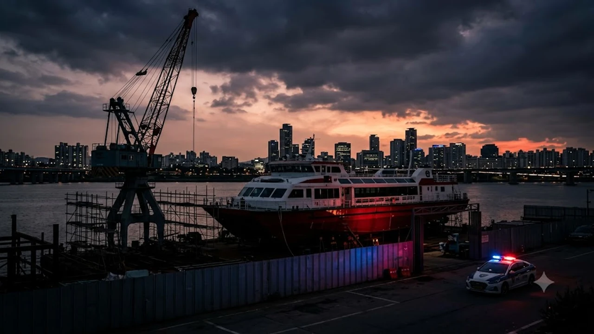

서울시가 야심 차게 띄운 수상 대중교통 프로젝트 뒤편에서 상상하기 힘든 비리 정황이 터져 나왔습니다. 국정감사에서 불거진 **한강버스 리베이트** 의혹이 단순한 풍문을 넘어 서울시의 전격적인 경찰 수사 의뢰로 이어지며 공공 교통 정책 전반에 대한 신뢰를 송두리째 뒤흔들고 있습니다. 시민의 세금 수백억 원이 투입되는 공공 선박 건조 사업에 대체 어떤 검은돈이 오갔는지, 당신이 모르는 진실을 팩트 중심으로 낱낱이 파헤쳐 봅니다.

## 한강버스 건조 사업 둘러싼 3억대 리베이트 의혹 전말

솔직히 말하면, 대중교통 인프라를 구축하는 과정에서 특정 브로커와 공기업 간부가 뒷돈을 주고받았다는 폭로는 충격 그 자체입니다.

### 10월 국정감사에서 터져 나온 선박 건조 계약 내부 폭로
이번 사태의 도화선은 10월 중순 열린 국회 행정안전위원회 서울시 국정감사장이었습니다. 서울시가 도입을 추진 중인 한강 수상버스(한강버스) 선박 제작 계약 과정에서 무려 3억 2천만 원 규모의 리베이트가 오갔다는 내부 녹취와 증언이 공개된 것입니다. 특정 민간 선박 건조 업체가 수주 권한을 따내기 위해 정치권 및 공공기관 줄을 대려 했다는 구체적인 폭로가 나오면서 국감장은 순식간에 아수라장이 되었습니다.

### 브로커 개입과 SH공사 고위 간부 유착 의혹의 사실관계
감사장에서 공개된 핵심 정황은 전문 브로커의 존재와 SH(서울주택도시공사) 고위 관계자의 연루 가능성입니다. 
- 건조 업체 선정 과정에서 브로커 A씨가 계약 금액의 일정 비율을 성공보수 및 로비 자금으로 요구
- 해당 자금 중 일부가 공공 출자 및 사업 관리를 총괄하는 SH공사 관계자들에게 흘러 들어갔다는 의혹
- 사업 추진 속도를 무리하게 맞추기 위해 통상적인 기술 심사 절차를 건너뛰었다는 내부 고발

이게 말이 됩니까. 시민의 발이 되어야 할 배를 만들면서 뒤로는 브로커가 수억 원의 수수료를 챙겼다는 정황은 결코 가볍게 넘길 수 없는 중대 사안입니다.

### 서울시의 전격 자체감사 중단 및 경찰 정식 수사 의뢰 배경
의혹이 걷잡을 수 없이 번지자 서울시는 즉각 입장문을 발표했습니다. 초기에는 서울시 감사위원회를 통한 자체 조사를 시도했으나, 민간 브로커와 사기업 간의 자금 거래는 지자체 감사권만으로 강제 파악하기 불가능하다는 결론을 내렸습니다. 결국 서울시는 자체 조사를 전면 중단하고 서울경찰청에 공식 수사를 의뢰하는 강수를 뒀습니다.

## 자체 감사 한계와 경찰 강제수사 전환의 쟁점

공공 사업에서 비리 잡음이 터져 나왔을 때 지자체 내부 조사는 매번 벽에 부딪힙니다. 수사기관의 강제수사가 불가피했던 현실적인 이유가 여기에 있습니다.

### 지자체 감사팀이 밝혀내지 못한 자금 흐름과 계탈 추적의 한계
행정기관 감사는 당사자가 자료 제출을 거부하거나 통장 내역 공개를 거부하면 강제로 들여다볼 권한이 없습니다. 
> "계좌 추적 영장이나 통신 조회 권한이 없는 내부 감사로는 차명 계좌를 거친 로비 자금의 실체를 밝혀낼 수 없다."

이러한 수사상 한계 때문에 강제수사 전환은 시간문제였습니다. 사태가 장기화될수록 공공 정책 전반에 대한 불신만 커지기 때문입니다. 공공 예산 낭비와 정책 비판을 다룬 [사회 전체 글 보기](/posts/society/)를 통해서도 알 수 있듯, 투명하지 못한 행정은 필연적으로 시민의 외면을 받습니다.

### 서울경찰청 배당과 향후 압수수색 등 강제수사 핵심 포인트
사건을 배당받은 서울경찰청 금융범죄수사대 또는 반부패수사대는 조만간 관련 선박 건조 업체 사무실과 SH공사 관련 부서에 대한 전격 압수수색에 착수할 전망입니다.
- 계약 체결 당시 심사위원 명단 및 평가표 조작 여부 확보
- 브로커와 공기업 간부 간 통화 녹음 파일 및 메신저 대화 포렌식
- 법인 계좌에서 인출된 현금의 최종 귀속처 추적

경찰이 이 핵심 고리를 얼마나 신속하게 꿰어 맞추느냐에 따라 이번 수사의 성패가 갈립니다.

### 리베이트 혐의 입증 시 적용 가능한 배임수재 및 뇌물죄 법적 처벌 수위
만약 의혹이 사실로 입증된다면 가담자들은 무거운 형사 처벌을 피할 수 없습니다. 형법상 배임수재죄는 물론, SH공사 직원이 직무와 관련하여 금품을 수수했다면 뇌물죄가 적용됩니다. 특정범죄 가중처벌 등에 관한 법률(특가법)에 따라 수수액이 1억 원 이상일 경우 무기 또는 10년 이상의 징역형까지 선고될 수 있는 엄중한 사안입니다.

## 한강 수상교통 정식 운항 일정과 사업 지속 여부 영향

비리 의혹도 심각하지만, 현실적인 문제는 당장 눈앞으로 다가온 한강버스의 정식 운항 일정입니다.

### 의혹 제기 선박 인도 지연 시 정식 개통 일정 차질 가능성
수사가 본격화되면 건조 중인 선박의 납품 검수와 대금 지급이 줄줄이 묶일 수밖에 없습니다. 경찰 조사를 받는 선박 제작 업체가 정상적인 납기를 맞추기는 사실상 불가능합니다. 당초 계획했던 선박 12척 중 의혹이 제기된 선박들의 인도가 기약 없이 미뤄진다면, 시범 운항 일정마저 차질을 빚게 됩니다.

### 기투입된 시 재정과 SH공사 출자금 안전성 점검
한강버스 사업에는 이미 서울시 예산과 SH공사의 막대한 출자금이 투입되었습니다. 계약이 파기되거나 건조가 중단될 경우 이미 지급된 선급금을 온전히 회수할 수 있을지도 불투명합니다. 세금이 낭비되는 전형적인 행정 실패의 그림자가 짙어지고 있습니다.

### 정치 공방으로 번진 대중교통 신규 사업 리스크
야당은 오세훈 시장의 역점 사업을 겨냥해 '총체적 부실과 정경유착'이라며 총공세를 펼치고 있고, 서울시는 '신속한 수사 의뢰로 의혹을 한 점 없이 털어내겠다'며 맞서는 중입니다. 결국 정쟁의 틈바구니에서 피해를 보는 것은 안전하고 쾌적한 출퇴근 교통수단을 기대했던 서울 시민들입니다.

## 논란 속 한강버스 이용객과 시민이 주목해야 할 체크포인트

이제 시민들이 두 눈 부릅뜨고 지켜봐야 할 것은 단순한 비리 처벌을 넘어 선박의 '진짜 안전'입니다.

### 운항 안전성 및 선박 품질 검증 절차 재확인 여부
뒷돈이 오가며 급하게 만들어진 배가 과연 거센 한강 물살을 안전하게 가를 수 있겠습니까. 리베이트 의혹보다 훨씬 두려운 것은 부실 건조로 인한 수상 사고 위험입니다.
- 선박 설계도 대비 실제 강판 두께 및 엔진 출력 적합성 전수조사
- 하이브리드 추진체 배터리 시스템의 화재 안전성 재인증
- 비상 상황 발생 시 구명정 전개 및 복원력 테스트 결과 투명 공개

이 세 가지 안전성 검증 결과가 명백하게 공개되기 전까지는 탑승을 꺼리는 시민들의 불안을 해소하기 어렵습니다.

### 향후 요금 체계 및 환승 할인 혜택 변동 가능성 점검
사업비가 늘어나거나 선박 도입 지연으로 유지비가 불어나면, 이는 고스란히 요금 인상 압박으로 돌아옵니다. 당초 기후동행카드 무제한 탑승 연계와 일반 대중교통 환승 할인 혜택이 정상 유지될 수 있을지 정책 변동 추이를 꼼꼼히 확인해야 합니다.

### 경찰 수사 결과 발표 일정과 서울시 후속 대책 확인법
경찰 수사는 최소 수개월이 걸릴 전망입니다. 서울시의 선박 발주 재공고 여부와 정식 취항 일정 조정 공지는 서울시 교통정보과 공식 보도자료를 통해 수시로 확인하는 습관이 필요합니다. 한강을 안전하게 건너고 싶은 시민들의 바람이 정치적 야심과 검은 리베이트에 멍드는 일은 결코 없어야 합니다.

[휴대용 구명조끼 및 수상 안전용품 쿠팡에서 보기](https://www.coupang.com/np/search?q=%ED%9C%B4%EB%8C%80%EC%9A%A9%EA%B5%AC%EB%AA%85%EC%A1%B0%EB%81%BC&sourceType=affiliate&trackingCode=AF8691300)

#한강버스 #한강버스리베이트 #서울시수사의뢰 #SH공사 #선박건조의혹 #한강수상버스 #서울경찰청수사 #대중교통비리