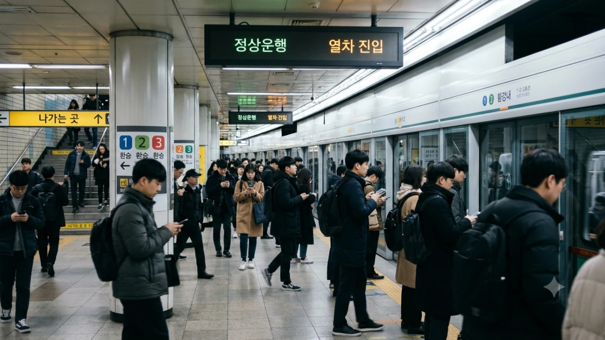

2026년 11월 25일 새벽, 출근길 교통대란을 우려하던 수도권 시민들이 한숨을 돌렸습니다. **서울 지하철 파업** 예고를 하루 앞두고 서울교통공사 노사가 밤샘 마라톤 협상 끝에 임금·단체협약(임단협)에 극적으로 합의했기 때문입니다. 매년 연말이면 어김없이 등장하는 파업 예고에 지친 시민이 적지 않은데, 이번에는 어떤 배경에서 극적 타결이 이루어졌고 노사가 도출한 3가지 핵심 합의안은 무엇인지 팩트 중심으로 정리했습니다.

## 서울 지하철 1·2·3노조 임단협 극적 타결 배경과 출근길 상황

### 16시간 마라톤 협상 끝에 25일 새벽 파업 전면 철회

서울교통공사 노사는 본교섭 결렬 이후 파업 돌입 시한을 코앞에 두고 16시간에 걸친 밤샘 교섭을 이어갔습니다. 공사 내에는 민주노총 소속 제1노조(서울교통공사노동조합), 한국노총 소속 제2노조(통합노조), 이른바 MZ노조로 불리는 제3노조(올바른노동조합)까지 총 3개의 교섭대표노조가 존재합니다.

각 노조의 지지 기반과 요구 우선순위가 달라 교섭 난항이 예상됐으나, 25일 새벽 사측이 대규모 인력 감축안을 보류하고 신규 채용 규모를 확대하는 수정안을 제시하면서 급물살을 탔습니다. 1·2·3노조 모두 최종 합의서에 서명함에 따라 예고됐던 전면 파업은 공식 철회되었습니다.

### 1~8호선 및 9호선·GTX-A 등 수도권 열차 정상 운행 현황

파업 철회 결정 직후 서울교통공사는 첫차부터 전 노선 정상 운행 체제에 돌입했습니다. 서울 도심과 외곽을 잇는 핵심 간선망이 멈추지 않으면서 출근길 대혼란은 피할 수 있었습니다.

- **서울 지하철 1~8호선:** 첫차부터 평시와 동일한 배차 간격으로 전 구간 정상 운행 중
- **9호선 및 민자·광역노선:** 9호선 2·3단계 구간은 물론 코레일 연계 구간 및 GTX-A 노선까지 환승 혼잡 없이 정상 가동
- **비상수송대책 해제:** 서울시가 준비했던 시내버스 출퇴근 집중배차 및 전세버스 투입 등 비상수송대책도 즉각 해제

## 서울교통공사 노사 최종 합의안 3가지 핵심 분석

### 2,212명 구조조정 계획 보류와 500명 신규 채용 확정

이번 협상에서 가장 치열했던 쟁점은 단연 인력 감축 문제였습니다. 당초 사측은 만성 적자 해소를 명분으로 2026년까지 총 2,212명의 정원을 감축하는 경영혁신계획을 밀어붙였습니다. 하지만 노조는 현장 안전 인력 부족과 업무 과부하를 이유로 강경하게 맞섰습니다.

> 노사는 기존 2,212명 규모의 강제적인 인력 감축 추진을 보류하고, 당장 현장에 투입할 **신규 채용 인원을 약 500명 수준으로 확정**하는 데 합의했습니다.

당장 발등에 불이 떨어진 역무·승무·차량 분야의 결원을 채우기로 하면서 파국을 막은 셈입니다.

### 총인건비 3.5% 이내 임금 인상 및 호봉승급분 별도 반영

임금 부문에서는 정부 지침과 노조의 실질임금 보전 요구 사이에서 절충점을 찾았습니다. 노사는 **총인건비 대비 3.5% 이내 임금 인상**에 합의했으며, 호봉승급분은 별도로 반영하기로 결정했습니다.

물가 상승률과 공공기관 임금 가이드라인을 동시에 고려한 결과로, 직급별 형평성 문제를 제기해 온 제3노조 역시 이 부분에서 사측의 수정안을 수용했습니다.

### 정년 연장·안전관리 강화 공동 TF 및 근무제도 개선

단순한 임금과 채용 숫자를 넘어 작업 환경과 제도 개선을 위한 후속 장치도 합의문에 담겼습니다.

- **안전관리 강화 공동 TF 구성:** 2인 1조 근무 원칙 준수 및 역사 내 안전사고 예방을 위한 노사 공동 태스크포스(TF) 가동
- **정년 연장 및 인력 운영 논의:** 고령화 추세와 숙련 인력 이탈 문제를 다루기 위한 정년 연장 관련 제도 개선 협의 지속
- **현장 근무환경 개선:** 혈액암 등 직업성 질환 예방을 위한 작업환경 측정 강화 및 휴게시설 확충

## 노사 양측의 핵심 쟁점과 양보 지점 비교

### 기존 사측 경영혁신계획과 노조 요구안의 입장 차이

협상 타결 전까지만 해도 양측의 간극은 좁혀지기 어려워 보였습니다. 사측은 누적 적자 18조 원대에 달하는 재무 위기를 극복하려면 인건비 비중 축소가 불가피하다는 입장이었습니다. 반면 노조는 적자의 주원인이 무임수송 손실과 낮은 운임 구조에 있는데, 그 책임을 현장 인력 감축으로 떠넘기는 것은 앞뒤가 맞지 않는다고 반박했습니다.

결국 사측은 '선(先) 구조조정' 카드를 접고 '선(先) 신규 채용 및 조직진단'으로 한발 물러섰고, 노조 역시 파업 강행 시 돌아올 시민들의 싸늘한 여론을 의식해 임금 인상폭과 세부 요구 수준을 조율하며 양보안을 받아들였습니다.

### 1·2·3노조별 세부 합의 사항(역 직통번호 폐지 등) 차이점

3개 노조가 공동으로 파업을 철회했지만, 각 노조가 중점적으로 관철한 세부 합의 사항에는 뚜렷한 차이가 있습니다.

- **제1·2노조 중심 요구안:** 외주화 철회 및 안전 인력 충원, 공공성 강화를 위한 정원 유지에 초점을 맞춰 신규 채용 확대를 이끌어냈습니다.
- **제3노조(올바른노조) 중심 요구안:** 악성 민원에 무방비로 노출되는 현장 직원 보호를 위해 **역 직통전화번호 폐지**와 대표번호 일원화, 그리고 성과급 및 수당 지급 기준의 공정성 확보를 관철했습니다.

## 향후 서울교통공사 인력 운영과 지하철 요금·안전 전망

### 조직진단 연구용역 결과에 따른 추가 노사 협의 과제

이번 합의로 당장의 출근길 대란은 막았지만, 갈등의 불씨가 완전히 꺼진 것은 아닙니다. 노사가 보류하기로 한 2,212명 인력 감축안은 폐기가 아니라 **외부 전문기관의 조직진단 연구용역 결과를 바탕으로 재논의**하기로 유예된 상태이기 때문입니다.

연구용역 결과에 따라 인력 재배치나 직무 효율화 방안이 다시 도마 위에 오를 경우, 내년 교섭에서도 노사 간 진통이 재연될 가능성을 배제할 수 없습니다.

### 인력 충원 지연 우려와 시민 안전 확보를 위한 후속 조치

신규 채용 500명이 확정되었더라도 실제 채용 공고부터 필기·면접, 현장 교육 배치까지는 최소 수개월이 소요됩니다. 그사이 발생하는 정년퇴직자 공백을 어떻게 메울지가 실질적인 안전 관리의 핵심입니다.

늦은 밤 귀가하는 직장인과 학생들의 불안감을 줄이려면 인력 공백기에도 역사 내 순찰과 안전 통제가 흔들리지 않아야 합니다. 야간 이동 시 안전 수칙과 지자체 지원 제도가 궁금하다면 [2026년 안심 귀가 서비스 완전 정리](/posts/society/youth-safety-stranger-anxiety-2026/) 글도 함께 확인해 보세요. 더불어 출퇴근길 이동 피로와 지하철 소음 스트레스를 줄이고 싶다면 [노이즈캔슬링 무선 이어폰 쿠팡에서 보기](https://www.coupang.com/np/search?q=%EB%85%B8%EC%9D%B4%EC%A6%88%EC%BA%94%EC%8A%AC%EB%A7%81+%EB%AC%B4%EC%84%A0+%EC%9D%B4%EC%96%B4%ED%8F%B0&sourceType=affiliate&trackingCode=AF8691300)를 통해 이동 환경을 보완하는 것도 한 가지 방법입니다.

#서울지하철파업 #서울교통공사파업철회 #지하철정상운행 #임단협타결 #서울지하철1호선 #출근길교통 #공공기관임금인상 #지하철신규채용