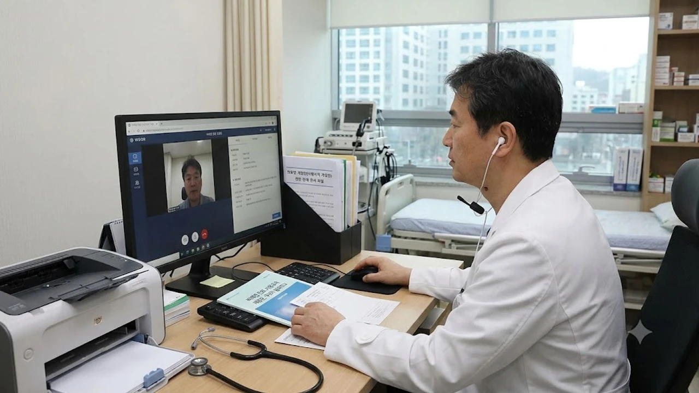

병원 대기실에서 두세 시간씩 허비하던 이들에게 집에서 전화 한 통으로 한 달 치 약을 받는 시스템은 꿈같은 현실일지도 모릅니다. 하지만 2026년 10월 19일 보건복지부가 비대면 진료 대상 확대와 처방일수 완화를 골자로 한 의료법 시행규칙 개정안을 입법예고하자마자, 의료계가 진료 거부(보이콧) 카드까지 꺼내 들며 정면 충돌하고 나섰습니다. 과연 이번 비대면진료 제도 개편은 환자를 위한 파격적 혜택일까요, 아니면 안전을 내팽개친 위험한 도박일까요?

## 비대면 진료 시행규칙 개정안, 무엇이 달라지나

### 만성질환 30일 장기 처방 허용 기준과 범위
정부가 내놓은 개정안의 핵심은 만성질환자의 처방 기간을 대폭 늘린 점입니다. 기존에는 약물 오남용을 막기 위해 1회 처방일수를 까다롭게 제한했지만, 이번 개정으로 **고혈압, 당뇨 등 재진 관리 질환에 대해 최대 30일까지 한 번에 처방전 발급**이 가능해졌습니다. 매달 약을 타기 위해 반차를 내고 병원을 찾아가던 직장인들에게는 분명 숨통이 트이는 변화입니다. 복지부는 거동이 불편한 고령층과 격오지 주민들의 의료 이용 문턱을 낮추기 위한 필수 조치라고 선을 그었습니다.

### 병원급 의료기관 확대 적용의 주요 변화
그동안 비대면 진료는 동네 의원급을 중심으로 제한 운영되어 왔습니다. 그러나 개정안은 **희귀질환자, 수술 후 지속적인 추적 관찰이 필요한 중증 환자**에 한해 상급종합병원 및 종합병원 등 대형병원의 비대면 진료 참여 범위를 구체적으로 명시했습니다. 진료를 받기 위해 지방에서 서울까지 반나절 넘게 이동하던 환자들의 물리적 부담을 덜어주겠다는 취지입니다. 반면 동네 1차 의료기관들은 대형병원으로 환자가 쏠려 골목 상권 격인 의원들이 고사할 것이라며 강하게 반발하고 있습니다.

## 의협의 진료 보이콧 경고, 핵심 쟁점 3가지

### 대면진료 원칙 훼손과 오진 위험성 논란
대한의사협회(의협)는 입법예고 당일 성명을 내고 "대면진료 중심이라는 의료 대원칙을 무너뜨린 행정편의주의"라고 맹비난했습니다. 모니터 화면이나 수화기 너머 목소리만으로는 환자의 미세한 안색 변화, 호흡음, 복부 촉진 결과나 급성 합병증 징후를 결코 파악할 수 없다는 지적입니다. 특히 30일 치 약을 한 번에 원격 처방할 경우, 복용 도중 발생하는 간·신장 독성이나 약물 부작용을 제때 잡아내지 못해 돌이킬 수 없는 사고로 이어질 수 있다는 경고를 쏟아냈습니다.

### 초진 플랫폼 의존 심화와 약물 오남용 우려
상업용 중개 플랫폼의 무분별한 환자 유치 경쟁도 뇌관입니다. 솔직히 말하면, 플랫폼 업체들이 이용자 수를 늘리려고 '빠른 배정', '원하는 약 처방'을 내세우며 사실상 자판기처럼 운영되는 현상이 이미 현장에서 적발된 바 있습니다. 진료의 질보다 건당 중개 수수료와 결제 실적만 앞서는 구조 속에서, 의사의 진단권은 무너지고 환자는 잠재적 위험에 무방비로 노출된다는 것이 현장 의료진의 공통된 목소리입니다. 사회 전반의 규제와 제도가 급변하는 흐름에 대한 논의는 [사회 전체 글 보기](/posts/society/)에서도 확인할 수 있습니다.

### 의료계가 요구하는 철회 조건과 현실적 대안
의협은 정부가 이번 시행규칙 개정을 원안대로 밀어붙인다면 산하 전 회원 대상 설문을 거쳐 **비대면 진료 플랫폼 참여 전면 중단(보이콧)**에 돌입하겠다고 배수진을 쳤습니다. 의료계가 내건 철회 조건은 명확합니다.

- 30일 장기 처방 조항 전면 폐지 및 기존 기준 유지
- 대형병원 진료 허용 범위 대폭 축소
- 진료 과오 발생 시 형사 책임 면책 범위 법제화
- 사설 중개 앱 수수료 규제 및 공공 플랫폼 중심 재편

이 조건들이 수용되지 않는다면 실제 진료 현장에서 참여 의사를 찾기 힘들어져 환자들만 중간에서 혼란을 겪는 파행이 불가피합니다.

## 환자 입장에서 따져본 편익과 숨은 리스크

### 병원 방문 시간 단축과 진료 접근성 개선
평일 낮에 짬을 내기 어려운 직장인이거나 거동이 불편한 부모님을 모시고 있다면, 스마트폰 터치 몇 번으로 진료와 처방전 전송이 끝나는 시스템은 분명 매력적입니다. 접수 대기, 진료 대기, 수납, 처방전 수령까지 최소 1~2시간 이상 걸리던 일련의 과정이 단 5분 안팎으로 압축됩니다. 특히 도서 벽지 거주자나 이동이 극도로 제한된 환자에게 원격 진료는 실질적인 의료 공백을 메우는 보완책 역할을 톡톡히 해냅니다.

### 부작용 발생 시 책임 소재와 분쟁 처리 문제
하지만 이 편리함 이면에 숨겨진 함정을 똑바로 직시해야 합니다. 만약 비대면으로 받은 30일 치 약을 먹다가 급성 신부전이나 알레르기 쇼크 같은 약물 부작용이 생기면 누구에게 책임을 물어야 할까요?

> "화면 너머 환자가 진술한 증상에만 의존해 처방했는데, 오진이나 약물 사고가 발생하면 모든 법적 책임을 의사 개인이 떠안아야 한다." — 현직 내과 전문의 인터뷰 중

현행 개정안에는 오진이나 사고 발생 시 명확한 분쟁 조정 기준과 면책 조항이 빠져 있습니다. 결국 의료 사고가 터지면 환자와 의사가 입증 책임을 두고 법정에서 소송전을 치러야 하는 구조입니다.

### 약 배송 허용 여부와 약국 조제 현장의 시각
진료는 원격으로 보더라도, 처방된 약을 손에 쥐는 문제는 또 다른 장벽에 부딪힙니다. 현행법상 약 배송은 감염병 격리 환자나 도서벽지 거주자 등 극히 예외적인 경우를 제외하고는 여전히 금지 상태입니다. 즉, 진료는 안방에서 보고 약은 직접 근처 약국을 찾아가서 받아야 하는 '반쪽짜리 원격 시스템'인 셈입니다. 약사회 역시 조제약 배달 허용 움직임에 대해 배송 중 변질, 복약 지도 부재, 오배송 위험을 이유로 결사항전 태세를 굽히지 않고 있습니다.

## 개정안 시행 전 꼭 알아둬야 할 이용 팁

### 진료 전 본인 질환의 비대면 처방 가능 여부 확인법
제도가 개정되더라도 모든 병이 비대면 대상이 되는 것은 아닙니다. 감기나 단순 몸살 등 급성 질환은 동일 의원에서 일정 기간 내 대면 진료를 받은 기록이 있어야 초진 비대면이 제한적으로 승인됩니다. 마약류 의약품이나 오남용 우려가 큰 특정 다이어트약, 탈모약, 여드름 치료제 등은 이번 개정에서도 비대면 처방 불가 대상 목록에 묶여 있으니, 본인이 처방받으려는 질환과 약물이 규제 대상인지 앱 이용 전 공지사항을 반드시 짚고 넘어가야 합니다.

### 실손보험 청구 및 본인부담금 변동 사항 체크리스트
비대면 진료 시 발생하는 진료비는 일반 대면 진료보다 본인부담금이 높게 책정되어 있습니다. 비대면 진료 시범사업 관리료 등 가산 수가가 붙기 때문입니다.
- **진료비 영수증 확인:** 비대면 관리료 가산 항목이 정상 반영되었는지 영수증 세부 내역을 챙깁니다.
- **실손의료비 청구 가능 여부:** 대부분의 실손보험에서 비대면 진료비 청구가 가능하지만, 보험사별로 모바일 전자영수증 외에 추가 진단서나 처방전 원본 제출을 요구하는 경우가 있으니 사전에 약관을 확인해야 합니다.
- **약제비 영수증 별도 보관:** 병원 진료비와 약국 조제비는 청구 트랙이 다르므로 결제 내역을 개별 저장해 두어야 누락을 막을 수 있습니다.

### 갈등 국면 속 안전하게 진료받는 단계별 가이드
의료계의 반발과 집단행동 조짐 속에서 불필요한 혼선을 피하려면 스스로 진료 방식을 점검해야 합니다.
1. 평소 본인의 기저질환을 관리해주던 동네 단골 병의원의 원장님과 먼저 비대면 진료 가능 여부를 조율합니다.
2. 처음 겪는 이상 증상, 극심한 흉통이나 호흡곤란, 고열 등은 비대면 앱을 켤 것이 아니라 지체 없이 응급실이나 대면 병원을 찾아가야 합니다.
3. 약을 택배로 받는 편법 서비스를 이용하지 말고, 본인이 지정한 약국에 처방전이 안전하게 팩스 전송되었는지 유선으로 확인 후 직접 수령합니다.

가정 내에서 만성질환을 꾸준히 관리하려면 정기적인 상태 측정이 필수입니다. 평소 가정용 혈압계를 구비해 수치를 매일 기록해 두면 원격 진료 시 의사에게 훨씬 정확한 건강 데이터를 전달할 수 있습니다.
[가정용 혈압계 쿠팡에서 보기](https://www.coupang.com/np/search?q=%ED%98%88%EC%95%95%EA%B3%84&sourceType=affiliate&trackingCode=AF8691300)

#비대면진료 #비대면진료개정안 #만성질환30일처방 #의협진료보이콧 #의료법시행규칙 #원격진료장단점 #비대면약처방 #실손보험비대면청구