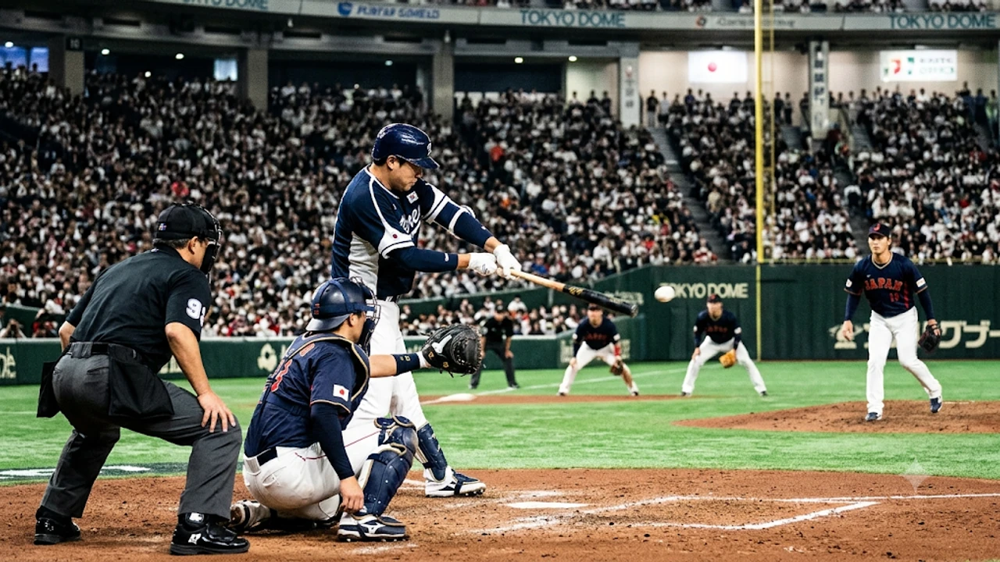

**2026 APBC 한일전**을 앞둔 한국 야구 대표팀이 조별리그 첫 경기에서 호주에 7-8 충격의 재역전패를 당하며 벼랑 끝에 몰렸습니다. 2026 아시아프로야구챔피언십(APBC) 결승 진출을 향한 교두보였던 첫 단추가 어긋나면서, 이제 13일 일본 도쿄돔에서 열리는 숙적 일본과의 2차전 결과가 대회 전체 운명을 가릅니다. 자력 진출이 어려워진 현시점에서 대표팀의 냉정한 전력 진단과 한일전 필승 해법, 그리고 복잡한 경우의 수까지 핵심만 짚었습니다.

## 2026 APBC 호주전 충격패 원인과 대표팀 현주소

### 6회 6득점 빅이닝에도 무너진 불펜진 분석

최원호 감독이 이끄는 한국 대표팀은 조별리그 1차전 호주와의 맞대결에서 0-4로 끌려가던 6회말, 폭발적인 집중력을 발휘하며 단숨에 승부를 뒤집었습니다. 김주원의 추격하는 2점 홈런을 시작으로 타선이 연속 출루에 성공했고, 이어 타석에 들어선 김휘집이 싹쓸이 3타점 2루타를 터뜨리며 순식간에 6득점 빅이닝을 완성했습니다.

하지만 리드는 오래가지 못했습니다. 8회초 불펜진이 뼈아픈 투런 홈런을 허용하며 동점을 내주었고, 9회초 마무리 카드로 투입된 최준용마저 호주 독립구단 출신 타자에게 결승 적시타를 맞고 무너졌습니다. **경기 후반 승부처에서 볼넷 허용과 제구 난조가 겹치며 스스로 위기를 자초한 점**이 7-8 재역전패의 결정적인 패인이었습니다.

### 투타 핵심 전력 냉정한 전력 비교분석

이번 대회 대표팀은 24세 이하 및 입단 3년 차 이하 젊은 선수들로 구성되어 세대교체와 국제대회 경험 축적이라는 뚜렷한 목표를 안고 출항했습니다. 호주전에서도 확인했듯 중심 타선의 장타력과 한 번 불붙으면 걷잡을 수 없는 응집력은 분명한 강점입니다.

반면 마운드의 높이와 경기 운영 노하우에서는 뚜렷한 약점을 노출했습니다. 국제대회 공인구 적응 문제와 낯선 도쿄돔 마운드 환경 속에서 투수들이 스트라이크 존 공략에 애를 먹었고, 이는 곧바로 투구 수 증가와 불펜 과부하로 이어졌습니다.

> "단기전 국제대회에서는 화려한 빅이닝보다 1점 차 리드를 지키는 불펜의 정교한 제구력과 수비 집중력이 승패를 가른다."

## 11연패 늪 '숙적' 일본전 승리 해법 3가지

### 한일전 예상 선발 투수 매치업 및 공략 포인트

한국 야구는 프로 선수들이 참가한 국제대회 한일전에서 최근 11연패라는 무거운 기록을 안고 있습니다. 연패의 사슬을 끊고 결승행 불씨를 살리기 위해서는 2차전 선발 마운드의 역할이 절대적입니다. 일본 역시 자국 리그에서 검증된 영건 에이스를 선발로 내세울 전망인 만큼, 초반 3이닝 동안 대량 실점을 막아내며 대등한 흐름을 끌고 가야 합니다.

- **초구 스트라이크 비율 확보:** 일본 타자들의 끈질긴 커트 능력을 무력화하기 위해 볼카운트를 유리하게 선점하는 공격적 피칭이 필요합니다.
- **낮은 코스의 변화구 활용:** 도쿄돔 특유의 타고투저 성향을 억제하려면 장타 허용률이 높은 높은 직구보다 종으로 떨어지는 포크볼과 슬라이더 구사율을 높여야 합니다.
- **발야구와 작전 수행:** 일본 투수진의 견제 동작과 포수의 송구 능력을 흔들기 위해 주루 센스가 뛰어난 테이블세터진의 적극적인 도루 시도가 요구됩니다.

### 도쿄돔 변수 극복을 위한 타선 배치 전략

도쿄돔은 인조잔디의 타구 속도가 빠르고 천장 조명과 흰색 지붕으로 인해 뜬공 처리가 까다로운 구장입니다. 1차전에서 맹타를 휘두른 김주원과 김휘집 등 타격감이 올라온 선수들을 전진 배치해 득점 생산력을 극대화해야 합니다.

상대 선발 투수가 마운드를 내려간 뒤 가동되는 일본의 필승조 불펜은 구속과 구위 모두 최상급입니다. 따라서 경기 중반 이전, 상대 선발이 흔들리는 틈을 놓치지 않고 선취점을 뽑아내며 일본 벤치의 투수 교체 타이밍을 앞당기는 전략이 유효합니다.

## 한국 대표팀 결승 진출 경우의 수 완전 정리

### 자력 진출 무산에 따른 TQB(팀 성적지표) 계산법

조별리그 풀리그 방식으로 진행되는 APBC는 4개국(한국, 일본, 대만, 호주) 중 상위 2개 팀만이 결승 무대를 밟습니다. 1패를 먼저 안은 한국은 남은 일본전과 대만전을 모두 승리하더라도, 다른 팀들의 전적에 따라 동률이 발생할 경우 **TQB(Team Quality Balance)** 규정을 적용받습니다.

TQB는 `(득점 ÷ 공격 이닝) - (실점 ÷ 수비 이닝)` 공식으로 산출됩니다. 호주전에서 7득점 8실점을 기록하며 1점 차로 패배한 점은 TQB 손실을 최소화했다는 측면에서 그나마 다행스러운 대목입니다. 남은 두 경기에서는 단순한 승리를 넘어 다득점·최소 실점 경기를 펼쳐 수치를 끌어올려야 합니다.

### 남은 조별리그 일정별 시나리오 장단점

- **최상의 시나리오 (2승 1패 마감):** 일본과 대만을 연파해 2승 1패를 달성하는 경우입니다. 만약 호주가 일본에 패배해 세 팀이 2승 1패로 물린다면 TQB 계산을 통해 결승 진출 티켓을 거머쥘 확률이 높습니다.
- **현실적 경계 시나리오 (1승 2패 마감):** 한일전에서 패배하고 대만전만 승리해 1승 2패가 된다면 결승행은 사실상 물 건너갑니다. 이 경우 3·4위 결정전으로 밀려나며 유종의 미를 거두는 데 만족해야 합니다.

국가대항전 토너먼트의 치열한 순위 경쟁과 이변의 역학 구조는 축구 무대에서도 동일하게 적용됩니다. 다른 종목의 국제대회 판도가 궁금하다면 [2026 FIFA 월드컵 한국 대표팀, 16강 넘을 수 있을까](/posts/sports/worldcup-2026-korea-preview/) 글에서도 흥미로운 전력 분석을 확인할 수 있습니다.

## 2026 APBC 한일전 중계 채널 및 시청 팁

### TV 및 모바일 실시간 생중계 플랫폼 안내

운명의 2026 APBC 한일전은 11월 13일 오후 7시 일본 도쿄돔에서 플레이볼됩니다. 야구팬들은 TV 생중계와 모바일 OTT 플랫폼을 통해 실시간으로 대표팀의 경기를 응원할 수 있습니다.

- **TV 중계 채널:** MBC 스포츠플러스(MBC+), SPOTV 등 주요 스포츠 전문 케이블 채널을 통해 고화질 생중계가 편성되어 있습니다.
- **모바일·PC 스트리밍:** 티빙(TVING) 등 공식 온라인 중계 플랫폼을 이용하면 이동 중에도 끊김 없는 실시간 시청과 주요 장면 다시보기 기능을 활용할 수 있습니다.

### 경기 직전 체크해야 할 선발 라인업 확인법

단기전 승부의 향방은 경기 시작 약 1시간 30분 전에 공개되는 선발 라인업에서 1차적으로 드러납니다. KBO 공식 SNS 채널과 야구 기록 전문 애플리케이션을 활용하면 양 팀의 선발 투수와 타순 변동을 가장 빠르게 파악할 수 있습니다. 집에서 편안하게 야구 중계를 즐기며 응원 분위기를 한층 끌어올리고 싶다면 [야구 응원용품 및 스포츠 굿즈 쿠팡에서 보기](https://www.coupang.com/np/search?q=%EC%95%BC%EA%B5%AC%EC%9D%91%EC%9B%90%EC%9A%A9%ED%92%88&sourceType=affiliate&trackingCode=AF8691300)를 통해 필요한 아이템을 미리 준비해 보는 것도 좋습니다.

#2026APBC #APBC한일전 #한국야구대표팀 #한일전야구중계 #APBC결승경우의수 #도쿄돔한일전 #한국호주야구 #야구국가대표일정