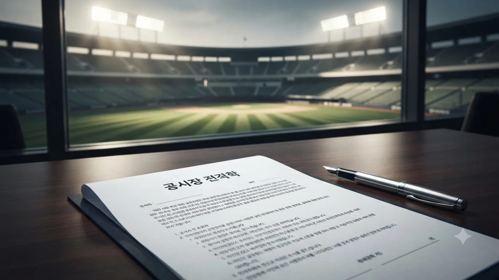
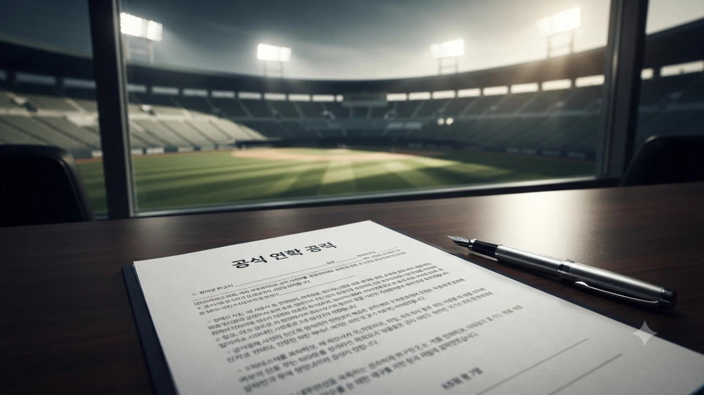

2026년 11월 말 프로야구 스토브리그가 본격적인 FA 계약 발표와 함께 **2026 KBO FA 보상선수** 지명 국면으로 접어들었습니다. 대형 자유계약선수(FA)의 유니폼이 바뀌면 원소속팀은 전력 누수를 막기 위해 보호선수 명단 외 자원을 뽑아 오는 치열한 수싸움을 시작합니다. 이번 스토브리그에서 놓치지 말아야 할 보상 규정 타임라인과 구단별 핵심 전략 3가지를 정리했습니다.

## 2026 KBO FA 시장 대형 계약과 보호선수 명단 제출 타임라인

### 등급별(A·B·C) 보상 규정 및 보호선수 제외 기준
KBO 규약상 FA 선수는 직전 3시즌 평균 연봉과 전체 연봉 순위, 나이를 기준으로 A·B·C 세 등급으로 분류됩니다. 등급에 따라 원소속팀이 영입 구단으로부터 받아 내는 보상 규모가 크게 달라집니다.

- **A등급:** 보호선수 20명 외 보상선수 1명과 전년도 연봉의 200%, 또는 선수 없이 전년도 연봉의 300%
- **B등급:** 보호선수 25명 외 보상선수 1명과 전년도 연봉의 100%, 또는 선수 없이 전년도 연봉의 200%
- **C등급:** 보상선수 지명 없이 전년도 연봉의 150%만 현금으로 보상

> **핵심 체크포인트:** 군 보류 선수, 당해 연도 신인 선수, 외국인 선수, 그리고 이미 FA 자격을 취득해 계약을 마친 선수는 보호선수 인원수 산정에서 자동 제외됩니다. 따라서 실제 구단이 묶어 둘 수 있는 1군 핵심 전력의 폭은 명단 숫자보다 훨씬 넓습니다.

### 보호선수 20인 명단 제출 마감일과 원소속팀 지명 기한
영입 구단은 KBO 총재의 FA 계약 공시일로부터 **3일 이내**에 원소속팀에 보호선수 명단을 넘겨야 합니다. 명단을 수령한 원소속팀 역시 받은 날로부터 **3일 이내**에 보상선수 지명 여부를 최종 통보해야 하므로, 계약 공시 후 일주일 안에 모든 줄다리기가 끝납니다. 이 짧은 72시간 동안 단장과 스카우트 팀은 퓨처스리그 트래킹 데이터와 트레이닝 파트의 메디컬 리포트를 밤새 대조하며 옥석을 가립니다.

### 현금 보상 대신 선수 지명을 선택할 구단별 상황 분석
A등급과 B등급 FA를 내준 원소속팀은 대개 현금보다 보상선수 지명을 1순위로 둡니다. 신인 드래프트 후 3~4년 걸리는 육성 시간을 건너뛰고 당장 1군 엔트리에 넣을 전력을 확보할 수 있기 때문입니다. 반대로 영입 구단의 1.5군 선수층이 얇아 보호선수 20인 혹은 25인 밖에 데려올 만한 자원이 없다면, 전년도 연봉의 300%(A등급 기준)를 현금으로 챙겨 외국인 선수 영입 한도나 구단 운영비로 돌리는 실리적 선택을 내립니다.

## 보호선수 20인 외 유출 위기에 놓인 숨은 유망주 및 베테랑

### 투수진 뎁스가 두터운 구단의 필승조 및 선발 자원
최근 한국시리즈에 올랐거나 150km/h대 강속구 유망주를 다수 보유한 상위권 구단은 20인 보호 명단을 짤 때 머리를 싸맵니다. 1군 선발 로테이션 5명과 핵심 불펜 6~7명, 주전 야수진을 먼저 묶고 나면 **상무·현역 복무를 막 마친 군필 투수나 1군 추격조 경험이 있는 20대 중반 우완·좌완 투수**가 어쩔 수 없이 21번째, 22번째로 밀려납니다. 마운드 보강이 시급한 원소속팀 입장에서는 이 '21번째 투수'가 사실상 최우선 타깃입니다.

### 내·외야 백업 경쟁에서 밀린 즉시전력감 야수 후보
주전 라인업이 탄탄한 팀에서는 타격 재능이나 멀티 포지션 수비력을 갖추고도 1군 타석 기회를 얻지 못한 백업 야수가 명단에서 빠질 공산이 큽니다. 특히 경기 후반 승부처를 뒤집을 대주자·대수비 스페셜리스트나 좌타 대타 요원은 144경기 장기 레이스를 버티는 데 빠질 수 없는 조각입니다. 벤치 전력이 얇은 구단은 제구가 불안한 투수 유망주 대신 곧바로 1군 백업 내·외야수로 투입할 수 있는 야수를 지명해 팀 공격력을 끌어올립니다.

### 샐러리캡 여력에 따른 고액 연봉 베테랑의 전략적 제외 가능성
KBO 경쟁균형세(샐러리캡) 상한선 압박이 커지면서 구단들은 고액 연봉 베테랑 선수를 의도적으로 보호선수 명단에서 빼는 심리전을 펼치기도 합니다. 연봉 규모가 큰 베테랑을 원소속팀이 지명하면 영입 구단은 샐러리캡 여유 공간을 확보할 수 있고, 반대로 원소속팀이 연봉 부담 때문에 지명을 포기하면 베테랑 선수를 고스란히 지키는 효과를 얻기 때문입니다.

## 구단별 보상선수 지명 전략과 전력 보강 시나리오

### FA 유출 구단의 약점 포지션 메우기 우선순위
FA 이적으로 주전 포수나 센터라인 내야수, 필승 계투조를 잃은 구단은 곧바로 해당 포지션의 구멍을 막는 데 집중합니다. 우선 영입 구단의 보호선수 명단에서 풀린 **동일 포지션 자원**을 찾지만, 눈높이에 맞는 선수가 없으면 포지션을 가리지 않고 전체 명단에서 가장 잠재력이 큰 선수를 뽑는 '최고 유망주(BPA) 지명'으로 방향을 틀어 팀 전체 자산 가치를 높입니다.

### 퓨처스리그 성적과 1군 활용도를 고려한 지명 기준
원소속팀 스카우트 파트는 1군 통산 성적뿐 아니라 최근 2년간 퓨처스리그(2군)에서의 평균 타구 속도, 볼넷 대비 삼진 비율(BB/K), 투수의 경우 포심 패스트볼 분당 회전수(RPM)와 구속 변화 추이를 면밀히 살핍니다. 1군 무대에서 아직 자리를 잡지 못했더라도 병역 의무를 마친 20대 초중반 군필 자원이라면 향후 5년 이상 팀의 허리를 책임질 수 있어 높은 평가를 받습니다. 프로야구 스토브리그 소식과 함께 다른 종목의 최신 흐름도 궁금하다면 [스포츠 전체 글 보기](/posts/sports/)에서 확인해 보세요.

## FA 보상선수 이적이 2027 시즌 판도에 미칠 영향

### 과거 보상선수 성공 사례로 본 팀 전력 상승 효과
역대 KBO 리그에서는 보상선수로 유니폼을 갈아입은 뒤 주전으로 도약해 원소속팀의 이적 공백을 완전히 지운 사례가 여럿 있습니다. 두산 베어스에서 삼성 라이온즈로 이적해 외야 한 자리를 꿰찬 김헌곤, LG 트윈스에서 한화 이글스로 옮겨 불펜의 핵심으로 활약한 장시환처럼 환경 변화와 출전 기회 보장이 맞물리면 선수의 잠재력이 폭발합니다. 이렇게 영입한 보상선수 한 명이 2027 시즌 중위권과 가을야구 진출을 가르는 결정적 변수로 작용합니다.

### 보상 지명 완료 후 이어질 2차 스토브리그 트레이드 전망
FA 계약과 보상선수 지명이 모두 끝나는 12월 초부터는 구단 간 **2차 트레이드 시장**의 문이 열립니다. 보상선수를 데려오면서 특정 포지션이 중복된 구단이 잉여 자원을 카드로 내놓고, 반대로 취약 포지션을 급히 채워야 하는 구단이 맞교환에 나서며 연쇄 이동이 일어납니다. 겨울철 실내 연습장이나 야외 캐치볼로 야구 감각을 유지하려는 사회인 야구 동호인이라면 관련 장비를 미리 점검해 보시기 바랍니다. [야구 글러브 및 훈련용품 쿠팡에서 보기](https://www.coupang.com/np/search?q=%EC%95%BC%EA%B5%AC+%EA%B8%80%EB%9F%AC%EB%B8%8C+%ED%9B%88%EB%A0%A8%EC%9A%A9%ED%92%88&sourceType=affiliate&trackingCode=AF8691300)

#2026KBOFA #FA보상선수 #보호선수20인 #KBO스토브리그 #프로야구FA #FA등급규정 #보상선수명단 #2027프로야구