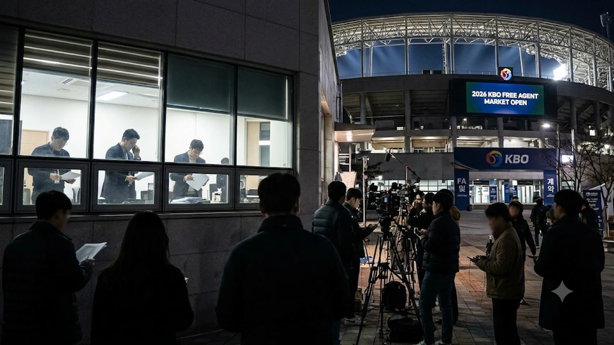

프로야구 2026 시즌 한국시리즈가 막을 내리고 본격적인 스토브리그의 꽃인 **2026 KBO FA** 시장이 열렸습니다. 이번 자유계약선수(FA) 시장에는 리그 판도를 뒤흔들 대어급 투수와 중심 타자들이 대거 쏟아지면서 구단 간의 치열한 머니 게임과 눈치싸움이 시작되었는데요. 샐러리캡(경쟁균형세) 압박과 보상 선수 규정 속에서 진짜 웃게 될 구단은 어디인지 핵심 관전 포인트를 짚어봅니다.

## 2026 KBO FA 시장 개장, 달라진 핵심 규정과 관전 포인트

### 등급별 보상 선수 및 보상금 규모 완벽 정리
KBO 리그의 FA 제도는 선수의 최근 3년간 연봉 순위와 나이, 이전 FA 취득 여부에 따라 **A등급, B등급, C등급**으로 나뉩니다. 구단들이 영입전을 펼칠 때 가장 먼저 계산기를 두드리는 지점이 바로 이 보상 규정입니다.

- **A등급:** 보호선수 20명 외 보상선수 1명 + 전년도 연봉 200% (또는 보상선수 없이 연봉 300%)
- **B등급:** 보호선수 25명 외 보상선수 1명 + 전년도 연봉 100% (또는 보상선수 없이 연봉 200%)
- **C등급:** 보상선수 없이 전년도 연봉 150%만 지급

특히 **B등급과 C등급**으로 분류된 베테랑 불펜이나 준척급 내야수들은 1군 즉시 전력 유망주를 내주지 않아도 되기에 개장 직후부터 복수 구단의 러브콜을 받으며 시장의 불을 지피는 기폭제 역할을 합니다.

### 샐러리캡(경쟁균형세) 상한액이 영입전에 미치는 영향
모든 구단에게 적용되는 경쟁균형세(샐러리캡) 상한선은 이번 스토브리그에서도 가장 강력한 변수로 작용합니다. 상한액을 초과할 경우 초과분의 50%에서 최대 150%까지 제재금을 내야 하며, 신인 지명권까지 1라운드가 밀리는 페널티를 받기 때문입니다.

> "모기업의 자금력만 믿고 예전처럼 백지수표를 내밀 수 없는 구조다. 기존 고액 연봉자들의 계약 구조와 연계한 치밀한 샐러리캡 설계가 영입 성패를 가른다."

따라서 구단들은 계약 첫해 연봉을 낮추고 옵션 비중을 높이거나, 다년계약을 통해 연평균 지급액을 분산시키는 **백로드(Back-loaded) 계약** 방식을 적극 활용하고 있습니다.

### 2026 스토브리그 시장 과열을 부른 3가지 변수
이번 시장이 유독 뜨겁게 달아오르는 이유는 크게 세 가지입니다. 첫째는 2026시즌 포스트시즌에서 드러난 **불펜 과부하** 현상으로 인해 검증된 필승조 자원의 가치가 폭등했다는 점입니다. 둘째는 홈런 타자 부족에 시달리는 구단들이 늘어나면서 장타력을 갖춘 코너 내야수 및 외야수 품귀 현상이 빚어졌다는 사실입니다. 셋째는 아시아쿼터 제도와 외국인 선수 교체 변수까지 겹치며 국내 즉시 전력감 확보가 1년 농사의 성패를 좌우하게 된 환경 변화입니다.

## 2026 FA 대어급 투수·타자 최대어 분석

### 선발·불펜 투수 FA 최대어 3인의 시장 가치 비교
투수 파트에서는 이닝 소화력을 갖춘 토종 선발 자원과 시속 150km 이상의 강속구를 뿌리는 필승조 투수들이 시장의 정점에 서 있습니다. 선발 투수의 경우 규정이닝을 꾸준히 채울 수 있는 내구성이 핵심 평가 기준이 되며, 4년 기준 총액 80억 원에서 100억 원대 대형 계약의 주인공이 탄생할 가능성이 높습니다.

반면 불펜 최대어들은 선발에 비해 총액 규모는 작지만, **B등급 이하**의 유리한 보상 조건 덕분에 실질적인 영입 경쟁률은 오히려 더 치열합니다. 가을야구 진출을 노리는 팀이라면 7~8회를 막아줄 확실한 셋업맨 영입이 곧 승수 추가로 직결되기 때문입니다.

### 중심 타선 보강을 이끌 야수 FA 핵심 자원 평가
야수 시장에서는 출루율과 장타율을 겸비한 중심 타선 자원과 수비 안정감이 뛰어난 센터라인(포수·유격수·중견수) 자원이 주목받고 있습니다. 최근 3시즌 동안 OPS 0.850 이상을 기록한 타자들은 타선 전체의 무게감을 바꿀 수 있는 카드로 평가받습니다.

- **장타력 보유 코너 야수:** 1루수나 좌익수 포지션에서 시즌 20홈런 이상을 기대할 수 있는 타자는 하위권 팀들의 득점력 갈증을 단숨에 해소해 줍니다.
- **멀티 포지션 내야수:** 2루와 3루, 유격수를 모두 소화할 수 있는 유틸리티 자원은 주전 선수의 체력 안배와 부상 공백을 메우는 핵심 퍼즐입니다.

### 부상 이력과 에이징 커브에 따른 오버페이 리스크 점검
화려한 커리어를 보유한 선수라 하더라도 계약 기간 4년 동안 전성기 기량을 유지할 수 있을지는 냉정하게 따져봐야 합니다. 특히 30대 중반에 접어든 베테랑 선수의 경우 **에이징 커브(나이에 따른 기량 하락)**와 최근 2년간의 부상자 명단(IL) 등재 이력이 협상 테이블의 최대 쟁점입니다. 구단들은 보장 금액을 줄이는 대신 출장 경기 수와 이닝, 타석 수에 따른 인센티브 조항을 촘촘하게 설계해 리스크를 방어하고 있습니다.

## 전력 보강에 사활을 건 구단별 영입 시나리오

### 대권 도전을 선언한 상위권 구단의 약점 보완 전략
한국시리즈 우승 문턱에서 고배를 마셨거나 왕조 구축을 노리는 상위권 구단들은 **'원포인트 보강'**에 집중합니다. 이미 탄탄한 주전 라인업을 갖춘 만큼, 전체적인 틀을 흔들기보다 취약 포지션 단 한 곳을 채우기 위해 과감하게 지갑을 여는 전략입니다. 선발진은 리그 최강이지만 뒷문이 불안했던 팀이 외부 불펜 최대어 1명에게 자원을 집중 투자해 우승 퍼즐을 완성하는 방식이 대표적입니다.

### 리빌딩과 성적을 동시에 노리는 중위권 구단의 선택
5강 싸움에서 아쉽게 탈락한 중위권 팀들에게 이번 FA 시장은 도약의 발판입니다. 유망주들의 성장을 기다리는 것만으로는 한계가 명확하기 때문에, 젊은 선수들의 멘토 역할을 해줄 베테랑 야수나 이닝이터 선발 투수를 영입해 **즉시 전력 강화와 육성**이라는 두 마리 토끼를 노립니다. 이들은 A등급 선수 영입 시 유출될 유망주 출혈을 막기 위해 주로 B등급 및 C등급 알짜 FA 영입전에 적극 뛰어듭니다.

### 내부 FA 단속이 최우선 과제로 떠오른 팀들의 계산법
외부 영입보다 집토끼 단속이 발등의 불인 구단들도 있습니다. 팀의 프랜차이즈 스타나 클럽하우스 리더가 시장에 나온 경우, 선수를 놓쳤을 때 돌아올 팬심 악화와 전력 누수를 감당하기 어렵기 때문입니다. 다른 구단의 거센 추격을 뿌리치고 잔류를 이끌어내기 위해서는 시장 개장 초기부터 진정성 있는 조건을 제시해 선수가 타 구단과 협상 테이블을 차리기 전에 도장을 찍게 만드는 속도전이 필수입니다.

## 성공적인 FA 영입을 가르는 최종 승부처

### 원소속팀 잔류와 이적 사이에서 갈리는 협상 타이밍
FA 협상은 심리전입니다. 개장 첫 주에는 원소속팀과 선수 측이 서로의 눈높이를 확인하며 탐색전을 벌이지만, 첫 번째 대형 계약이 발표되는 순간 도미노처럼 시장 전체가 급물살을 타게 됩니다. 선수는 시장의 기준점이 세워지기를 기다리고, 구단은 경쟁 팀이 제시한 금액이 거품인지 실체인지 파악하느라 치열한 정보전을 펼칩니다. 결국 구단이 설정한 **'마지노선'을 지키는 냉정함**이 훗날 구단 운영의 건전성을 결정합니다.

### 비FA 다년계약 및 트레이드 연계 시나리오 전망
최근 KBO 스토브리그의 또 다른 트렌드는 예비 FA 선수를 미리 묶어두는 **비FA 다년계약**과 FA 보상선수 지명 직후 이루어지는 **연계 트레이드**입니다. FA 시장에서 원하는 포지션의 선수를 놓친 구단은 곧바로 트레이드 시장으로 눈을 돌려 잉여 자원을 내주고 약점을 메우는 플랜 B를 가동합니다. 야구 외에 국제 스포츠 빅이벤트가 궁금하다면 [스포츠 전체 글 보기](/posts/sports/)에서 더 많은 소식을 확인할 수 있습니다.

### 2027 시즌 판도를 뒤바꿀 스토브리그 최종 관전법
결국 이번 2026 KBO FA 시장의 진짜 승자는 가장 많은 돈을 쓴 팀이 아니라, **샐러리캡 여유분을 효율적으로 배분해 팀의 가장 아픈 곳을 정확히 치료한 팀**이 될 것입니다. 계약 규모라는 화려한 숫자 이면에 숨겨진 옵션 조건, 보상 선수 유출 여부, 그리고 기존 유망주들과의 포지션 교통정리까지 함께 지켜본다면 다가오는 2027 시즌 프로야구 판도를 훨씬 입체적으로 예측할 수 있습니다. 스토브리그의 뜨거운 열기를 느끼며 집이나 야구장에서 직접 경기를 응원할 때 필수적인 KBO 굿즈와 응원용품도 미리 챙겨보시기 바랍니다. [프로야구 응원용품 쿠팡에서 보기](https://www.coupang.com/np/search?q=%ED%94%84%EB%A1%9C%EC%95%BC%EA%B5%AC%EC%9D%91%EC%9B%90%EC%9A%A9%ED%92%88&sourceType=affiliate&trackingCode=AF8691300)

#2026KBOFA #KBO스토브리그 #프로야구FA #FA최대어 #KBO이적시장 #프로야구소식 #야구트렌드 #스토브리그분석