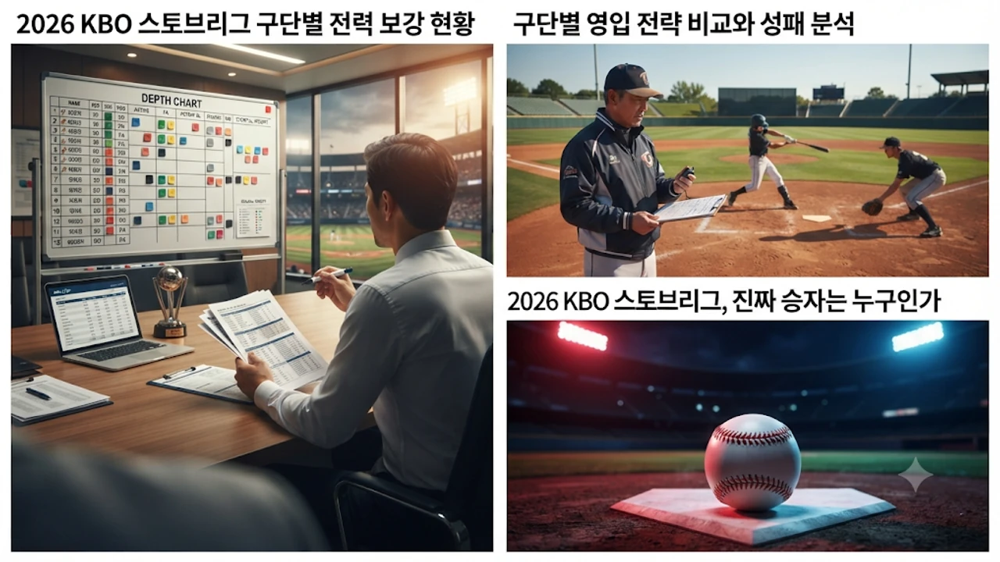

한국시리즈의 열기가 채 가시기도 전에 막을 올린 **2026 KBO 스토브리그**가 본격화하면서 10개 구단 프런트의 수 싸움이 치열합니다. 내년 시즌 대권 재도전을 선언한 상위권 팀부터 가을야구 복귀를 벼르는 하위권 팀까지, 각 구단은 FA 시장과 트레이드 카드를 쥐고 전력 보강에 사활을 걸고 있습니다. 스토브리그 초기 구단별 영입 기조와 현실적인 전력 변화 포인트를 짚어봅니다.

## 2026 KBO 스토브리그 구단별 전력 보강 현황

### 상위권 수성을 위한 디펜딩 챔피언의 선택
왕좌를 지켜야 하는 상위권 구단들은 무리한 외부 쇼핑보다 **집토끼 단속과 불펜 뎁스 강화**에 무게를 둡니다. 포스트시즌이라는 단기전 무대에서는 결국 선발진의 체력 안배와 필승조의 구위가 승패를 가르기 때문입니다. 내부 FA 자원을 붙잡는 동시에 2차 드래프트나 방출 선수 시장에서 검증된 베테랑 불펜을 수혈하며 기존 전력의 균열을 막는 데 집중합니다.

### 중하위권 반등을 노리는 구단들의 과감한 투자
가을야구 문턱에서 고배를 마셨던 중하위권 구단들은 지갑을 활짝 열며 공격적인 행보를 보입니다. 특히 장타력을 갖춘 중심 타자나 150이닝 이상을 책임질 선발 자원을 확보하기 위해 시장 개장과 동시에 협상 테이블을 차렸습니다. 타선의 응집력이 떨어져 1점 차 접전에서 무너졌던 팀일수록 **확실한 해결사 영입**으로 팀 체질 자체를 바꾸려는 의지가 뚜렷합니다.

### 샐러리캡 변수와 각 구단의 현실적 영입 한계
KBO 리그에 자리 잡은 샐러리캡(경쟁균형세) 제도는 이번 스토브리그에서도 구단들의 발목을 잡는 핵심 변수로 작동합니다.
- 고액 연봉자가 몰린 수도권 인기 구단들은 상한선 초과에 따른 제재금과 신인 지명권 하락을 피하려고 대형 계약에 신중을 기합니다.
- 샐러리캡 여유가 있는 구단들은 이 틈을 파고들어 다년 계약이나 옵션 비중을 높이는 변형 계약 구조로 협상 우위를 점하려 합니다.

## 구단별 영입 전략 비교와 성패 분석

### 즉시 전력감 중심의 단기 승부수 전략
당장 다음 시즌 우승이나 5강 진입이 절실한 구단들은 기량이 검증된 A급 외부 FA 영입에 승부를 겁니다. 리그 적응이 따로 필요 없는 베테랑을 데려오면 스프링캠프부터 곧바로 베스트 라인업을 가동할 수 있습니다. 다만 원소속팀에 내줘야 하는 보상 선수 출혈과 고액 계약으로 인한 중장기적 자금 경직성은 구단이 감당해야 할 몫입니다.

### 유망주 육성과 내부 단속 위주의 장기 플랜
외부 시장의 과열된 몸값 경쟁에서 한발 물러선 구단들은 퓨처스리그에서 성장한 젊은 야수와 투수들에게 주전 자리를 열어주는 방향을 택했습니다.
- 상무나 현역 복무를 마치고 복귀하는 예비역 선수들의 합류를 전력 보강의 핵심 축으로 삼습니다.
- 외국인 선수 교체 카드를 적극 활용해 구멍 난 포지션의 빈자리를 메우는 실리적인 노선을 걷습니다.

> "스토브리그의 진짜 승자는 돈을 가장 많이 쓴 팀이 아니라, 팀의 가장 아픈 약점을 최소한의 출혈로 메운 팀이다."

### 영입 포지션별 기대 효과 및 시너지 분석
포지션에 따른 전력 상승 체감도는 확연히 다릅니다. **센터라인(포수·유격수·중견수) 보강**에 성공한 팀은 투수진의 평균자책점 하락이라는 연쇄 수비 시너지를 얻습니다. 반면 코너 내야수나 지명타자를 영입한 팀은 득점권 타율 상승과 클린업 트리오의 무게감 증가를 통해 타선 전체의 파괴력을 끌어올립니다.

## 2026 스토브리그 영입 정책의 명암

### 공격적 투자 구단이 얻는 전력 상승의 장점
과감한 투자를 단행한 구단은 비시즌 내내 팬들의 폭발적인 관심과 홈 관중 동원력 상승이라는 부가 효과를 챙깁니다.
- 검증된 주전급 선수가 합류하면서 기존 선수단 내부에 팽팽한 주전 경쟁 긴장감이 감돕니다.
- 패배 의식에 젖어 있던 하위권 팀이라면 더그아웃 분위기를 뒤바꾸고 접전 상황에서 중심을 잡아줄 구심점을 확보하게 됩니다.

### 오버페이와 보상 선수 출혈이라는 치명적 단점
영입 경쟁이 과열되면서 선수의 실제 기대치보다 훨씬 큰 금액을 안기는 오버페이 사례도 어김없이 나옵니다. 계약 첫해부터 부상이나 에이징 커브로 부진에 빠지면 남은 계약 기간 내내 샐러리캡 운영을 묶어버리는 악성 계약으로 전락합니다. 여기에 20인 보호선수 명단 외 유망주를 보상 선수로 뺏기면 3~4년 뒤 팀의 허리를 받칠 미래 자원까지 잃는 이중고를 겪습니다.

## 다음 시즌 판도를 바꿀 핵심 관전 포인트

### 새 유니폼을 입은 이적생들의 예상 보직
유니폼을 갈아입은 이적생들이 새 홈구장의 규격과 코칭스태프의 작전 색깔에 얼마나 빨리 스며드는지가 관건입니다. 잠실구장처럼 외야가 넓은 구장으로 옮긴 타자는 장타 감소에 대비한 타격 밸런스 조정이 필요하고, 타자 친화적 구장으로 둥지를 튼 투수는 피홈런 억제 능력을 입증해야 합니다. 국내 야구 팬들이 비시즌 KBO 이적 시장을 주시하는 가운데, 축구 팬들 역시 [스포츠 전체 글 보기](/posts/sports/)를 통해 국제 대회 소식과 종목별 최신 이슈를 함께 챙겨보고 있습니다.

### 스프링캠프 전까지 주목해야 할 잔여 변수
FA 시장의 큰 장이 닫힌 뒤에도 구단들의 전력 재편은 멈추지 않습니다. 미계약 상태로 남은 베테랑들의 사인 앤드 트레이드 여부, 구단별 잉여 자원과 취약 포지션을 맞바꾸는 1대1 트레이드가 스프링캠프 출국 직전까지 물밑에서 이어집니다. 새 외국인 선수 3인방의 메디컬 테스트 통과와 계약 발표 역시 전력 평가의 마침표를 찍는 변수입니다.

### 2027 시즌 KBO 순위 판도 조기 예측
이번 스토브리그 결과에 따라 내년 시즌은 절대 강자 없는 치열한 중위권 혼전으로 흘러갈 공산이 큽니다. 상위권 팀들의 전력 누수가 일부 생긴 반면 하위권 팀들이 약점 보완에 속도를 내면서, 개막 초반부터 반 게임 차 이내의 촘촘한 순위 다툼이 펼쳐질 전망입니다. 비시즌 동안 착실하게 뎁스를 채운 구단이 144경기 장기 레이스의 체력 고비를 넘기고 가을야구 티켓을 거머쥐게 됩니다. 야구 직관 시즌을 미리 준비하거나 사회인 야구 및 개인 훈련을 계획 중이라면 [야구 글러브 및 배트 용품 쿠팡에서 보기](https://www.coupang.com/np/search?q=%EC%95%BC%EA%B5%AC%EC%9A%A9%ED%92%88&sourceType=affiliate&trackingCode=AF8691300)에서 필요한 장비를 둘러보세요.

#2026KBO스토브리그 #프로야구FA #KBO이적시장 #프로야구전력분석 #샐러리캡 #구단별영입현황 #2027프로야구전망 #야구스토브리그