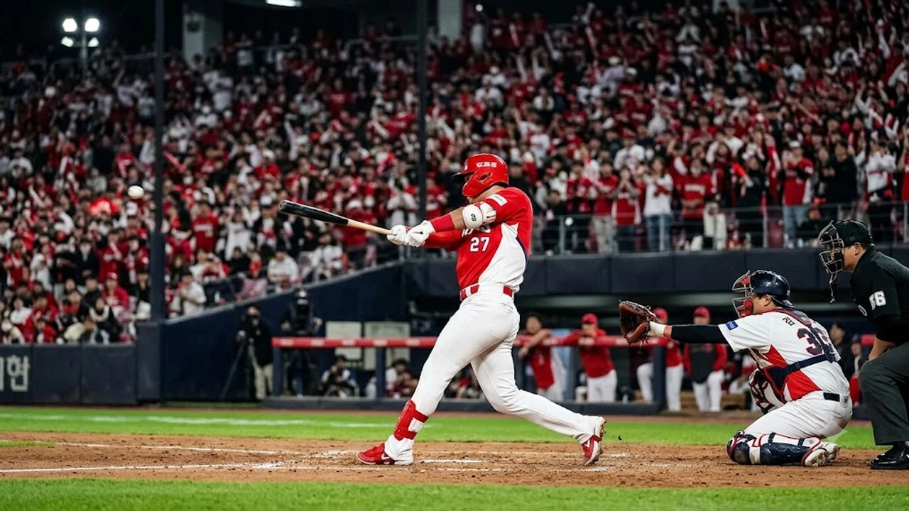

2026 KBO 포스트시즌의 열기가 절정으로 치닫는 가운데, **KIA LG 준PO 2차전**은 플레이오프 티켓의 향방을 가를 최대 승부처입니다. 1차전을 잡으며 기선을 제압한 KIA 타이거즈와 벼랑 끝에서 반격을 노리는 LG 트윈스가 이번 가을야구 시리즈의 주도권을 두고 정면충돌합니다. 단기전 특유의 팽팽한 긴장감 속에서 양 팀 사령탑의 벤치 수싸움과 선발 투수의 어깨에 모든 시선이 쏠립니다.

## 1차전 김도영 멀티포가 바꾼 준PO 판도

### 1차전 승리팀의 PO 진출 확률 70.6%의 무게
역대 5전 3선승제로 치러진 KBO 준플레이오프에서 1차전을 선점한 팀이 플레이오프에 진출한 확률은 무려 **70.6%**(17회 중 12회)에 달합니다. 1차전 승리는 단순한 1승 이상의 가치를 지니며, 투수 운용의 유연성과 선수단 심리적 안정감을 동시에 안겨줍니다.

> "단기전 첫 경기의 승패는 시리즈 전체의 볼카운트 싸움과 같다. 1차전을 가져간 팀은 상대 실수를 유도하는 공격적 경기 운영이 가능해진다."

LG는 와일드카드 결정전을 거쳐 올라오며 누적된 피로 속에서 반드시 2차전을 잡아야만 잠실 홈으로 돌아가 승부를 원점으로 돌릴 수 있는 배수의 진을 쳤습니다.

### 광주 홈런 레이스로 본 KIA 타선의 화력 집중력
1차전 승리의 일등 공신은 단연 중심 타선에서 터진 장타력이었습니다. 김도영이 쏘아 올린 역전 솔로 아치와 경기 후반 승부에 쐐기를 박은 2점 홈런은 상대 벤치의 마운드 계산을 완벽하게 무너뜨렸습니다. 광주-기아 챔피언스필드의 특성상 우중간 펜스 쪽으로 형성되는 타구의 비거리가 길게 뻗어나가는 경향이 있는데, KIA 중심 타선은 실투를 놓치지 않고 완벽한 풀스윙으로 공략했습니다. 장타로 흐름을 단숨에 가져오는 KIA의 응집력은 시리즈 전체를 관통하는 핵심 무기입니다.

### LG 불펜 조기 투입의 득과 실
LG는 1차전 중반 실점을 억제하기 위해 필승조 자원을 조기에 투입하는 강수를 뒀습니다. 추격 흐름을 이어가기 위한 필연적 선택이었으나, 투수들의 투구 수가 늘어나며 2차전 연투 부담을 안았습니다. 단기전에서는 불펜의 구위 저하가 곧바로 경기 후반 장타 허용으로 이어집니다. 2차전에서 선발 투수가 긴 이닝을 버텨주지 못할 경우, LG 마운드는 시리즈 초반부터 심각한 과부하에 직면합니다.

## 준PO 2차전 선발 매치업 정밀 분석

### 올러의 체인지업 제구와 LG 좌타 라인업 상성
KIA의 2차전 선발 애덤 올러는 우완 정통파 투수로서 최고 150km/h에 육박하는 빠른 공과 낙차 큰 체인지업을 주무기로 삼습니다. LG 타선의 핵심인 홍창기, 문보경, 오지환 등 까다로운 좌타 라인을 상대로 체인지업의 우타자 바깥쪽(좌타자 바깥쪽 낮은 코스) 제구가 승패를 가릅니다. 볼카운트가 몰려 패스트볼 위주의 단조로운 승부로 이어질 경우 집중타를 맞을 수 있으므로, 경기 초반 변화구 스트라이크 비율을 얼마나 높이느냐가 관건입니다.

### 가을 사나이 임찬규의 빅게임 피칭 노림수
반격에 나서는 LG의 선발 카드는 포스트시즌 경험이 풍부한 임찬규입니다. 140km/h 초반의 속구에도 불구하고 정교한 체인지업과 슬로 커브를 섞어 타자의 타이밍을 완벽하게 뺏는 피칭 아트가 돋보입니다.

- 스트라이크 존 구석을 찌르는 칼날 제구
- 타자의 배트 중심을 비껴가는 완급 조절
- 누상에 주자가 나갔을 때 흔들리지 않는 위기관리 능력

KIA 타자들이 1차전 승리의 여운으로 초구부터 공격적인 스윙을 들고나올 공산이 큰 만큼, 유인구를 활용해 범타를 유도하는 노련한 수싸움이 통할지가 핵심입니다.

### 5회 이전 첫 실점 여부가 가를 투수 교체 타이밍
양 팀 벤치의 투수 교체 타이밍은 경기 중반인 4~5회에 요동칠 공산이 큽니다. 특히 0의 균형이 깨지는 첫 실점 순간, 벤치가 선발을 끝까지 신뢰할 것인지 혹은 한 박자 빠른 퀵후크로 불펜을 가동할 것인지가 경기 후반의 양상을 좌우합니다. 2차전마저 내줄 경우 탈락 위기에 몰리는 LG는 선발이 흔들리는 낌새만 보여도 가용 가능한 모든 자원을 쏟아부어야 하는 압박을 안고 있습니다.

## 시리즈 분수령이 될 공수 디테일 3가지

### 챔피언스필드 외야 수비 범위와 장타 억제력
챔피언스필드는 펜스 높이가 타 구장에 비해 비교적 낮아 외야수의 펜스 플레이와 타구 판단이 2루타 이상의 장타 허용 여부를 결정합니다. 1차전에서도 좌우 외야수의 기민한 첫 발 스타트가 실점 위기를 지워냈습니다. 2차전 역시 빗맞은 타구가 안타로 둔갑하거나 깊숙한 플라이가 펜스를 때리는 돌발 상황에서, 외야 수비진의 중계 플레이 속도와 정확도가 1점을 막아내는 결정타가 됩니다.

### 와일드카드전 피로 누적과 LG 기동력의 딜레마
LG의 가장 날카로운 창 중 하나는 적극적인 도루와 한 베이스를 더 가는 기동력입니다. 하지만 와일드카드전부터 연전을 치르며 야수진의 하체 피로도가 누적되어 무리한 주루 플레이가 자칫 주루사로 이어질 위험이 커졌습니다. 상대 배터리의 견제 동작과 팝타임(Pop-time)을 철저히 계산하지 않은 무모한 도루 시도는 경기 흐름을 단숨에 끊어놓는 자충수가 됩니다.

### 클러치 상황에서의 대타 카드와 벤치 수싸움
경기 후반 1~2점 차 박빙 승부에서는 승부처마다 등장할 대타 요원의 한 방이 승패를 뒤바꿉니다. 좌우놀이에 얽매이지 않고 상대 불펜의 구종 궤적에 최적화된 타자를 적재적소에 배치하는 벤치의 결단력이 요구됩니다. 가을 스포츠 전반의 치열한 전술 흐름은 [스포츠 전체 글 보기](/posts/sports/)에서 다른 종목 사례와 함께 확인할 수 있습니다.

## 플레이오프 직행 시나리오와 승부 전망

### KIA 2연승 시 잠실 3차전 운영 여유와 로테이션
KIA가 2차전마저 승리로 장식할 경우, 시리즈 전적 2승 무패를 기록하며 절대적인 고지를 점합니다. 잠실 원정 3차전에서 로테이션을 무리하게 앞당기지 않고 정상적으로 가동할 수 있으며, 불펜 필승조에게 충분한 휴식을 부여하는 여유를 얻습니다. 이는 플레이오프 진출 시 상위 시드 팀을 상대하는 데 있어서도 엄청난 체력적 밑천이 됩니다.

### LG의 시리즈 원점 회귀를 위한 1번 타자 출루율
LG가 승부를 1승 1패 원점으로 되돌리기 위해서는 리드오프의 출루가 절실합니다. 1번 타자가 1회부터 누상에 나가 상대 선발 투수의 투구 수를 늘리고 배터리를 흔들어야만 중심 타선의 적시타가 빛을 발합니다. 득점권 찬스를 지속적으로 만들어 상대 수비진에 심리적 압박을 가하는 것이 LG 반격의 유일한 돌파구입니다.

### 포스트시즌 승률 지표로 내다본 2차전 최종 향방
단기전 승부는 전력의 우열보다 당일 마운드의 제구 안정감과 득점권 집중력이라는 미세한 균형에서 갈립니다. 장타력의 우위를 점한 홈팀과 정교한 기동력을 앞세운 원정팀의 충돌은 결국 실책을 범하지 않는 팀의 승리로 귀결될 확률이 높습니다. 쌀쌀해진 가을 날씨 속에서 체온 유지와 컨디션 관리에 도움을 주는 [프로야구 가을야구 방한용품 및 스포츠웨어 쿠팡에서 보기](https://www.coupang.com/np/search?q=%ED%94%84%EB%A1%9C%EC%95%BC%EA%B5%AC%EC%9D%91%EC%9B%90%EC%9A%A9%ED%92%88&sourceType=affiliate&trackingCode=AF8691300)를 통해 가을야구의 열기를 더욱 쾌적하게 즐길 수 있습니다.

#프로야구 #KBO포스트시즌 #준플레이오프2차전 #KIA타이거즈 #LG트윈스 #김도영 #임찬규 #올러 #가을야구