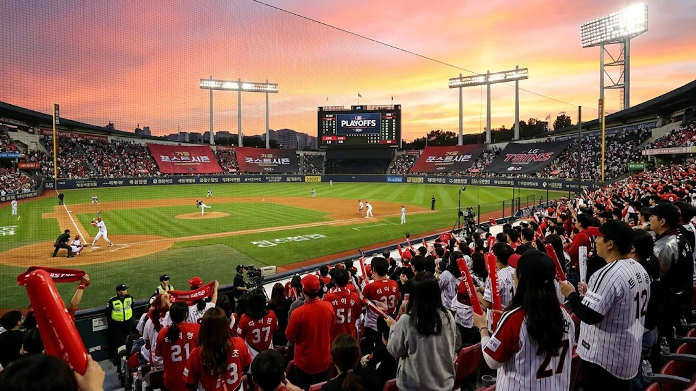

2026 KBO 포스트시즌의 열기가 절정으로 치닫는 가운데, 가을야구 최고의 흥행 카드로 꼽히는 KIA 타이거즈와 LG 트윈스의 준플레이오프 맞대결이 성사됐다. 양 팀 팬들의 접속이 폭주하면서 **2026 준플레이오프 예매** 경쟁이 치열해진 상태다. 광주와 서울 잠실을 오가는 치열한 단기전 승부를 현장에서 직접 지켜보기 위해 팬들이 숙지해야 할 핵심 동선과 실전 예매 노하우를 정리했다.

## 2026 KBO 준플레이오프 KIA vs LG 맞대결 성사와 경기 일정

### 10년 만의 가을야구 리턴매치 배경과 경기장 배정
정규시즌 3위 KIA 타이거즈와 와일드카드 결정전을 단 1경기 만에 끝낸 4위 LG 트윈스가 포스트시즌에서 맞붙는 것은 2016년 이후 10년 만이다. 탄탄한 팬덤을 자랑하는 두 전통 명문 구단이 격돌하는 만큼 전 경기 매진은 떼어 놓은 당상이다. 5전 3선승제로 치러지는 이번 시리즈는 상위 시드인 KIA의 홈 광주-기아 챔피언스필드에서 1·2차전과 5차전이 펼쳐지고, LG의 홈 서울 잠실야구장에서 3·4차전이 진행된다.

### 1·2차전 광주 기아챔피언스필드 및 3·4차전 잠실 일정 총정리
KBO 공식 일정상 준플레이오프는 10월 17일 토요일 오후 2시 광주 1차전으로 시작한다. 주말 낮 경기로 배정된 1차전과 2차전(10월 18일 일요일)은 오후 2시에 플레이볼이 선언되며, 주중 잠실로 자리를 옮겨 치르는 3차전(10월 20일 화요일)과 4차전(10월 21일 수요일)은 퇴근길 직관 팬들을 위해 오후 6시 30분에 열린다. 최종 5차전까지 갈 경우 10월 23일 금요일 오후 6시 30분 다시 광주에서 끝장 승부를 벌인다. 

### 우천 순연 가능성과 대체 경기 일정 가이드
가을철 기습적인 가을비로 경기가 취소되면 해당 경기는 다음 날로 순연되며 시리즈 전체 일정이 하루씩 뒤로 밀린다. 포스트시즌 경기 규정상 서스펜디드 게임이나 더블헤더는 원칙적으로 적용하지 않고 하루 1경기 진행을 유지한다. 만약 광주 1차전이 비로 취소되면 기존 예매 티켓의 효력은 밀린 경기로 자동 승계되므로 취소표 환불 규정과 순연 시 예매 유지 여부를 KBO 공지사항을 통해 미리 파악해 두어야 한다.

## 준플레이오프 NOL 티켓 예매 일정 및 단계별 절차

### 구단 멤버십 선예매 vs 일반 예매 오픈 시간표
포스트시즌 티켓 판매는 정규시즌 구단별 멤버십 혜택이 일절 적용되지 않고, 전 좌석이 KBO 공식 예매처인 NOL(야놀자) 티켓을 통해 일반 예매로 일괄 오픈된다. 광주 1·2차전 예매는 경기 이틀 전인 10월 15일 오후 2시와 3시에 순차적으로 열렸고, 잠실 3·4차전 티켓은 10월 16일 오후 2시부터 판매에 들어간다. 1인당 최대 예매 가능 매수는 4매로 제한되며, 정각 접속 시 수초 만에 1만 번 이상의 대기열이 형성되므로 정확한 오픈 시간 진입이 관건이다.

### NOL 티켓 서버 시계 확인 및 결제 수단 사전 등록법
수만 명이 몰리는 피케팅 환경에서는 핸드폰 시계 대신 NOL 티켓 예매 서버의 실제 물리적 시간(네이비즘 기준)을 초 단위로 대조해야 한다. 오픈 1초 전에 클릭하면 시스템 오류 화면으로 튕기므로 정확히 59초에서 00초로 전환되는 찰나에 접속 버튼을 눌러야 한다. 아울러 계정 로그인과 본인 인증을 사전에 완료해 두어야 결제 단계에서 멈추는 불상사를 막을 수 있다.

> **예매 전 필수 체크포인트**  
> 간편결제(카카오페이, 네이버페이, 페이코 등) 수단에 비밀번호나 생체 인증을 미리 등록해 두면 카드 번호를 일일이 수기 입력하는 경쟁자보다 결제 승인 시간을 15초 이상 단축할 수 있다.

### 모바일 앱 vs PC 웹 환경 접속 환경 최적화 전략
트래픽이 폭주할 때는 모바일 앱과 유선 랜선이 연결된 PC 브라우저를 동시에 켜두는 분산 접속이 안전하다. PC 환경에서는 크롬 브라우저의 팝업 차단을 해제하고 리소스를 잡아먹는 확장 프로그램을 꺼두어야 한다. 스마트폰은 불안정한 와이파이 대신 5G/LTE 단독 모드로 전환하고 캐시를 정리한 상태에서 진입해야 통신 오류를 피할 수 있다. 종목을 막론하고 대형 스포츠 이벤트는 회선 관리가 결과를 좌우하는데, 국내외 경기 흐름이 궁금하다면 [스포츠 전체 글 보기](/posts/sports/)에서 다른 종목 분석도 함께 읽어볼 만하다.

## 피케팅 뚫는 실전 예매 전략과 취소표 공략 3가지

### 대기열 발생 시 새로고침 방지와 단말기 분산 접속 요령
예매 창을 누른 직후 수천 번대의 대기열 숫자가 뜨더라도 **절대 새로고침(F5)을 눌러선 안 된다**. 대기 번호가 멈춘 것처럼 보여도 새로고침을 누르는 순간 세션 토큰이 날아가 대기열 맨 끝 순번으로 쫓겨난다. 다른 명의 계정을 활용해 스마트폰과 PC를 동시에 띄워두고 먼저 입장 번호가 뚫리는 단말기 1대에만 집중해 결제까지 밀어붙여야 한다.

### 자동 배정 vs 좌석 직접 선택의 실질 성공률 비교
치열한 가을야구 티켓팅에서 좌석 배치도를 보며 명당자리를 고르는 행위는 예매 실패를 자초하는 길이다. 좌석을 클릭하는 찰나에 다른 사용자가 0.1초 먼저 선점하면서 '이미 선택된 좌석' 팝업과 함께 예매창이 원점으로 돌아간다. 블록과 등급(내야지정석, 외야자유석 등)만 빠르게 찍고 **좌석 자동 배정**을 선택해 결제로 넘어가는 것이 예매 성공률을 끌어올리는 현실적인 방법이다.

### 새벽 취소표 풀리는 시간대 및 무통장 미입금 취소분 노리기
일반 예매 첫날 전석 매진이 뜨더라도 포기할 단계는 아니다. 결제 단계에서 무통장 입금을 선택한 예매자들의 미입금 취소분은 결제 당일 자정(24시 00분)을 기점으로 일괄 취소되어 시스템에 다시 반영된다.
- **1차 취소표 타이밍 (자정 직후):** 자정부터 새벽 0시 15분 사이 미입금 수백 장이 전산에 재등록되는 시간대
- **2차 취소표 타이밍 (새벽 2시~4시):** 단순 변심으로 인한 취소 티켓이 심야 서버 점검 후 불시에 노출되는 구간
- **3차 취소표 타이밍 (경기 당일 오전):** 매크로 및 암표 모니터링 시스템에 걸려 강제 회수된 티켓이 풀리는 시점

## 직관 팬을 위한 챔피언스필드·잠실 좌석 꿀팁 및 시야 가이드

### 광주 챔피언스필드 응원석 명당과 시야 방해석 피하는 법
광주-기아 챔피언스필드는 3루가 홈팀 응원석, 1루가 원정팀 응원석이다. 붉은 물결의 육성 응원을 즐기고 싶다면 3루 K9 및 K8 구역 118~122 블록을 노리는 편이 좋다. 반면 안전 난간이나 그물망 기둥에 홈 플레이트 시야가 가리는 K3 상단 1열은 피해야 한다. 탁 트인 시야에서 편안하게 야구를 즐기고 싶다면 외야 잔디석이나 중앙 테이블석이 알맞다.

### 잠실구장 원정 팬 추천 블록과 이동 동선 체크리스트
잠실에서 열리는 3·4차전은 1루가 홈팀 LG, 3루가 원정팀 KIA 구역이다. 잠실 3루 네이비석 328~331 블록은 그라운드 전체 시야가 한눈에 들어오는 가성비 명당이다. 반면 레드석 맨 앞 열(1~2열)은 난간 펜스에 시야가 걸릴 수 있으므로 3열 이후 좌석을 예매하는 편이 속 편하다. 경기 당일 종합운동장역 출구는 발 디딜 틈 없이 붐비므로 경기 시작 최소 1시간 30분 전에는 도착해야 응원용품 구매와 입장이 수월하다.

### 가을야구 현장 지류 티켓 발권 vs 모바일 스마트 티켓 입장 팁
경기 당일 현장 매표소 지류 티켓 무인 발권기는 대기 줄이 길게 늘어서 경기 1회 초를 놓치기 십상이다. 종이 티켓 수집 목적이 아니라면 NOL 티켓 모바일 앱의 스마트 티켓 바코드로 전용 게이트를 통과하는 편이 훨씬 빠르다. 10월 중순 야간 경기는 강바람과 기온 급락으로 체감 온도가 크게 떨어지므로 핫팩, 담요, 방한 패딩을 챙겨 체온 유지에 신경 써야 한다.
[야구 직관 방한용품 쿠팡에서 보기](https://www.coupang.com/np/search?q=%EC%95%BC%EA%B5%AC%EC%A7%81%EA%B4%80%EB%B0%A9%ED%95%9C%EC%9A%A9%ED%92%88&sourceType=affiliate&trackingCode=AF8691300)

#2026준플레이오프 #준플레이오프예매 #KIA타이거즈 #LG트윈스 #NOL티켓 #가을야구티켓팅 #챔피언스필드좌석 #잠실야구장예매 #야구취소표공략