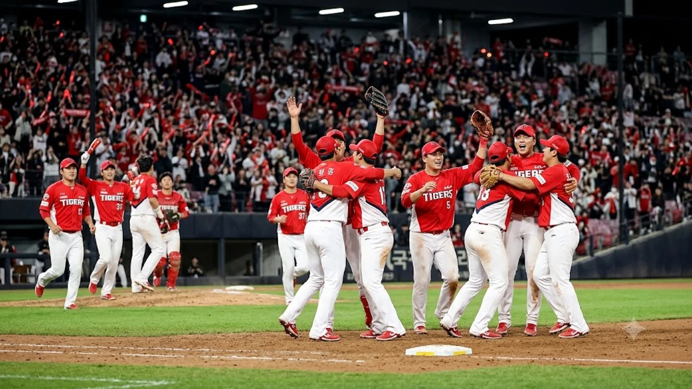

2026 KBO 정규시즌 최종전에서 팬들의 손에 땀을 쥐게 만든 끝장 승부 끝에 **KIA 준플레이오프 직행**이 현실이 되었습니다. 마지막 경기까지 승차 없이 팽팽하게 맞섰던 순위 싸움에서 타이거즈 타선의 응집력과 마운드의 버티는 힘이 포스트시즌 진출 티켓의 향방을 갈랐습니다. 와일드카드 결정전을 건너뛰고 충분한 휴식을 확보한 KIA 타이거즈의 행보는 가을야구 판도 전체를 뒤흔들고 있습니다.

## 정규시즌 최종전, KIA가 3위 쟁탈전을 지켜낸 순간

### 8회말 터진 결정적 한 방과 승부의 분수령
동점 상황이 길어지며 팽팽한 투수전이 이어지던 8회말, 상대 필승조의 실투성 슬라이더를 놓치지 않은 우중간 2루타가 터져 나왔습니다. 주자 1, 2루 득점권 찬스에서 터진 이 한 방은 더그아웃 분위기를 단숨에 끌어올렸습니다. 볼카운트 2-2의 불리한 카운트에서도 배트 중심에 공을 정확히 맞힌 타격 메커니즘이 결승 득점으로 이어졌습니다.

### 불펜 총력전으로 지켜낸 2점 차 리드
선발 투수가 6이닝을 채우고 내려간 뒤, 벤치는 지체 없이 필승조를 가동했습니다. 셋업맨이 7회와 8회 상대 중심 타선을 상대로 삼진 3개를 솎아내며 출루를 원천 봉쇄했습니다. 9회초 등판한 마무리 투수는 선두 타자에게 안타를 허용했으나 후속 타자를 6-4-3 병살타로 솎아내며 4-2 승리에 마침표를 찍었습니다.

### LG전 상대 전적 열세를 뒤집은 집중력
시즌 내내 맞대결에서 뼈아픈 열세를 겪었던 흐름을 가장 결정적인 순간에 끊어냈습니다. 특히 주루 플레이에서 보여준 과감함이 돋보였습니다. 단타성 타구에도 주저 없이 3루를 파고든 기동력이 상대 수비의 무리한 송구를 유도해 귀중한 추가점을 만들어냈습니다.

## 준플레이오프 직행을 완성한 3가지 핵심 동력

### 중심 타선의 클러치 능력과 승부처 장타
시즌 후반기 팀 득점권 타율 1위를 견인한 중심 타선이 가을 문턱에서도 위력을 발휘했습니다. 득점권 기회마다 타자들이 공을 침착하게 골라내며 출루율을 높였고, 장타율 5할대를 유지한 중심 타자의 존재감은 상대 배터리에 극심한 압박감을 안겼습니다.

> "단기전 승패는 찬스에서 얼마나 주저하지 않고 자기 스윙을 가져가는지에 달렸다."

- **선구안과 볼넷 유도**: 상대 유인구에 방망이를 헛돌리지 않고 볼넷을 골라 찬스를 연결
- **초구 공략 성공률**: 스트라이크 존에 들어오는 첫 타구를 과감하게 노려 안타 생산
- **2사 후 집중력**: 투아웃 이후에도 연속 안타로 점수를 뽑아내는 응집력

### 가을야구 직전 살아난 선발 로테이션 안정감
에이스 선발 투수의 퀄리티스타트 플러스 행진이 마운드 운용에 숨통을 틔웠습니다. 정규시즌 막판 4경기 연속 6이닝 이상 2자책 이하를 기록하며 불펜진의 과부하를 막아냈습니다. 외국인 원투펀치의 구속과 릴리스 포인트가 완전히 회복된 점 역시 고무적입니다.

### 벤치의 과감한 투수 교체 타이밍
벤치의 한 박자 빠른 투수 교체 결단이 연패 위기를 넘기는 열쇠였습니다. 위기 징후가 포착되자마자 좌우 매치업을 고려한 스페셜리스트를 투입해 대량 실점 위기를 지워냈습니다. 데이터에 기반한 과감한 퀵후크 운용이 승리를 지키는 든든한 방패가 되었습니다.

## 와일드카드 격돌 LG·두산 vs 휴식 얻은 KIA의 유불리

### 체력을 비축한 KIA 투수진의 이점과 변수
준플레이오프에 직행하면서 얻은 3일 이상의 정비 시간은 투수진에 든든한 자산입니다. 포스트시즌 전반의 흐름을 짚어보고 싶다면 [스포츠 전체 글 보기](/posts/sports/)를 함께 참고하기 바랍니다. 어깨 피로도가 누적되었던 필승조가 구위를 되찾고, 선발 투수들이 정상 로테이션에 맞춰 등판 간격을 조율할 수 있습니다. 다만 실전 경기 감각이 다소 무뎌질 수 있다는 점은 코칭스태프가 청백전을 통해 보완해야 할 과제입니다.

### 하위 라운드 혈투를 치르고 올라올 상대팀 전력 비교
와일드카드 결정전을 치러야 하는 4위와 5위 팀은 1차전부터 에이스를 소모할 수밖에 없습니다. 2차전까지 승부가 이어질 경우 불펜 필승조 전력이 크게 소진된 상태로 준플레이오프 무대에 서게 됩니다. 상대의 핵심 투수 카드들이 소모된 틈을 타 경기 초반부터 강하게 밀어붙이는 전략이 적중할 확률이 높습니다.

### 광주 홈경기 이점을 극대화하기 위한 대비책
1차전과 2차전이 안방인 광주-기아 챔피언스필드에서 열린다는 점은 확실한 우위 요소입니다. 홈 관중의 열광적인 응원은 상대 원정팀 투수진을 심리적으로 흔드는 무기입니다. 익숙한 그라운드 환경에서 내야 수비 실책을 최소화하는 기본기 점검이 승패를 가릅니다.

## 2026 가을야구 정상 도전, KIA의 잔여 포스트시즌 체크포인트

### 단기전 승패를 가를 수비 집중력과 실책 관리
포스트시즌 단기전은 화려한 타격보다 한 번의 알까기나 송구 실책으로 무너지는 경우가 허다합니다. 특히 빗맞은 타구 처리와 중계 플레이에서 외야수와 내야수의 호흡이 완벽해야 실점을 억제합니다. 불필요한 추가 진루를 허용하지 않는 디테일한 수비 포메이션이 시리즈 승리를 견인합니다.

### 필승조의 연투 능력 및 불펜 뎁스 점검
5전 3선승제로 진행되는 준플레이오프 특성상 경기 후반 1~2점 차 박빙 승부가 연일 이어질 가능성이 큽니다. 연투가 가능한 롱릴리프 자원의 발굴과 좌완 원포인트 릴리프의 제구 안정감이 유지되어야 합니다. 멀티 이닝을 소화할 수 있는 전천후 불펜 투수의 활약 여부가 시리즈의 숨은 키포인트입니다.

### 한국시리즈 진출을 위해 반드시 넘어야 할 상대들
준플레이오프를 넘어 플레이오프에서 기다리는 상위 시드 팀들과의 매치업을 미리 염두에 둔 전력 배분이 필요합니다. 단기전에서 소모전을 최소화하고 3차전이나 4차전 안에서 시리즈를 끝내야 대권 도전의 발판을 마련할 수 있습니다. 가을 그라운드의 열기를 제대로 만끽하려면 [야구 응원용품 쿠팡에서 보기](https://www.coupang.com/np/search?q=%EC%95%BC%EA%B5%AC%EC%9D%91%EC%9B%90%EC%9A%A9%ED%92%88&sourceType=affiliate&trackingCode=AF8691300)를 통해 준비해보는 것도 좋은 방법입니다.

#KIA타이거즈 #준플레이오프 #2026KBO #가을야구 #포스트시즌 #프로야구순위 #김도영 #양현종