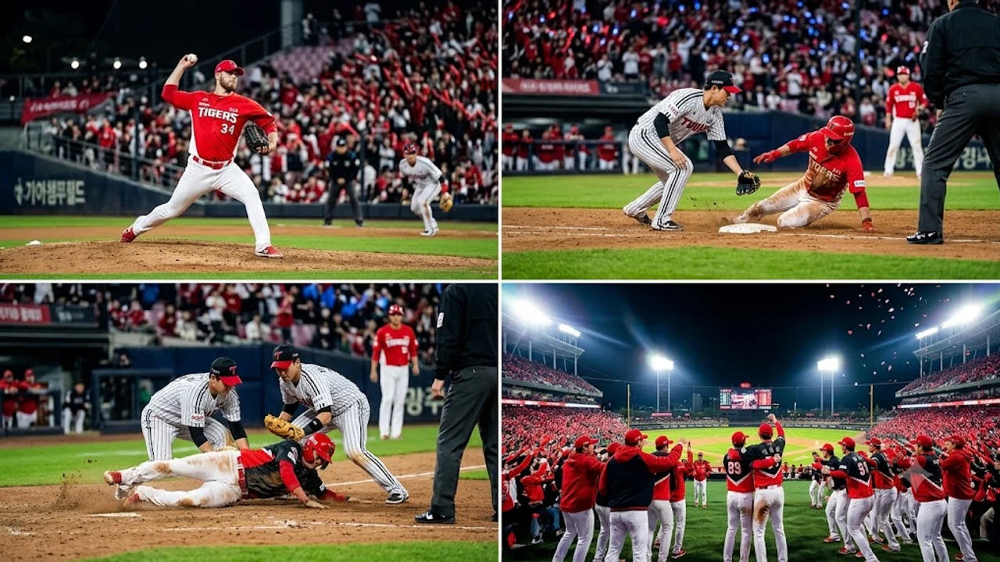

2026 KBO 포스트시즌의 열기가 절정으로 치닫는 가운데, **KIA 준플레이오프 2차전** 격돌에서 호랑이 군단이 다시 한번 승리의 포효를 내질렀습니다. 광주-기아챔피언스필드를 가득 메운 만원 관중의 함성 속에서 펼쳐진 이번 맞대결은 가을야구 단기전 특유의 빈틈없는 압박감이 그라운드를 지배했습니다. 팽팽하던 흐름을 단숨에 부수고 시리즈 2승 무패를 완성한 원동력과 양 팀의 희비를 가른 결정적 장면들을 현장감 있게 짚어봅니다.

## 벼랑 끝에 몰린 LG와 승기를 굳힌 KIA의 2차전 명승부

### 1·2차전 연승 팀의 역대 플레이오프 진출 확률 100%의 무게

KBO 포스트시즌 역사에서 5전 3승제로 치러진 역대 준플레이오프를 돌아보면, 1차전과 2차전을 연거푸 쓸어 담은 팀이 플레이오프 티켓을 놓친 적은 단 한 번도 없었습니다.

> 역대 5전 3승제 준플레이오프 1·2차전 승리 팀의 PO 진출 확률: **100% (총 9회 중 9회 전승 통과)**

이 압도적인 기록은 단순한 통계 수치를 넘어 선수단 벤치의 심리적 공기마저 뒤흔듭니다. 안방에서 기분 좋은 2연승을 챙긴 KIA는 단 1승만 더 보태면 대구에서 숨을 고르고 있는 삼성 라이온즈와의 격돌을 성사시킵니다. 반면 낯선 원정에서 2연패를 떠안은 LG는 이제 단 한 번의 패배로 가을 야구가 끝나는 벼랑 끝 엘리미네이션 상황에 갇혔습니다.

### 선발 올러의 6이닝 역투와 불펜진의 완벽한 경기 봉쇄

마운드의 응집력이 승패의 갈림길이었습니다. 선발 애덤 올러는 시속 150km를 넘나드는 묵직한 패스트볼과 존 구석을 찌르는 슬라이더 조합으로 LG 타선을 6이닝 2실점으로 틀어막았습니다.

- **선발 올러의 실질적 기록:** 6이닝 5피안타 6탈삼진 2볼넷 2실점 (퀄리티스타트 달성)
- **위기관리 승부수:** 주자가 득점권에 나간 3회와 5회, 타자 몸쪽에 과감한 속구를 찔러 넣어 빗맞은 땅볼을 유도
- **철벽 계투진 가동:** 전상현과 정해영으로 이어지는 필승 공식이 7회 이후 상대의 추격 의지를 완벽하게 꺾어놓음

선발이 6회까지 든든하게 버텨주자 불펜 투수진의 투구 수 부담이 크게 줄었고, 경기 후반 벤치 운용의 계산도 한층 수월해졌습니다.

### LG 타선의 잔루 악몽과 경기 흐름을 가른 치명적 실책

LG는 경기 초반 숱한 기회를 잡고도 결정타 부재로 허탈하게 잔루만 쌓았습니다. 2회초 선두타자가 살아 나간 절호의 찬스에서 작전 실패와 헛스윙 삼진이 잇따랐고, 5회초 1사 2·3루 황금 기회에서도 내야 땅볼로 겨우 1점을 보태는 데 그쳤습니다.

여기에 6회말 수비 도중 외야 중계 플레이에서 발생한 송구 실책은 뼈아팠습니다. 공이 빠지는 틈을 타 주자가 추가 진루하면서 헌납한 실점은 추격 불씨를 완전히 꺼뜨렸고, 가을 단기전에서 수비 실수 하나가 얼마나 치명적인지 다시금 증명했습니다.

## 경기 흐름을 송두리째 바꾼 3가지 결정적 승부처 분석

### 4회말 클린업 트리오의 집중타와 적시타 폭발 순간

살얼음판 투수전의 균형추는 4회말 순식간에 깨졌습니다. 상대 투수의 실투성 체인지업을 벼락같이 통타해 좌중간을 가른 2루타를 시작으로, 득점권에서 타자들의 끈질긴 볼카운트 승부가 이어졌습니다.

단순한 힘대결이 아닌 상대 배터리의 구종 노림수를 정확하게 읽어내며 연속 적시타를 터뜨렸습니다. 순식간에 3점을 몰아치며 경기 흐름의 고삐를 틀어쥔 명장면이었습니다.

### 7회초 위기 상황에서 터져 나온 전상현의 연속 삼진쇼

이날 경기의 최대 승부처는 4-2로 쫓기던 7회초였습니다. 마운드를 넘겨받은 전상현은 1사 1, 2루라는 절체절명의 역전 위기를 맞닥뜨렸습니다.

* **승부 구종:** 홈플레이트 바깥쪽 높은 하이 패스트볼로 카운트를 잡은 뒤 낙차 큰 슬라이더 구사
* **결과:** 상대 중심 타선을 상대로 2연속 헛스윙 삼진을 솎아내며 실점 위기를 완벽 진화

이 고비를 넘지 못하고 동점을 내줬다면 승부의 행방은 걷잡을 수 없이 흔들렸겠지만, 흔들림 없는 강심장 피칭으로 상대 벤치의 기세를 완전히 꺾었습니다. 국내 야구의 열기와 더불어 다른 메이저 종목들의 흐름도 함께 읽고 싶다면 [스포츠 전체 글 보기](/posts/sports/)에서 흥미로운 분석을 만날 수 있습니다.

### 기동력 야구의 승리: 작전 야구와 적극적인 베이스러닝 차이

포스트시즌 같은 단기전에서는 한 루를 더 훔쳐내는 주루 센스가 승패를 결정짓습니다. 5회말과 8회말, KIA 주자들은 단타 타구에도 주저 없이 3루를 파고들며 상대 수비진의 중계 동작을 흔들었습니다.

반면 LG는 무리한 도루 시도가 상대 포수의 날카로운 송구에 걸려 횡사당하는 등 주루에서 맥이 끊겼습니다. 보이지 않는 작은 주루 디테일의 차이가 결국 6-3 스코어를 완성했습니다.

## 잠실로 향하는 3차전 매치업과 양 팀 마운드 운용 전망

### KIA 3차전 선발 투수 등판 시나리오와 스윕 진출 가능성

광주 2연전을 싹쓸이한 KIA는 마운드 운용에 막대한 여유를 안고 서울행 버스에 오릅니다. 3차전 선발로는 로테이션상 토종 에이스가 출격을 준비하며, 경기 상황에 따라 롱릴리프 자원을 아낌없이 투입해 3연승 스윕으로 플레이오프 직행을 확정 짓겠다는 계산입니다.

3차전에서 승부를 끝낼 경우, 투수진이 며칠간 달콤한 휴식을 취하며 플레이오프를 대비할 수 있어 가을야구 최상의 시나리오를 그리게 됩니다.

### 벼랑 끝 LG의 배수진: 불펜 총동원 카드와 타순 개편 과제

홈구장 잠실로 돌아가는 LG는 더는 뒤로 물러설 자리가 없습니다. 3차전에는 선발 투수가 흔들리는 기미만 보여도 3회나 4회부터 필승조를 투입하는 총력전을 펼칠 수밖에 없습니다.

출루에 애를 먹었던 테이블세터진의 타순 재배치 역시 피할 수 없는 과제입니다. 찬스마다 침묵했던 타선이 잠실의 넓은 외야를 활용해 득점력을 살려내지 못한다면 올 시즌 가을야구 여정은 3차전에서 막을 내립니다.

### 잠실 원정 구장 변수와 포스트시즌 수비 집중력 비교

광주 챔피언스필드와 비교할 때 잠실야구장은 좌우 펜스 거리가 훨씬 깊고 외야 공간이 광활합니다. 펜스를 직격하는 타구가 쏟아져 나오는 만큼 외야수들의 펜스 플레이와 중계 송구 능력이 결정적 변수로 작용합니다.

넓은 구장 환경을 감안하면 큰 것 한 방보다는 틈새를 노리는 연속 안타와 번트, 기동력을 앞세운 1점 짜내기 싸움이 치열하게 전개될 가능성이 높습니다.

## 2026 KBO 가을야구 직관 및 중계 시청 핵심 가이드

### 준플레이오프 3차전 잠실 경기 잔여석 예매 및 취소표 공략법

잠실에서 펼쳐지는 3차전은 양 팀 팬들의 불꽃 튀는 티켓 전쟁이 한창입니다. 공식 예매 오픈 직후 순식간에 매진된 만큼, 취소표가 풀리는 심야 시간대를 집중 공략해야 합니다.

* **티켓 취소표 방출 시간대:** 무통장 미입금 취소분이 일괄 반영되는 자정 및 새벽 시간대 모니터링
* **모바일 접속 요령:** 대기 화면에서 무리하게 새로고침을 누르지 말고 잔여 좌석 구역을 선점하는 침착함 필요

### TV 생중계 방송사 편성표와 OTT 모바일 실시간 스트리밍 채널

경기 개시 시간인 오후 6시 30분에 맞춰 지상파 및 스포츠 전문 채널에서 생중계를 송출합니다.

- **TV 중계 채널:** KBS N 스포츠, MBC SPORTS+, SBS Sports 채널 동시 편성
- **온라인 스트리밍:** TVING(티빙) 플랫폼을 통해 모바일과 PC 환경에서 끊김 없는 고화질 라이선스 중계 제공

대중교통 퇴근길에서도 스마트폰을 통해 가을야구의 생생한 타구 음과 함성을 실시간으로 즐길 수 있습니다.

### 플레이오프 조기 진출 시 매치업 상대 분석과 티켓팅 일정 팁

KIA가 3차전 승리로 시리즈를 마무리하면 정규리그 2위 삼성 라이온즈와의 달빛시리즈 플레이오프가 성사됩니다. 플레이오프 입장권 예매는 준플레이오프 종료 직후 공지되며 순차적으로 오픈되므로 구단 공식 알림을 켜두는 것이 유리합니다.

10월 중순 잠실야구장의 밤바람은 체감온도를 급격히 떨어뜨리므로 든든한 방한 점퍼와 보온 방석을 미리 챙기는 관람 준비가 필수입니다. 가을야구 야간 직관의 쾌적함을 더해줄 보온 용품을 찾고 있다면 미리 구비해 두는 것을 권합니다.

[가을야구 직관 방한용품 쿠팡에서 보기](https://www.coupang.com/np/search?q=%EC%95%BC%EA%B5%AC%EC%9E%A5+%EB%B0%A9%ED%95%9C%EC%9A%A9%ED%92%88&sourceType=affiliate&trackingCode=AF8691300)

#KIA타이거즈 #LG트윈스 #준플레이오프2차전 #2026KBO포스트시즌 #가을야구 #잠실야구장 #프로야구직관