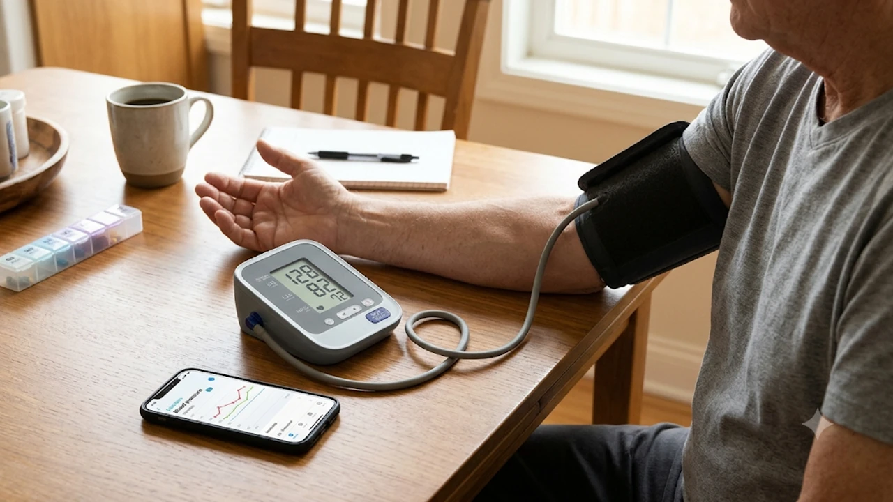

11월 하순에 접어들면서 아침 기온이 영하권으로 뚝 떨어졌습니다. 기온이 급격히 낮아지면 혈관이 수축해 평소보다 혈압이 높게 측정되는 경우가 많습니다. 병원 진료실에서 재는 혈압은 긴장감 때문에 실제보다 높게 나오는 '백의 고혈압' 현상이 잦아, 요즘은 집에서 아침저녁으로 직접 측정해 추이를 기록하는 것이 기본 관리법으로 자리 잡았습니다.

특히 최근에는 수첩에 볼펜으로 숫자를 받아 적던 구형 기기 대신, 측정 즉시 스마트폰 앱으로 데이터가 자동 전송되는 블루투스 상완식 혈압계가 대세입니다. 가격대별로 가장 검증된 오므론, 인바디, 위딩스 3종의 핵심 스펙과 실사용 장단점을 정리했습니다.

## 1. 지금 블루투스 가정용 혈압계가 뜨는 이유

가정용 혈압계 시장이 블루투스 연동형 중심으로 빠르게 재편된 데에는 세 가지 현실적인 배경이 있습니다.

첫째, **겨울철 혈압 변동성 관리**입니다. 날씨가 추워지면 교감신경이 활성화되면서 아침 기상 직후 혈압이 급상승하는 '아침 고혈압' 위험이 커집니다. 매일 같은 시간에 측정해 주간·월간 그래프를 확인해야 약물 조절이나 생활 습관 개선에 실질적인 도움이 됩니다.

둘째, **수기 기록의 번거로움 해소**입니다. 혈압계를 사두고 방치하는 가장 큰 이유는 매번 수치를 적기 귀찮아서입니다. 블루투스 모델은 팔에 감고 버튼만 누르면 측정 시각, 수축기·이완기 혈압, 맥박수가 스마트폰 앱에 자동으로 쌓입니다. 병원 방문 시 앱 화면만 의사에게 보여주면 진료 정확도도 높아집니다.

셋째, **부모님 효도 선물과 3040 자가 관리 수요의 결합**입니다. 떨어져 사는 부모님의 혈압 기록을 자녀 앱으로 공유할 수 있어 연말 선물로 인기가 높습니다. 겨울철 부모님 건강 선물로 [2026 무선 목어깨 온열마사지기 TOP3 비교](/posts/trending-picks/wireless-neck-shoulder-heat-massager-top3-2026/) 같은 온열 기기와 함께 혈압계를 세트로 준비하는 구매자도 꾸준히 늘고 있습니다.

## 2. 가정용 혈압계 TOP3 상품 스펙 비교

가정에서 메인으로 쓸 혈압계는 손목식보다 오차가 적은 **상완식(팔뚝형)**을 고르는 것이 정석입니다. 국내에서 A/S와 측정 신뢰도가 검증된 대표 모델 3종을 한눈에 비교할 수 있도록 표로 정리했습니다.

| 모델명 | 가격대 | 핵심 스펙 | 추천 대상 |
| :--- | :--- | :--- | :--- |
| **오므론 HEM-7156T** | 9만\~11만 원대 | 360도 피트 커프(22\~42cm), 메모리 60회, 블루투스 연동 | 정확도 최우선, 부모님 효도 선물 |
| **인바디 BP170B** | 11만\~13만 원대 | 원터치 측정, 메모리 100회, 인바디 앱 통합 연동 | 인바디 체중계 사용자, 3040 자가 관리 |
| **위딩스 BPM Connect** | 17만\~20만 원대 | 튜브리스 일체형(250g), Wi-Fi·블루투스, 충전식(최대 6개월) | 잦은 출장·여행, 미니멀 디자인 선호 |

세 모델 모두 식약처 의료기기 인증을 받은 상완식 제품이지만, 커프 구조와 전원 방식에서 뚜렷한 차이를 보입니다. 오므론은 혼자서도 쉽게 감을 수 있는 원통형 커프가 강점이고, 인바디는 국내 앱 생태계 연동성이 뛰어납니다. 위딩스는 본체와 커프를 하나로 합쳐 공기 호스(튜브)를 없앤 휴대성 특화 모델입니다.

## 3. 예산대별 추천 (저가·중간·프리미엄)

예산과 주 사용자의 연령대, 평소 사용 환경에 맞춰 아래 세 가지 모델 중 하나를 고르면 용도에 딱 맞게 쓸 수 있습니다.

### ① 가성비·입문용 (9만\~11만 원대): 오므론(OMRON) HEM-7156T

전 세계 가정용 혈압계 시장에서 표준처럼 쓰이는 오므론의 베스트셀러 블루투스 모델입니다.

* **핵심 스펙:** 360도 인텔리랩(피트) 커프 적용(팔둘레 22\~42cm 지원), 본체 무게 약 340g, 메모리 60회 저장, 블루투스(OMRON connect 앱) 연동, AA 건전지 4개 사용
* **장점 1:** 원통형으로 모양이 잡혀 있는 360도 피트 커프 덕분에 한 손으로도 팔뚝에 쓱 끼워 감기 편하며, 커프 위치가 약간 돌아가도 측정 오차가 적습니다.
* **장점 2:** 커프 착용 가이드와 측정 중 움직임 감지, 불규칙 맥파 감지 기능이 기본 탑재되어 어르신도 정확한 자세로 잴 수 있습니다.
* **단점:** 기본 구성에 전원 어댑터가 빠져 있어 건전지를 교체하며 쓰거나 약 2만 원대의 정품 어댑터를 별도로 구매해야 합니다.
* **이런 사람에게 추천:** 기계 조작에 익숙하지 않은 부모님께 선물할 분, 군더더기 없이 측정 정확도와 내구성이 검증된 입문기를 찾는 분

👉 [오므론 HEM-7156T 쿠팡에서 보기](https://www.coupang.com/np/search?q=오므론+HEM-7156T&sourceType=affiliate&trackingCode=AF8691300)

### ② 밸런스·국산 앱 연동 (11만\~13만 원대): 인바디(InBody) BP170B

체성분 분석기로 친숙한 인바디에서 출시한 가정용 블루투스 혈압계입니다. 투박한 의료기기 느낌을 뺀 깔끔한 화이트 디자인이 돋보입니다.

* **핵심 스펙:** 원터치 자동 측정(기본 커프 팔둘레 22\~32cm), 본체 메모리 100회 저장, 크기 115 × 168 × 66mm, 블루투스(InBody 앱) 연동, AA 건전지 4개 및 어댑터 겸용
* **장점 1:** 기존에 인바디 체중계를 쓰고 있다면 별도 앱을 깔 필요 없이 하나의 'InBody' 앱 안에서 체중·체지방률과 혈압 데이터를 한꺼번에 관리할 수 있습니다.
* **장점 2:** 버튼이 크고 직관적이며, 측정 완료 후 이전 측정값과 비교해 혈압 변화를 바로 확인할 수 있어 매일 기록하는 재미가 있습니다.
* **단점:** 오므론 같은 하드 타입 원통형 커프가 아닌 일반 소프트 커프 방식이라, 처음 사용할 때는 한 손으로 팔에 밀착시켜 감는 데 약간의 적응이 필요합니다.
* **이런 사람에게 추천:** 이미 인바디 앱으로 건강 관리를 하고 있는 3040 직장인, 거실이나 침실 인테리어를 해치지 않는 깔끔한 디자인의 혈압계를 원하는 분

👉 [인바디 BP170B 쿠팡에서 보기](https://www.coupang.com/np/search?q=인바디+BP170B&sourceType=affiliate&trackingCode=AF8691300)

### ③ 프리미엄·휴대성 (17만\~20만 원대): 위딩스(Withings) BPM Connect

프랑스 스마트 헬스케어 브랜드 위딩스의 대표작으로, 번거로운 공기 호스를 완전히 없앤 튜브리스(Tubeless) 일체형 혈압계입니다.

* **핵심 스펙:** 튜브리스 일체형(무게 250g, 팔둘레 22\~42cm), Wi-Fi 및 블루투스 동시 지원, 내장 리튬이온 배터리(1회 충전 시 최대 6개월 사용), LED 도트 매트릭스 디스플레이
* **장점 1:** 본체와 커프가 하나로 붙어 있고 무게가 250g에 불과해 파우치에 쏙 들어갑니다. 출장이나 여행을 갈 때도 평소 쓰던 혈압계를 그대로 챙겨 다닐 수 있습니다.
* **장점 2:** Wi-Fi 연동이 가능해 스마트폰이 옆에 없어도 측정이 끝나면 자동으로 클라우드(Withings 앱)에 기록이 올라갑니다. 건전지 교체 없이 USB로 충전해 쓰는 점도 쾌적합니다.
* **단점:** 17만\~20만 원대로 다른 상완식 모델보다 7\~9만 원가량 비싸며, 본체 표면의 LED 도트 숫자가 일반 대형 LCD 화면보다 작아 시력이 약한 어르신에게는 가독성이 다소 아쉽게 느껴질 수 있습니다.
* **이런 사람에게 추천:** 집과 사무실, 출장지를 오가며 꾸준히 혈압을 재야 하는 분, 호스 정리나 건전지 교체 없이 스마트하게 관리하고 싶은 얼리어답터

👉 [위딩스 BPM Connect 쿠팡에서 보기](https://www.coupang.com/np/search?q=위딩스+BPM+Connect&sourceType=affiliate&trackingCode=AF8691300)

## 4. 구매 전 반드시 확인할 체크포인트

혈압계는 한 번 사면 최소 3\~5년 이상 매일 쓰는 건강기기입니다. 결제 버튼을 누르기 전에 아래 네 가지만 체크하면 기기 선택의 시행착오를 크게 줄일 수 있습니다.

1. **식약처 의료기기 인증 여부:** 직구 저가형 제품 중에는 국내 의료기기 인증이 없는 경우가 있습니다. 혈압 수치는 진료와 직결되므로 반드시 정식 수입·인증된 모델을 선택해야 합니다.
2. **상완식(팔뚝형) 우선 고려:** 손목식은 휴대가 간편하지만 손목 위치가 심장 높이와 조금만 어긋나도 수치가 크게 흔들립니다. 가정용 메인 기기는 무조건 상완식이 유리합니다.
3. **팔둘레 호환 범위 확인:** 기본 커프는 보통 팔둘레 22\~42cm(일부 모델 22\~32cm)를 지원합니다. 팔이 유독 가늘거나 운동으로 팔뚝이 두꺼운 편이라면 구매 전 지원 사이즈를 꼭 확인하세요.
4. **전원 방식과 사용 환경:** 침대 옆에 고정해 두고 쓴다면 어댑터 겸용 모델이 편하고, 거실과 안방을 옮겨 다니며 쓴다면 건전지형이나 위딩스 같은 충전식 모델이 동선상 훨씬 깔끔합니다.

아침 기상 후 화장실을 다녀온 뒤, 의자에 등을 기대고 5분간 안정을 취한 상태에서 측정하는 습관만 들여도 겨울철 혈관 건강 관리가 훨씬 수월해집니다. 본인의 예산과 사용 패턴에 맞는 모델로 올겨울 혈압 관리를 시작해 보세요.

---

> 이 포스팅은 쿠팡 파트너스 활동의 일환으로, 이에 따른 일정액의 수수료를 제공받습니다.

#트렌드상품 #쿠팡추천 #가정용혈압계추천 #블루투스혈압계 #오므론HEM7156T #인바디BP170B #위딩스BPMConnect #부모님효도선물 #겨울철건강관리