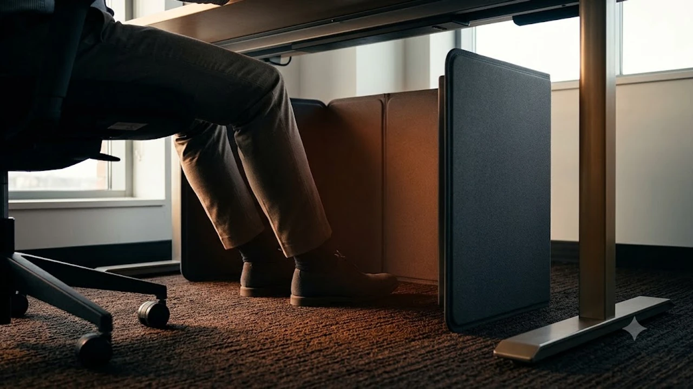

아침저녁으로 찬 바람이 불기 시작하는 10월 중순, 사무실이나 서재 책상 밑은 벌써부터 냉골입니다. 중앙난방 가동일까지는 한참 남았고, 개인용 소형 온풍기를 틀자니 주변 동료 눈치가 보이고 공기마저 건조해져 눈과 피부가 뻑뻑해집니다. 이 시기 직장인들의 책상 밑 필수 생존템으로 자리 잡은 장비가 바로 원적외선 탄소발열 패널을 사용하는 접이식 파티션 히터입니다.

## 1. 사무실 책상 밑 히터, 왜 파티션 형태가 대세인가

일반적인 코일형 미니 온풍기나 세라믹 히터는 팬 모터가 돌아가면서 특유의 40\~50dB 소음을 뿜어냅니다. 조용한 사무실에서는 이 모터 구동음이 큰 방해가 되며, 바닥 먼지를 공중으로 날려 호흡기를 자극합니다. 게다가 1,000W\~1,500W에 달하는 과도한 전력 소모 때문에 멀티탭 차단기가 내려가는 사고도 빈번합니다.

반면 접이식 파티션 히터는 명확한 이점을 지닙니다.

* **무소음·무풍 복사열 방식:** 내부 송풍 모터가 없어 구동 소음이 0dB입니다. 열선을 직접 태우지 않고 탄소 결정체 발열 필름에서 뿜어 나오는 원적외선 복사열로 다리와 무릎을 데웁니다. 강제 열풍을 쏘지 않아 안구건조증이나 피부 가려움이 생기지 않습니다.
* **160\~210W 초절전 설계:** 하루 8시간 내내 켜두어도 소비전력이 150\~200W 안팎에 불과합니다. 형광등 서너 개 켜는 수준이라 사무실 차단기 트립 걱정이 없고, 가정용 기준 월 전기요금 증가분도 2천\~3천 원대에 그칩니다.
* **1cm 미만 틈새 수납력:** 봄·여름이 오면 보관하기 버거운 원통형 난로와 달리, 병풍처럼 납작하게 3단이나 4단으로 접힙니다. 책상 옆 파티션 틈새나 서랍장 사이 5cm 틈만 있으면 그대로 밀어 넣어 보관할 수 있습니다.

환절기 데스크 환경을 개선할 때는 손목 부담을 덜어주는 [2026 무선 버티컬 마우스 추천 TOP3](/posts/trending-picks/wireless-vertical-mouse-top3-2026/)와 함께 하체 온열 세팅을 병행하면 근무 피로도를 체감할 수준으로 낮출 수 있습니다.

---

## 2. 접이식 파티션 히터 TOP3 스펙 비교

시중에서 검증된 대표 3개 모델의 제원과 특성을 직접 비교한 표입니다.

| 모델명 | 가격대 | 핵심 스펙 | 추천 대상 |
| :--- | :--- | :--- | :--- |
| **루니스 3면 탄소발열 파티션 히터** | 34,900원 | 165W 전력소비, 3단계 온도제어, 3시간 타이머, 45도 전도 OFF | 다리 이동 반경이 넓고 가벼운 기본형 선호자 |
| **에어보나 4면 접이식 파티션 히터** | 42,800원 | 195W 전력소비, 발 터치 스위치, 4시간 타이머, 4면 확장 패널 | 허리 숙이기 싫고 측면 찬 바람을 막고 싶은 직장인 |
| **Surkat 5면 덮개형 발난로 (D1902)** | 58,900원 | 210W 전력소비, 5단계 디지털 제어, 지퍼 체결 덮개, 바닥 발열판 | 발바닥 냉골과 수족냉증이 심한 수험생·창가 근무자 |

---

## 3. 예산대별 추천 모델 분석

### ① [가성비 실속형] 루니스 3면 탄소발열 파티션 히터

책상 아래 공간을 크게 차지하지 않고 깔끔하게 ㄷ자로 둘러치는 표준형 3단 모델입니다. 1.5kg 미만의 가벼운 무게와 기본에 충실한 조작계로 매년 10월부터 폭발적인 판매량을 기록합니다.

* **실제 가격대:** 34,900원
* **핵심 수치 스펙:**
  * 정격소비전력 165W
  * 3단계 온도 제어 (강 65℃ / 중 55℃ / 약 45℃ 도달)
  * 규격: 펼쳤을 때 가로 100cm x 세로 51cm, 접었을 때 두께 0.8cm
* **장점:**
  * 상단에 얹을 수 있는 전용 폴라폴리스 무릎 담요를 기본 제공하여 즉석에서 미니 코타츠 보온 환경을 구축합니다.
  * 접었을 때 부피가 얇고 가벼워 회의실, 서재, 사무실로 들고 이동하며 배치하기 수월합니다.
* **단점:**
  * 바닥면과 상단이 뚫린 3면 개방형이라, 타일 바닥이나 외풍이 심한 창가 자리에서는 발바닥 쪽으로 냉기가 스며듭니다.
* **이런 사람에게 추천:**
  * 의자에 앉아 다리를 자주 꼬거나 앞뒤로 뻗는 활동적인 직장인.
  * 3만 원대 초중반의 적은 지출로 필수 안전장치가 들어간 기본기를 찾는 실속파.

👉 [루니스 3면 파티션 히터 쿠팡에서 보기](https://www.coupang.com/np/search?q=루니스+3면+파티션+히터&sourceType=affiliate&trackingCode=AF8691300)

---

### ② [밸런스 중간형] 에어보나 4면 접이식 파티션 히터

3면 제품의 고질적 한계인 측면 열기 손실을 막기 위해 패널 한 면을 추가한 4면 와이드 설계입니다. 손으로 일일이 컨트롤러를 만질 필요 없이 발끝으로 조작하는 편의성을 갖췄습니다.

* **실제 가격대:** 42,800원
* **핵심 수치 스펙:**
  * 정격소비전력 195W
  * 발 터치(풋 스위치) 전원 및 3단 온도 제어 모듈
  * 규격: 펼쳤을 때 가로 125cm x 세로 52cm (3면 대비 가로 폭 25cm 확장)
* **장점:**
  * 의자에 깊숙이 기댄 채 발끝으로 가볍게 밟아 전원을 켜고 온도를 바꿀 수 있어 작업 흐름이 끊기지 않습니다.
  * 25cm 늘어난 4번째 패널이 종아리 뒤편까지 감싸 복도 출입문 쪽에서 치고 들어오는 찬 기류를 효과적으로 막아냅니다.
* **단점:**
  * 바닥 발열 패널이 없는 구조라 신발을 벗고 양말만 신는 사무실에서는 두꺼운 털슬리퍼를 따로 챙겨 신어야 합니다.
* **이런 사람에게 추천:**
  * 책상 밑으로 허리를 숙여 전원 버튼을 누르는 동작이 귀찮은 직장인.
  * 책상 좌우 폭이 1,200mm 이상으로 넓어 다리 양옆 외풍이 거슬리는 근무자.

👉 [에어보나 4면 파티션 히터 쿠팡에서 보기](https://www.coupang.com/np/search?q=에어보나+4면+파티션+히터&sourceType=affiliate&trackingCode=AF8691300)

---

### ③ [프리미엄 챔버형] Surkat 5면 덮개형 발난로 (D1902)

하체 전체를 전용 핫룸으로 바꿔주는 풀 커버 5면 일체형 구조입니다. 상단 지퍼 덮개와 바닥 발열판을 빈틈없이 연결해 열기가 빠져나갈 틈을 막았습니다.

* **실제 가격대:** 58,900원
* **핵심 수치 스펙:**
  * 정격소비전력 210W (바닥 발열 패널 동시 구동)
  * 5단계 세부 디지털 온도 조절 (40℃, 48℃, 55℃, 62℃, 70℃)
  * 30분\~4시간 단위 4단계 타이머 예약 세팅
* **장점:**
  * 바닥 패널 자체에서 열이 올라오므로 실내화를 벗고 양말만 얹어도 온돌방 아랫목에 발을 묻어둔 듯한 열감이 전달됩니다.
  * 지퍼 체결식 상단 덮개가 훈기를 가두어 강 단계가 아닌 48\~55℃ 중저온 설정만으로도 발등과 무릎 전체가 훈훈해집니다.
* **단점:**
  * 직육면체 박스 형태로 하체가 갇히는 구조라 자리에서 갑자기 일어날 때 무릎이나 발이 상단 덮개에 걸릴 수 있습니다.
* **이런 사람에게 추천:**
  * 손발 끝이 쉽게 하얗게 질리는 심한 수족냉증 보유자 및 창가 코너 자리에 앉은 분.
  * 바닥 단열이 취약한 단독주택이나 오피스텔에서 재택근무를 장시간 수행하는 사람.

👉 [Surkat 5면 발난로 쿠팡에서 보기](https://www.coupang.com/np/search?q=Surkat+5면+발난로&sourceType=affiliate&trackingCode=AF8691300)

---

## 4. 파티션 히터 구매 전 필수 체크포인트

결제 직전, 화재 안전과 오피스 환경 적합성을 검증하기 위해 다음 세 가지 기준을 확인해야 합니다.

* **기울임 감지(전도 안전 스위치) 각도:** 발장난이나 의자 바퀴 충돌로 히터가 쓰러지는 사고에 대비해야 합니다. 제품이 45도 이상 기울어지거나 완전히 전도되었을 때 1초 이내 전원을 즉각 차단하는 롤링 볼 스위치 내장 여부를 확인하십시오.
* **자동 전원 차단 타이머 탑재:** 퇴근길에 켜두고 나가는 실수를 원천 차단해야 합니다. 별도 조작이 없어도 3\~4시간 연속 작동 후 스스로 전원을 끄는 과열 방지 타이머가 필수입니다.
* **난연성 외장재 및 탄소 코팅 내구성:** 발열 필름을 감싸는 패브릭이 불이 붙지 않는 난연 부직포 원단이어야 하며, 한국산업기술시험원(KTL) 등 공인기관의 KC 안전인증 번호가 기재되어 있는지 살펴봐야 합니다.

가을철 책상 아래 구석진 자리에 먼지가 쌓이면 히터 표면에 달라붙어 위생상 좋지 않으므로, [무선 에어건 제트팬 추천 TOP3 비교](/posts/trending-picks/wireless-turbo-jet-air-duster-top3-2026/)를 활용해 책상 밑 먼지를 미리 정돈해 두는 것이 쾌적한 데스크셋업 유지에 유리합니다.

---

> 이 포스팅은 쿠팡 파트너스 활동의 일환으로, 이에 따른 일정액의 수수료를 제공받습니다.

#트렌드상품 #쿠팡추천 #접이식파티션히터 #사무실발난로 #데스크히터 #탄소발열난로 #오피스방한용품 #수족냉증아이템