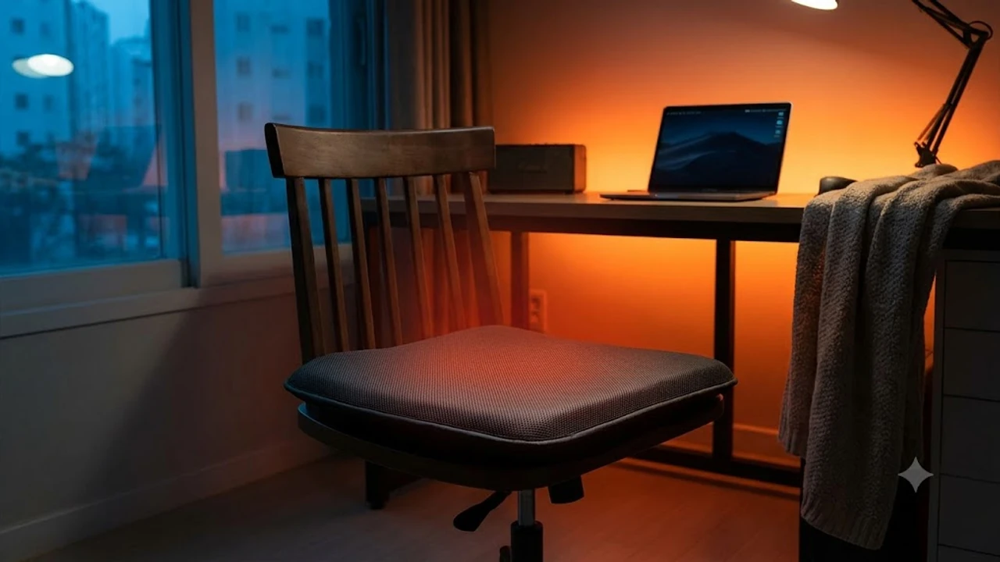

찬 바람이 불기 시작하는 10월 하순, 사무실 중앙난방이 본격 가동되기 전까지는 체감 온도가 가장 낮아지는 구간입니다. 하루 8시간 이상 의자에 앉아 근무하는 직장인에게 차가운 의자 가죽과 시린 허리를 덥혀줄 1인용 난방 장비는 필수입니다.

---

## 1. 지금 탄소 온열 방석이 뜨는 이유 (시장 배경, 최신 트렌드)

과거 전기방석 시장은 구리 코일 열선을 얇은 스펀지로 둘러싼 저가형 제품이 대부분이었습니다. 접히거나 엉덩이 하중에 눌렸을 때 발생하는 단선 화재 위험, 특유의 전자파 찌릿함, 엉덩이에 직접 배기는 딱딱한 열선 감촉은 고질적인 단점이었습니다.

최근 데스크테리어 시장에서 급부상한 3세대 난방 기기는 **카본 탄소 섬유와 나노 그래핀 복합 발열체**를 적용해 이러한 불안 요소를 지웠습니다. 유연한 탄소 섬유는 체중 압박에도 단선되지 않으며, 원적외선 복사열을 방출해 겉표면만 뜨겁게 달구는 대신 엉덩이 깊숙한 곳까지 온기를 고르게 채웁니다.

오피스 환경에 최적화된 설계 변화도 눈에 띕니다.
* **초저전력 및 안전 타이머:** 소비전력 20\~25W 안팎으로 하루 8시간 내내 30일간 틀어도 월 전기요금은 1,000원대 초반에 불과합니다. 퇴근 시 전원을 끄지 않아도 8\~12시간 뒤 자동으로 전원을 끊는 차단 기능이 기본 장착되었습니다.
* **단정한 데스크테리어 패브릭:** 요란한 원색이나 꽃무늬 비닐 대신 차콜, 멜란지 그레이 등 무채색 패브릭을 채택해 사무용 메쉬 체어 및 게이밍 체어와 이질감 없이 어우러집니다.
* **물세탁(워셔블) 지원:** 커피나 음료를 쏟아도 외피 커버를 분리해 세탁하거나 방수 단자 처리로 통세탁할 수 있어 위생 관리가 수월합니다.

손목 통증 완화를 돕는 [2026 무선 버티컬 마우스 추천 TOP3](/posts/trending-picks/wireless-vertical-mouse-top3-2026/)와 함께 조합하면 환절기 데스크 환경을 쾌적하게 구성할 수 있습니다.

---

## 2. TOP3 상품 스펙 비교

발열 안정성 검증과 실구매 데이터 평점을 기준으로 추린 세 가지 대표 모델 비교입니다.

| 모델명 | 가격대 | 핵심 스펙 | 추천 대상 |
| :--- | :--- | :--- | :--- |
| **한일의료기 무자계 카본 1인 전기방석** | 24,800원 | 소비전력 20W, 무자계 탄소 열선, 바이메탈 60°C 과열 차단 | 예산 절감형 구매자 및 회사 단체 비치용 |
| **보국전자 제로닷 카본 온열 쿠션 방석 (BKB-24S)** | 48,900원 | 소비전력 22W, 3D 에어셀 25mm 쿠션폼, 5중 안전 제어 | 장시간 착석하는 직장인, 열선 배김 없는 쿠션감 선호자 |
| **몽비오스 극세사 그래핀 탄소 온열방석 AIR** | 53,000원 | 소비전력 25W, 나노 그래핀 발열체(30초 급속), 8시간 타이머 | 빠른 예열과 외피 분리 물세탁을 원하는 실사용자 |

---

## 3. 예산대별 추천 (저가·중간·프리미엄 각 1개)

### [가성비 실속형] 한일의료기 무자계 카본 1인 전기방석
* **브랜드/모델명:** 한일의료기 한일 무자계 카본 탄소매트 1인용 방석
* **가격대:** 24,800원 (2만 원대 중반)
* **핵심 스펙:**
  * 소비전력 20W 초절전
  * 전자기장 상쇄형 무자계 카본 열선
  * 450 x 450mm 정사각 표준 규격
* **장점:**
  * 2만 원대 중반의 낮은 진입 장벽으로 개인 자리뿐 아니라 독서실, 캠핑 체어 보조용으로 부담 없이 구비할 수 있습니다.
  * 기존 구리선 대비 인장 강도가 높은 카본사를 엮어 반복 착석 시에도 열선이 꺾여 끊어지는 고장이 적습니다.
* **단점:**
  * 내장 폼 두께가 약 10mm 수준으로 얇아 딱딱한 원목 의자에 올렸을 때 푹신한 감착을 기대하기는 어렵습니다.
* **이런 사람에게 추천:** 지출을 최소화하면서 전자파 불안감 없는 카본 열선 방석을 찾는 실속파 직장인 및 수험생.
* **구매 링크:** [한일의료기 카본 탄소 방석 쿠팡에서 보기](https://www.coupang.com/np/search?q=한일의료기카본탄소방석&sourceType=affiliate&trackingCode=AF8691300)

---

### [밸런스 추천형] 보국전자 제로닷 카본 온열 쿠션 방석 (BKB-24S)
* **브랜드/모델명:** 보국전자 제로닷 프리미엄 카본 온열 쿠션 방석 (BKB-24S)
* **가격대:** 48,900원 (4만 원대 후반)
* **핵심 스펙:**
  * 25mm 두께 3D 입체 에어셀 폼 내장
  * 전자기장 환경인증(EMF) 획득 카본 열선
  * 5중 안전 전원 제어 및 소비전력 22W
* **장점:**
  * 25mm 고밀도 폼이 열선 굴곡을 완벽하게 차단해 일반 고급 메모리폼 방석 수준의 체압 분산 효과를 냅니다.
  * 계절가전 전문 브랜드 규격에 맞춰 전자기장 환경인증(EMF)을 통과했으므로 장시간 피부 밀착 시 저릿한 전자파 피로가 없습니다.
* **단점:**
  * 도톰한 폼 두께 탓에 좌판 높낮이 조절이 불가능한 고정식 의자에서는 무릎 각도가 다소 높아질 수 있습니다.
* **이런 사람에게 추천:** 하루 8시간 이상 의자에 붙어 일하며 푹신한 착좌감과 대기업급 안전 검증을 동시에 요구하는 사무직 종사자.
* **구매 링크:** [보국전자 카본 온열 방석 쿠팡에서 보기](https://www.coupang.com/np/search?q=보국전자카본온열방석&sourceType=affiliate&trackingCode=AF8691300)

---

### [프리미엄 하이엔드형] 몽비오스 극세사 그래핀 탄소 온열방석 AIR
* **브랜드/모델명:** 몽비오스 극세사 그래핀 탄소 온열방석 AIR
* **가격대:** 53,000원 (5만 원대 초반)
* **핵심 스펙:**
  * 열전도율 200W/m·K급 나노 그래핀 복합 열선 (30초 내 체감 발열)
  * 8시간 자동 전원 차단 스마트 타이머
  * 외피 커버 완전 분리형 지퍼 구조 (세탁기 사용 가능)
* **장점:**
  * 그래핀 소재 특유의 전도율로 전원을 켜고 30초 내에 표면 온도가 40°C를 돌파해 출근 직후 차가운 체온을 즉각 덥혀줍니다.
  * 외피 커버만 지퍼로 벗겨 세탁기에 돌릴 수 있어 음료 오염 시 관리가 직관적이며, 바닥면 실리콘 미끄럼 방지 도트가 밀착력을 유지합니다.
* **단점:**
  * 1인용 규격 방석 중 5만 원이 넘는 가격대로 단순 보조 난방기 대비 초기 구매 비용이 높습니다.
* **이런 사람에게 추천:** 출근 직후 예열 대기 시간 없이 즉각적인 발열을 원하거나 커버를 수시로 세탁해 깔끔하게 쓰려는 실사용자.
* **구매 링크:** [몽비오스 그래핀 탄소 온열방석 쿠팡에서 보기](https://www.coupang.com/np/search?q=몽비오스그래핀탄소온열방석&sourceType=affiliate&trackingCode=AF8691300)

퇴근 후 굳은 승모근과 목을 집중적으로 풀어주는 [2026 무선 목어깨 온열마사지기 TOP3 비교](/posts/trending-picks/wireless-neck-shoulder-heat-massager-top3-2026/)와 병행하면 겨울철 굳은 몸을 이완하는 데 제격입니다.

---

## 4. 구매 전 반드시 확인할 체크포인트

결제 전 세 가지 기술 사양을 꼼꼼히 점검해야 후회 없는 선택이 가능합니다.

1. **공식 EMF(전자기장 환경인증) 마크 획득 여부**  
   단순 KC 안전인증은 누전·감전 방지 수준만 봅니다. 인체와 맞닿는 온열 기기는 전기장 10V/m 이하, 자기장 2mG 이하 기준을 통과한 한국기계전기전자시험연구원의 EMF 마크를 확인해야 장시간 사용 시 피로감과 두통을 막습니다.

2. **자동 전원 오프(Auto-Off) 타이머 탑재**  
   퇴근 시간 불을 끄고 자리를 비우면서 방석 스위치를 켜둔 채 방치하는 상황은 빈번합니다. 연속 8시간 또는 12시간 후 전원 공급을 스스로 끊는 타이머 모듈 장착 제품을 골라야 화재 위험을 배제할 수 있습니다.

3. **발열체 종류(나노 탄소사 vs 코일 열선)와 바닥 논슬립**  
   상품 상세페이지에서 '구리 코일' 표기가 없는지 확인하고 유연한 '탄소 섬유사' 혹은 '그래핀' 표기를 확인하십시오. 착석 및 기립 시 방석이 바닥으로 미끄러져 떨어지는 스트레스를 막기 위해 하단부 실리콘 도트 마감 유무도 놓쳐서는 안 될 요소입니다.

---

> 이 포스팅은 쿠팡 파트너스 활동의 일환으로, 이에 따른 일정액의 수수료를 제공받습니다.

#트렌드상품 #쿠팡추천 #탄소온열방석 #그래핀온열방석 #사무실전기방석 #데스크테리어 #겨울오피스필수템