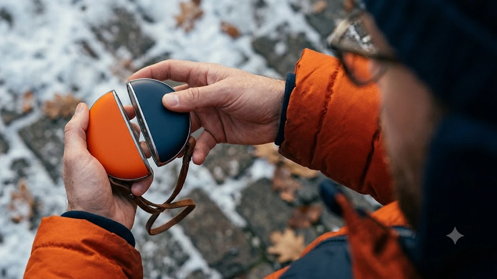

아침저녁으로 찬 바람이 불면서 외투 주머니에 손을 찔러 넣게 되는 계절이 성큼 다가왔습니다. 매번 뜯어서 버려야 하는 일회용 핫팩은 쓰레기가 감당되지 않고, 기존 일체형 충전식 손난로는 180g 이상 묵직한 데다 한쪽 손만 데울 수 있어 반대쪽 손은 여전히 꽁꽁 얼어붙는 한계가 뚜렷했습니다. 

이러한 불편을 단번에 해결하며 최근 SNS와 이커머스를 휩쓸고 있는 제품이 바로 자석으로 붙였다 떼어내는 '마그네틱 듀얼 손난로'입니다. 평소에는 하나로 결합해 휴대하다가 주머니에 넣을 때는 1초 만에 떼어내 양손을 동시에 데우는 실속형 아이템으로, 늦가을부터 한겨울까지 필수 방한템으로 급부상했습니다.

---

## 1. 지금 마그네틱 듀얼 손난로가 뜨는 이유

일교차가 10도 이상 벌어지는 환절기가 시작되면 출퇴근길 체감 온도는 급격히 떨어집니다. 이때 손발이 차가워지면 신체 전반의 피로도가 빠르게 상승합니다. 사무실에서 굳은 손목과 뻐근해진 목을 달래기 위해 [2026 무선 목어깨 온열마사지기 TOP3 비교](/posts/trending-picks/wireless-neck-shoulder-heat-massager-top3-2026/)를 찾는 직장인이 늘어나는 것과 마찬가지로, 야외 이동 중에는 즉각적인 체온 유지를 돕는 손난로의 검색량이 폭발합니다.

2026년 10월 들어 단순 발열 기기를 넘어선 '마그네틱 분리형' 구조가 대세로 자리 잡은 이유는 3가지로 압축됩니다.

첫째, 양손 독립 보온입니다. 기존 일체형 모델은 양손을 번갈아 가며 쥐어야 했지만, 마그네틱 듀얼 구조는 자력을 이용해 1초 만에 두 개로 쪼개어 좌우 외투 주머니에 각각 넣을 수 있습니다. 외출 시 친구나 연인과 하나씩 나눠 쓰기에도 안성맞춤입니다.

둘째, 5\~8초대 초고속 발열 기술입니다. 세라믹 히팅 패널 성능이 개선되면서 전원을 켜고 주머니에 넣자마자 열이 올라 대기 시간 없이 즉각적인 온기를 체감합니다.

셋째, C타입 스마트폰 보조배터리 기능의 결합입니다. 기온이 5도 이하로 내려가면 스마트폰 리튬이온 배터리가 급격히 방전되는데, 외출 중 5V/2A 출력의 비상 충전기로 곧바로 전환해 쓸 수 있어 가방 속 짐을 덜어줍니다.

---

## 2. TOP3 상품 스펙 비교

실제 이커머스 누적 판매량 1,000건 이상, 평점 4.5점 이상을 기록 중인 대표 3개 모델의 핵심 규격을 정리했습니다.

| 모델명 | 가격대 | 핵심 스펙 | 추천 대상 |
| :--- | :--- | :--- | :--- |
| **모란카노 분리형 듀얼 손난로** | 18,900원 | 6,000mAh, 개당 80g, 최고 52℃ | 가벼운 출퇴근·등하굣길 가성비 입문자 |
| **누아트 마그네틱 듀얼 손난로 (NDHW-01)** | 23,800원 | 6,000mAh, 5초 예열, 최고 55℃ | 완성도 높은 마감과 발열 균형을 따지는 직장인 |
| **일리온 무선 분리형 듀얼 손난로** | 32,900원 | 10,000mAh, 디지털 잔량표시, 10W 출력 | 캠핑·낚시·골프 등 장시간 야외 활동족 |

---

## 3. 예산대별 추천 모델 심층 분석

### 1) 실속 가성비 원픽: 모란카노 듀얼 분리형 손난로

* **브랜드/모델명**: 모란카노(Morankano) 마그네틱 듀얼 분리형 양면 발열 손난로
* **가격대**: 18,900원
* **핵심 스펙**:
  * 배터리 용량: 총 6,000mAh (각 3,000mAh × 2)
  * 개당 무게: 80g (2개 결합 시 160g)
  * 최고 발열 온도: 52℃ (1단계 42℃ / 2단계 48℃ / 3단계 52℃)
* **장점**:
  1. 부드러운 유선형 조약돌 쉐입으로 가로 폭이 좁아 손안에 착 감깁니다.
  2. 분실 방지용 실리콘 스트랩이 본체에 기본 결합되어 야외 보행 중 떨어뜨려 파손될 위험을 줄였습니다.
* **단점**:
  * 배터리 잔량이 숫자가 아닌 단순 3구 점등 인디케이터로만 표시되어 남은 잔량을 분 단위로 파악하기 어렵습니다.
* **이런 사람에게 추천**: 
  * 왕복 1\~2시간 대중교통 출퇴근길이나 통학 시간에 쓸 가볍고 주머니 처짐 없는 1만 원대 실속형 기기를 찾는 분.

👉 [모란카노 분리형 듀얼 손난로 쿠팡에서 보기](https://www.coupang.com/np/search?q=모란카노+분리형+듀얼+손난로&sourceType=affiliate&trackingCode=AF8691300)

---

### 2) 완성도 높은 표준 밸런스: 누아트 마그네틱 듀얼 손난로 (NDHW-01)

* **브랜드/모델명**: 누아트(NUART) 마그네틱 듀얼 충전식 손난로 보조배터리 NDHW-01
* **가격대**: 23,800원
* **핵심 스펙**:
  * 배터리 용량: 총 6,000mAh (각 3,000mAh × 2)
  * 발열 도달 속도: 전원 인가 후 5초 내 체감 발열 시작
  * 온도 설정 범위: 1단계 40℃, 2단계 48℃, 3단계 55℃
* **장점**:
  1. N52급 네오디뮴 마그네틱을 내장해 가방 안에서 굴러다녀도 두 본체가 제멋대로 쪼개지지 않고 견고하게 맞물립니다.
  2. 양면 서라운드 알루미늄 열선 하우징을 적용해 손바닥뿐만 아니라 외투 주머니 내부 전체로 열기를 균일하게 전달합니다.
* **단점**:
  * 최고 온도인 3단계(55℃)로 연속 구동할 경우 배터리 소모율이 높아져 개당 실사용 시간이 2시간 40분 안팎으로 줄어듭니다.
* **이런 사람에게 추천**: 
  * 고급스러운 무광 파스텔톤 마감을 원하며, 코트나 패딩 주머니에 쏙 넣어 다닐 완성도 높은 데일리 기기를 찾는 직장인.

👉 [누아트 마그네틱 듀얼 손난로 NDHW-01 쿠팡에서 보기](https://www.coupang.com/np/search?q=누아트+마그네틱+듀얼+손난로+NDHW-01&sourceType=affiliate&trackingCode=AF8691300)

---

### 3) 장시간 야외용 프리미엄: 일리온 무선 분리형 듀얼 손난로

* **브랜드/모델명**: 일리온(ILLION) 고용량 무선 분리형 듀얼 손난로 보조배터리
* **가격대**: 32,900원
* **핵심 스펙**:
  * 배터리 용량: 총 10,000mAh (각 5,000mAh × 2)
  * 디스플레이: 전면 디지털 LED 숫자 디스플레이 탑재 (온도 및 배터리 잔량 1\~100% 실시간 표기)
  * 입출력 스펙: USB-C 10W 고속 충전 및 외장 보조배터리 출력 지원
* **장점**:
  1. 10,000mAh 대용량 셀 탑재로 1단계(42℃) 설정 시 최장 8시간 연속 발열을 유지해 외박 일정에도 거뜬합니다.
  2. 전면 디스플레이에 배터리 잔량이 숫자로 직관 표시되므로 방전 시점을 사전에 파악하고 대처할 수 있습니다.
* **단점**:
  * 대용량 셀 탑재로 인해 개당 무게가 110g(2개 결합 시 220g)으로, 6,000mAh 경량형 모델 대비 얇은 정장 주머니에서는 다소 묵직하게 처집니다.
* **이런 사람에게 추천**: 
  * 겨울철 오토캠핑, 얼음낚시, 등산, 골프 라운딩을 즐기거나 충전 환경이 열악한 야외 현장에서 종일 온기를 유지해야 하는 분.

👉 [일리온 무선 분리형 듀얼 손난로 쿠팡에서 보기](https://www.coupang.com/np/search?q=일리온+무선+분리형+듀얼+손난로&sourceType=affiliate&trackingCode=AF8691300)

---

## 4. 구매 전 반드시 확인할 체크포인트

결제 버튼을 누르기 전 아래 4가지 항목을 필히 대조해야 후회가 없습니다.

### ① KC 인증 번호 및 NTC 온도 제어 센서 탑재 여부
피부에 직접 닿고 외투 주머니 속 밀폐된 공간에서 열을 내는 기기입니다. 반드시 **국내 KC 안전인증(전기용품 및 생활용품 안전관리법 승인)**을 필했는지 확인해야 합니다. 과충전·과방전 방지 보호회로는 물론, 표면 온도가 60℃를 초과하면 전력을 즉각 차단하는 NTC(Negative Temperature Coefficient) 서미스터 센서가 있어야 저온 화상 위험을 방지합니다.

### ② 양면 360도 입체 히팅 구조 확인
시중 1만 원 미만 초저가형 제품 중에는 원가 절감을 위해 한쪽 평면만 따뜻해지는 단면 발열 패널을 사용하는 경우가 적지 않습니다. 손난로는 손바닥뿐만 아니라 구부린 손가락 마디 전체를 감싸야 온열 효과를 봅니다. 제품 상세페이지 기술서에서 **'양면 360도 알루미늄 발열'** 문구가 명시되어 있는지 확인해야 합니다.

### ③ 용도별 무게와 배터리 용량의 타협점
배터리 셀 용량과 물리적 무게는 정비례합니다. 출퇴근 대중교통 이용 위주라면 주머니 처짐이 없는 **6,000mAh(개당 75\~80g 선)**를 선택하는 편이 손목 부담이 없습니다. 반면 반나절 이상 야외에 머무는 아웃도어 환경이라면 다소 묵직하더라도 **10,000mAh(개당 110g 선)** 이상을 골라야 배터리 부족을 겪지 않습니다.

### ④ USB-C 포트 규격 및 비상 출력 지원 여부
구형 마이크로 5핀 규격 제품은 별도 케이블을 챙겨야 하므로 피해야 합니다. 상하 구분이 없는 USB-C 단자를 적용했는지, 스마트폰을 최소 5V/2A(10W) 속도로 충전할 수 있는 출력 포트 겸용 회로가 내장되었는지 점검해야 겨울철 이후에도 보조배터리로 활용 가치를 이어갈 수 있습니다.

---

> 이 포스팅은 쿠팡 파트너스 활동의 일환으로, 이에 따른 일정액의 수수료를 제공받습니다.

#트렌드상품 #쿠팡추천 #마그네틱듀얼손난로 #충전식손난로 #손난로보조배터리 #겨울방한용품 #직장인출퇴근템 #내돈내산추천