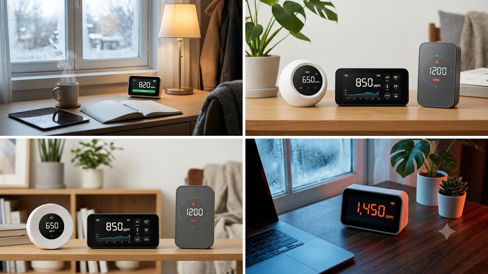

겨울철 보일러와 온풍기를 켜두고 창문을 꽉 닫은 채 생활하다 보면, 어느 순간 머리가 지끈거리고 이유 없이 졸음이 쏟아지는 경험을 하게 됩니다. 흔히 단순한 피로나 난방 탓으로 넘기기 쉽지만, 실제 주범은 밀폐된 공간에 빠르게 축적된 고농도 이산화탄소(CO2)인 경우가 많습니다. 성인 1명이 10㎡ 남짓한 방에서 1\~2시간만 업무나 공부를 해도 실내 CO2 농도는 집중력 저하 기준치인 1,000ppm을 훌쩍 넘깁니다. 환기 타이밍을 감이 아닌 정확한 수치로 확인해 쾌적한 실내 환경을 유지해 주는 2026년 가정용 이산화탄소 측정기 대표 모델 3가지를 꼼꼼하게 비교해 정리했습니다.

## 1. 지금 이 카테고리가 뜨는 이유 (시장 배경, 최신 트렌드)

11월 중순에 접어들며 아침저녁으로 영하권에 가까운 기온이 이어지자, 온라인 쇼핑몰과 데스크테리어 커뮤니티에서 가정용 이산화탄소 측정기 검색량이 가파르게 치솟고 있습니다. 난방비 절약과 한파 차단을 위해 창문을 닫아두는 시간이 길어지면서 재택근무자, 수험생, 신생아·반려동물 양육 가구를 중심으로 '실내 공기질 시각화'에 대한 수요가 폭발적으로 늘어난 결과입니다.

최근 시장의 핵심 트렌드는 크게 세 가지로 압축됩니다. 첫째, 과거 보급형 제품에 주로 쓰이던 오차율 높은 반도체 추정 방식(eCO2) 대신 적외선 파장으로 실제 이산화탄소 분자를 정밀 측정하는 **NDIR(비분산 적외선) 센서** 탑재 모델이 5만\~10만 원대 대중적인 가격으로 보급되었습니다. 둘째, 애플 홈킷(HomeKit), 샤오미 미홈, 삼성 스마트싱스 등 스마트홈 플랫폼과 연동해 CO2 농도가 설정값(예: 1,000ppm)을 초과하면 전열교환기나 공기청정기를 자동 가동하는 자동화 루틴 구축이 보편화되었습니다. 셋째, 책상 위 인테리어를 해치지 않는 미니멀한 디자인과 눈의 피로가 적은 전자잉크(E-Ink) 디스플레이 적용 제품들이 데스크셋업 필수 아이템으로 자리 잡았습니다. 장시간 책상 앞에 앉아 일하는 환경이라면 [2026 무선 버티컬 마우스 추천 TOP3](/posts/trending-picks/wireless-vertical-mouse-top3-2026/) 같은 인체공학 주변기기와 함께 공기질 측정기를 배치해 두는 것만으로도 업무 피로도를 크게 낮출 수 있습니다.

## 2. TOP3 상품 스펙 비교 (표 형식 포함)

현재 쿠팡과 네이버쇼핑에서 실구매자 평점과 재구매율이 가장 높은 NDIR 센서 기반 가정용 이산화탄소 측정기 3종을 추렸습니다. 입문형 스마트홈 연동 모델부터 무전원 배치가 가능한 E-Ink 모델, 국내 기술 기반의 복합 공기질 측정기까지 각기 다른 강점을 지닌 제품들입니다.

| 모델명 | 가격대 | 핵심 스펙 | 추천 대상 |
| :--- | :--- | :--- | :--- |
| **청핑 Air Monitor Lite** | 59,000원 \~ 65,000원 | 스위스 센시리온 NDIR 센서 / CO2·PM2.5·PM10·온습도 5종 측정 / 3.1인치 OLED 터치스크린 / 애플 홈킷·미홈 지원 | 가성비와 스마트홈 연동을 동시에 원하는 입문자 |
| **잉크버드 IAM-T1** | 82,000원 \~ 89,000원 | 스위스 센시리온 NDIR 센서(±30ppm 오차) / 3.7인치 E-Ink 디스플레이 / AA 건전지 2개로 최대 4년 사용 / 블루투스 앱 기록 | 선 없는 깔끔한 데스크테리어와 긴 배터리 수명을 선호하는 사용자 |
| **휴마아이 HI-300** | 125,000원 \~ 135,000원 | 듀얼 채널 NDIR 센서 / CO2·PM2.5·PM10·TVOC·온습도 6종 측정 / 휴대용 내장 배터리(약 7시간) / 4색 LED 직관 표시 | 신생아실·거실 등 미세먼지와 유해가스까지 정밀 관리할 가정 |

## 3. 예산대별 추천 (저가·중간·프리미엄 각 1개)

### ① 실속 입문형 (5만 원\~6만 원대): 청핑(Qingping) Air Monitor Lite
* **가격대:** 59,000원 \~ 65,000원
* **핵심 스펙:**
  * 스위스 센시리온(Sensirion) 고정밀 NDIR CO2 센서 탑재 (측정 범위 400\~9,999ppm, 해상도 1ppm)
  * 5가지 항목(CO2, 초미세먼지 PM2.5, 미세먼지 PM10, 온도, 습도) 동시 측정 및 3.1인치 OLED 디스플레이 표시
  * Wi-Fi 2.4GHz 연결을 통한 애플 홈킷(Apple HomeKit) 및 샤오미 미홈(Mi Home) 공식 연동
* **장점:**
  * 5만\~6만 원대 가격으로 NDIR 센서 기반 CO2 측정과 초미세먼지 측정, 스마트홈 자동화 연동까지 모두 지원하는 뛰어난 가격 대비 성능을 자랑합니다.
  * 상단 터치 바를 가볍게 탭하거나 밀어서 화면을 전환하는 직관적인 인터페이스와 63.6×46×54.6mm의 콤팩트한 화이트 바디 디자인이 책상 위 어디에 두어도 자연스럽게 어우러집니다.
* **단점:**
  * 내장 배터리 용량이 2,000mAh로 상시 무선 사용 시 약 7시간 정도만 작동하므로, 실질적으로는 USB-C 케이블을 상시 연결해 거치형으로 사용해야 합니다.
* **이런 사람에게 추천:** 아이폰·아이패드를 사용하며 애플 홈킷으로 스마트홈 자동화를 꾸미고 싶은 분, 6만 원대 이하 예산으로 정확한 NDIR 방식 공기질 측정기에 입문하려는 자취생 및 재택근무자에게 추천합니다.
* [청핑 Air Monitor Lite 쿠팡에서 보기](https://www.coupang.com/np/search?q=%EC%B2%AD%ED%95%91+Air+Monitor+Lite&sourceType=affiliate&trackingCode=AF8691300)

### ② 데스크테리어·배터리 특화형 (8만 원\~9만 원대): 잉크버드(INKBIRD) IAM-T1
* **가격대:** 82,000원 \~ 89,000원
* **핵심 스펙:**
  * 고정밀 센시리온 NDIR 센서 적용 (측정 정확도 ±30ppm+3%, 측정 주기 1분\~10분 사용자 맞춤 설정 가능)
  * 종이 책처럼 눈부심이 없는 3.7인치 대형 E-Ink(전자잉크) 디스플레이 탑재
  * AA 알카라인 건전지 2개 장착 시 측정 주기(10분 기준)에 따라 최대 4년 연속 구동 가능
* **장점:**
  * 전원 케이블을 꽂아둘 필요가 전혀 없어 모니터 아래나 선반 위에 선 없이 깔끔하게 배치할 수 있으며, 180도 가까운 넓은 시야각으로 어떤 방향에서도 선명한 시인성을 제공합니다.
  * 전용 스마트폰 앱(INKBIRD App)과 블루투스로 연동되어 최대 30일 이상(앱 내 무제한)의 CO2 농도 변화 그래프를 저장하고, 설정한 ppm 수치 초과 시 본체 부저 알람과 앱 푸시 알림을 동시에 받을 수 있습니다.
* **단점:**
  * 백라이트가 없는 E-Ink 패널 특성상 불을 완전히 끈 한밤중 어두운 방에서는 화면 수치를 육안으로 확인하기 어렵습니다.
* **이런 사람에게 추천:** 책상 위 전원 선이 늘어지는 것을 싫어하는 미니멀 데스크테리어 추구자, 주기적으로 충전하거나 어댑터를 꽂아두는 번거로움 없이 장기간 방치하며 쓰고 싶은 수험생 및 직장인에게 적합합니다.
* [잉크버드 IAM-T1 쿠팡에서 보기](https://www.coupang.com/np/search?q=%EC%9E%89%ED%81%AC%EB%B2%84%EB%93%9C+IAM-T1&sourceType=affiliate&trackingCode=AF8691300)

### ③ 올인원 복합 측정형 (12만 원\~13만 원대): 휴마아이(Huma-i) HI-300
* **가격대:** 125,000원 \~ 135,000원
* **핵심 스펙:**
  * 자동 보정(ABC) 기능을 갖춘 듀얼 채널 NDIR CO2 센서(측정 범위 400\~5,000ppm) 및 레이저 산란 방식 미세먼지 센서 탑재
  * CO2, PM2.5, PM10, 휘발성유기화합물(TVOC), 온도, 습도까지 총 6가지 실내 공기질 지표 통합 측정
  * 195g 초경량 무게와 내장 리튬폴리머 배터리(완충 시 약 7시간 구동) 탑재로 거실·안방·차량 등 이동 측정 지원
* **장점:**
  * 국내 공기질 측정기 전문 브랜드 제품으로 센서 반응 속도가 매우 빠르며, 4단계 LED 색상(파랑·초록·노랑·빨강)으로 현재 공기 상태를 3\~4m 거리에서도 한눈에 파악할 수 있습니다.
  * 새집증후군 유발 물질인 TVOC(0.000\~10.000ppm)와 초미세먼지까지 동시에 정밀 측정하므로 요리 후 미세먼지 농도나 가구에서 나오는 유해가스 수치까지 종합적으로 관리할 수 있습니다.
* **단점:**
  * Wi-Fi 기반 스마트홈 앱 연동 기능이 빠져 있어 외부에서 스마트폰으로 실시간 수치를 모니터링하는 용도로는 활용하기 어렵습니다.
* **이런 사람에게 추천:** 영유아나 호흡기가 예민한 가족이 있어 이산화탄소뿐 아니라 초미세먼지와 유해가스 수치까지 한 기기로 꼼꼼히 체크하고 싶은 가정, 방마다 들고 다니며 환기 상태를 점검하려는 분에게 추천합니다.
* [휴마아이 HI-300 쿠팡에서 보기](https://www.coupang.com/np/search?q=%ED%9C%B4%EB%A7%88%EC%95%84%EC%9D%B4+HI-300&sourceType=affiliate&trackingCode=AF8691300)

## 4. 구매 전 반드시 확인할 체크포인트

가정용 이산화탄소 측정기를 실패 없이 고르려면 겉모습이나 가격보다 아래 세 가지 기술적 기준을 먼저 확인해야 합니다.

첫째, **'NDIR 방식' 센서 탑재 여부를 반드시 확인하세요.** 시중에 판매되는 2만\~3만 원대 보급형 공기질 측정기 중 상당수는 실제 이산화탄소를 측정하지 않고 휘발성유기화합물(TVOC) 수치를 기반으로 이산화탄소 농도를 역산 추정하는 반도체(MOX) 센서를 사용합니다. 이런 제품은 방 안에서 향수를 뿌리거나 알코올 솜만 닦아도 CO2 수치가 3,000ppm 이상으로 치솟는 오작동을 일으킵니다. 정확한 환기 시점을 잡으려면 제품 상세 페이지에 'NDIR(비분산 적외선) 센서'가 명시되어 있는지 꼭 체크해야 합니다.

둘째, **사용 공간에 맞는 전원 방식과 디스플레이 타입을 선택하세요.** NDIR 센서는 내부 적외선 램프를 주기적으로 발광시켜야 하므로 일반 온습도계보다 전력 소모가 큽니다. 따라서 컬러 OLED 화면이 달린 제품은 대부분 USB-C 상시 전원이 필요하고, 선 없이 배터리로 오래 쓰려면 잉크버드 IAM-T1처럼 저전력 E-Ink 화면과 측정 주기(1\~10분) 조절 기능을 갖춘 모델을 골라야 합니다. 침실 머리맡에 두고 쓸 목적이라면 밤에 눈부심을 유발하는 고휘도 LED 대신 자동 밝기 조절이나 화면 끄기 기능이 있는지 확인하는 것이 좋습니다.

셋째, **센서 먼지 유입 관리와 설치 위치에 신경 써야 합니다.** 측정기 내부의 광학 센서 통풍구에 생활 먼지가 쌓이면 측정 오차가 커질 수 있으므로 주기적인 관리가 필요합니다. 평소 책상 위 먼지를 깔끔하게 털어낼 때 [무선 에어건 제트팬 추천 TOP3 비교](/posts/trending-picks/wireless-turbo-jet-air-duster-top3-2026/) 제품 등을 활용해 통풍구 주변 먼지를 가볍게 불어내 주면 센서 수명을 오래 유지할 수 있습니다. 또한 날숨이 직접 닿는 모니터 바로 앞보다는 코끝에서 1m 이상 떨어진 책상 측면이나 선반 위(바닥에서 1\~1.5m 높이)에 두어야 공간 전체의 평균 이산화탄소 농도를 가장 정확하게 측정할 수 있습니다.

---

> 이 포스팅은 쿠팡 파트너스 활동의 일환으로, 이에 따른 일정액의 수수료를 제공받습니다.

#트렌드상품 #쿠팡추천 #가정용이산화탄소측정기 #CO2측정기추천 #실내공기질측정기 #데스크테리어 #겨울철환기 #청핑공기질측정기 #잉크버드IAMT1 #휴마아이HI300