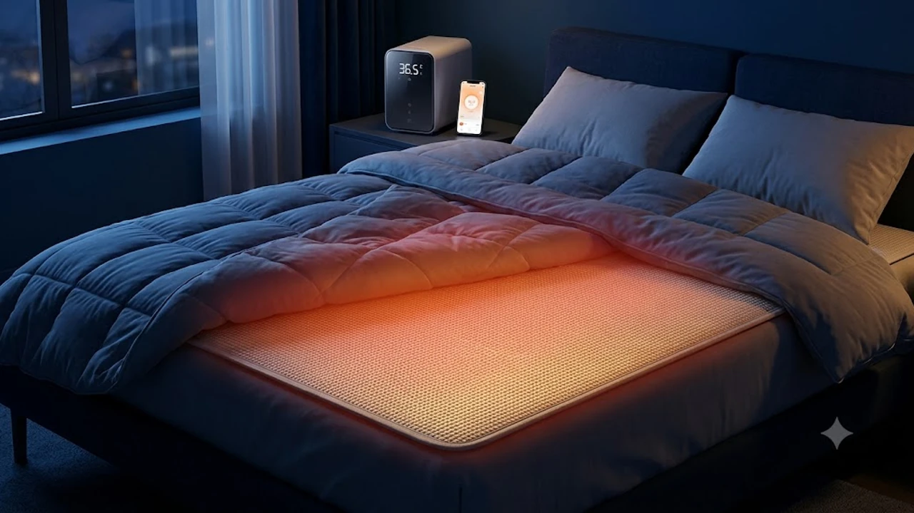

10월 하순으로 접어들며 아침 최저기온이 5°C 안팎까지 급격히 떨어졌습니다. 보일러를 상시 가동하기에는 월 10만 원을 훌쩍 넘는 도시가스 난방비 폭탄이 부담스럽고, 전기장판은 열선 전자파와 자고 일어났을 때 목이 타는 건조감이 걸립니다. 과거 구형 온수매트의 치명적 단점이었던 굵은 호스 등 배김 현상과 봄철 물빼기 고역을 완벽히 개선한 2026년형 초슬림 스마트 온수매트가 월동 가전의 중심축으로 자리 잡았습니다.

일과 중 경직된 근육을 풀기 위해 [2026 무선 목어깨 온열마사지기 TOP3 비교](/posts/trending-picks/wireless-neck-shoulder-heat-massager-top3-2026/)를 찾는 직장인이 늘어난 것과 마찬가지로, 밤새 체온을 균일하게 받쳐주는 침실 온열 가전은 겨울철 피로 회복의 핵심입니다. 침대 매트리스의 푹신한 탄성을 그대로 유지하면서, 모바일 원격 제어와 자동 물빼기 편의성을 갖춘 실사용 검증 TOP3 모델을 실측 수치 중심으로 비교 분석합니다.

---

## 1. 지금 초슬림 스마트 온수매트가 뜨는 이유

구형 온수매트는 내부에 8\~10mm 직경의 실리콘 호스가 지나가 매트리스 토퍼 위에 올리면 이물감이 고스란히 등에 전해졌습니다. 반면 3세대 초슬림 온수매트는 0.9\~1.0mm 두께의 고주파 열압착 수로 방식을 채택했습니다. 매트리스 고유의 체압 분산 기능을 훼손하지 않으며, 이불처럼 콤팩트하게 4단 접이가 가능해 좁은 수납장에도 손쉽게 보관할 수 있습니다.

조작 방식에서도 큰 기술적 전환이 일어났습니다. 2.4GHz Wi-Fi 모듈이 내장되어 퇴근 30분 전 스마트폰 앱으로 미리 38°C 예열을 걸어둘 수 있습니다. 단순 타이머 구동을 넘어 수면 초기 37°C 체류, 깊은 수면 단계인 새벽 2\~4시 사이 34°C로 자동 감온, 기상 직전 36°C 재가온 등 인간 체온 리듬에 맞춘 온도 사이클 알고리즘이 적용되었습니다. 겨우내 사용한 뒤 보관할 때 에어 컴프레셔 모터가 관 내 잔수를 99% 이상 밀어내는 원터치 자동 배수 모드는 사용자의 계절 교체 피로를 완전히 해소했습니다.

---

## 2. TOP3 상품 스펙 비교

가장 수요가 높은 퀸(Q, 가로 145\~150cm x 세로 195\~200cm) 규격 기준으로 3대 브랜드 핵심 모델의 실측 제원과 제어 성능을 대조한 표입니다.

| 모델명 | 가격대 | 핵심 스펙 | 추천 대상 |
| :--- | :--- | :--- | :--- |
| **경동나비엔 AI 숙면매트 온수 EMW700** | 450,000원 \~ 490,000원 | 두께 1mm / 0.5°C 정밀 제어 / 자동 물빼기 99% / Wi-Fi 연동 | 수면 패턴 맞춤 케어와 원터치 자동 물빼기를 원하는 사용자 |
| **스팀보이 프리미엄 사계절 온수매트 C7300** | 258,000원 \~ 338,800원 | 180W 저전력 / 25dB 저소음 BLDC / 클린 필터 / 1°C 분리난방 | 펌프 작동음과 진동에 민감하고 여과 필터 수질 관리를 중시하는 부부 |
| **경동나비엔 나비엔메이트 슬림 온수매트 EQM565** | 311,000원 \~ 343,000원 | 두께 1mm / 좌우 0.5°C 개별 조절 / Wi-Fi 원격 제어 / UV 살균 | 30만 원 초반대에서 1mm 두께와 스마트폰 예열 기능을 찾는 실속파 |

---

## 3. 예산대별 추천 모델 심층 분석

### 1) 경동나비엔 AI 숙면매트 온수 EMW700 (퀸 사이즈)
* **가격대:** 450,000원 \~ 490,000원 (공식몰 출고가 500,000원 선)
* **핵심 스펙:** 매트 두께 1.0mm, 소비전력 280W, 0.5°C 단위 좌우 독립 제어(설정 범위 25°C\~45°C), 에어 펌프 잔수 자동 배출 모드
* **장점:**
  * 봄철 보관 시 수동 에어 펌프 질이나 호스 입 불기 과정 없이, 본체 '자동 물빼기' 버튼 하나로 10분 만에 내부 수분을 99% 이상 공기로 불어내 완전 건조 배출합니다.
  * 나비엔 스마트 앱을 통해 사용자의 입면 시간과 기상 시간을 입력하면 새벽 체온 하강에 맞춰 온도를 1\~2°C 낮추고 아침에 다시 온도를 올려주어 땀 배출 없는 개운한 숙면을 지원합니다.
* **단점:**
  * 보일러 본체 가로 230mm x 높이 165mm 규격으로 협탁 위 공간을 꽤 차지하며, 40만 원대 후반에 이르는 높은 가격대는 단기 1인 가구에 다소 부담스럽습니다.
* **이런 사람에게 추천:**
  * 잔수 부패와 물때 냄새 때문에 온수매트 재구매를 망설였던 분, 밤중에 더워서 이불을 차내다 감기에 걸리는 수면 불안정자에게 최적입니다.
* **구매 링크:**
  [경동나비엔 EMW700 쿠팡에서 보기](https://www.coupang.com/np/search?q=경동나비엔+EMW700&sourceType=affiliate&trackingCode=AF8691300)

---

### 2) 스팀보이 프리미엄 사계절 온수매트 C7300 (퀸 사이즈)
* **가격대:** 258,000원 \~ 338,800원
* **핵심 스펙:** 소비전력 180W 저전력 모터, 25dB 저소음 BLDC 순환 펌프, 자가 여과 클린 필터, 좌우 1°C 분리 제어(30°C\~55°C)
* **장점:**
  * BLDC 모터를 채용해 작동 소음을 도서관 수준인 25dB 안팎으로 억제하여 침대 바로 옆 협탁에 올려두어도 수면에 거슬림이 없습니다.
  * 보일러 수조 내부에 장착하는 자가 여과 클린 필터가 수돗물이나 생수에서 생기는 칼슘 석회질 및 물때 침전물을 걸러내 잔고장을 방지합니다.
* **단점:**
  * 모바일 앱을 통한 외부 원격 제어가 지원되지 않아 침실 밖에서 미리 예열하려면 전용 리모컨을 침실 내에서 직접 눌러야 합니다.
* **이런 사람에게 추천:**
  * 귀가 예민해 작은 모터 진동음에도 잠을 깨는 분, 한 달 내내 매일 8시간씩 가동했을 때 누진세 부담 없는 180W급 초절전형 난방을 원하는 분에게 적합합니다.
* **구매 링크:**
  [스팀보이 C7300 쿠팡에서 보기](https://www.coupang.com/np/search?q=스팀보이+C7300&sourceType=affiliate&trackingCode=AF8691300)

---

### 3) 경동나비엔 나비엔메이트 슬림 온수매트 EQM565 (퀸 사이즈)
* **가격대:** 311,000원 \~ 343,000원
* **핵심 스펙:** 매트 두께 1.0mm, 소비전력 280W, 좌우 0.5°C 개별 온도 조절, 스마트폰 2.4GHz Wi-Fi 연동 원격 제어
* **장점:**
  * 최상위 플래그십 모델과 동일한 1mm 두께의 고주파 압착 패브릭 수로를 채택해 침대 매트리스의 체압 분산 쿠션감을 고스란히 살립니다.
  * 30만 원 초반대 가격대임에도 좌우 0.5°C 정밀 분리난방과 퇴근길 스마트폰 원격 제어 기능을 모두 갖춰 실질 가성비가 가장 우수합니다.
* **단점:**
  * 물빼기 시 보일러 본체 내부 에어 컴프레셔 자동 배출이 아닌 동봉된 수동 키트형 배수 방식을 사용하므로 시즌 보관 시 10분 정도의 수작업이 요구됩니다.
* **이런 사람에게 추천:**
  * 30만 원대 초반 예산에서 원격 앱 제어와 1mm 초슬림 매트 스펙을 확보하고 싶은 2인 신혼부부나 1인 가구에 가장 추천합니다.
* **구매 링크:**
  [경동나비엔 EQM565 쿠팡에서 보기](https://www.coupang.com/np/search?q=경동나비엔+EQM565&sourceType=affiliate&trackingCode=AF8691300)

---

## 4. 구매 전 반드시 확인할 체크포인트

깔끔한 데스크 환경을 만들 때 [무선 에어건 제트팬 추천 TOP3 비교](/posts/trending-picks/wireless-turbo-jet-air-duster-top3-2026/)를 통해 풍속 스펙을 따지듯, 온수매트도 수치화된 기계적 안전성과 내부 구조를 점검해야 3년 이상 잔고장 없이 사용할 수 있습니다.

### 1) 매트 두께와 고주파 압착 튜빙 유무
침대 매트리스 사용자라면 두께가 1.0mm 이하인지 실측 수치를 확인해야 합니다. 5mm 이상의 튜빙 매트는 내부 실리콘 관이 척추 라인을 자극해 허리 통증을 유발합니다. 바닥에 직접 깔고 사용하는 온돌형 바닥재 환경이 아니라면 반드시 '무호스 고주파 열압착 슬림형' 규격을 골라야 합니다.

### 2) 좌우 분리난방의 온도 간격 단위
2인용 퀸/킹 사이즈 제품은 좌우 온도 조절 간격이 0.5°C 단위인지 확인해야 합니다. 1°C 단위 제어 모델은 36°C에서는 춥고 37°C에서는 땀이 차는 체감 온도 편차가 생깁니다. 체질이 다른 두 사람이 함께 쓸 경우 각자의 수면 적정 온도에 맞출 수 있는 0.5°C 미세 조정 지원 여부가 수면 지속성을 좌우합니다.

### 3) 펌프 모터 순환 방식과 소음 데시벨
온수 순환 방식은 크게 무동력 자연순환식과 펌프 동력식으로 나뉩니다. 자연순환식은 모터음이 적은 대신 물이 매트 끝까지 순환하는 데 40분 이상 걸리고 상하 편차가 큽니다. 빠른 예열을 위해서는 200W급 이하 BLDC 모터 펌프 방식을 고르되, 구동 데시벨이 25\~28dB 이하로 설계된 저진동 패킹 제품인지 확인해야 새벽 모터 웅웅거림을 피할 수 있습니다.

### 4) 자동 잔수 배출 시스템 탑재 여부
온수매트 고장의 80%는 봄철 보관 시 배관 내부에 남은 물이 여름 동안 부패하면서 생기는 녹조 및 물때 막힘에서 발생합니다. 본체 자체 모터로 공기를 불어 잔수를 빼내는 '원터치 자동 물빼기' 기능이 들어가 있는지, 아니면 사용자가 손주사기로 배수해야 하는 수동 방식인지 파악해야 매년 초가을 악취 없이 매트를 재가동할 수 있습니다.

---

> 이 포스팅은 쿠팡 파트너스 활동의 일환으로, 이에 따른 일정액의 수수료를 제공받습니다.

#트렌드상품 #쿠팡추천 #스마트온수매트추천 #초슬림온수매트 #경동나비엔온수매트 #스팀보이온수매트 #월동가전 #온수매트비교 #숙면가전