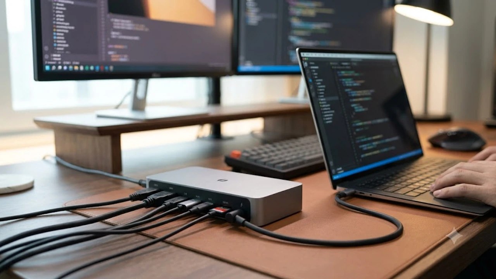

출근하거나 책상에 앉을 때마다 충전기 꽂고, 모니터 케이블 2개 연결하고, 외장 SSD와 키보드 리시버까지 일일이 꽂느라 선 뭉치와 씨름하는 일은 이제 끝내야 합니다. 2\~3만 원대 C타입 멀티허브를 쓰다가 화면이 깜빡거리거나, 발열 때문에 전송 속도가 반토막 나거나, 전력이 부족해 배터리가 서서히 닳는 배터리 드레인을 겪어봤다면 해결책은 하나뿐입니다. 

케이블 딱 1개만 노트북에 꽂으면 최대 100W 초고속 충전부터 듀얼 4K 144Hz 고주사율 화면 출력, 40Gbps 외장 드라이브 전송까지 한 번에 끝내는 썬더볼트4 및 USB4 도킹스테이션 대표 3종을 실사용 관점에서 정밀 분석합니다.

---

## 1. 지금 썬더볼트4 도킹스테이션이 뜨는 이유

단순한 포트 확장을 넘어 데스크셋업의 중심축이 된 배경에는 명확한 하드웨어 변화가 자리 잡고 있습니다.

* **초슬림 고성능 랩톱의 단자 축소:** 맥북 프로·에어 라인업은 물론, 최신 인텔 및 AMD 탑재 윈도우 울트라북들이 C타입 단자 위주로 얇아지면서 풀사이즈 포트(HDMI, RJ45 랜선, USB-A) 확장이 필수가 되었습니다.
* **대역폭 40Gbps의 압도적인 안정성:** 일반 USB 3.2 허브(5\~10Gbps)는 고해상도 모니터와 대용량 파일 전송을 동시에 물리면 대역폭 병목이 생깁니다. 반면 인텔 공인 썬더볼트4 컨트롤러는 양방향 40Gbps 고정 대역폭을 보장해 모니터 깜빡임이나 끊김 현상이 발생하지 않습니다.
* **진정한 '원케이블' 데스크테리어 구현:** 복잡하게 얽힌 전선들을 모니터 뒤편이나 서랍 속 도킹스테이션 본체에 전부 몰아넣고, 책상 위에는 노트북으로 들어가는 고품질 썬더볼트 케이블 1줄만 남길 수 있습니다. [2026 무선 버티컬 마우스 추천 TOP3](/posts/trending-picks/wireless-vertical-mouse-top3-2026/)나 무선 키보드 수신기를 도크 후면에 직결해두면 신호 간섭 없는 쾌적한 작업 공간이 완성됩니다.

---

## 2. 썬더볼트4 도킹스테이션 TOP3 스펙 비교

각 브랜드별 가격대와 핵심 포트, 출력 성능을 한눈에 대조할 수 있도록 정리했습니다.

| 모델명 | 가격대 | 핵심 스펙 | 추천 대상 |
| :--- | :--- | :--- | :--- |
| **아트뮤 T4D210** | 19만 8,000원 | 인텔 Goshen Ridge JHL8440 / 호스트 PD 96W / TB4 다운스트림 3구 | 콤팩트한 부피와 10만 원대 진입 장벽을 찾는 미니멀 데스크 유저 |
| **앤커 파워익스팬드 568** | 27만 9,000원 | USB4 40Gbps / 호스트 PD 100W / HDMI 2.1 + DP 1.4 동시 탑재 | 변환 젠더 없이 윈도우 듀얼 모니터를 직결하려는 실속파 |
| **칼디짓 TS4** | 45만 9,000원 | 18개 확장 포트 / 호스트 PD 98W / 2.5GbE 유선 랜 / 통 알루미늄 방열 | 초고화질 영상 편집 및 프로급 워크스테이션 구축 전문가 |

---

## 3. 예산대별 추천 상품 상세 분석

### 아트뮤(ARTMU) 썬더볼트4 도킹스테이션 T4D210
* **가격대:** 19만 8,000원
* **핵심 스펙:** 인텔 Goshen Ridge JHL8440 칩셋 탑재, 호스트 단독 PD 96W 고속 충전, 썬더볼트4 다운스트림 3포트(각 15W 전력 공급 및 40Gbps 데이터 전송) 지원
* **장점:**
  * 썬더볼트 정식 인증 제품 중 10만 원대 후반이라는 뛰어난 가격 접근성을 갖췄습니다.
  * 손바닥 크기(124 × 74 × 13mm) 수준으로 콤팩트해 모니터 받침대 아래나 좁은 책상 틈새에 거치하기 용이합니다.
* **단점:**
  * 후면 영상 출력이 전부 Type-C(썬더볼트) 단자 형태라, 일반 HDMI나 DP 케이블을 쓰는 구형 모니터 연결 시 별도의 C-to-HDMI/DP 변환 케이블이 필요합니다.
* **이런 사람에게 추천:** 모니터와 고속 외장 SSD 등 썬더볼트/Type-C 기반 주변기기 위주로 군더더기 없는 슬림 데스크셋업을 구성하려는 실속파 맥북·노트북 사용자에게 최적입니다.

👉 [아트뮤 T4D210 쿠팡에서 보기](https://www.coupang.com/np/search?q=아트뮤+T4D210&sourceType=affiliate&trackingCode=AF8691300)

---

### 앤커(Anker) 파워익스팬드 568 USB4 도킹스테이션
* **가격대:** 27만 9,000원
* **핵심 스펙:** USB4 40Gbps 대역폭, 호스트 최대 100W PD 출력, HDMI 2.1(8K 30Hz / 4K 120Hz) 1구 및 DisplayPort 1.4 1구, 1Gbps 이더넷 포트 내장
* **장점:**
  * HDMI 2.1과 DP 1.4 단자를 본체에 기본 내장해 별도 젠더 없이 일반 게이밍 모니터나 4K 144Hz 디스플레이를 직결할 수 있습니다.
  * 180W 고용량 DC 전원 어댑터가 기본 동봉되어 외장 기기들을 풀 세팅해도 노트북에 정규 100W 충전이 흔들림 없이 유지됩니다.
* **단점:**
  * 가로 폭이 210mm로 다소 넓은 직사각형 형태라 데스크 배치 시 가로 거치 공간을 어느 정도 확보해야 합니다.
* **이런 사람에게 추천:** 변환 젠더 주렁주렁 달기 싫고, 윈도우 기반 고성능 노트북에서 듀얼 4K 모니터와 외장 키보드·마우스 수신기를 안정적으로 굴리고 싶은 직장인 및 개발자에게 적합합니다.

👉 [앤커 파워익스팬드 568 쿠팡에서 보기](https://www.coupang.com/np/search?q=앤커+파워익스팬드+568&sourceType=affiliate&trackingCode=AF8691300)

---

### 칼디짓(CalDigit) TS4 썬더볼트4 도킹스테이션
* **가격대:** 45만 9,000원
* **핵심 스펙:** 총 18개 확장 포트, 호스트 PD 98W 출력, 2.5기가비트(2.5GbE) 초고속 이더넷, 전면 UHS-II SD 및 마이크로SD 4.0 슬롯 동시 탑재
* **장점:**
  * 외장 하드, 마이크, 오디오 인터페이스, 카메라 메모리카드까지 현존하는 작업 장비 18개를 허브 하나로 전부 흡수합니다.
  * 통 알루미늄 핀 구조 하우징을 채택해 내부 열을 외벽 전체로 빠르게 분산시켜, 24시간 풀로드 작업 시에도 쓰로틀링 없는 안정성을 보여줍니다.
* **단점:**
  * 40만 원대 중반에 달하는 높은 초기 비용과 640g의 묵직한 본체 무게가 부담스러울 수 있습니다.
* **이런 사람에게 추천:** 대용량 4K/8K 풋티지를 매일 다루는 전문 영상 크리에이터, 디자이너, 스튜디오 작업자처럼 단 한 번의 연결 끊김도 용납할 수 없는 헤비 유저에게 적합합니다. 책상 위 먼지가 쌓이기 쉬운 틈새는 [무선 에어건 제트팬 추천 TOP3 비교](/posts/trending-picks/wireless-turbo-jet-air-duster-top3-2026/) 글을 참고해 깔끔하게 관리해 두면 고가 도크의 포트 접촉 불량까지 사전에 방지할 수 있습니다.

👉 [칼디짓 TS4 쿠팡에서 보기](https://www.coupang.com/np/search?q=칼디짓+TS4&sourceType=affiliate&trackingCode=AF8691300)

---

## 4. 구매 전 반드시 확인할 체크포인트

결제 버튼을 누르기 전 아래 4가지 항목을 점검해야 중복 지출을 막을 수 있습니다.

1. **인텔 공인 썬더볼트4 또는 USB4 40Gbps 칩셋 인증 여부**
   * 시중의 저가형 멀티허브는 외관만 Type-C일 뿐 내부 대역폭이 5Gbps나 10Gbps에 불과한 경우가 태반입니다. 인텔 Goshen Ridge(JHL8440 등) 공인 컨트롤러나 정규 40Gbps 인증을 명시한 제품인지 확인해야 모니터 신호 유실을 피할 수 있습니다.
2. **호스트 노트북 단독 유효 PD 충전 용량 (최소 85W 이상 권장)**
   * 도킹스테이션 자체 전원 어댑터 용량이 작으면 주변기기가 전력을 뺏어가 노트북 충전 속도가 급격히 떨어집니다. 스펙 시트에서 도크 자체 소비 전력을 제외하고 '호스트(노트북)에 순수하게 들어가는 출력'이 85W\~100W급인지 확인해야 배터리 소모 없는 쾌적한 렌더링 작업이 가능합니다.
3. **OS별 멀티 모니터 출력 방식 차이 (macOS vs Windows)**
   * 윈도우 노트북은 일반 MST(Multi-Stream Transport) 허브로도 화면 확장이 자유롭지만, 맥북(macOS)은 운영체제 정책상 MST를 지원하지 않아 일반 허브 연결 시 두 모니터에 똑같은 화면만 복제(Mirroring)됩니다. 맥북에서 서로 다른 화면으로 듀얼 모니터를 쓰려면 썬더볼트 다운스트림 단자가 탑재된 정규 썬더볼트4 도크를 골라야 합니다.
4. **자체 발열 제어 구조 설계**
   * 40Gbps 대역폭으로 4K 영상 신호와 초고속 데이터를 전송하면 컨트롤러 칩셋에서 상당한 열이 발생합니다. 플라스틱 재질 대신 메탈/알루미늄 바디를 적용했는지, 방열 핀 구조가 들어갔는지 살펴봐야 장시간 사용 시 끊김 없는 수명을 보장받을 수 있습니다.

---

> 이 포스팅은 쿠팡 파트너스 활동의 일환으로, 이에 따른 일정액의 수수료를 제공받습니다.

#트렌드상품 #쿠팡추천 #썬더볼트4도킹스테이션 #USB4도킹스테이션 #데스크테리어 #맥북도킹스테이션 #노트북멀티허브 #칼디짓TS4 #아트뮤도킹스테이션