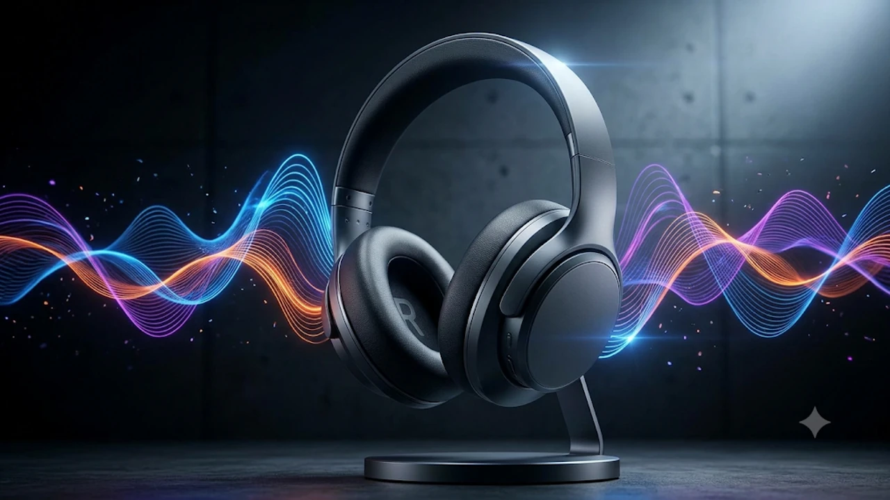

찬 바람이 본격적으로 불기 시작하는 11월 말, 출퇴근길 지하철과 카페에서 오버이어 헤드폰을 쓴 사람들이 눈에 띄게 늘었다. 여름철 땀과 열기 때문에 서랍에 넣어두었던 헤드폰이 겨울철 방한 효과와 패션 아이템, 음향 기기 역할을 동시에 해내며 다시 인기를 끌고 있다.

2026년 하반기에는 10만 원대 입문기부터 50만 원대 플래그십 모델까지 액티브 노이즈 캔슬링(ANC) 성능이 전반적으로 올라가면서 선택지가 넓어졌다. 예산과 사용 목적에 맞춰 바로 고를 수 있도록 대표 노이즈캔슬링 무선 헤드폰 3종의 핵심 수치와 실사용 장단점을 정리했다.

## 지금 노이즈캔슬링 헤드폰이 뜨는 이유

겨울철 헤드폰 수요가 급증하는 첫 번째 이유는 계절성이다. 귀 전체를 덮는 오버이어 구조 덕분에 영하권 날씨에도 별도 귀마개 없이 보온 효과를 얻는다. 코트나 패딩 같은 두꺼운 아우터에 매치하기 좋아 2030 세대 사이에서는 실용적인 겨울 액세서리로 자리 잡았다.

두 번째 이유는 재택근무와 카공(카페 공부) 문화의 일상화다. 오픈형이나 커널형 이어폰은 2\~3시간 이상 꽂고 있으면 외이도 통증이나 귀 피로감이 생긴다. 반면 오버이어 헤드폰은 귓바퀴를 감싸는 형태라 3\~4시간 연속 착용해도 부담이 적고, 카페 말소리나 지하철 굉음을 물리적으로 한 번 더 막아 집중력을 유지하기 좋다. 책상 앞 작업 환경을 쾌적하게 꾸미는 중이라면 [2026 무선 버티컬 마우스 추천 TOP3](/posts/trending-picks/wireless-vertical-mouse-top3-2026/) 같은 데스크테리어 아이템과 함께 맞춰두면 효율이 올라간다.

세 번째 이유는 가격 대비 기능의 상향이다. 과거에는 40만 원 이상을 써야 쓸 만한 노이즈 캔슬링을 체감할 수 있었지만, 지금은 10만 원 초반대 모델에도 하이브리드 ANC, 멀티포인트 연결, 고해상도 코덱(LDAC)이 기본으로 들어간다. 입문 장벽이 낮아지면서 쿠팡과 네이버쇼핑에서 관련 검색량이 매주 늘고 있다.

## 2026 노이즈캔슬링 헤드폰 TOP3 스펙 비교

현재 국내 오픈마켓과 음향 커뮤니티에서 판매량과 실사용 만족도가 높은 대표 모델 3가지를 가격대별로 추렸다. 무게, 배터리 지속 시간, 급속 충전, 지원 코덱 등 구매에 직결되는 핵심 수치만 표로 비교했다.

| 모델명 | 가격대 | 핵심 스펙 | 추천 대상 |
| :--- | :--- | :--- | :--- |
| **앤커 사운드코어 스페이스 원** | 11만\~13만 원대 | 무게 265g / ANC 켜고 최대 40시간 / 5분 충전 4시간 재생 / LDAC 지원 | 첫 헤드폰 입문자, 10만 원대 예산의 학생·직장인 |
| **소니 WH-1000XM5** | 35만\~39만 원대 | 무게 250g / ANC 켜고 최대 30시간 / 3분 충전 3시간 재생 / 8개 마이크 ANC | 음질과 통화 품질 밸런스를 중시하는 올라운더 |
| **보스 QC 울트라 헤드폰** | 48만\~53만 원대 | 무게 254g / ANC 켜고 최대 24시간 / 15분 충전 2.5시간 재생 / 커스텀튠 | 최상급 소음 차단과 안경 착용 시 편안함이 최우선인 사용자 |

## 예산대별 노이즈캔슬링 헤드폰 추천

### 1. 저가·입문 추천: 앤커 사운드코어 스페이스 원 (Anker Soundcore Space One)
* **가격대:** 11만\~13만 원대
* **핵심 스펙:** 40mm 맞춤형 다이내믹 드라이버 / ANC 활성화 시 최대 40시간(비활성화 시 55시간) 재생 / 5분 충전 시 4시간 재생 / LDAC 및 블루투스 5.3 지원 / 무게 265g

10만 원 초반대 예산으로 30만 원대 중급기에 준하는 기능을 원할 때 가장 합리적인 선택지다. 앤커 특유의 단단한 저음 튜닝이 적용되어 팝이나 힙합, 락 장르를 들을 때 타격감이 분명하다. 전용 앱에서 22가지 EQ 프리셋으로 음색을 조절할 수 있고, 주변 소음에 맞춰 5단계로 강도를 바꾸는 적응형 ANC 기능도 실사용에서 준수하게 작동한다.

* **장점:**
  1. 10만 원대 모델 중 드물게 LDAC 고해상도 코덱과 착용 감지 센서(벗으면 음악 자동 일시정지)를 모두 탑재했다.
  2. ANC를 켠 상태에서도 최대 40시간 연속 재생이 가능해 하루 2시간 출퇴근 기준 2주 이상 충전 없이 버틴다.
* **단점:**
  1. 외관 소재가 플라스틱 위주라 30\~50만 원대 모델에 비해 마감 고급감이 떨어지며, 기본 구성품이 하드 케이스가 아닌 천 파우치다.
* **이런 사람에게 추천:** 10만 원대 예산으로 노이즈 캔슬링 헤드폰에 처음 입문하는 대학생, 카페에서 유튜브나 인강 시청 비중이 높은 구매자.
* [앤커 사운드코어 스페이스 원 쿠팡에서 보기](https://www.coupang.com/np/search?q=앤커+사운드코어+스페이스+원&sourceType=affiliate&trackingCode=AF8691300)

### 2. 중급·올라운더 추천: 소니 WH-1000XM5 (Sony WH-1000XM5)
* **가격대:** 35만\~39만 원대
* **핵심 스펙:** 30mm 카본 파이버 드라이버 / 8개 마이크 및 듀얼 프로세서(V1+QN1) ANC / 최대 30시간 재생(3분 충전 시 3시간 사용) / 무게 250g

출시 이후 꾸준히 판매 최상위권을 지키는 모델이다. 250g의 가벼운 무게와 부드러운 소프트 핏 레더 이어패드 덕분에 3시간 이상 연속 착용해도 정수리와 귀 주변 압박감이 적다. AI 노이즈 감소 알고리즘이 적용된 4개의 빔포밍 마이크가 바람 소리와 주변 잡음을 걸러내어, 야외 통화나 화상 회의 시 상대방에게 목소리가 또렷하게 전달된다.

* **장점:**
  1. 저음·중음·고음 밸런스가 고르게 잡혀 있어 장르를 가리지 않으며, 무선 헤드폰 중 통화 품질이 가장 안정적이다.
  2. PC와 스마트폰 2대를 동시에 연결하는 멀티포인트 전환 속도가 빨라 업무용으로 쓰기 쾌적하다.
* **단점:**
  1. 전작(XM4)과 달리 이어컵이 안쪽으로 접히지 않는 구조라 전용 하드 케이스 부피가 크다. 작은 크로스백이나 슬림한 백팩에 넣기에는 공간 차지가 상당하다.
* **이런 사람에게 추천:** 음악 감상, 통화, 재택근무 화상 회의까지 한 대로 해결하려는 직장인.
* [소니 WH-1000XM5 쿠팡에서 보기](https://www.coupang.com/np/search?q=소니+WH-1000XM5&sourceType=affiliate&trackingCode=AF8691300)

### 3. 프리미엄 추천: 보스 QC 울트라 헤드폰 (Bose QuietComfort Ultra Headphones)
* **가격대:** 48만\~53만 원대
* **핵심 스펙:** 커스텀튠(CustomTune) 자동 음향 보정 / 보스 몰입형 오디오(공간 음향) / 최대 24시간 재생(공간 음향 사용 시 18시간, 15분 충전 2.5시간 재생) / 무게 254g

극강의 소음 차단과 편안한 착용감에 예산을 집중한다면 보스 QC 울트라가 확실한 대안이다. 전원을 켜는 순간 사용자의 귀 내부 형태를 분석해 최적의 사운드와 노이즈 캔슬링을 자동 세팅하는 커스텀튠 기술이 강점이다. 지하철 철로 마찰음이나 비행기 엔진 소리 같은 저주파 소음을 지워내는 성능이 매우 뛰어나며, 이어컵이 접히는 폴딩 구조라 휴대성까지 챙겼다.

* **장점:**
  1. 이어패드 깊이가 넉넉하고 쿠션 복원력이 부드러워 안경을 쓴 상태로 오래 써도 귀 눌림과 두통이 현저히 적다.
  2. 몰입형 오디오 모드를 켜면 소리가 머리 앞쪽에서 입체적으로 퍼져 영화나 라이브 음원 감상 시 현장감이 살아난다.
* **단점:**
  1. 50만 원 안팎의 높은 가격대와 공간 음향 활성화 시 18시간으로 줄어드는 배터리 지속 시간은 아쉽다.
* **이런 사람에게 추천:** 장거리 비행·출장이 잦은 사용자, 안경을 써서 헤드폰 장력에 민감한 사람, 완벽한 정적 속에서 집중하고 싶은 구매자.
* [보스 QC 울트라 헤드폰 쿠팡에서 보기](https://www.coupang.com/np/search?q=보스+QC+울트라+헤드폰&sourceType=affiliate&trackingCode=AF8691300)

## 구매 전 반드시 확인할 체크포인트

헤드폰은 스펙표만 보고 샀다가 착용감이나 휴대성 문제로 방치하는 경우가 잦다. 결제 전 아래 3가지 기준을 본인 사용 패턴에 대입해 보아야 실패를 줄인다.

**1. 무게와 장력(안경 착용 여부)**
헤드폰 무게가 280g을 넘어가면 목과 정수리에 피로가 빠르게 쌓인다. 하루 2시간 이상 쓸 계획이라면 250g\~265g 사이의 경량 모델을 고르는 편이 안전하다. 안경을 쓰고 있다면 이어패드 쿠션이 부드럽고 내부 공간이 넉넉한 보스 QC 울트라나 소니 XM5 계열이 유리하다. 장시간 책상에 앉아 헤드폰을 쓰고 작업하다 보면 목과 어깨가 쉽게 뭉치므로, 퇴근 후 [2026 무선 목어깨 온열마사지기 TOP3 비교](/posts/trending-picks/wireless-neck-shoulder-heat-massager-top3-2026/) 같은 관리 기기로 피로를 풀어주는 습관도 유용하다.

**2. 휴대 방식과 폴딩 구조**
매일 가방에 넣고 다니며 출퇴근용으로 쓸 생각이라면 이어컵이 접히는 폴딩 지원 여부를 먼저 따져야 한다. 보스 QC 울트라와 앤커 스페이스 원은 접어서 부피를 줄일 수 있지만, 소니 WH-1000XM5는 평평하게 눕혀 보관하는 방식이라 가방 공간을 더 차지한다. 목에 걸고 다니는 빈도가 높다면 이어컵이 안쪽으로 자연스럽게 회전하는 모델이 턱에 걸리지 않아 편하다.

**3. 사용 기기와 코덱 호환성**
아이폰(iOS)은 블루투스 전송 시 AAC 코덱까지만 지원하므로 LDAC 같은 고해상도 코덱 유무에 추가 비용을 쓸 필요가 없다. 반면 갤럭시 등 안드로이드 스마트폰 사용자라면 LDAC이나 aptX Adaptive 코덱을 지원하는 모델을 골라야 무손실 음원 스트리밍의 장점을 제대로 체감한다.

예산이 10만 원대라면 앤커 스페이스 원, 30만 원대 올라운더를 원한다면 소니 WH-1000XM5, 가격보다 최상의 착용감과 소음 차단이 우선이라면 보스 QC 울트라를 고르면 용도에 맞는 확실한 선택이 된다.

---

> 이 포스팅은 쿠팡 파트너스 활동의 일환으로, 이에 따른 일정액의 수수료를 제공받습니다.

#트렌드상품 #쿠팡추천 #노이즈캔슬링헤드폰 #무선헤드폰추천 #소니WH1000XM5 #보스QC울트라 #앤커스페이스원 #겨울패션템