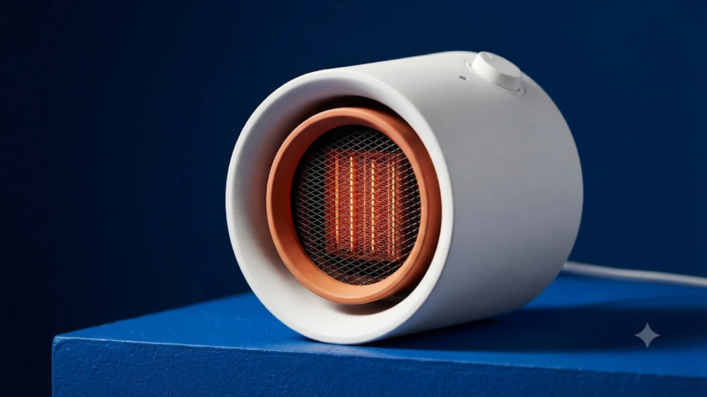
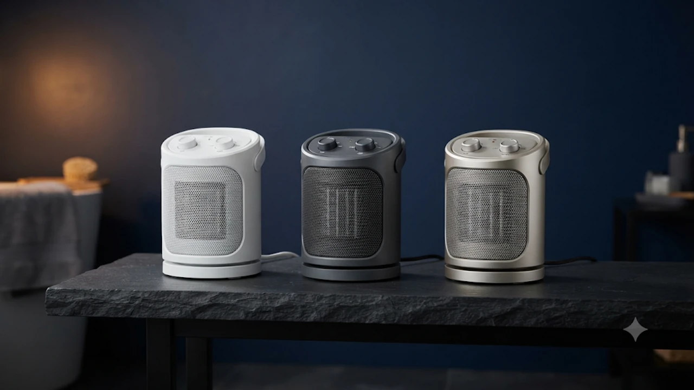

11월 하순 아침 기온이 영하권으로 떨어지면서 가장 먼저 한기가 스며드는 공간은 단연 욕실이다. 거실 보일러를 아무리 높여도 타일과 도기로 마감된 욕실 내부 공기는 쉽게 데워지지 않는다. 따뜻한 물로 샤워를 마친 직후 수건에 손을 뻗는 찰나의 한기는 단순한 불쾌감을 넘어 급격한 혈압 상승을 유발하는 겨울철 히트쇼크의 주원인이 된다. 최근 전월세 거주자와 신축 아파트 입주민 사이에서 벽에 구멍을 뚫지 않고 수건걸이나 벽면에 거치할 수 있는 무타공 생활방수 PTC 온풍기 검색량이 급증하는 배경이다.

## 1. 지금 욕실용 무타공 PTC 온풍기가 뜨는 이유

과거 욕실 난방기 시장은 인테리어 시공 단계에서 천장에 매립하는 환풍기 일체형 제품이 주류를 이뤘다. 하지만 설치비만 20만 원에서 40만 원에 달하고 타공이 필수적이라 세입자나 기존 주택 거주자에게는 진입 장벽이 높았다. 최근 1\~2년 사이 2,000W급 고효율 PTC 세라믹 발열체와 IPX2\~IPX4 등급 생활방수 설계를 결합한 소형 벽걸이·거치 겸용 제품이 대중화되면서 판도가 바뀌었다.

항공기 기내 난방에도 쓰이는 PTC(Positive Temperature Coefficient) 소자는 전원을 켜자마자 3초 이내에 열풍을 뿜어내며, 설정 온도에 도달하면 스스로 소비전력을 줄여 과열 위험과 화재 가능성을 낮춘다. 여기에 타일 벽면을 뚫지 않고 기존 수건걸이 봉에 걸거나 무타공 접착 브라켓으로 고정하는 방식이 더해져 1인 가구와 어린 자녀, 고령의 부모님과 함께 사는 가정에서 겨울철 필수 계절가전으로 자리 잡았다. 샤워 후 송풍 모드를 활용해 욕실 내 눅눅한 습기를 말리고 수건을 뽀송하게 건조하는 부가 기능 역시 실사용자들의 만족도를 끌어올린 요인이다.

## 2. 2026 욕실용 PTC 온풍기 TOP3 스펙 비교

현재 쿠팡과 네이버 쇼핑에서 판매량과 실구매 후기가 검증된 대표 모델 3종을 출력, 방수 등급, 설치 편의성, 가격대 기준으로 정리했다.

| 모델명 | 가격대 | 핵심 스펙 | 추천 대상 |
| :--- | :--- | :--- | :--- |
| **한경희생활과학 HAAN-4000** | 6만 원대 | 1000W/2000W 2단 조절, 120분 타이머, 2.2kg | 초기 비용 부담을 줄이고 직관적인 다이얼 조작을 원하는 실속파 |
| **신일전자 SEH-C2000PS** | 10만 원대 | 2000W 3단(송풍·온풍·고온), IP23 방수, 리모컨, 2.5kg | 공식 방수 인증과 국내 A/S 인프라, 리모컨 편의성을 중시하는 가정 |
| **바툼 욕실 온풍기 4.0 (BTF-2000)** | 13만 원대 | 2000W 쾌속 발열, 30분 자동 꺼짐, 수건봉·벽걸이 겸용 | 깔끔한 화이트 인테리어와 영유아·부모님 안전 차단을 우선하는 가정 |

### 한경희생활과학 욕실용 PTC 온풍기 (HAAN-4000)

* **가격대:** 6만 4,000원 \~ 6만 9,000원대
* **핵심 스펙:** 최대 소비전력 2,000W(1단 1,000W / 2단 2,000W), 최대 120분 기계식 타이머, 크기 265 × 150 × 380mm, 무게 2.2kg
* **장점:** 6만 원대 중반의 합리적인 가격에 2,000W 고출력 PTC 히터를 탑재해 1.5평 내외 표준 아파트 욕실 공기를 3분 안에 훈훈하게 데운다. 상단 수건걸이 거치대, 벽걸이 브라켓, 바닥 스탠드 거치까지 3가지 방식을 모두 지원해 욕실 구조에 구애받지 않는다.
* **단점:** 전용 무선 리모컨이 포함되지 않아 본체 측면의 회전식 다이얼로 직접 전원과 타이머를 조작해야 한다.
* **이런 사람에게 추천:** 원룸이나 오피스텔에 거주하며 7만 원 이하 예산으로 화력 좋은 욕실 난방기를 찾는 자취생, 복잡한 디지털 버튼보다 아날로그 다이얼 조작이 편한 사용자에게 알맞다.

[한경희생활과학 욕실용 PTC 온풍기 HAAN-4000 쿠팡에서 보기](https://www.coupang.com/np/search?q=한경희생활과학%20욕실용%20PTC%20온풍기%20HAAN-4000&sourceType=affiliate&trackingCode=AF8691300)

### 신일전자 무타공 욕실 벽걸이 PTC 히터 (SEH-C2000PS)

* **가격대:** 9만 9,000원 \~ 10만 9,000원대
* **핵심 스펙:** 최대 소비전력 2,000W(송풍·온풍 1,000W·고온 2,000W 3단계), 방수 등급 IP23 인증, 1\~8시간 예약 타이머, 크기 280 × 155 × 410mm, 무게 2.5kg
* **장점:** 계절가전 전문 브랜드답게 공식 IP23 생활방수 등급을 획득해 60도 각도에서 분사되는 물방울이나 수증기 유입으로부터 내부 회로를 안전하게 보호한다. 전용 리모컨과 전면 LED 온도 표시창이 있어 샤워 부스 밖이나 세면대 앞에서 허리를 굽히지 않고도 풍량과 온도를 손쉽게 바꿀 수 있다.
* **단점:** 수건걸이 봉 두께가 25mm를 초과하는 두꺼운 일자형 선반의 경우 기본 후크 체결 시 유격이 생길 수 있어 벽면 브라켓 사용이 권장된다.
* **이런 사람에게 추천:** 물기가 많은 욕실 환경에서 검증된 방수 인증 스펙과 전국 50여 개 서비스센터의 사후 관리를 우선시하는 3\~4인 가족에게 가장 균형 잡힌 선택지다.

[신일전자 무타공 욕실 벽걸이 PTC 히터 SEH-C2000PS 쿠팡에서 보기](https://www.coupang.com/np/search?q=신일전자%20무타공%20욕실%20벽걸이%20PTC%20히터%20SEH-C2000PS&sourceType=affiliate&trackingCode=AF8691300)

### 바툼 욕실 온풍기 4.0 (BTF-2000)

* **가격대:** 13만 5,000원 \~ 14만 5,000원대
* **핵심 스펙:** 최대 소비전력 2,000W, 고감도 PTC 세라믹 발열체, 기본 30분 자동 전원 차단 안전 시스템, 무타공 수건봉 클립·벽걸이 겸용, 무게 2.4kg
* **장점:** 투박한 공업용 히터 디자인에서 벗어난 매트 화이트 미니멀 외관으로 리모델링한 신축 욕실 인테리어를 해치지 않는다. 전원을 켠 후 별도 조작이 없으면 30분 뒤 자동으로 전원이 차단되는 세이프티 타이머가 기본 작동해 깜빡하고 외출했을 때의 과열과 전기요금 폭탄을 원천 차단한다.
* **단점:** 13만 원대 후반의 가격으로 경쟁 모델 대비 초기 구매 비용이 3만\~6만 원가량 높다.
* **이런 사람에게 추천:** 아이 목욕을 시킬 때 욕실 온도를 빠르게 높여야 하는 영유아 가정, 기계 조작 후 전원을 끄는 것을 자주 잊어버리는 부모님 댁 효도 선물로 적합하다.

[바툼 욕실 온풍기 4.0 BTF-2000 쿠팡에서 보기](https://www.coupang.com/np/search?q=바툼%20욕실%20온풍기%204.0%20BTF-2000&sourceType=affiliate&trackingCode=AF8691300)

## 3. 예산대별 추천 가이드

욕실 평수와 거주 형태, 주로 사용하는 가족 구성원에 맞춰 예산을 배분하면 불필요한 지출을 줄일 수 있다.

* **6만 원대 실속형 (한경희생활과학 HAAN-4000):** 오직 '빠른 난방' 본연의 기능에 집중한 가성비 모델이다. 1인 가구나 1.5평 미만의 소형 화장실에서는 1,000W 약풍 모드만으로도 샤워 시간 내내 충분한 온기가 유지되므로 굳이 10만 원 이상 투자할 필요가 없다.
* **10만 원대 표준 밸런스형 (신일전자 SEH-C2000PS):** 온풍 기능 외에 여름철과 환절기 욕실 습기 제거를 위한 '송풍 전용 모드'와 리모컨 조작이 필요하다면 이 구간이 정답이다.
* **13만 원대 프리미엄 안전형 (바툼 욕실 온풍기 4.0):** 욕실 내 거울이나 수납장과 어울리는 깔끔한 디자인, 그리고 30분 자동 꺼짐 안전 로직이 필수적인 가족 단위 거주자에게 가격 값을 톡톡히 한다.

겨울철 실내 생활의 쾌적함을 높이는 데 관심이 있다면 장시간 PC 작업 시 손목 부담을 덜어주는 [2026 무선 버티컬 마우스 추천 TOP3](/posts/trending-picks/wireless-vertical-mouse-top3-2026/)나 뭉친 승모근을 풀어주는 [2026 무선 목어깨 온열마사지기 TOP3 비교](/posts/trending-picks/wireless-neck-shoulder-heat-massager-top3-2026/) 글도 함께 확인해 두면 실내 환경 전반을 업그레이드하는 데 도움이 된다.

## 4. 구매 전 반드시 확인할 체크포인트 4가지

욕실용 온풍기는 물과 전기가 공존하는 공간에서 2,000W의 고전력을 소모하는 기기인 만큼 주문 전 아래 4가지 조건을 반드시 점검해야 한다.

1. **욕실 내 방수 콘센트 위치와 전원선 길이**
   국내 아파트 욕실의 방수 콘센트는 보통 세면대 옆 110cm\~130cm 높이에 위치한다. 본체 전원 코드 길이가 평균 1.5m 내외이므로 수건걸이에서 콘센트까지 선이 팽팽하게 당겨지지 않고 여유 있게 닿는지 줄자로 먼저 재봐야 한다. 또한 2,000W 소비전력 제품은 멀티탭에 다른 기기와 함께 꽂으면 차단기가 내려가거나 과부하 화재 위험이 있으므로 반드시 벽면 단독 콘센트에 직결해야 한다.
2. **샤워기 직수 구역 회피 및 방수 등급(IPX) 확인**
   IPX2\~IPX4 등급은 위에서 떨어지는 물방울이나 사방에서 튀는 생활 물보라를 막아주는 수준이지 샤워기 호스에서 뿜어져 나오는 강한 물줄기(IPX5 이상)까지 견디는 완전 방수가 아니다. 욕조나 샤워부스 바로 안쪽 벽면은 피하고, 세면대 위쪽이나 변기 상단 수건걸이처럼 물줄기가 직접 닿지 않는 건식 구역에 설치해야 한다.
3. **무타공 거치 방식의 호환성**
   수건걸이에 걸어 쓰는 행거형 제품은 기존 수건걸이의 벽면 고정 나사가 헐겁지 않은지 먼저 흔들어 확인해야 한다. 2.2kg\~2.5kg의 본체 무게를 지탱해야 하므로 부식되거나 실리콘으로만 붙어 있는 약한 수건걸이는 낙하 사고의 원인이 된다. 무타공 접착 브라켓을 쓸 때는 엠보싱이나 무광 돌기 타일에는 접착력이 떨어지므로 매끈한 유광 폴리싱 타일 면에만 부착하고, 부착 후 24시간 이상 경화시킨 뒤 본체를 걸어야 안전하다.
4. **월간 실제 전기요금 계산법**
   2,000W 소비전력을 기준으로 하루 20분씩 한 달(30일) 사용하면 총 전력 사용량은 20kWh다. 주택용 저압 전기요금 기준 월 200kWh 이하 1단계 누진 구간 가정이라면 한 달 추가 전기요금은 약 2,400원 수준이며, 201\~400kWh 2단계 구간 가정에서도 약 4,200원대에 불과하다. 단, 외출 시 전원을 켜둔 채 방치하면 요금이 급증하므로 30분\~60분 타이머 기능을 습관적으로 활용하는 것이 핵심이다.

---

> 이 포스팅은 쿠팡 파트너스 활동의 일환으로, 이에 따른 일정액의 수수료를 제공받습니다.

#트렌드상품 #쿠팡추천 #욕실용PTC온풍기 #무타공욕실온풍기 #방수온풍기 #겨울난방가전 #욕실히터추천 #화장실온풍기 #자취필수템 #가전제품비교