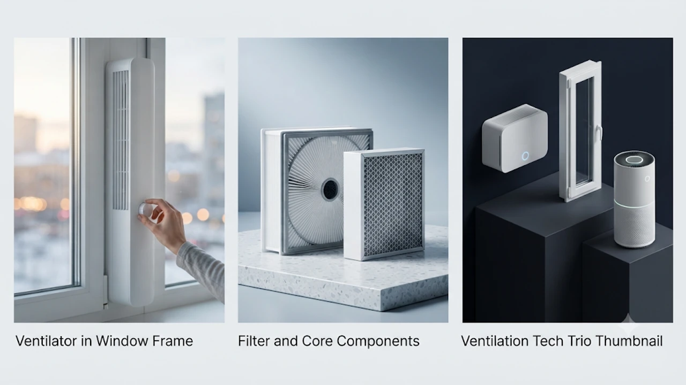

영하권으로 뚝 떨어진 기온과 매서운 미세먼지가 동시에 찾아오는 11월 하순, 집 안 공기를 관리하려는 소비자들의 고민이 깊어지고 있다. 춥다고 창문을 꽁꽁 닫아두면 실내 이산화탄소($CO_2$) 농도가 1,500ppm 이상으로 급격히 치솟아 두통과 졸음을 유발하고, 환기를 위해 창문을 열면 실내 온도가 3\~5도씩 순식간에 떨어져 난방비 폭탄을 맞기 십상이다. 

이러한 딜레마를 단번에 해결해 주는 아이템으로 **창문형 및 벽부형 열회수 환기청정기**가 2026년 겨울철 최고 인기 가전으로 급부상했다. 기존 공기청정기가 실내 공기를 내부에서 순환시키며 먼지만 걸러내는 방식이었다면, 환기청정기는 외부의 신선한 공기를 H13 등급 이상의 헤파필터로 정화해 실내로 들여보내고 오염된 내부 공기는 밖으로 배출한다. 특히 열교환 소자를 통해 버려지는 실내 열에너지의 70% 이상을 회수해 유입되는 찬 공기를 데워주는 기능 덕분에 겨울철 필수 가전으로 자리 잡았다.

---

## 지금 창문형 환기청정기가 뜨는 이유

최근 유튜브 인테리어 채널과 육아 커뮤니티, 자취생 카페에서는 '무타공 창문형 환기청정기' 리뷰 콘텐츠가 폭발적인 조회수를 기록하고 있다. 검색량과 판매량이 동시에 급증한 배경에는 세 가지 명확한 시장 트렌드가 자리한다.

첫째, **기밀성이 높아진 현대 주거 환경의 변화**다. 단열 성능을 극대화한 신축 아파트나 샷시 교체를 마친 구축 주택은 외부 냉기를 완벽히 차단하는 대신 시간당 자연 환기 횟수가 0.2회 미만으로 급격히 줄어들었다. 이로 인해 요리할 때 발생하는 초미세먼지와 호흡으로 쌓이는 이산화탄소, 라돈 같은 유해가스가 집 안에 갇히는 현상이 심화되면서 강제 환기 설비에 대한 필요성이 커졌다.

둘째, **타공 없는 간편 설치 제품의 대중화**다. 과거 열회수 환기장치(전열교환기)는 천장 매립형이나 외벽에 직경 100mm 이상의 구멍을 뚫어야 하는 벽부형이 주를 이뤄 전세·월세 거주자나 구축 아파트 주민들은 설치 자체가 불가능했다. 하지만 최근에는 창틀에 끼우기만 하면 되는 창문형 모델이 대거 출시되면서 이사 갈 때 떼어갈 수 있는 '이동식 환기 가전' 시대가 열렸다.

셋째, **전기요금 및 난방비 절감 효과**다. 겨울철 맞통풍 환기를 10분만 시켜도 실내 온도가 3\~5도 이상 떨어지며, 이를 다시 데우기 위해 보일러를 가동하면 상당한 에너지가 낭비된다. 최신 환기청정기는 전열교환 소자를 통해 난방열의 70\~80%를 회수하므로, 창문을 여는 것보다 훨씬 경제적으로 쾌적한 실내 온도와 공기질을 유지할 수 있다.

---

## 환기청정기 추천 TOP3 스펙 비교

시장에서 가장 검증된 대표 모델 3가지를 선정해 핵심 제원과 가격대를 한눈에 비교할 수 있도록 정리했다.

| 모델명 | 가격대 | 핵심 스펙 | 추천 대상 |
| :--- | :--- | :--- | :--- |
| **샤오미 미지아 스마트 프레시 에어 C1** | 28만 원대 | 풍량 80㎥/h, H13 헤파필터, 300W PTC 히터 내장 | 원룸·작은방 가성비 입문자 |
| **힘펠 휴벤 W (HUVEN-W)** | 65만 원대 | 창틀 무타공 설치, 열회수율 72%, H13 헤파필터 | 전월세 가구 및 거실·안방 겸용 |
| **경동나비엔 환기청정기 스탠드형** | 115만 원대 | 4단계 청정 필터(99.97% 제거), AI 센서, UV-LED 살균 | 신축·대형 평수 및 육아 가정 |

---

## 예산대별 상세 추천 가이드

### 1. 가성비 입문형: 샤오미 미지아 스마트 프레시 에어 C1 (약 28만 원대)

* **핵심 스펙:** 최대 환기풍량 80㎥/h / H13 등급 트루 헤파필터 탑재(0.3㎛ 입자 99.95% 제거) / 300W 세라믹 PTC 보조 난방 히터 내장
* **장점:** 28만 원대라는 압도적인 가격 경쟁력을 갖췄으며, 겨울철 유입되는 차가운 공기를 자체 300W PTC 히터로 데워서 내보내 냉기 유입을 원천 차단한다. 미홈(Mi Home) 앱 연동으로 스마트폰 원격 제어와 시간대별 스케줄 설정이 매끄럽다.
* **단점:** 벽면 타공이나 전용 창문 아크릴 판넬 별도 제작을 통한 설치가 필요하며, 최대 풍량 가동 시 소음이 41dB 이상으로 다소 크게 느껴질 수 있다.
* **이런 사람에게 추천:** 5\~8평(16\~26㎡) 규모의 원룸이나 서재, 작업실에 합리적인 비용으로 24시간 자동 환기 시스템을 구축하고 싶은 1인 가구.

[샤오미 미지아 스마트 프레시 에어 C1 쿠팡에서 보기](https://www.coupang.com/np/search?q=샤오미+미지아+스마트+프레시+에어&sourceType=affiliate&trackingCode=AF8691300)

---

### 2. 밸런스 베스트셀러: 힘펠 휴벤 W (약 65만 원대)

* **핵심 스펙:** 전열교환 열회수율 72% / 창틀 거치형 무타공 설치(높이 110\~230cm 대응) / H13 등급 헤파필터 및 프리필터 2중 구조
* **장점:** 국내 환기 가전 전문 기업 힘펠의 기술력이 집약된 모델로, 창문 틈새에 거치대만 세우면 성인 혼자서도 30분 내에 무타공 설치가 가능하다. 열회수율이 72%에 달해 한겨울에도 난방열 손실 없이 실내 이산화탄소 농도를 600ppm 이하로 쾌적하게 유지한다.
* **단점:** 창문 한쪽 면(폭 약 25cm)을 세로로 차지하기 때문에 창문 개방감이 일부 줄어들며, 외부 바람이 강하게 부는 고층 아파트에서는 창틀 틈새 마감재(문풍지 등) 보강 작업에 신경 써야 한다.
* **이런 사람에게 추천:** 벽에 구멍을 뚫을 수 없는 전세·월세 거주자, 혹은 이미 인테리어가 완료된 아파트 안방과 아이 방에 깔끔하게 환기청정기를 들이고 싶은 소비자.

[힘펠 휴벤 W 쿠팡에서 보기](https://www.coupang.com/np/search?q=힘펠+휴벤+W&sourceType=affiliate&trackingCode=AF8691300)

---

### 3. 프리미엄 올인원: 경동나비엔 환기청정기 스탠드형 (약 115만 원대)

* **핵심 스펙:** 4단계 듀얼 청정 필터(0.01㎛ 초미세먼지 99.97% 제거) / UV-LED 살균 기능 / 듀얼 에어 센서($CO_2$, 라돈, 초미세먼지 감지)
* **장점:** 공기청정기와 환기시스템을 하나로 결합한 하이엔드 제품으로, 실내 오염도에 따라 청정 모드와 환기 모드를 스스로 전환한다. 요리 매연이 발생할 때 주방 후드와 연동해 빠르게 공기를 정화하며, 내부 열교환 소자까지 UV-LED로 살균해 위생 관리가 탁월하다.
* **단점:** 초기 구매 및 설치 비용이 115만 원대로 높으며, 창문 연결 배관 키트 설치 시 실내 바닥 공간 일부를 차지한다.
* **이런 사람에게 추천:** 어린아이나 호흡기가 예민한 가족이 있는 가정, 미세먼지와 라돈 수치를 실시간 데이터로 관리하며 최고 수준의 실내 공기질을 원하는 소비자.

[경동나비엔 환기청정기 쿠팡에서 보기](https://www.coupang.com/np/search?q=경동나비엔+환기청정기&sourceType=affiliate&trackingCode=AF8691300)

---

## 구매 전 반드시 확인할 체크포인트

환기청정기는 일반 가전과 달리 창문 규격과 설치 환경에 따라 호환 여부가 갈리므로 결제 전 아래 세 가지 항목을 반드시 점검해야 한다.

첫째, **설치할 창문의 높이와 샷시 두께 측정**이다. 창문형 환기청정기는 기본 제공되는 연장 패널로 맞출 수 있는 높이 범위(보통 110cm\~230cm)가 정해져 있다. 베란다 통창처럼 높이가 240cm를 넘어가는 경우 추가 연장 키트 구매가 가능한지 제조사 상세 페이지를 통해 확인해야 하며, 이중창 구조라면 외부 창과 내부 창 중 어느 쪽에 설치할지 미리 결정해야 방충망 간섭을 피할 수 있다.

둘째, **정격 풍량(CMH)과 사용 공간 면적 매칭**이다. 환기청정기의 성능은 시간당 몇 세제곱미터($m^3$)의 공기를 교체할 수 있는지를 나타내는 CMH(㎥/h) 수치로 판단한다. 침실이나 공부방(3\~5평) 용도라면 50\~80㎥/h 수준으로 충분하지만, 거실이나 주방이 연결된 20평대 이상 공간에서 효과를 보려면 최소 100㎥/h 이상의 풍량을 지원하는 모델을 선택해야 한다. 데스크 환경의 쾌적함을 높이고 싶다면 실내 공기질 관리와 함께 손목 피로를 줄여주는 [2026 무선 버티컬 마우스 추천 TOP3](/posts/trending-picks/wireless-vertical-mouse-top3-2026/)나 창틀 먼지를 손쉽게 제거하는 [무선 에어건 제트팬 추천 TOP3 비교](/posts/trending-picks/wireless-turbo-jet-air-duster-top3-2026/) 같은 주변 기기를 함께 활용하는 것도 효율적이다.

셋째, **필터 교체 주기와 유지비 계산**이다. 외부의 매연과 미세먼지를 직접 걸러내는 특성상 일반 공기청정기보다 필터 오염 속도가 빠르다. 보통 6개월에서 1년 주기로 프리필터 세척 및 헤파필터 교체가 필요하므로, 정품 필터의 개별 구매 가격(보통 3만\~7만 원대)과 수급 용이성을 따져보고 장기적인 유지비가 합리적인 제품을 고르는 것이 현명하다.

---

> 이 포스팅은 쿠팡 파트너스 활동의 일환으로, 이에 따른 일정액의 수수료를 제공받습니다.

#트렌드상품 #쿠팡추천 #트렌드 상품 추천 #환기청정기 #창문형환기청정기 #전열교환기 #힘펠휴벤W #겨울철환기 #미세먼지가전 #스마트홈가전