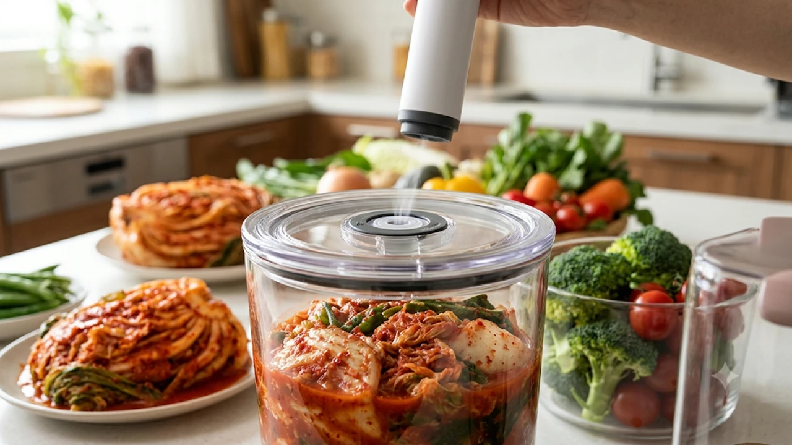

11월 말 찬 바람이 불기 시작하면서 본격적인 김장철이 돌아왔습니다. 일반 플라스틱 통에 김장 김치나 대용량 식재료를 넣어두면 금세 김치 냄새가 냉장고 전체에 배고, 며칠 지나지 않아 겉면이 시큼하게 물러버리는 경험을 자주 하게 됩니다. 1\~2인 가구 역시 장을 한 번 보면 채소나 고기를 다 먹지 못해 버리는 식비가 만만치 않습니다.

이런 보관 스트레스를 줄이기 위해 최근 주방 살림 트렌드로 자리 잡은 아이템이 바로 **원터치 자동 진공 밀폐용기**입니다. 버튼 한 번만 누르면 내부 공기를 강제로 빼내 산화를 막아주어, 일반 밀폐용기 대비 식재료 신선도를 최대 3배 가까이 길게 유지해 줍니다. 2026년 현재 쿠팡과 네이버쇼핑에서 후기와 판매량이 검증된 **진공 밀폐용기 추천 TOP3** 모델을 소재, 진공 압력, 가격대별로 꼼꼼하게 비교했습니다.

## 1. 지금 진공 밀폐용기가 뜨는 이유

진공 밀폐용기가 주방 필수템으로 급부상한 배경에는 계절적 요인과 식생활 변화가 맞물려 있습니다.

* **김장철 및 대용량 식재료 장기 보관 수요:** 11월 하순 김장 시즌에는 한 번에 많은 양의 김치와 수육용 돼지고기, 젓갈류를 보관해야 합니다. 내부 산소를 차단하는 진공 용기를 사용하면 김치가 과숙성되어 시어지는 속도를 늦추고 아삭한 식감을 오랫동안 지킬 수 있습니다.
* **고물가 시대 '냉장고 파먹기'와 식비 절감:** 외식비와 장바구니 물가가 오르면서 주말에 식재료를 한꺼번에 손질해 소분해 두는 밀프렙(Meal Prep) 문화가 확산했습니다. 아보카도, 사과, 샐러드 채소, 원두처럼 공기와 닿자마자 갈변하거나 향이 날아가는 식재료를 진공 상태로 보관하면 버리는 음식물 쓰레기가 눈에 띄게 줄어듭니다.
* **수동 펌프에서 무선 원터치 방식으로 진화:** 과거에는 손으로 수십 번 펌프질을 해야 해 번거로웠지만, 최근 출시되는 제품들은 USB-C 타입으로 충전하는 무선 자동 펌프를 얹어 버튼 클릭 한 번, 약 10\~15초 만에 진공 포장이 끝납니다.

## 2. TOP3 상품 스펙 비교

현재 온라인 쇼핑몰에서 가장 많이 팔리는 입문형, 주력 베스트셀러, 프리미엄 유리형 3가지 대표 모델을 한눈에 비교할 수 있도록 정리했습니다.

| 모델명 | 가격대 | 핵심 스펙 | 추천 대상 |
| :--- | :--- | :--- | :--- |
| **코멧 홈 자동 진공 밀폐용기 스타터 세트** | 3만 원대 | AS 수지 소재 / C타입 무선 펌프 / 600ml\~1,400ml 용기 4종 구성 | 처음 진공 용기를 써보는 1인 가구·자취생 |
| **바퀜(VAKUEN) 프리미엄 진공 밀폐용기 5종 세트** | 7만 원대 | SAN·실리콘 이중 밀폐 / 진공압 최대 -35kPa / 식기세척기(-30℃\~100℃) 가능 | 김장 김치, 반찬, 과일을 대량 보관하는 2\~4인 가정 |
| **즈윌링(ZWILLING) 프레쉬 앤 세이브 유리 7종 세트** | 11만 원대 | 붕규산 내열강화유리 / 최대 280℃ 오븐·전자레인지 지원 / 전용 앱 유통기한 관리 | 색·냄새 배임 없는 유리 용기와 오븐 조리를 원하는 분 |

주방 수납과 정리 정돈에 관심이 많다면 책상 위 환경을 깔끔하게 바꿔주는 [2026 무선 버티컬 마우스 추천 TOP3](/posts/trending-picks/wireless-vertical-mouse-top3-2026/)나 먼지 청소를 간편하게 돕는 [무선 에어건 제트팬 추천 TOP3 비교](/posts/trending-picks/wireless-turbo-jet-air-duster-top3-2026/) 글도 함께 참고해 보시기 바랍니다.

## 3. 예산대별 추천

### 저가형: 코멧 홈 자동 진공 밀폐용기 스타터 세트 (3만 원대)

초기 비용 부담 없이 자동 진공 기능을 경험해 보고 싶은 분들에게 적합한 3만 원대 가성비 입문 모델입니다.

* **핵심 스펙:** 투명 AS 수지 바디, 원터치 자동 진공 펌프(USB-C 충전식), 600ml 2개·1,000ml 1개·1,400ml 1개 기본 구성, 내열 온도 -20℃\~80℃
* **장점 2가지:**
  1. 3만 원대의 실속 있는 가격에 본체 용기 4개와 전용 전동 펌프가 모두 포함되어 있어 추가 지출 없이 바로 사용할 수 있습니다.
  2. 무게가 가볍고 투명도가 높아 냉장고 깊숙한 곳에 넣어두어도 내용물과 잔량을 즉시 파악할 수 있습니다.
* **단점 1가지:**
  * 내열 온도가 80℃ 수준이라 식기세척기 고온 건조 코스나 전자레인지 장시간 가열 사용에는 적합하지 않습니다.
* **이런 사람에게 추천:** 자취방에서 샐러드, 자른 과일, 시리얼, 커피 원두 등을 신선하게 소분해 두고 싶은 1인 가구와 가성비 입문자에게 권합니다.

[코멧 홈 자동 진공 밀폐용기 쿠팡에서 보기](https://www.coupang.com/np/search?q=코멧+자동+진공+밀폐용기&sourceType=affiliate&trackingCode=AF8691300)

---

### 중간형: 바퀜(VAKUEN) 프리미엄 진공 밀폐용기 5종 세트 (7만 원대)

SNS와 주부 커뮤니티에서 '김치·채소 보관 끝판왕'으로 입소문이 난 국내 대표 베스트셀러 모델입니다.

* **핵심 스펙:** 고강도 SAN 소재, 특허받은 이중 실리콘 패킹 구조, 최대 -35kPa 진공 압력, 식기세척기 및 냉동실(-30℃\~100℃) 사용 가능, 500ml\~3,100ml 규격 지원
* **장점 2가지:**
  1. 일반 진공 용기보다 진공 압력(-35kPa)이 강해 잎채소나 허브류를 넣어두면 2주가 지나도 시들지 않고 수분감이 그대로 살아 있습니다.
  2. 500ml 소형부터 3,100ml 대용량 김치통 규격까지 라인업이 촘촘해 필요에 따라 단품 용기만 추가로 늘려가며 모듈형으로 적층하기 좋습니다.
* **단점 1가지:**
  * 펌프 기기를 별도 옵션으로 선택해야 하는 구성이 많아 구매 전 옵션표에서 '진공기기 포함' 여부를 꼼꼼히 확인해야 합니다.
* **이런 사람에게 추천:** 김장 김치의 아삭함을 오래 유지하고 싶거나, 주말마다 대량으로 식재료를 손질해 냉장 보관하는 2\~4인 가정에 가장 알맞습니다.

[바퀜 프리미엄 진공 밀폐용기 쿠팡에서 보기](https://www.coupang.com/np/search?q=바퀜+진공+밀폐용기&sourceType=affiliate&trackingCode=AF8691300)

---

### 프리미엄형: 즈윌링(ZWILLING) 프레쉬 앤 세이브 유리 7종 세트 (11만 원대)

독일 주방 명가 즈윌링에서 선보인 프리미엄 라인으로, 위생적인 내열유리 용기와 스마트 관리 기능을 결합한 제품입니다.

* **핵심 스펙:** 붕규산 내열강화유리 바디, 최대 280℃ 오븐 및 전자레인지·식기세척기(-20℃\~280℃) 사용 가능, 뚜껑 QR코드 연동 전용 앱 유통기한 알림 기능, 350ml\~2,000ml 용량 구성
* **장점 2가지:**
  1. 강화유리 소재를 채택해 카레, 김치, 토마토소스 같은 양념이 강한 음식을 담아도 색배임이나 냄새 배임이 전혀 발생하지 않습니다.
  2. 뚜껑만 열면 냉장고에서 꺼낸 용기 그대로 전자레인지나 최대 280℃ 오븐에 넣어 조리한 뒤 식탁에 바로 올릴 수 있어 설거짓거리가 줄어듭니다.
* **단점 1가지:**
  * 유리 소재 특성상 플라스틱(SAN·트라이탄) 용기보다 무게가 묵직하고 떨어뜨렸을 때 파손 주의가 필요합니다.
* **이런 사람에게 추천:** 플라스틱 미세 스크래치와 환경호르몬 걱정을 덜고 싶은 분, 김치·장아찌류와 오븐 요리를 한 용기로 해결하고 싶은 분에게 추천합니다.

[즈윌링 프레쉬 앤 세이브 진공 세트 쿠팡에서 보기](https://www.coupang.com/np/search?q=즈윌링+프레쉬+앤+세이브+유리+진공+세트&sourceType=affiliate&trackingCode=AF8691300)

## 4. 구매 전 반드시 확인할 체크포인트

진공 밀폐용기는 일반 반찬통보다 단가가 높은 만큼, 구매 전 아래 3가지 기준을 확인해야 후회 없는 선택을 할 수 있습니다.

1. **액체 역류 방지 밸브 설계 여부**
   김장 김치나 국물이 있는 조림 반찬을 보관할 때는 진공 펌프가 공기를 빨아들이는 과정에서 국물이 밸브 안쪽으로 딸려 올라올 수 있습니다. 밸브 하단에 액체 차단 캡이 이중으로 설계되어 있는지, 실리콘 패킹을 분리해 세척할 수 있는 구조인지 확인하세요.
2. **소재에 따른 가열 및 세척 한계**
   가벼움과 내충격성을 우선한다면 **SAN이나 트라이탄 소재(-30℃\~100℃)**가 유리하고, 열탕 소독·오븐 조리·색배임 방지가 최우선이라면 **내열강화유리 소재(-20℃\~280℃)**를 선택하는 것이 합리적입니다.
3. **진공 유지 기간과 단품 확장성**
   저가형 일부 모델은 진공을 걸어둔 지 하루 이틀 만에 미세하게 공기가 새어 들어가는 경우가 있습니다. 진공 표시 밸브가 뚜껑에 장착되어 육안으로 압력 유지 상태를 확인할 수 있는지, 그리고 추후 용기만 낱개로 추가 구매하기 쉬운 브랜드인지 점검해 보시기 바랍니다.

---

> 이 포스팅은 쿠팡 파트너스 활동의 일환으로, 이에 따른 일정액의 수수료를 제공받습니다.

#트렌드상품 #쿠팡추천 #진공밀폐용기추천 #김장김치보관통 #원터치진공용기 #바퀜진공용기 #즈윌링프레쉬앤세이브 #주방살림템 #식재료소분보관 #냉장고정리용기