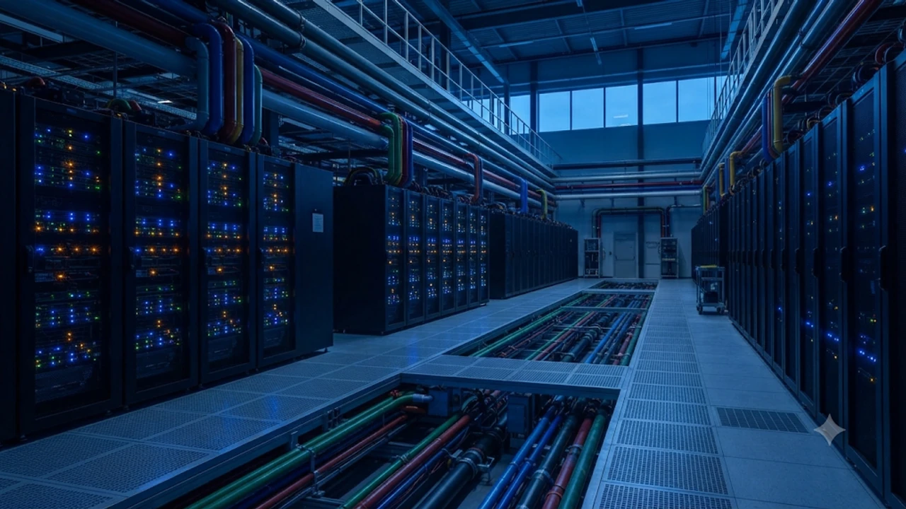

In November 2026, policymakers across major technology economies are aggressively reshaping **global AI regulation** by pairing strict safety mandates with novel fiscal mechanisms like a dedicated **AI compute tax**. Rather than relying solely on voluntary corporate pledges, governments in Washington, Brussels, and Tokyo are targeting the physical bottleneck of artificial intelligence—high-density GPU clusters and gigawatt-scale data centers—to fund public infrastructure and offset labor displacement.

## Why Policymakers Are Targeting Compute Infrastructure in Late 2026

The shift from regulating model outputs to taxing raw computational capacity marks a fundamental turning point in international technology governance. Frontier model training runs now consume staggering amounts of electrical power and specialized silicon, creating measurable strain on regional power grids and semiconductor supply chains.

### The Mechanics of FLOP-Based Levies
Tax authorities are moving beyond traditional corporate income models because frontier AI labs frequently reinvest revenue into capital expenditures, minimizing taxable profits. Under frameworks currently debated in European parliamentary committees and North American policy task forces, levies attach directly to **verified floating-point operations (FLOPs)** and data center megawatt capacity.

- **Compute Threshold Triggers:** Facilities exceeding specific high-performance interconnect thresholds face tiered surcharges per kilowatt-hour dedicated to frontier training clusters.
- **Hardware Import Surcharges:** Customs authorities are aligning tariff schedules on advanced AI accelerators with domestic grid-modernization funds, a dynamic closely tied to recent shifts in [US Secondary Tariffs 2026: 3 Tech Supply Chain Impacts](/posts/us-trends/us-secondary-tariffs-2026-tech-supply-chain-impacts/).
- **Auditability via Chip Telemetry:** Regulators increasingly rely on hardware-level cryptographic attestation built into next-generation server GPUs to verify compute usage without inspecting proprietary model weights.

### Grid Strain and Municipal Pushback
Local municipalities in Northern Virginia, Ireland, and parts of East Asia have enacted temporary moratoriums on new hyperscale permits throughout 2026. Water cooling demands and substation bottlenecks have turned data center zoning into a contentious issue for local taxpayers, prompting lawmakers to demand direct fiscal returns from cloud operators before approving new grid connections.

> "Regulating software weights after deployment proved nearly impossible to enforce across borders; metering the power and silicon at the substation gives states a concrete, auditable lever." — *Summary finding from the 2026 Autumn Transatlantic Digital Infrastructure Forum*

## Transatlantic Alignment and Divergence on AI Governance

While the concept of compute governance has gained traction globally, execution varies sharply between regulatory blocs. Enterprises operating multi-region cloud architectures must navigate overlapping compliance obligations that directly affect where models are trained and served.

### European Union AI Act Enforcement Milestones
With core provisions of the **EU AI Act** entering full enforcement phases in 2026, European regulators have paired transparency obligations with strict systemic-risk evaluations for general-purpose AI models. Companies training models above designated compute thresholds must submit detailed energy consumption disclosures alongside adversarial testing logs. Failure to maintain verifiable provenance records carries administrative fines tied to global annual turnover, pushing several European startups to seek sovereign compute grants.

### North American Energy and Security Priorities
In the United States, federal policy emphasizes national security export controls, grid reliability standards, and voluntary safety institute evaluations rather than broad statutory bans. However, state-level legislatures in California and New York have introduced targeted environmental and digital infrastructure surcharges on large-scale AI training facilities. At the same time, international trade tensions continue to shape how frontier hardware moves across borders, echoing broader geopolitical pressures highlighted in [U.S.–Iran Standoff & The Strait of Hormuz: August 2026 Global Flashpoints](/posts/us-trends/us-trends-issue-20260802/).

## How Asia-Pacific Tech Hubs Are Adapting to Compute Standards

Major Asian economies are balancing aggressive sovereign AI investment with pragmatic regulatory guardrails designed to keep domestic chipmakers and cloud providers globally competitive.

### Japan and South Korea's Infrastructure Incentives
Tokyo and Seoul have prioritized **sovereign AI compute clusters** backed by public-private subsidies rather than punitive taxation. Under the Hiroshima AI Process follow-up frameworks active in 2026, Japanese regulators emphasize interoperable safety reporting and watermarking standards. Meanwhile, South Korean policy focuses on semiconductor cluster tax credits and grid expansion laws to support domestic foundation model developers without stalling commercial deployment.

### Cross-Border Data and Compute Arbitrage
When one jurisdiction imposes higher energy levies or stricter model-auditing rules, cloud workloads rapidly migrate toward regions with abundant renewable power and streamlined permitting. Nordic nations, parts of the Middle East, and Southeast Asian data center hubs have attracted significant capital inflows in late 2026 by offering long-term power purchase agreements paired with predictable regulatory sandboxes.

- **Workload Splitting:** Engineering teams increasingly separate pre-training (executed in low-cost, high-power jurisdictions) from fine-tuning and inference (hosted locally to satisfy data-residency mandates).
- **Green Compute Credits:** Several jurisdictions now waive infrastructure surcharges for facilities powered by behind-the-meter nuclear or dedicated renewable generation.

## Strategic Shifts for Enterprise AI Deployment in 2027

Rising regulatory compliance costs and potential compute surcharges are forcing technology leaders to rethink brute-force scaling in favor of architectural efficiency.

### The Rise of Edge Inference and Small Language Models
Taxing centralized cloud compute accelerates the commercial shift toward compact, domain-specific models capable of running locally on neural processing units (NPUs). By moving inference workloads from hyperscale data centers onto laptops, smartphones, and industrial gateways, companies bypass recurring cloud compute levies while reducing latency. This architectural pivot mirrors consumer hardware trends documented in [Why IFA 2026 Shifted to On-Device AI: 3 Key Takeaways](/posts/us-trends/why-ifa-2026-shifted-on-device-smart-home-ai/).

### Compliance Checklists for Technology Leaders
Organizations building or procuring AI systems ahead of 2027 budget cycles should audit their infrastructure exposure immediately:

- **Map Compute Lineage:** Document where foundation models were trained, including cloud region, energy disclosures, and third-party API dependencies.
- **Evaluate Hybrid Architectures:** Benchmark distilled open-weights models on local hardware to reduce reliance on metered frontier APIs.
- **Monitor Regional Surcharges:** Track state-level utility tariffs and digital infrastructure fees in primary cloud hosting regions before signing multi-year reserved instance contracts.

For professionals building local AI workstations or upgrading hardware to run efficient on-device models without recurring cloud surcharges, you can explore current hardware options here: [AI 워크스테이션 및 고성능 그래픽카드 쿠팡에서 보기](https://www.coupang.com/np/search?q=AI+%EC%9B%8C%ED%81%AC%EC%8A%A4%ED%85%8C%EC%9D%B4%EC%85%98+%EA%B7%B8%EB%9E%98%ED%94%BD%EC%B9%B4%EB%93%9C&sourceType=affiliate&trackingCode=AF8691300)

#GlobalTrends #AIRegulation #ComputeTax #TechPolicy #ArtificialIntelligence #Semiconductors #CloudInfrastructure #2026Trends