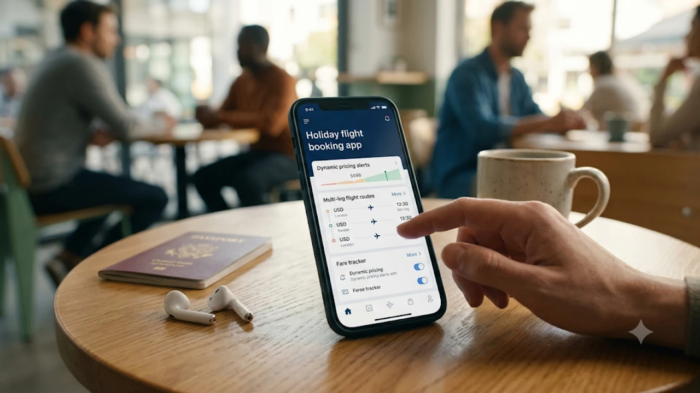

Finding **Thanksgiving 2026 AI travel deals** has quickly shifted from a niche tech experiment into a practical survival tactic for late-November flyers. As holiday airfare algorithms adjust seat inventory by the minute, autonomous booking assistants and predictive fare trackers give everyday travelers the same pricing leverage once reserved for corporate travel desks.

## Top 5 AI Travel Agents Dominating Thanksgiving 2026 Bookings

Legacy flight comparison sites built on static search forms lose ground fast to agentic platforms capable of executing multi-step itinerary searches, monitoring fare classes, and holding seats automatically. Rather than forcing travelers to refresh browser tabs manually, modern AI travel assistants continuously evaluate route permutations across partner airlines and hotel chains.

### How Autonomous Fare Trackers Beat Traditional Aggregators

Traditional online travel agencies rely on cached fare snapshots that often lag behind live airline inventory changes during peak holiday rushes. When a carrier releases a batch of unsold economy or premium economy seats forty-eight hours before departure, manual searchers rarely spot the window before automated bots claim the inventory.

Autonomous fare trackers close this latency gap by polling airline inventory feeds directly and evaluating multi-carrier combinations that standard search engines miss. An agentic assistant can pair a one-way legacy carrier outbound flight with a separate regional carrier return leg, applying promo codes and loyalty transfer bonuses in a single workflow.

- **Hopper Price Freeze & Predictive Engine:** Uses historical yield-management patterns to lock in volatile holiday fares for a small holding fee, shielding travelers from sudden Tuesday-night price spikes.
- **Perplexity Travel & Shopping Assistant:** Aggregates real-time flight schedules, hotel cancellation terms, and local transit routes into one comparison matrix without requiring dozens of open browser tabs.
- **Google Flights AI Route Explorer:** Spots hidden multi-city routing opportunities and nearby secondary airports that shave real money off rigid Wednesday-to-Sunday Thanksgiving schedules.
- **Kayak PriceCheck & Conversational Planner:** Lets travelers upload screenshots of existing itineraries so the engine can scan for identical routes at lower net rates across partner portals.
- **Expedia Romie & Group Trip Coordinator:** Integrates directly into group chat threads to reconcile conflicting departure cities, hotel budgets, and loyalty tiers for family reunions.

### Real-Time Price Drop Alerts for Last-Minute Holiday Flyers

The old assumption that holiday flights only climb in price inside the final week before departure no longer holds on every route. Airlines routinely over-index on business travel demand right up until the Tuesday before Thanksgiving, leaving pockets of unsold seats that revenue algorithms discount sharply at the eleventh hour.

> "Dynamic airline pricing models are engineered to maximize yield on rigid corporate bookings, which creates sudden liquidation pockets for flexible leisure travelers willing to fly on Thanksgiving morning or Saturday."

AI monitoring tools catch these micro-dips because they evaluate fare-bucket availability rather than headline ticket prices. When an airline opens lower-tier fare classes for a brief window, automated alerts notify the user immediately—or, when pre-authorized, execute the rebooking under airline twenty-four-hour risk-free cancellation rules.

### Comparing Agentic Booking Fees vs. Direct Airline Savings

While AI booking tools uncover hidden discounts, travelers must weigh platform fees and fare restrictions against booking directly with the operating carrier. Many third-party AI wrappers monetize through service fees, subscription tiers, or affiliate commissions tied to non-refundable basic economy tickets.

| Booking Channel | Primary Advantage | Fee & Risk Structure | Best Use Case |
| :--- | :--- | :--- | :--- |
| **Autonomous AI Agents** | Instant multi-airline routing and automated fare-drop execution | Monthly subscription or per-booking service fee; occasional third-party change friction | Complex multi-leg trips and last-minute price-drop hunting |
| **Direct Airline Portals** | Seamless schedule-change protection and full loyalty status recognition | Zero platform surcharge, though interfaces lack cross-carrier optimization | High-risk weather routes where rapid rebooking is critical |
| **Card Issuer Travel Portals** | Point multipliers and built-in trip delay insurance | Portal markups can occasionally offset bonus point value | Redeeming accumulated flexible bank points for hotels |

---

## Why Thanksgiving 2026 Travel Surge Is Testing Airport AI Systems

Heavy passenger volumes across major hubs are putting newly deployed airport automation systems through an intense real-world stress test. From curbside biometric checkpoints to automated gate-reassignment engines, aviation infrastructure relies on predictive software to prevent cascading delays. This shift toward localized, low-latency hardware mirrors broader consumer tech trends explored in [Why IFA 2026 Shifted to On-Device AI: 3 Key Takeaways](/posts/us-trends/why-ifa-2026-shifted-on-device-smart-home-ai/), where processing data locally proves essential when cloud networks hit peak congestion.

### Biometric Boarding and Automated Rebooking Rollouts

Major U.S. hubs and international gateway terminals have expanded touchless biometric boarding lanes that verify passenger identity via facial matching in seconds. Instead of scanning paper boarding passes and checking physical passports at multiple checkpoints, travelers opt into digital identity tokens linked directly to their airline profiles.

Behind the scenes, airlines also run automated disruption-management engines. When an inbound aircraft encounters a mechanical delay or winter weather front, predictive scheduling software calculates downstream missed connections and pushes pre-selected rebooking options to passenger smartphones before the first flight lands.

### Cross-Border Impact on Transpacific Routes to Seoul and Tokyo

The Thanksgiving travel rush extends well beyond domestic U.S. corridors, creating sharp demand spikes on transpacific routes connecting North America with East Asia. Travelers taking advantage of the long holiday weekend—often paired with remote workdays—frequently target nonstop flights into Seoul Incheon (ICN) and Tokyo Haneda (HND).

- **Hub Connection Bottlenecks:** Incheon International Airport serves as a primary transit hub for North American travelers connecting onward to Southeast Asia, making tight layover windows sensitive to westbound jet-stream delays.
- **Carrier Joint-Venture Pricing:** Transpacific airline alliances synchronize fare algorithms across partner carriers, meaning an AI search across Korean Air, Delta, United, and ANA often reveals identical base fares alongside vastly different seat-selection fees and upgrade bidding thresholds.
- **Currency and Point Arbitrage:** International travelers using AI fare monitors can compare pricing in both USD and KRW across regional booking portals, occasionally capturing favorable exchange-rate spreads on refundable premium cabin tickets.

### Hidden Bottlenecks in Automated Airline Customer Support

Despite impressive front-end automation, airline customer service ecosystems still fracture when severe weather triggers mass cancellations across multiple hubs at once. Conversational support bots handle routine seat changes and baggage tracking effortlessly, yet they hit hard permission walls when travelers need complex rerouting onto rival carriers.

When an automated chat assistant stalls during an irregular operations event, passengers who rely solely on the app lose valuable minutes. Experienced flyers pair AI monitoring alerts with immediate phone calls to international call centers or airport lounge agents who hold manual override authority.

---

## Step-by-Step Guide to Using AI Tools for Cyber Week Travel Extensions

The overlap between Thanksgiving weekend and Cyber Week creates a prime window for extending holiday trips or locking in winter and spring travel at meaningful discounts. By combining structured prompt engineering with loyalty-point optimizers, travelers can stack seasonal airline sales with hotel and credit card promotions.

### Setting Up Multi-Leg Dynamic Itinerary Prompts

Vague prompts like "find cheap flights to Chicago for Thanksgiving" yield generic results that mirror standard search engines. To extract real value from conversational AI travel planners, frame your queries around flexible parameters, hidden-city alternatives, and split-ticket logic.

- **Define Airport Radiuses:** Instruct the AI tool to evaluate all commercial airports within a seventy-five-mile radius of both origin and destination cities, factoring in ground transit costs.
- **Separate Outbound and Return Logic:** Ask the assistant to price two independent one-way tickets across competing carriers rather than defaulting to a single airline round-trip fare.
- **Specify Fare-Class Constraints:** Explicitly command the model to exclude basic economy fares that charge extra for carry-on bags, ensuring a true apples-to-apples comparison of total out-of-pocket costs.

### Combining Credit Card Point Optimizers with AI Fare Predictors

Award availability fluctuates just as aggressively as cash fares during late November, making point-valuation tools indispensable for stretching rewards balances. Browser extensions and AI award search engines scan partner airline alliance inventory to uncover saver-level business and economy seats hidden behind dynamic pricing tiers.

Before transferring flexible bank points to an airline loyalty program, run the cash price through an AI fare predictor. If a cash ticket drops sharply during a Cyber Week flash sale, paying out of pocket while earning bonus travel points often preserves far more value than redeeming inflated dynamic award miles.

### Avoiding Dynamic Pricing Traps on Repeat Searches

Airline and hotel revenue systems track session behavior, device fingerprints, and regional demand surges to calibrate displayed rates. Repeatedly searching the exact same route and dates from a logged-in account signals high purchase intent, which often coincides with disappearing discount fare buckets.

To prevent skewed pricing data, run exploratory searches through isolated browser sessions or server-side AI agents that query public fare feeds without attaching personal cookie histories. Once the AI tool identifies a target fare, switch directly to the airline's official checkout page to finalize the reservation cleanly.

---

## Pros and Cons of Letting AI Agents Handle Holiday Cancellations

Delegating payment credentials and rebooking authority to autonomous software brings clear convenience alongside real contractual risks. Before authorizing an AI assistant to manage live holiday reservations, travelers should understand exactly where automated convenience ends and carrier liability begins.

### Speed of Automated Re-Routing During Weather Delays

When winter storms sweep across major connecting hubs over Thanksgiving weekend, available seats on surviving flights vanish within minutes. An autonomous travel monitor watching flight status telemetry can detect a delay trigger and secure a backup seat while human passengers are still waiting in line at the gate podium.

This speed advantage matters most for families or groups traveling on a single record locator, where finding three or four adjacent seats on an alternate flight requires immediate execution before solo travelers claim the remaining inventory.

### Refund Policy Blind Spots in Third-Party AI Wrappers

A major pitfall of booking through newer AI travel startups lies in how involuntary schedule changes and refunds are processed. When you purchase a ticket directly from an airline, federal consumer protection rules require prompt cash refunds if the carrier cancels your flight or significantly alters your schedule and you choose not to travel.

Third-party AI booking intermediaries sometimes act as the merchant of record, meaning refund requests must pass through the platform's own support queue rather than the airline's automated system. During peak holiday surges, third-party refund processing can stretch into weeks, and proprietary service fees often remain non-refundable.

### Essential Checklist Before Granting Payment Wallet Access

Granting an AI agent permission to execute transactions on your behalf requires strict financial guardrails to prevent unauthorized charges or non-refundable booking mistakes. For broader context on global market shifts and emerging digital trends, explore [Global Trends](/posts/us-trends/).

- **Use Virtual Credit Cards:** Generate a single-use or merchant-locked virtual card number with a strict spending cap before linking payment credentials to any automated booking tool.
- **Require Human-in-the-Loop Confirmation:** Configure agent permissions so the software can hold a fare or draft a cart, but requires explicit biometric approval before finalizing any non-refundable charge.
- **Verify Ticket Issuance Numbers:** Immediately confirm that a thirteen-digit airline e-ticket number—not merely a third-party reservation code—appears in the operating carrier's official mobile app within minutes of booking.
- **Audit Cancellation Deadlines:** Double-check whether the booked fare qualifies for the U.S. Department of Transportation twenty-four-hour free cancellation rule, which applies only to tickets purchased at least seven days before departure.

[View Recommended Travel Gear on Coupang](https://www.coupang.com/np/search?q=%ED%95%B4%EC%99%B8%EC%9D%B8%EA%B8%B0%EC%83%81%ED%92%88&sourceType=affiliate&trackingCode=AF8691300)

#GlobalTrends #Thanksgiving2026 #AITravel #TravelHacks #CyberWeek #SmartTravel #AirlineDeals #KoreaTravel #2026Trends