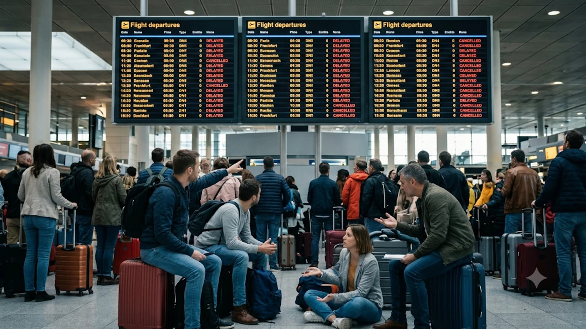

2026년 11월 중순 유럽 주요 공항과 철도 노조의 연쇄 파업으로 연말 여행객들의 항공편 결항과 연착 우려가 커지고 있다. 갑작스러운 현지 교통 마비 속에서도 **유럽 항공 지연 보상** 규정을 정확히 알면 최대 600유로의 현금 배상과 숙박·식사 지원을 챙길 수 있다. 출국 직전 탑승구가 닫히는 최악의 상황에서도 손해를 막아주는 EU261 승객 권리 기준과 공항 현장 대응법을 핵심만 추렸다.

## 2026년 11월 유럽 교통 연쇄 파업 현황과 여행자 영향 범위

### 11월 중순 주요 공항 지상조업 및 관제 파업 일정 정리

2026년 11월 중순부터 12월 성수기를 앞둔 유럽 전역에서는 임금 인상과 인력 충원을 요구하는 운송 노조의 파업이 잇따르고 있다. 이탈리아와 프랑스, 스페인 등 한국인 여행객이 몰리는 거점 공항의 지상조업사 및 항공관제(ATC) 부문이 순환 파업에 돌입하면서 단거리 연결편부터 장거리 직항 노선까지 연쇄 지연이 속출한다. 이탈리아 일정을 계획 중이라면 현지 교통과 입장 규정을 다룬 [베네치아 당일치기 300유로 벌금 피하는 법](/posts/world-travel/venice-day-trip-entry-fee-qr-fine-guide/)까지 미리 읽어두면 돌발 변수에 대비하기 수월하다.

### 파업으로 인한 결항·지연 시 항공사가 제공하는 기본 의무 지원

유럽연합(EU) 내 공항에서 출발하거나 EU 국적 항공사를 타고 유럽으로 들어가는 승객은 파업 주체가 누구든 항공사의 **돌봄 의무(Right to Care)**를 보장받는다. 비행 거리와 지연 시간에 따라 대기 중 식사와 음료 바우처, 무료 전화·이메일 2회가 제공되며, 출발이 다음 날로 넘어가면 공항 인근 호텔 숙박비와 왕복 셔틀 교통편까지 항공사가 전액 대야 한다.

### 환승 공항 마비 시 당일 대체 노선 확보를 위한 실전 체크리스트

- **단일 항공권(Thru-ticket) 발권 여부 확인**: 인천에서 파리나 프랑크푸르트를 거쳐 최종 목적지로 가는 하나의 예약 번호 항공권이라면 앞선 비행기가 연착돼 환승편을 놓쳐도 항공사가 목적지까지 무료로 대체편을 끊어준다.
- **저비용항공사(LCC) 분리 발권 주의**: 유럽 내 구간을 별도 예약 번호로 따로 끊었다면 첫 항공편 파업으로 환승에 실패해도 다음 항공편을 무료로 바꿔주지 않으므로 최소 4시간 이상 환승 간격을 두어야 한다.
- **철도·버스 대체 이동 경로 사전 파악**: 파리 샤를 드골, 암스테르담 스키폴, 프랑크푸르트 공항처럼 고속철도역이 터미널과 바로 이어진 허브 공항은 단거리 항공 결항 시 기차로 갈아타는 편이 훨씬 빠르다.

## 항공사 귀책 vs 불가항력: EU261 현금 보상 기준 비교

### 항공사 소속 직원 파업과 공항 외부 노조 파업의 보상 차이

유럽 항공 승객 권리 규정인 **EC 261/2004(EU261)**에 따른 현금 배상은 파업을 일으킨 주체에 따라 지급 여부가 갈린다. 유럽사법재판소(CJEU) 판례상 조종사·객실승무원·자사 정비사 등 **항공사 직접 고용 인력의 파업**은 항공사가 노무 관리를 통해 통제할 수 있는 내부 사유로 인정되어 현금 배상 대상이다. 반면 공항 보안검색 요원, 수하물 하역 외부 용역업체, 국가 항공관제사 파업은 항공사가 어쩔 수 없는 '특별한 상황(Extraordinary Circumstances)'으로 분류되어 현금 배상 책임이 면제된다.

### 비행 거리별(1,500km 이하·중거리·장거리) 최대 600유로 보상액 표

| 비행 거리 구간 | 지연 도착 기준 | 현금 보상 금액 | 대표 노선 예시 |
| :--- | :--- | :--- | :--- |
| 1,500km 이하 단거리 | 3시간 이상 지연 | **250유로** | 파리-런던, 로마-바르셀로나 |
| EU 역내 1,500km 초과 / 역외 1,500~3,500km | 3시간 이상 지연 | **400유로** | 암스테르담-아테네, 마드리드-이스탄불 |
| EU 역외 3,500km 초과 장거리 | 4시간 이상 지연 | **600유로** | 인천-프랑크푸르트, 파리-인천 |

> 장거리 노선의 경우 최종 목적지 도착 시각이 예정보다 3시간 이상 4시간 미만 늦어졌다면 600유로의 절반인 300유로가 지급된다.

### 항공사의 바우처 제안을 거절하고 계좌 현금 환불을 받는 조건

결항이나 5시간 이상 장기 지연이 발생하면 항공사는 자사 마일리지나 1년 기한의 여행 바우처를 먼저 내미는 경우가 흔하다. 이때 바우처 수령에 서명하는 순간 추후 현금 청구권이 사라지므로 서두르지 말아야 한다. 승객은 바우처를 거절하고 **7일 이내에 미사용 구간 항공권 전액 현금 환불**을 요구할 권리가 있으며, 대체 항공편 탑승을 택하더라도 항공사 내부 직원 파업이라면 EU261 지연 보상금을 별도로 받아낼 수 있다.

## 지연·결항 발생 직후 공항 현장에서 바로 실행할 대응 절차

### 탑승구 및 수하물 수취대에서 반드시 확보해야 할 증빙 서류 3가지

- **지연·결항 확인서(Delay/Cancellation Certificate)**: 공항 항공사 카운터에서 지연 시간과 사유(파업 주체 명시)가 적힌 공식 문서나 이메일 안내문을 현장에서 바로 받아둔다.
- **실제 탑승권(Boarding Pass) 및 수하물 태그**: 최종 목적지에 몇 시에 내렸는지 입증하려면 변경된 대체편의 종이 탑승권이나 모바일 화면 캡처를 지워지지 않게 남겨야 한다.
- **지출 영수증 원본(Itemized Receipt)**: 카드 매출전표만 내면 항목 확인이 안 돼 거절당하기 십상이므로 식음료·생필품·숙박 내역이 낱낱이 찍힌 품목별 영수증을 챙긴다.

### 대체 항공편 재예약(Re-routing) 우선순위를 높이는 항공사 앱 활용법

공항 안내 데스크 앞 대기 줄이 수백 미터씩 늘어설 때는 줄을 서면서 동시에 **항공사 공식 앱과 고객센터 전화, SNS 다이렉트 메시지(DM)**를 함께 돌려야 한다. 결항 공지가 뜨자마자 앱 내 '일정 변경(Manage Booking)' 메뉴에 잔여 좌석이 잠깐씩 풀리는 경우가 많고, 동일 항공동맹(스카이팀·스타얼라이언스·원월드) 소속 타 항공사 직항편으로 바꿔 달라고 구체적인 편명을 콕 집어 요구하면 배정 속도가 훨씬 빨라진다.

### 공항 노숙 대신 호텔 숙박비 및 식사 영수증을 전액 청구하는 요령

공항 내 항공사 직원이 퇴근해 호텔 바우처를 직접 받지 못했다면 승객이 먼저 사비로 숙소를 잡은 뒤 귀국 후 정산을 청구할 수 있다. 이때 5성급 최고급 호텔이나 주류·고급 코스 요리 영수증은 '합리적 지출' 기준을 넘어 삭감되므로, 공항 근처 3~4성급 비즈니스 호텔과 일반 식사·택시 이동 영수증을 1인 적정 금액선에서 결제해야 전액 돌려받기 수월하다. 다른 해외 지역의 최신 여행 트렌드와 준비 팁은 [세계여행지 최신 트렌드](/posts/world-travel/world-travel-1783348391782/) 글에서도 참고할 수 있다.

## 귀국 후 보상금 청구 실전 가이드와 여행자 보험 중복 활용법

### 항공사 공식 클레임 폼 작성 시 거절당하지 않는 핵심 문구

귀국 후 해당 항공사 홈페이지 하단의 '고객 지원(Customer Relations)' 또는 'EU261 보상 청구' 창구에서 예약 번호(PNR)와 증빙 서류를 올린다. 사유란에는 감정적인 하소연 대신 **"EC Regulation 261/2004에 근거하여 귀사 소속 직원 파업으로 인한 최종 목적지 4시간 이상 도착 지연에 따른 법정 보상금 600유로 지급을 요청한다"**는 문장으로 간결하게 적고, 영문 은행 계좌 정보(IBAN 또는 SWIFT 코드)를 오타 없이 기입해야 송금이 밀리지 않는다.

### 보상 거절 시 유럽 각국 민간항공청(NEB) 민원 접수 절차

항공사가 '공항 외부 파업'이라는 두루뭉술한 핑계로 배상을 거절하거나 6주 넘게 답변을 끌면 출발지 국가의 **민간항공청(National Enforcement Body, NEB)**에 무료로 분쟁 조정을 걸 수 있다. 프랑스 출발편은 DGAC, 독일은 LBA, 이탈리아는 ENAC 온라인 포털에 항공사 거절 메일과 증빙 서류를 올리면 감독 기관이 항공사에 공식 소명을 요구한다. 대행 업체를 끼면 보상금의 25~35%를 수수료로 떼이므로 먼저 직접 민원을 접수하는 편이 낫다.

### 국내 여행자 보험 항공기 지연 특약과 EU261 보상의 중복 수령 기준

국내 손해보험사의 해외여행자보험에 가입할 때 **'항공기 지연·결항 추가비용(실손)' 특약**을 넣어두면 공항 대기 중 쓴 식비·숙박비·통신비를 가입 한도(보통 20만~30만 원) 내에서 돌려받는다. 다만 이 특약은 실제 지출한 영수증 금액을 메워주는 실손 보상이므로, 항공사에서 이미 현금으로 정산받은 영수증 항목은 중복 수령이 막혀 있다. 반면 항공사로부터 받은 EU261 현금 배상금(250~600유로)은 정액 위자료 성격이라 여행자보험 실손 청구와 무관하게 온전히 챙길 수 있다. 공항 대기 시간이 길어져 스마트폰 배터리가 꺼지면 모바일 탑승권 제시와 실시간 일정 변경이 막히므로 출국 전 대용량 보조배터리를 챙겨두는 편이 안전하다.

[기내용 대용량 보조배터리 쿠팡에서 보기](https://www.coupang.com/np/search?q=%EA%B8%B0%EB%82%B4%EC%9A%A9+%EB%B3%B4%EC%A1%B0%EB%B0%B0%ED%84%B0%EB%A6%AC&sourceType=affiliate&trackingCode=AF8691300)

#유럽항공지연보상 #EU261보상 #유럽공항파업 #항공편결항대처 #해외여행자보험 #유럽자유여행준비 #항공권환불방법 #연말유럽여행